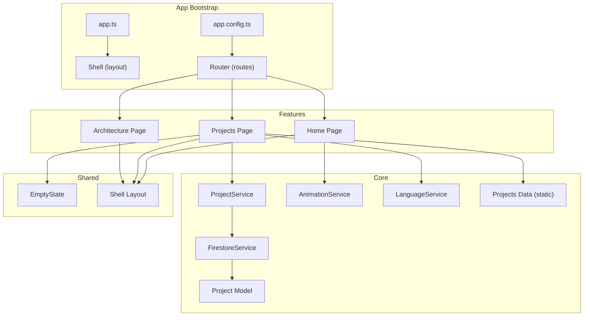
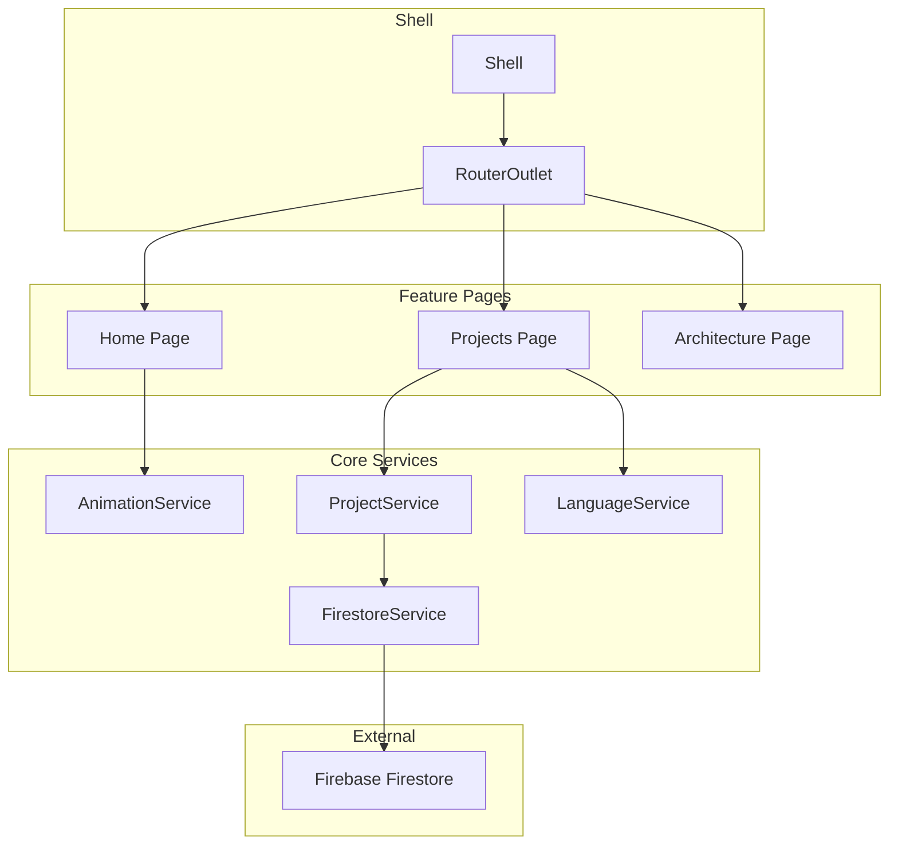
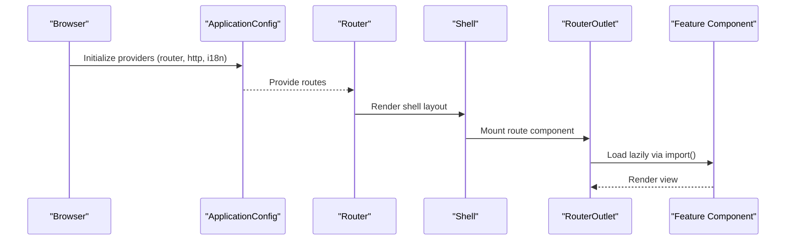
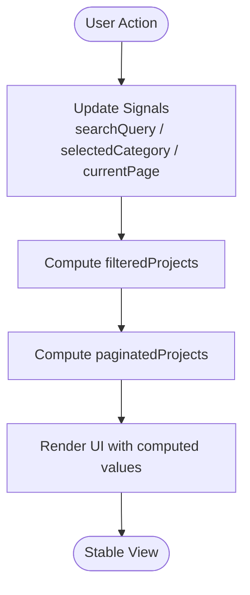
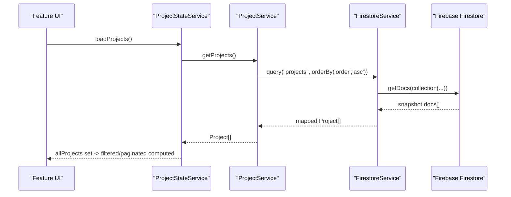
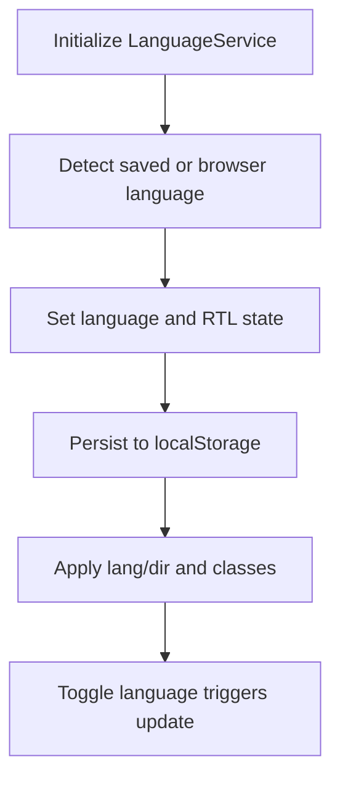
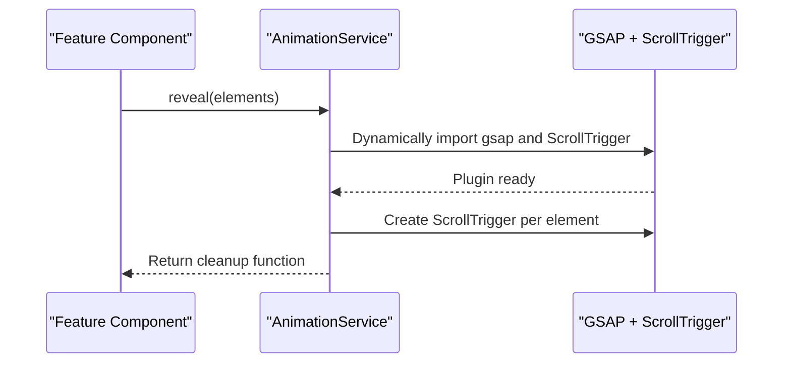
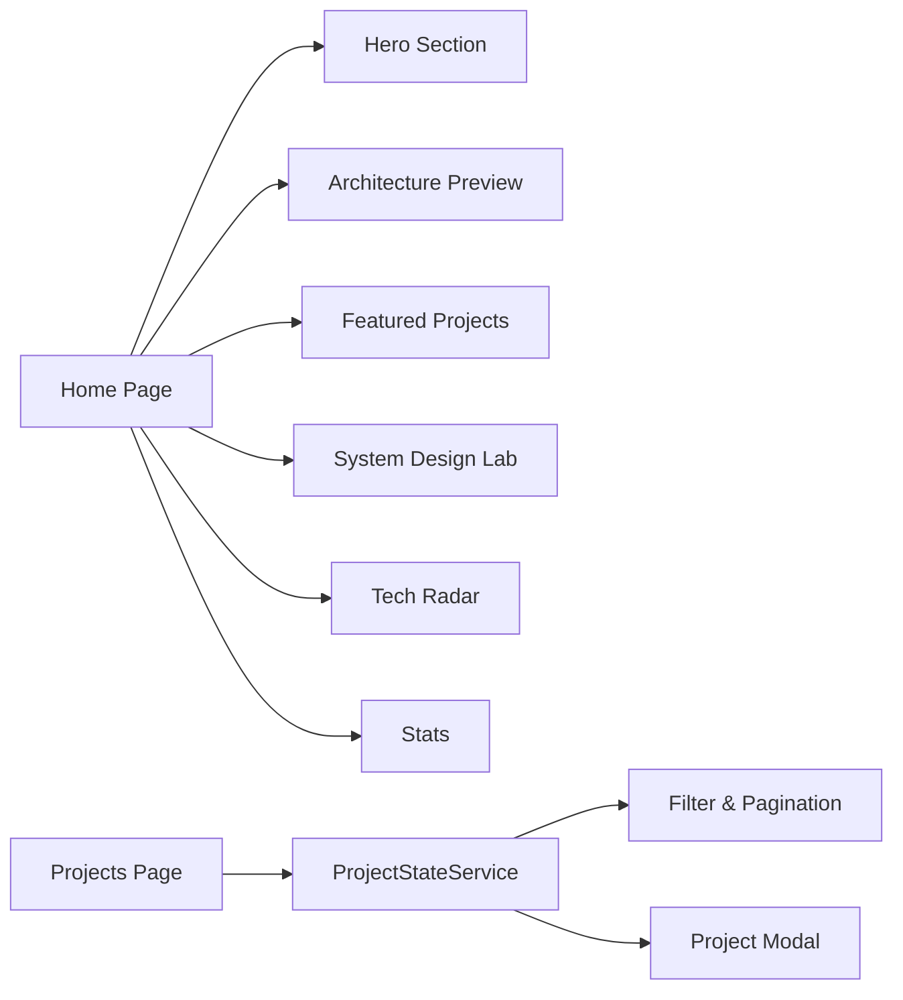
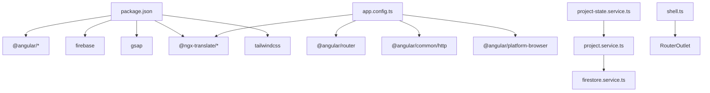

# Architecture Overview

<cite>
**Referenced Files in This Document**
- [app.routes.ts](file://src/app/app.routes.ts)
- [app.config.ts](file://src/app/app.config.ts)
- [app.ts](file://src/app/app.ts)
- [shell.ts](file://src/app/shared/layout/shell/shell.ts)
- [home.ts](file://src/app/features/home/pages/home/home.ts)
- [project.service.ts](file://src/app/core/services/project.service.ts)
- [firestore.service.ts](file://src/app/core/firebase/firestore.service.ts)
- [firebase.config.ts](file://src/app/core/firebase/firebase.config.ts)
- [animation.service.ts](file://src/app/core/services/animation.service.ts)
- [language.service.ts](file://src/app/core/services/language.service.ts)
- [project-state.service.ts](file://src/app/features/projects/services/project-state.service.ts)
- [project.model.ts](file://src/app/core/models/project.model.ts)
- [projects.data.ts](file://src/app/core/data/projects.data.ts)
- [empty-state.ts](file://src/app/shared/components/empty-state/empty-state.ts)
- [package.json](file://package.json)
</cite>

## Table of Contents
1. Introduction
2. Project Structure
3. Core Components
4. Architecture Overview
5. Detailed Component Analysis
6. Dependency Analysis
7. Performance Considerations
8. Troubleshooting Guide
9. Conclusion

## Introduction
This document describes the MegaPortfolio system architecture using a feature-based modular design with clear separation between core services, feature modules, and shared components. It explains the component hierarchy from the shell layout through router outlets to feature pages and individual components, details data flow patterns including signal-based reactivity and service layer abstraction, and documents Firebase integration for data persistence. The routing strategy uses lazy loading for optimal performance. Cross-cutting concerns such as error handling, loading states, and responsive design are addressed throughout.

## Project Structure
MegaPortfolio follows a feature-based architecture:
- Core: Shared services (Firebase, animations, language), models, interceptors, and utilities.
- Features: Feature-specific pages and components organized by domain (home, projects, architecture, blog, contact, experience).
- Shared: Reusable UI components, layout shell, directives, pipes, and common UI primitives.
- App bootstrap: Root app component and application configuration.



**Diagram sources**
- [app.ts:1-13](file://src/app/app.ts#L1-L13)
- [shell.ts:1-26](file://src/app/shared/layout/shell/shell.ts#L1-L26)
- [app.config.ts:1-26](file://src/app/app.config.ts#L1-L26)
- [app.routes.ts:1-31](file://src/app/app.routes.ts#L1-L31)
- [project.service.ts:1-60](file://src/app/core/services/project.service.ts#L1-L60)
- [firestore.service.ts:1-100](file://src/app/core/firebase/firestore.service.ts#L1-L100)
- [animation.service.ts:1-72](file://src/app/core/services/animation.service.ts#L1-L72)
- [language.service.ts:1-62](file://src/app/core/services/language.service.ts#L1-L62)
- [project.model.ts:1-44](file://src/app/core/models/project.model.ts#L1-L44)
- [projects.data.ts:1-59](file://src/app/core/data/projects.data.ts#L1-L59)
- [home.ts:1-25](file://src/app/features/home/pages/home/home.ts#L1-L25)
- [empty-state.ts:1-21](file://src/app/shared/components/empty-state/empty-state.ts#L1-L21)

**Section sources**
- [app.ts:1-13](file://src/app/app.ts#L1-L13)
- [app.config.ts:1-26](file://src/app/app.config.ts#L1-L26)
- [app.routes.ts:1-31](file://src/app/app.routes.ts#L1-L31)

## Core Components
- Shell layout: Provides global navigation, footer, mobile sidebar, and router outlet for feature pages.
- Router configuration: Defines routes with lazy-loaded feature components.
- Application configuration: Bootstraps router, HTTP client, hydration, and internationalization.
- Core services:
  - ProjectService: Abstraction over Firestore queries for project data.
  - FirestoreService: Generic CRUD and query operations over Firebase Firestore.
  - AnimationService: GSAP-based scroll-triggered animations with cleanup.
  - LanguageService: Signal-driven i18n state management and RTL support.
- Feature state:
  - ProjectStateService: Centralized signal-based state for filtering, pagination, modal, and loading/error states.
- Models and static data:
  - Project model defines typed entities and enums/constants.
  - Projects data provides static fallback/demo data.
- Shared UI:
  - EmptyState reusable component for consistent empty/error messaging.

**Section sources**
- [shell.ts:1-26](file://src/app/shared/layout/shell/shell.ts#L1-L26)
- [app.routes.ts:1-31](file://src/app/app.routes.ts#L1-L31)
- [app.config.ts:1-26](file://src/app/app.config.ts#L1-L26)
- [project.service.ts:1-60](file://src/app/core/services/project.service.ts#L1-L60)
- [firestore.service.ts:1-100](file://src/app/core/firebase/firestore.service.ts#L1-L100)
- [animation.service.ts:1-72](file://src/app/core/services/animation.service.ts#L1-L72)
- [language.service.ts:1-62](file://src/app/core/services/language.service.ts#L1-L62)
- [project-state.service.ts:1-157](file://src/app/features/projects/services/project-state.service.ts#L1-L157)
- [project.model.ts:1-44](file://src/app/core/models/project.model.ts#L1-L44)
- [projects.data.ts:1-59](file://src/app/core/data/projects.data.ts#L1-L59)
- [empty-state.ts:1-21](file://src/app/shared/components/empty-state/empty-state.ts#L1-L21)

## Architecture Overview
The system is composed of:
- Shell layout orchestrating global UI and routing.
- Lazy-loaded feature pages encapsulating domain logic and views.
- Core services providing cross-cutting capabilities (data, animations, i18n).
- Shared components ensuring consistent UX across features.



**Diagram sources**
- [shell.ts:1-26](file://src/app/shared/layout/shell/shell.ts#L1-L26)
- [app.routes.ts:1-31](file://src/app/app.routes.ts#L1-L31)
- [home.ts:1-25](file://src/app/features/home/pages/home/home.ts#L1-L25)
- [project.service.ts:1-60](file://src/app/core/services/project.service.ts#L1-L60)
- [firestore.service.ts:1-100](file://src/app/core/firebase/firestore.service.ts#L1-L100)
- [animation.service.ts:1-72](file://src/app/core/services/animation.service.ts#L1-L72)
- [language.service.ts:1-62](file://src/app/core/services/language.service.ts#L1-L62)

## Detailed Component Analysis

### Shell Layout and Routing
- Shell composes Navbar, Footer, MobileSidebar, and RouterOutlet.
- Routes define lazy-loaded components for Home, Projects, and Architecture.
- Application config sets up router, hydration, HTTP client, and i18n loader.



**Diagram sources**
- [app.config.ts:1-26](file://src/app/app.config.ts#L1-L26)
- [app.routes.ts:1-31](file://src/app/app.routes.ts#L1-L31)
- [shell.ts:1-26](file://src/app/shared/layout/shell/shell.ts#L1-L26)

**Section sources**
- [app.config.ts:1-26](file://src/app/app.config.ts#L1-L26)
- [app.routes.ts:1-31](file://src/app/app.routes.ts#L1-L31)
- [shell.ts:1-26](file://src/app/shared/layout/shell/shell.ts#L1-L26)

### Service Layer Architecture
- ProjectService abstracts Firestore queries for projects, exposing typed methods for listing, filtering, fetching by id/slug, and CRUD operations.
- FirestoreService centralizes Firestore interactions, mapping documents to include ids and normalizing data.
- ProjectStateService manages UI state with signals and computed values for filtering, pagination, modal visibility, and loading/error states.

```mermaid
classDiagram
class ProjectService {
+getProjects() Promise<Project[]>
+getFeaturedProjects() Promise<Project[]>
+getProjectsByCategory(category) Promise<Project[]>
+getProject(id) Promise<Project>
+getProjectBySlug(slug) Promise<Project>
+create(project) Promise<{id : string}>
+update(id, project) Promise<void>
+delete(id) Promise<void>
}
class FirestoreService {
+query<T>(path, ...constraints) Promise<T[]>
+getDocument<T>(path) Promise<T>
+create(path, data) Promise<Ref>
+update(path, id, data) Promise<void>
+delete(path, id) Promise<void>
}
class ProjectStateService {
+allProjects : signal<Project[]>
+filteredProjects : computed<Project[]>
+paginatedProjects : computed<Project[]>
+loadingState : signal<string>
+loadProjects() Promise<void>
+retry() void
+setSearch(query) void
+setCategory(category) void
+setPage(page) void
+openModal(project) void
+closeModal() void
}
ProjectService --> FirestoreService : "uses"
ProjectStateService --> ProjectService : "consumes"
```

**Diagram sources**
- [project.service.ts:1-60](file://src/app/core/services/project.service.ts#L1-L60)
- [firestore.service.ts:1-100](file://src/app/core/firebase/firestore.service.ts#L1-L100)
- [project-state.service.ts:1-157](file://src/app/features/projects/services/project-state.service.ts#L1-L157)

**Section sources**
- [project.service.ts:1-60](file://src/app/core/services/project.service.ts#L1-L60)
- [firestore.service.ts:1-100](file://src/app/core/firebase/firestore.service.ts#L1-L100)
- [project-state.service.ts:1-157](file://src/app/features/projects/services/project-state.service.ts#L1-L157)

### Data Flow Patterns
- Signal-based reactivity: ProjectStateService exposes signals for raw data, filters, pagination, and UI state; computed properties derive filtered results and derived metrics.
- Service layer abstraction: ProjectService encapsulates Firestore calls; consumers interact with typed promises and errors.
- Firebase integration: FirestoreService handles collection/document operations and maps results to include ids and normalized fields.



**Diagram sources**
- [project-state.service.ts:1-157](file://src/app/features/projects/services/project-state.service.ts#L1-L157)

**Section sources**
- [project-state.service.ts:1-157](file://src/app/features/projects/services/project-state.service.ts#L1-L157)

### Firebase Integration
- Configuration initializes Firebase app instance.
- FirestoreService wraps Firestore SDK functions to provide typed queries and CRUD operations.
- ProjectService composes FirestoreService to expose domain-specific methods.



**Diagram sources**
- [firebase.config.ts:1-13](file://src/app/core/firebase/firebase.config.ts#L1-L13)
- [firestore.service.ts:1-100](file://src/app/core/firebase/firestore.service.ts#L1-L100)
- [project.service.ts:1-60](file://src/app/core/services/project.service.ts#L1-L60)
- [project-state.service.ts:1-157](file://src/app/features/projects/services/project-state.service.ts#L1-L157)

**Section sources**
- [firebase.config.ts:1-13](file://src/app/core/firebase/firebase.config.ts#L1-L13)
- [firestore.service.ts:1-100](file://src/app/core/firebase/firestore.service.ts#L1-L100)
- [project.service.ts:1-60](file://src/app/core/services/project.service.ts#L1-L60)

### Internationalization and Responsive Design
- LanguageService maintains current language and RTL state via signals, persists selection, and updates document direction/class.
- Application config sets default language and loader for i18n JSON files.
- Shell includes MobileSidebar for responsive navigation.



**Diagram sources**
- [language.service.ts:1-62](file://src/app/core/services/language.service.ts#L1-L62)
- [app.config.ts:1-26](file://src/app/app.config.ts#L1-L26)
- [shell.ts:1-26](file://src/app/shared/layout/shell/shell.ts#L1-L26)

**Section sources**
- [language.service.ts:1-62](file://src/app/core/services/language.service.ts#L1-L62)
- [app.config.ts:1-26](file://src/app/app.config.ts#L1-L26)
- [shell.ts:1-26](file://src/app/shared/layout/shell/shell.ts#L1-L26)

### Animations
- AnimationService dynamically loads GSAP and ScrollTrigger, registers scroll-triggered reveals, and ensures cleanup on destroy.



**Diagram sources**
- [animation.service.ts:1-72](file://src/app/core/services/animation.service.ts#L1-L72)

**Section sources**
- [animation.service.ts:1-72](file://src/app/core/services/animation.service.ts#L1-L72)

### Feature Pages and Components
- Home page composes multiple sections (hero, architecture preview, featured projects, system design lab, tech radar, stats).
- Projects page integrates ProjectStateService for data-driven filtering, pagination, and modal interactions.
- Architecture page is lazily loaded via routes.



**Diagram sources**
- [home.ts:1-25](file://src/app/features/home/pages/home/home.ts#L1-L25)
- [project-state.service.ts:1-157](file://src/app/features/projects/services/project-state.service.ts#L1-L157)
- [app.routes.ts:1-31](file://src/app/app.routes.ts#L1-L31)

**Section sources**
- [home.ts:1-25](file://src/app/features/home/pages/home/home.ts#L1-L25)
- [project-state.service.ts:1-157](file://src/app/features/projects/services/project-state.service.ts#L1-L157)
- [app.routes.ts:1-31](file://src/app/app.routes.ts#L1-L31)

## Dependency Analysis
- External dependencies include Angular framework, Firebase SDK, GSAP, i18n library, and TailwindCSS.
- Internal dependencies:
  - ProjectService depends on FirestoreService and Project model.
  - ProjectStateService depends on ProjectService and Project model.
  - Shell depends on RouterOutlet and shared layout components.
  - Application config depends on router, HTTP client, hydration, and i18n loader.



**Diagram sources**
- [package.json:1-49](file://package.json#L1-L49)
- [app.config.ts:1-26](file://src/app/app.config.ts#L1-L26)
- [project.service.ts:1-60](file://src/app/core/services/project.service.ts#L1-L60)
- [firestore.service.ts:1-100](file://src/app/core/firebase/firestore.service.ts#L1-L100)
- [project-state.service.ts:1-157](file://src/app/features/projects/services/project-state.service.ts#L1-L157)
- [shell.ts:1-26](file://src/app/shared/layout/shell/shell.ts#L1-L26)

**Section sources**
- [package.json:1-49](file://package.json#L1-L49)
- [app.config.ts:1-26](file://src/app/app.config.ts#L1-L26)

## Performance Considerations
- Lazy loading: Routes use dynamic imports to load feature components only when needed, reducing initial bundle size.
- Client hydration: Enabled with event replay to improve SSR-to-client transition.
- Efficient queries: FirestoreService supports where, orderBy, and limit constraints to minimize payload.
- Cleanup: AnimationService ensures ScrollTrigger instances are killed to prevent memory leaks.
- Static fallback: Projects data can be used for demo or offline scenarios without network calls.

[No sources needed since this section provides general guidance]

## Troubleshooting Guide
- Loading states: ProjectStateService exposes loadingState and hasError/computed flags to drive UI feedback.
- Error handling: FirestoreService throws descriptive errors for missing documents; ProjectService propagates errors for not found cases.
- Empty states: EmptyState component provides consistent messaging and actions for no-data scenarios.
- Network issues: Retry mechanism available in ProjectStateService to reload data.

**Section sources**
- [project-state.service.ts:1-157](file://src/app/features/projects/services/project-state.service.ts#L1-L157)
- [firestore.service.ts:1-100](file://src/app/core/firebase/firestore.service.ts#L1-L100)
- [project.service.ts:1-60](file://src/app/core/services/project.service.ts#L1-L60)
- [empty-state.ts:1-21](file://src/app/shared/components/empty-state/empty-state.ts#L1-L21)

## Conclusion
MegaPortfolio employs a clean, feature-based architecture with strong separation of concerns. The shell orchestrates layout and routing, while feature pages encapsulate domain-specific logic. Core services provide reusable capabilities like data access, animations, and internationalization. Signal-based reactivity and service abstractions ensure predictable data flows and maintainability. Firebase integration offers scalable data persistence, and lazy loading optimizes performance. The design balances clarity, scalability, and user experience across devices and languages.