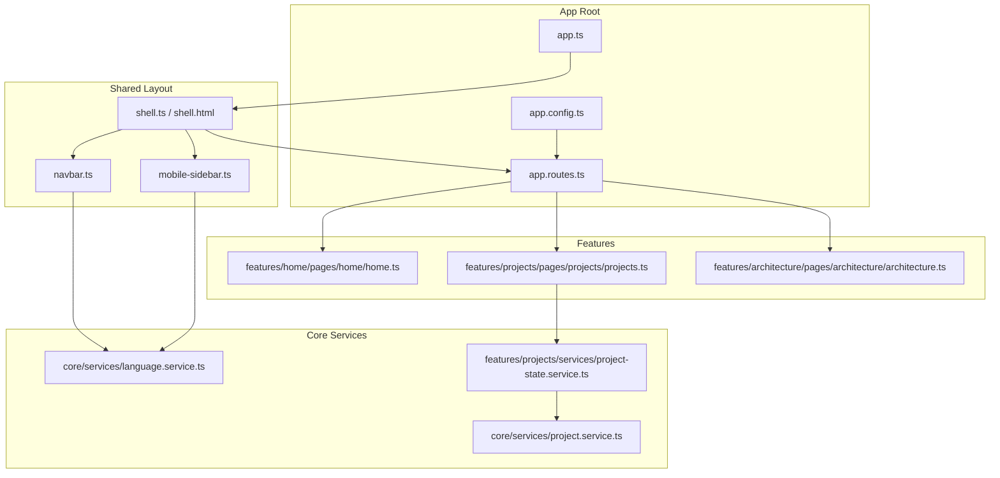
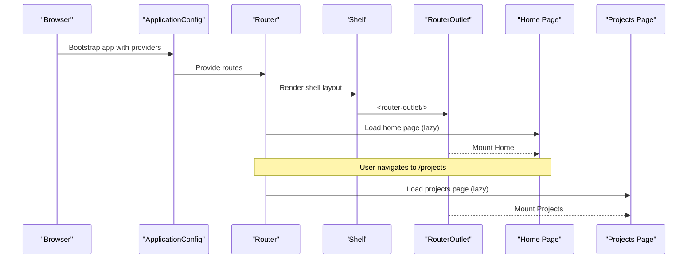
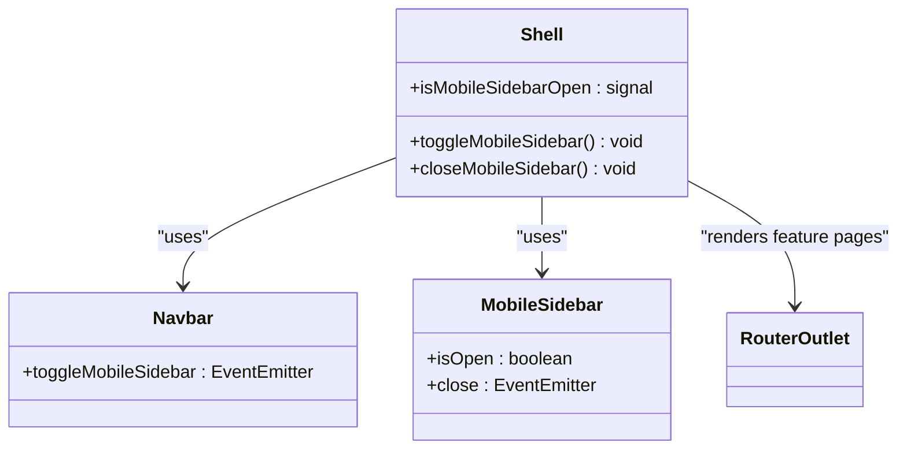
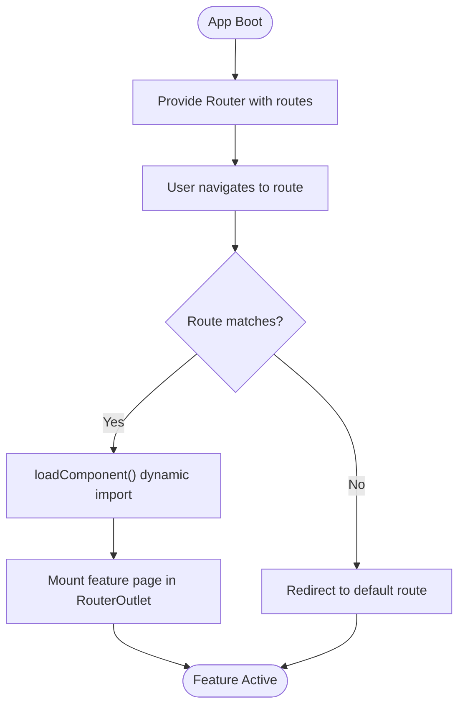
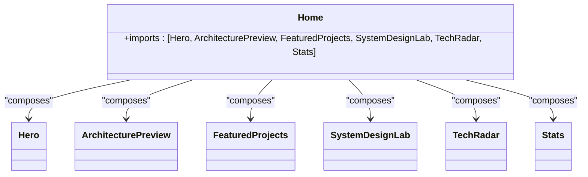
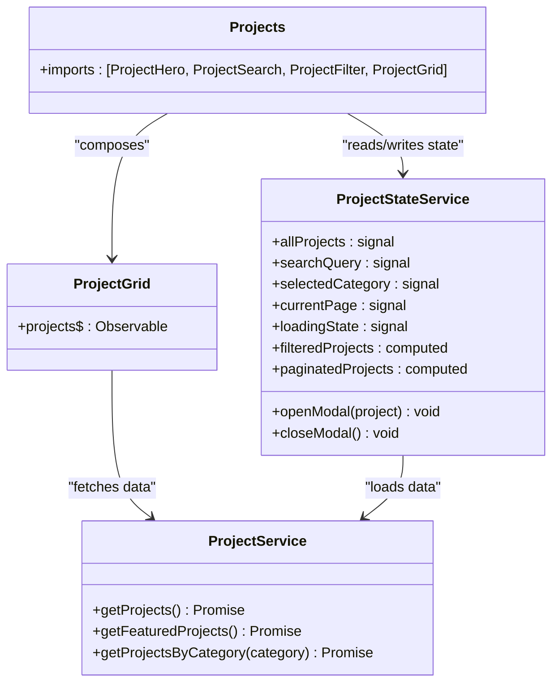
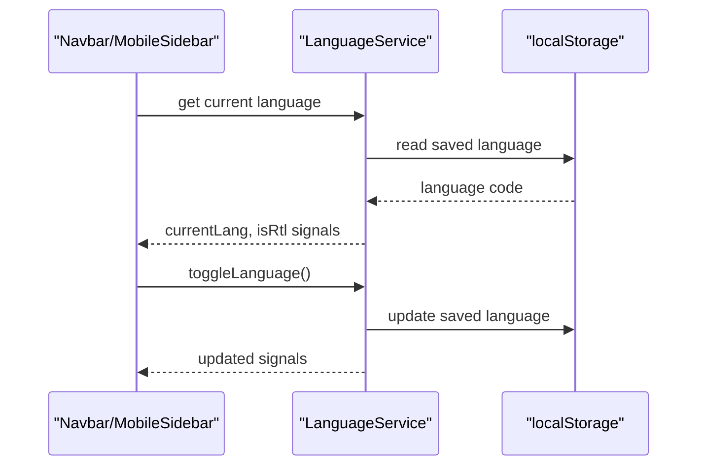
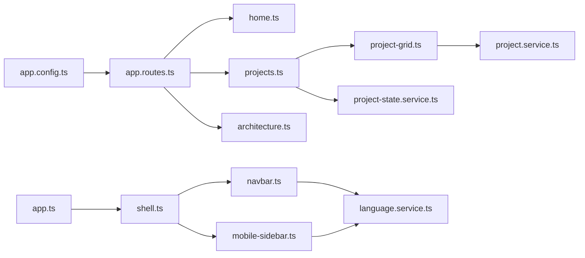

# Component Hierarchy

<cite>
**Referenced Files in This Document**
- [app.ts](file://src/app/app.ts)
- [app.config.ts](file://src/app/app.config.ts)
- [app.routes.ts](file://src/app/app.routes.ts)
- [shell.ts](file://src/app/shared/layout/shell/shell.ts)
- [shell.html](file://src/app/shared/layout/shell/shell.html)
- [navbar.ts](file://src/app/shared/layout/navbar/navbar.ts)
- [mobile-sidebar.ts](file://src/app/shared/components/mobile-sidebar/mobile-sidebar.ts)
- [language.service.ts](file://src/app/core/services/language.service.ts)
- [home.ts](file://src/app/features/home/pages/home/home.ts)
- [projects.ts](file://src/app/features/projects/pages/projects/projects.ts)
- [architecture.ts](file://src/app/features/architecture/pages/architecture/architecture.ts)
- [project-grid.ts](file://src/app/features/projects/components/project-grid/project-grid.ts)
- [project-state.service.ts](file://src/app/features/projects/services/project-state.service.ts)
- [project.service.ts](file://src/app/core/services/project.service.ts)
</cite>

## Table of Contents
1. [Introduction](#introduction)
2. [Project Structure](#project-structure)
3. [Core Components](#core-components)
4. [Architecture Overview](#architecture-overview)
5. [Detailed Component Analysis](#detailed-component-analysis)
6. [Dependency Analysis](#dependency-analysis)
7. [Performance Considerations](#performance-considerations)
8. [Troubleshooting Guide](#troubleshooting-guide)
9. [Conclusion](#conclusion)

## Introduction
This document explains the component hierarchy and standalone architecture of the application, starting from the shell layout through the router outlet to feature pages and individual components. It details how the shell orchestrates navigation, responsive behavior, and global state; documents the routing structure with lazy loading for performance; and describes component composition patterns, parent-child relationships, and communication strategies across features.

## Project Structure
The application is organized into:
- App root and configuration
- Shared layout (shell, navbar, footer, mobile sidebar)
- Core services and data models
- Feature modules (Home, Projects, Architecture, Blog, Contact, Experience)
- Shared UI components and utilities

**Diagram sources**
- [app.ts:1-13](file://src/app/app.ts#L1-L13)
- [app.config.ts:1-26](file://src/app/app.config.ts#L1-L26)
- [app.routes.ts:1-31](file://src/app/app.routes.ts#L1-L31)
- [shell.ts:1-26](file://src/app/shared/layout/shell/shell.ts#L1-L26)
- [shell.html:1-12](file://src/app/shared/layout/shell/shell.html#L1-L12)
- [navbar.ts:1-30](file://src/app/shared/layout/navbar/navbar.ts#L1-L30)
- [mobile-sidebar.ts:1-25](file://src/app/shared/components/mobile-sidebar/mobile-sidebar.ts#L1-L25)
- [home.ts:1-25](file://src/app/features/home/pages/home/home.ts#L1-L25)
- [projects.ts:1-16](file://src/app/features/projects/pages/projects/projects.ts#L1-L16)
- [architecture.ts:1-10](file://src/app/features/architecture/pages/architecture/architecture.ts#L1-L10)
- [project.service.ts:1-60](file://src/app/core/services/project.service.ts#L1-L60)
- [project-state.service.ts:1-157](file://src/app/features/projects/services/project-state.service.ts#L1-L157)

**Section sources**
- [app.ts:1-13](file://src/app/app.ts#L1-L13)
- [app.config.ts:1-26](file://src/app/app.config.ts#L1-L26)
- [app.routes.ts:1-31](file://src/app/app.routes.ts#L1-L31)

## Core Components
- Shell: The top-level layout container that hosts the navbar, mobile sidebar, main content area with a router outlet, and footer. It manages the mobile sidebar state using a signal and exposes methods to toggle/close it.
- Navbar: Provides navigation links and emits an event to open the mobile sidebar. It also integrates language switching via LanguageService.
- MobileSidebar: Displays navigation on small screens, receives an input flag for visibility, and emits a close event back to the shell.
- Feature Pages: Standalone components loaded lazily by routes (Home, Projects, Architecture). Each composes smaller section or feature components.
- Services: LanguageService provides global language and RTL state via signals. ProjectStateService centralizes project data, filtering, pagination, and modal state. ProjectService encapsulates Firestore queries.

Key responsibilities:
- Shell orchestrates layout and responsive behavior.
- RouterOutlet renders feature pages based on route configuration.
- Standalone components explicitly import only what they need, avoiding NgModules.

**Section sources**
- [shell.ts:1-26](file://src/app/shared/layout/shell/shell.ts#L1-L26)
- [shell.html:1-12](file://src/app/shared/layout/shell/shell.html#L1-L12)
- [navbar.ts:1-30](file://src/app/shared/layout/navbar/navbar.ts#L1-L30)
- [mobile-sidebar.ts:1-25](file://src/app/shared/components/mobile-sidebar/mobile-sidebar.ts#L1-L25)
- [home.ts:1-25](file://src/app/features/home/pages/home/home.ts#L1-L25)
- [projects.ts:1-16](file://src/app/features/projects/pages/projects/projects.ts#L1-L16)
- [architecture.ts:1-10](file://src/app/features/architecture/pages/architecture/architecture.ts#L1-L10)
- [language.service.ts:1-62](file://src/app/core/services/language.service.ts#L1-L62)
- [project-state.service.ts:1-157](file://src/app/features/projects/services/project-state.service.ts#L1-L157)
- [project.service.ts:1-60](file://src/app/core/services/project.service.ts#L1-L60)

## Architecture Overview
The application uses a standalone component architecture with Angular Router configured at the application level. Routes are defined with loadComponent to enable lazy loading of feature pages. The shell wraps all views and handles global UI state such as the mobile sidebar.

**Diagram sources**
- [app.config.ts:1-26](file://src/app/app.config.ts#L1-L26)
- [app.routes.ts:1-31](file://src/app/app.routes.ts#L1-L31)
- [shell.ts:1-26](file://src/app/shared/layout/shell/shell.ts#L1-L26)
- [shell.html:1-12](file://src/app/shared/layout/shell/shell.html#L1-L12)
- [home.ts:1-25](file://src/app/features/home/pages/home/home.ts#L1-L25)
- [projects.ts:1-16](file://src/app/features/projects/pages/projects/projects.ts#L1-L16)

## Detailed Component Analysis

### Shell Layout and Navigation Orchestration
The shell component:
- Imports RouterOutlet, Navbar, Footer, and MobileSidebar as standalone dependencies.
- Exposes a signal-based boolean state for the mobile sidebar and methods to toggle and close it.
- Binds the navbar’s custom event to open the sidebar and passes the sidebar’s isOpen input and close output to control its visibility.
- Uses RouterOutlet to render the active feature page.

**Diagram sources**
- [shell.ts:1-26](file://src/app/shared/layout/shell/shell.ts#L1-L26)
- [shell.html:1-12](file://src/app/shared/layout/shell/shell.html#L1-L12)
- [navbar.ts:1-30](file://src/app/shared/layout/navbar/navbar.ts#L1-L30)
- [mobile-sidebar.ts:1-25](file://src/app/shared/components/mobile-sidebar/mobile-sidebar.ts#L1-L25)

**Section sources**
- [shell.ts:1-26](file://src/app/shared/layout/shell/shell.ts#L1-L26)
- [shell.html:1-12](file://src/app/shared/layout/shell/shell.html#L1-L12)
- [navbar.ts:1-30](file://src/app/shared/layout/navbar/navbar.ts#L1-L30)
- [mobile-sidebar.ts:1-25](file://src/app/shared/components/mobile-sidebar/mobile-sidebar.ts#L1-L25)

### Routing and Lazy Loading
Routes are configured at the application level and use loadComponent to dynamically import feature pages only when needed. This reduces initial bundle size and improves startup performance.

**Diagram sources**
- [app.config.ts:1-26](file://src/app/app.config.ts#L1-L26)
- [app.routes.ts:1-31](file://src/app/app.routes.ts#L1-L31)

**Section sources**
- [app.config.ts:1-26](file://src/app/app.config.ts#L1-L26)
- [app.routes.ts:1-31](file://src/app/app.routes.ts#L1-L31)

### Home Feature Composition
The Home page is a standalone component that composes multiple sections: Hero, ArchitecturePreview, FeaturedProjects, SystemDesignLab, TechRadar, and Stats. Each section is a standalone component imported directly by the page.

**Diagram sources**
- [home.ts:1-25](file://src/app/features/home/pages/home/home.ts#L1-L25)

**Section sources**
- [home.ts:1-25](file://src/app/features/home/pages/home/home.ts#L1-L25)

### Projects Feature Composition and State Management
The Projects page composes ProjectHero, ProjectSearch, ProjectFilter, and ProjectGrid. Data flow is centralized via ProjectStateService, which holds signals for search, category, pagination, loading state, and selected project. ProjectGrid consumes ProjectService to fetch data asynchronously.

**Diagram sources**
- [projects.ts:1-16](file://src/app/features/projects/pages/projects/projects.ts#L1-L16)
- [project-grid.ts:1-20](file://src/app/features/projects/components/project-grid/project-grid.ts#L1-L20)
- [project-state.service.ts:1-157](file://src/app/features/projects/services/project-state.service.ts#L1-L157)
- [project.service.ts:1-60](file://src/app/core/services/project.service.ts#L1-L60)

**Section sources**
- [projects.ts:1-16](file://src/app/features/projects/pages/projects/projects.ts#L1-L16)
- [project-grid.ts:1-20](file://src/app/features/projects/components/project-grid/project-grid.ts#L1-L20)
- [project-state.service.ts:1-157](file://src/app/features/projects/services/project-state.service.ts#L1-L157)
- [project.service.ts:1-60](file://src/app/core/services/project.service.ts#L1-L60)

### Global Language and Responsive Behavior
LanguageService provides current language and RTL direction as signals, initialized from localStorage or browser preferences. Navbar and MobileSidebar inject LanguageService to reflect the current language and support toggling. Shell coordinates responsive behavior by managing the mobile sidebar state.

**Diagram sources**
- [language.service.ts:1-62](file://src/app/core/services/language.service.ts#L1-L62)
- [navbar.ts:1-30](file://src/app/shared/layout/navbar/navbar.ts#L1-L30)
- [mobile-sidebar.ts:1-25](file://src/app/shared/components/mobile-sidebar/mobile-sidebar.ts#L1-L25)

**Section sources**
- [language.service.ts:1-62](file://src/app/core/services/language.service.ts#L1-L62)
- [navbar.ts:1-30](file://src/app/shared/layout/navbar/navbar.ts#L1-L30)
- [mobile-sidebar.ts:1-25](file://src/app/shared/components/mobile-sidebar/mobile-sidebar.ts#L1-L25)

### Communication Strategies Between Components
- Parent-to-child: Inputs bind values down the tree (e.g., shell passes isOpen to MobileSidebar).
- Child-to-parent: Outputs emit events up the tree (e.g., Navbar emits toggleMobileSidebar; MobileSidebar emits close).
- Cross-cutting state: Services expose signals and computed properties consumed by multiple components (e.g., LanguageService, ProjectStateService).
- Async data: Observables/Promises are used for data fetching (e.g., ProjectService returns promises; ProjectGrid binds async pipe).

**Section sources**
- [shell.ts:1-26](file://src/app/shared/layout/shell/shell.ts#L1-L26)
- [shell.html:1-12](file://src/app/shared/layout/shell/shell.html#L1-L12)
- [navbar.ts:1-30](file://src/app/shared/layout/navbar/navbar.ts#L1-L30)
- [mobile-sidebar.ts:1-25](file://src/app/shared/components/mobile-sidebar/mobile-sidebar.ts#L1-L25)
- [language.service.ts:1-62](file://src/app/core/services/language.service.ts#L1-L62)
- [project-state.service.ts:1-157](file://src/app/features/projects/services/project-state.service.ts#L1-L157)
- [project-grid.ts:1-20](file://src/app/features/projects/components/project-grid/project-grid.ts#L1-L20)

## Dependency Analysis
Standalone components declare explicit imports, reducing coupling and improving tree-shaking. Services are provided at the root level and injected where needed.

**Diagram sources**
- [app.ts:1-13](file://src/app/app.ts#L1-L13)
- [app.config.ts:1-26](file://src/app/app.config.ts#L1-L26)
- [app.routes.ts:1-31](file://src/app/app.routes.ts#L1-L31)
- [shell.ts:1-26](file://src/app/shared/layout/shell/shell.ts#L1-L26)
- [navbar.ts:1-30](file://src/app/shared/layout/navbar/navbar.ts#L1-L30)
- [mobile-sidebar.ts:1-25](file://src/app/shared/components/mobile-sidebar/mobile-sidebar.ts#L1-L25)
- [home.ts:1-25](file://src/app/features/home/pages/home/home.ts#L1-L25)
- [projects.ts:1-16](file://src/app/features/projects/pages/projects/projects.ts#L1-L16)
- [architecture.ts:1-10](file://src/app/features/architecture/pages/architecture/architecture.ts#L1-L10)
- [project-grid.ts:1-20](file://src/app/features/projects/components/project-grid/project-grid.ts#L1-L20)
- [project-state.service.ts:1-157](file://src/app/features/projects/services/project-state.service.ts#L1-L157)
- [project.service.ts:1-60](file://src/app/core/services/project.service.ts#L1-L60)
- [language.service.ts:1-62](file://src/app/core/services/language.service.ts#L1-L62)

**Section sources**
- [app.ts:1-13](file://src/app/app.ts#L1-L13)
- [app.config.ts:1-26](file://src/app/app.config.ts#L1-L26)
- [app.routes.ts:1-31](file://src/app/app.routes.ts#L1-L31)
- [shell.ts:1-26](file://src/app/shared/layout/shell/shell.ts#L1-L26)
- [navbar.ts:1-30](file://src/app/shared/layout/navbar/navbar.ts#L1-L30)
- [mobile-sidebar.ts:1-25](file://src/app/shared/components/mobile-sidebar/mobile-sidebar.ts#L1-L25)
- [home.ts:1-25](file://src/app/features/home/pages/home/home.ts#L1-L25)
- [projects.ts:1-16](file://src/app/features/projects/pages/projects/projects.ts#L1-L16)
- [architecture.ts:1-10](file://src/app/features/architecture/pages/architecture/architecture.ts#L1-L10)
- [project-grid.ts:1-20](file://src/app/features/projects/components/project-grid/project-grid.ts#L1-L20)
- [project-state.service.ts:1-157](file://src/app/features/projects/services/project-state.service.ts#L1-L157)
- [project.service.ts:1-60](file://src/app/core/services/project.service.ts#L1-L60)
- [language.service.ts:1-62](file://src/app/core/services/language.service.ts#L1-L62)

## Performance Considerations
- Lazy loading: Routes use loadComponent to defer loading of feature pages until navigation, minimizing initial bundle size.
- Standalone components: Explicit imports enable better tree-shaking and reduce unnecessary dependencies.
- Signals and computed: Reactive state updates avoid unnecessary re-renders and simplify change detection.
- Async data binding: Using async pipes and promises ensures efficient rendering of remote data.

[No sources needed since this section provides general guidance]

## Troubleshooting Guide
Common issues and resolutions:
- Sidebar not closing: Ensure the close event from MobileSidebar is bound to the shell’s close method and that the isOpen input reflects the shell’s signal state.
- Language not updating: Verify LanguageService is injected in Navbar and MobileSidebar and that setLanguage updates both signals and DOM attributes.
- Projects not loading: Check ProjectStateService.loadProjects error handling and ensure ProjectService.getProjects resolves successfully. Confirm Firestore connectivity and collection names.
- Route not found: Validate route paths in app.routes.ts and confirm loadComponent imports resolve correctly.

**Section sources**
- [shell.ts:1-26](file://src/app/shared/layout/shell/shell.ts#L1-L26)
- [shell.html:1-12](file://src/app/shared/layout/shell/shell.html#L1-L12)
- [language.service.ts:1-62](file://src/app/core/services/language.service.ts#L1-L62)
- [project-state.service.ts:1-157](file://src/app/features/projects/services/project-state.service.ts#L1-L157)
- [project.service.ts:1-60](file://src/app/core/services/project.service.ts#L1-L60)
- [app.routes.ts:1-31](file://src/app/app.routes.ts#L1-L31)

## Conclusion
The application follows a clear standalone component architecture with a shell-driven layout, reactive state management via signals, and lazy-loaded routes for optimal performance. Features are composed from smaller, focused components, and communication occurs through inputs, outputs, and shared services. This structure promotes maintainability, scalability, and efficient resource usage.

[No sources needed since this section summarizes without analyzing specific files]