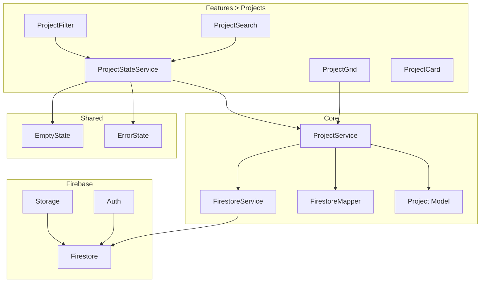
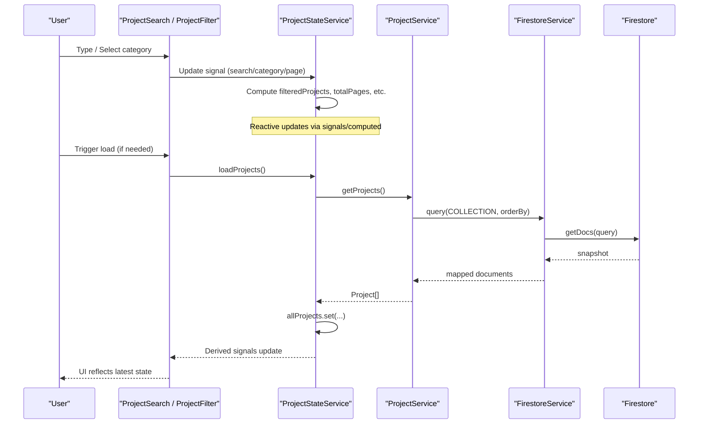
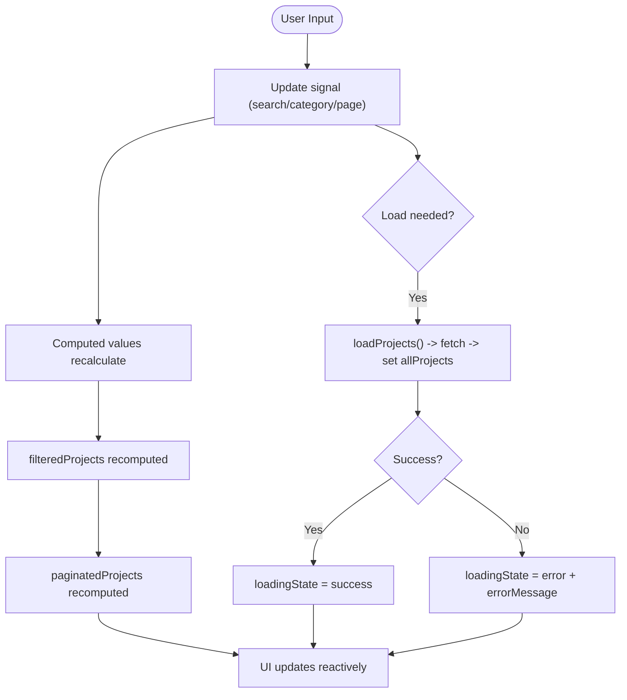
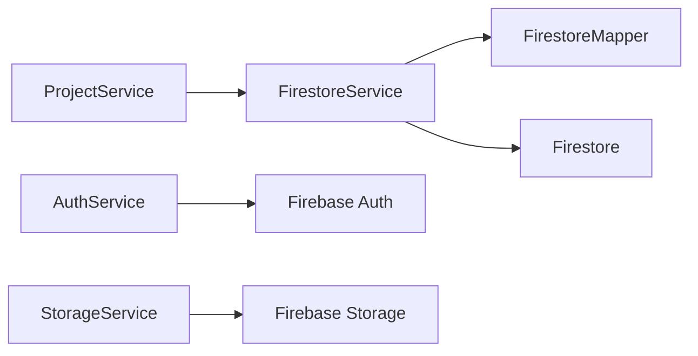
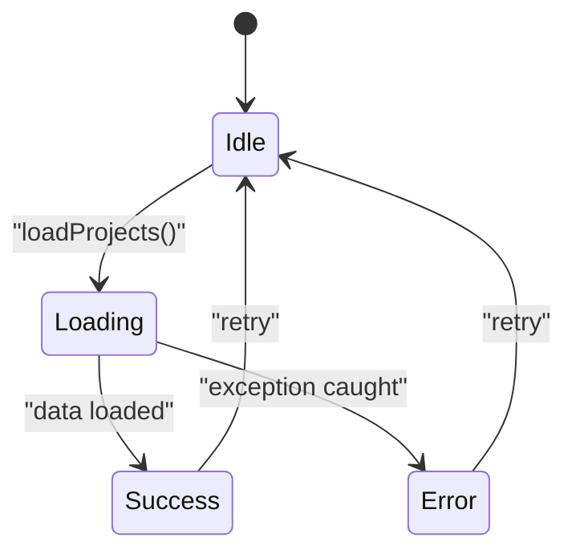
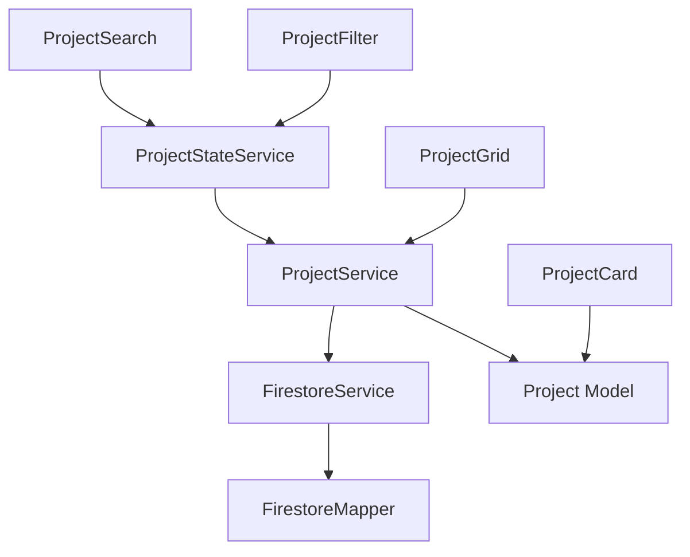

# Data Flow Patterns

<cite>
**Referenced Files in This Document**
- [firestore.service.ts](file://src/app/core/firebase/firestore.service.ts)
- [project.service.ts](file://src/app/core/services/project.service.ts)
- [project-state.service.ts](file://src/app/features/projects/services/project-state.service.ts)
- [firestore.mapper.ts](file://src/app/core/utils/firestore.mapper.ts)
- [project.model.ts](file://src/app/core/models/project.model.ts)
- [project-grid.ts](file://src/app/features/projects/components/project-grid/project-grid.ts)
- [projects.ts](file://src/app/features/projects/pages/projects/projects.ts)
- [project-search.ts](file://src/app/features/projects/components/project-search/project-search.ts)
- [project-filter.ts](file://src/app/features/projects/components/project-filter/project-filter.ts)
- [project-card.ts](file://src/app/features/projects/components/project-card/project-card.ts)
- [auth.service.ts](file://src/app/core/firebase/auth.service.ts)
- [storage.service.ts](file://src/app/core/firebase/storage.service.ts)
- [app.config.ts](file://src/app/app.config.ts)
- [empty-state.ts](file://src/app/shared/components/empty-state/empty-state.ts)
- [error-state.ts](file://src/app/shared/components/error-state/error-state.ts)
</cite>

## Table of Contents
1. Introduction
2. Project Structure
3. Core Components
4. Architecture Overview
5. Detailed Component Analysis
6. Dependency Analysis
7. Performance Considerations
8. Troubleshooting Guide
9. Conclusion

## Introduction
This document explains the data flow patterns in the application with a focus on:
- Signal-based reactivity for state management
- Service layer abstraction over Firebase
- Unidirectional data flow from UI to services to Firestore
- Error handling, loading states, and real-time synchronization strategies
- Efficient mutation propagation and UI updates

The project uses Angular signals and computed values to manage reactive state without traditional observables for most flows. A service layer abstracts business logic and data access, while Firebase is integrated via a dedicated Firestore service.

## Project Structure
Key layers and responsibilities:
- Core data layer: Firebase integration (Firestore, Auth, Storage)
- Core services: Business logic and data access abstractions
- Feature modules: Domain-specific components and feature-level state
- Shared UI: Reusable components for empty/error states and layout



**Diagram sources**
- [firestore.service.ts:1-100](file://src/app/core/firebase/firestore.service.ts#L1-L100)
- [project.service.ts:1-60](file://src/app/core/services/project.service.ts#L1-L60)
- [project-state.service.ts:1-157](file://src/app/features/projects/services/project-state.service.ts#L1-L157)
- [firestore.mapper.ts:1-28](file://src/app/core/utils/firestore.mapper.ts#L1-L28)
- [project.model.ts:1-44](file://src/app/core/models/project.model.ts#L1-L44)
- [project-grid.ts:1-20](file://src/app/features/projects/components/project-grid/project-grid.ts#L1-L20)
- [project-search.ts:1-43](file://src/app/features/projects/components/project-search/project-search.ts#L1-L43)
- [project-filter.ts:1-35](file://src/app/features/projects/components/project-filter/project-filter.ts#L1-L35)
- [project-card.ts:1-15](file://src/app/features/projects/components/project-card/project-card.ts#L1-L15)
- [auth.service.ts:1-13](file://src/app/core/firebase/auth.service.ts#L1-L13)
- [storage.service.ts:1-13](file://src/app/core/firebase/storage.service.ts#L1-L13)

**Section sources**
- [app.config.ts:1-26](file://src/app/app.config.ts#L1-L26)

## Core Components
- FirestoreService: Thin wrapper around Firebase Firestore providing typed queries, reads, creates, updates, and deletes. Normalizes timestamps via mapper.
- ProjectService: Domain service that encapsulates project-related operations and composes Firestore constraints.
- ProjectStateService: Feature-level state manager using Angular signals and computed values for filtering, pagination, loading, and error states.
- ProjectSearch and ProjectFilter: UI inputs that update shared state via signals and debounce search input.
- ProjectGrid and ProjectCard: Presentational components consuming either services directly or state-driven data.

**Section sources**
- [firestore.service.ts:1-100](file://src/app/core/firebase/firestore.service.ts#L1-L100)
- [project.service.ts:1-60](file://src/app/core/services/project.service.ts#L1-L60)
- [project-state.service.ts:1-157](file://src/app/features/projects/services/project-state.service.ts#L1-L157)
- [project-search.ts:1-43](file://src/app/features/projects/components/project-search/project-search.ts#L1-L43)
- [project-filter.ts:1-35](file://src/app/features/projects/components/project-filter/project-filter.ts#L1-L35)
- [project-grid.ts:1-20](file://src/app/features/projects/components/project-grid/project-grid.ts#L1-L20)
- [project-card.ts:1-15](file://src/app/features/projects/components/project-card/project-card.ts#L1-L15)

## Architecture Overview
Unidirectional data flow:
- User interactions occur in feature components (e.g., search, filter).
- Signals in ProjectStateService capture user intent and derived state.
- Computed values derive filtered/paginated results efficiently.
- Services call FirestoreService to read/write data.
- UI subscribes implicitly to signals; changes propagate automatically.



**Diagram sources**
- [project-search.ts:1-43](file://src/app/features/projects/components/project-search/project-search.ts#L1-L43)
- [project-filter.ts:1-35](file://src/app/features/projects/components/project-filter/project-filter.ts#L1-L35)
- [project-state.service.ts:1-157](file://src/app/features/projects/services/project-state.service.ts#L1-L157)
- [project.service.ts:1-60](file://src/app/core/services/project.service.ts#L1-L60)
- [firestore.service.ts:1-100](file://src/app/core/firebase/firestore.service.ts#L1-L100)

## Detailed Component Analysis

### Signal-Based Reactivity and State Management
- ProjectStateService exposes signals for raw data, filters, pagination, and status.
- Computed values derive filtered lists, totals, and UI flags (isLoading, hasError, isEmpty).
- Effects are used to debounce user input and trigger side effects without manual subscriptions.
- Mutations update signals directly; Angular’s fine-grained reactivity ensures minimal UI updates.



**Diagram sources**
- [project-state.service.ts:1-157](file://src/app/features/projects/services/project-state.service.ts#L1-L157)
- [project-search.ts:1-43](file://src/app/features/projects/components/project-search/project-search.ts#L1-L43)

**Section sources**
- [project-state.service.ts:1-157](file://src/app/features/projects/services/project-state.service.ts#L1-L157)
- [project-search.ts:1-43](file://src/app/features/projects/components/project-search/project-search.ts#L1-L43)

### Service Layer Abstraction
- ProjectService encapsulates domain operations and composes Firestore constraints.
- Methods return Promises for predictable async behavior and easy error handling at the caller level.
- FirestoreService centralizes Firestore calls and normalizes timestamp fields through the mapper.

```mermaid
classDiagram
class ProjectService {
+getProjects() Promise<Project[]>
+getFeaturedProjects() Promise<Project[]>
+getProjectsByCategory(category) Promise<Project[]>
+getProject(id) Promise<Project>
+getProjectBySlug(slug) Promise<Project>
+create(project) Promise<{id : string}>
+update(id, data) Promise<void>
+delete(id) Promise<void>
}
class FirestoreService {
+query(path, ...constraints) Promise<T[]>
+getDocument(path) Promise<T>
+create(path, data) Promise<DocumentReference>
+update(path, id, data) Promise<void>
+delete(path, id) Promise<void>
}
class FirestoreMapper {
+mapFirestoreDoc(data) T
+mapFirestoreDocs(docs) (T & {id : string})[]
}
ProjectService --> FirestoreService : "uses"
FirestoreService --> FirestoreMapper : "normalizes dates"
```

**Diagram sources**
- [project.service.ts:1-60](file://src/app/core/services/project.service.ts#L1-L60)
- [firestore.service.ts:1-100](file://src/app/core/firebase/firestore.service.ts#L1-L100)
- [firestore.mapper.ts:1-28](file://src/app/core/utils/firestore.mapper.ts#L1-L28)

**Section sources**
- [project.service.ts:1-60](file://src/app/core/services/project.service.ts#L1-L60)
- [firestore.service.ts:1-100](file://src/app/core/firebase/firestore.service.ts#L1-L100)
- [firestore.mapper.ts:1-28](file://src/app/core/utils/firestore.mapper.ts#L1-L28)

### Firebase Integration
- FirestoreService provides typed CRUD operations and query building helpers.
- Mapper converts Firestore Timestamps to native Date objects for consistent consumption.
- AuthService and StorageService expose Firebase instances for auth and storage needs.



**Diagram sources**
- [project.service.ts:1-60](file://src/app/core/services/project.service.ts#L1-L60)
- [firestore.service.ts:1-100](file://src/app/core/firebase/firestore.service.ts#L1-L100)
- [firestore.mapper.ts:1-28](file://src/app/core/utils/firestore.mapper.ts#L1-L28)
- [auth.service.ts:1-13](file://src/app/core/firebase/auth.service.ts#L1-L13)
- [storage.service.ts:1-13](file://src/app/core/firebase/storage.service.ts#L1-L13)

**Section sources**
- [firestore.service.ts:1-100](file://src/app/core/firebase/firestore.service.ts#L1-L100)
- [firestore.mapper.ts:1-28](file://src/app/core/utils/firestore.mapper.ts#L1-L28)
- [auth.service.ts:1-13](file://src/app/core/firebase/auth.service.ts#L1-L13)
- [storage.service.ts:1-13](file://src/app/core/firebase/storage.service.ts#L1-L13)

### Real-Time Synchronization Strategy
- Current implementation uses explicit queries (Promises) rather than real-time listeners.
- To enable real-time sync, replace getDocs with onSnapshot and map snapshots into signals via patchValue-like updates.
- Maintain optimistic UI by updating signals immediately, then reconcile with server state upon listener callbacks.

[No sources needed since this section provides general guidance]

### Data Mutations and UI Updates
- Create/update/delete methods are exposed via ProjectService and can be wired to ProjectStateService actions.
- After mutations, refresh relevant signals (e.g., reload projects list) to keep UI consistent.
- Use try/catch blocks to set error state and provide retry mechanisms.

**Section sources**
- [project.service.ts:1-60](file://src/app/core/services/project.service.ts#L1-L60)
- [project-state.service.ts:1-157](file://src/app/features/projects/services/project-state.service.ts#L1-L157)

### Loading States and Error Handling
- ProjectStateService manages loadingState and errorMessage signals.
- Components can render EmptyState or ErrorState based on derived flags (isEmpty, hasError).
- Retry action resets state and re-triggers load.



**Diagram sources**
- [project-state.service.ts:1-157](file://src/app/features/projects/services/project-state.service.ts#L1-L157)
- [empty-state.ts:1-21](file://src/app/shared/components/empty-state/empty-state.ts#L1-L21)
- [error-state.ts:1-19](file://src/app/shared/components/error-state/error-state.ts#L1-L19)

**Section sources**
- [project-state.service.ts:1-157](file://src/app/features/projects/services/project-state.service.ts#L1-L157)
- [empty-state.ts:1-21](file://src/app/shared/components/empty-state/empty-state.ts#L1-L21)
- [error-state.ts:1-19](file://src/app/shared/components/error-state/error-state.ts#L1-L19)

## Dependency Analysis
High-level dependencies between core and feature layers:



**Diagram sources**
- [project-state.service.ts:1-157](file://src/app/features/projects/services/project-state.service.ts#L1-L157)
- [project.service.ts:1-60](file://src/app/core/services/project.service.ts#L1-L60)
- [firestore.service.ts:1-100](file://src/app/core/firebase/firestore.service.ts#L1-L100)
- [firestore.mapper.ts:1-28](file://src/app/core/utils/firestore.mapper.ts#L1-L28)
- [project.model.ts:1-44](file://src/app/core/models/project.model.ts#L1-L44)
- [project-grid.ts:1-20](file://src/app/features/projects/components/project-grid/project-grid.ts#L1-L20)
- [project-search.ts:1-43](file://src/app/features/projects/components/project-search/project-search.ts#L1-L43)
- [project-filter.ts:1-35](file://src/app/features/projects/components/project-filter/project-filter.ts#L1-L35)
- [project-card.ts:1-15](file://src/app/features/projects/components/project-card/project-card.ts#L1-L15)

**Section sources**
- [project-state.service.ts:1-157](file://src/app/features/projects/services/project-state.service.ts#L1-L157)
- [project.service.ts:1-60](file://src/app/core/services/project.service.ts#L1-L60)
- [firestore.service.ts:1-100](file://src/app/core/firebase/firestore.service.ts#L1-L100)
- [project-grid.ts:1-20](file://src/app/features/projects/components/project-grid/project-grid.ts#L1-L20)
- [project-search.ts:1-43](file://src/app/features/projects/components/project-search/project-search.ts#L1-L43)
- [project-filter.ts:1-35](file://src/app/features/projects/components/project-filter/project-filter.ts#L1-L35)
- [project-card.ts:1-15](file://src/app/features/projects/components/project-card/project-card.ts#L1-L15)

## Performance Considerations
- Prefer signals and computed values to avoid unnecessary subscriptions and change detection overhead.
- Debounce search input to reduce frequent state updates and downstream computations.
- Paginate results to limit DOM size and improve rendering performance.
- Keep services thin and focused; avoid heavy computation inside services—prefer derived computations in state services.
- When adding real-time listeners, batch updates to minimize re-renders and consider optimistic updates for perceived responsiveness.

[No sources needed since this section provides general guidance]

## Troubleshooting Guide
Common issues and resolutions:
- No data displayed: Ensure loadProjects is called and loadingState transitions to success. Verify Firestore permissions and collection names.
- Search not updating results: Confirm search signal is debounced and setSearch updates both searchQuery and currentPage.
- Errors not shown: Check error handling in loadProjects and ensure errorMessage is bound to ErrorState.
- Real-time not syncing: Replace getDocs with onSnapshot and map changes into signals; handle offline/online states gracefully.

**Section sources**
- [project-state.service.ts:1-157](file://src/app/features/projects/services/project-state.service.ts#L1-L157)
- [project-search.ts:1-43](file://src/app/features/projects/components/project-search/project-search.ts#L1-L43)
- [error-state.ts:1-19](file://src/app/shared/components/error-state/error-state.ts#L1-L19)

## Conclusion
The application employs a clean, unidirectional data flow with signal-based reactivity for efficient UI updates. The service layer abstracts Firebase interactions, keeping components focused on presentation and user interactions. By leveraging signals, computed values, and debounced effects, the system achieves responsive and maintainable state management. For real-time features, extend the pattern by integrating Firestore listeners and reconciling with local signals.

[No sources needed since this section summarizes without analyzing specific files]