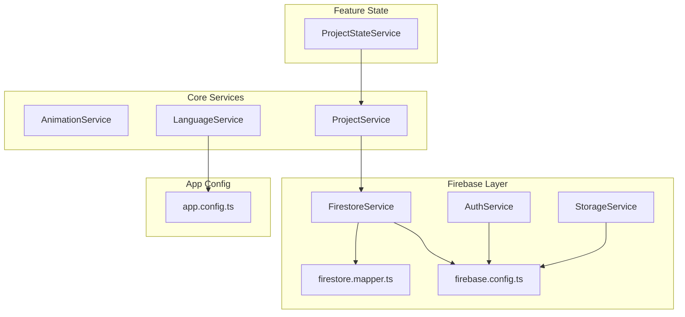
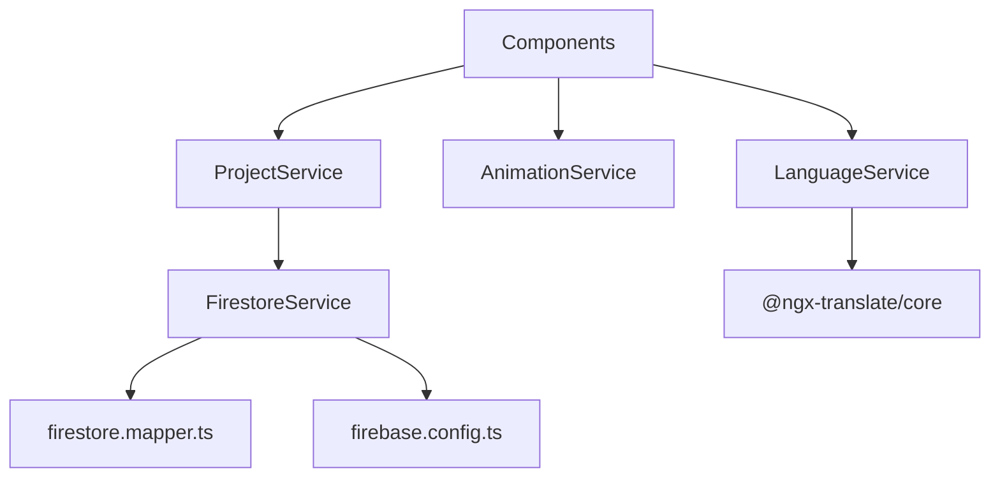
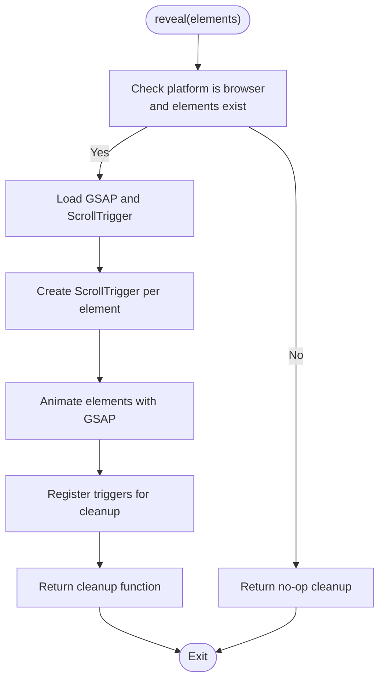
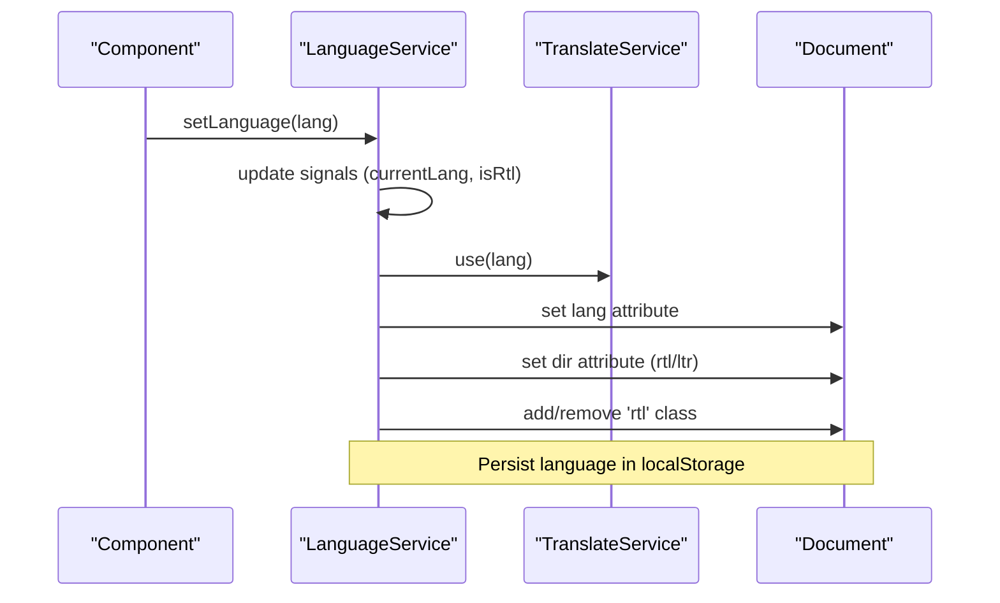
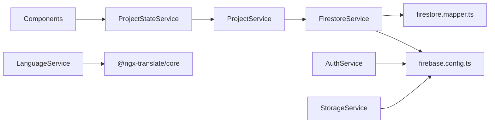

# Service Layer Architecture

<cite>
**Referenced Files in This Document**
- [animation.service.ts](file://src/app/core/services/animation.service.ts)
- [language.service.ts](file://src/app/core/services/language.service.ts)
- [firestore.service.ts](file://src/app/core/firebase/firestore.service.ts)
- [auth.service.ts](file://src/app/core/firebase/auth.service.ts)
- [storage.service.ts](file://src/app/core/firebase/storage.service.ts)
- [firebase.config.ts](file://src/app/core/firebase/firebase.config.ts)
- [index.ts](file://src/app/core/firebase/index.ts)
- [firestore.mapper.ts](file://src/app/core/utils/firestore.mapper.ts)
- [project.service.ts](file://src/app/core/services/project.service.ts)
- [project-state.service.ts](file://src/app/features/projects/services/project-state.service.ts)
- [project.model.ts](file://src/app/core/models/project.model.ts)
- [app.config.ts](file://src/app/app.config.ts)
</cite>

## Table of Contents
1. [Introduction](#introduction)
2. [Project Structure](#project-structure)
3. [Core Components](#core-components)
4. [Architecture Overview](#architecture-overview)
5. [Detailed Component Analysis](#detailed-component-analysis)
6. [Dependency Analysis](#dependency-analysis)
7. [Performance Considerations](#performance-considerations)
8. [Troubleshooting Guide](#troubleshooting-guide)
9. [Conclusion](#conclusion)
10. [Appendices](#appendices)

## Introduction
This document explains the service layer architecture of the Angular portfolio application with a focus on:
- Firebase integration for Firestore, Authentication, and Storage
- State management using Angular signals and computed values
- Animation services managing GSAP lifecycle and memory cleanup
- Internationalization (i18n) and RTL support via a language service
- Service composition patterns, dependency injection, and testing strategies

The goal is to show how each service encapsulates specific functionality while maintaining loose coupling with components through well-defined interfaces and dependency injection.

## Project Structure
The service layer is organized under core features and feature-specific state:
- Core services: animation, language, project data access
- Firebase services: Firestore, Auth, Storage, configuration, and mapper utilities
- Feature state: project state management with signals and computed properties
- App configuration: translation setup and HTTP provider



**Diagram sources**
- [animation.service.ts:1-72](file://src/app/core/services/animation.service.ts#L1-L72)
- [language.service.ts:1-62](file://src/app/core/services/language.service.ts#L1-L62)
- [project.service.ts:1-60](file://src/app/core/services/project.service.ts#L1-L60)
- [firestore.service.ts:1-100](file://src/app/core/firebase/firestore.service.ts#L1-L100)
- [auth.service.ts:1-13](file://src/app/core/firebase/auth.service.ts#L1-L13)
- [storage.service.ts:1-13](file://src/app/core/firebase/storage.service.ts#L1-L13)
- [firebase.config.ts:1-13](file://src/app/core/firebase/firebase.config.ts#L1-L13)
- [firestore.mapper.ts:1-28](file://src/app/core/utils/firestore.mapper.ts#L1-L28)
- [project-state.service.ts:1-157](file://src/app/features/projects/services/project-state.service.ts#L1-L157)
- [app.config.ts:1-26](file://src/app/app.config.ts#L1-L26)

**Section sources**
- [animation.service.ts:1-72](file://src/app/core/services/animation.service.ts#L1-L72)
- [language.service.ts:1-62](file://src/app/core/services/language.service.ts#L1-L62)
- [project.service.ts:1-60](file://src/app/core/services/project.service.ts#L1-L60)
- [firestore.service.ts:1-100](file://src/app/core/firebase/firestore.service.ts#L1-L100)
- [auth.service.ts:1-13](file://src/app/core/firebase/auth.service.ts#L1-L13)
- [storage.service.ts:1-13](file://src/app/core/firebase/storage.service.ts#L1-L13)
- [firebase.config.ts:1-13](file://src/app/core/firebase/firebase.config.ts#L1-L13)
- [firestore.mapper.ts:1-28](file://src/app/core/utils/firestore.mapper.ts#L1-L28)
- [project-state.service.ts:1-157](file://src/app/features/projects/services/project-state.service.ts#L1-L157)
- [app.config.ts:1-26](file://src/app/app.config.ts#L1-L26)

## Core Components
- AnimationService: Encapsulates GSAP initialization, ScrollTrigger creation, and cleanup. Provides a reveal method that returns a cleanup function to kill triggers and remove references.
- LanguageService: Manages current language, RTL direction, and persistence via localStorage. Integrates with @ngx-translate and updates DOM attributes/classes for i18n and RTL.
- FirestoreService: Type-safe wrapper around Firestore operations with query constraints (where, orderBy, limit). Maps Firestore Timestamps to Date objects for consistent typing.
- AuthService and StorageService: Thin wrappers exposing Firebase Auth and Storage instances initialized from the shared Firebase app.
- ProjectService: Domain service over Firestore for projects, providing typed queries and CRUD methods.
- ProjectStateService: Signal-based state container for project listing, filtering, pagination, modal state, and error handling.

**Section sources**
- [animation.service.ts:1-72](file://src/app/core/services/animation.service.ts#L1-L72)
- [language.service.ts:1-62](file://src/app/core/services/language.service.ts#L1-L62)
- [firestore.service.ts:1-100](file://src/app/core/firebase/firestore.service.ts#L1-L100)
- [auth.service.ts:1-13](file://src/app/core/firebase/auth.service.ts#L1-L13)
- [storage.service.ts:1-13](file://src/app/core/firebase/storage.service.ts#L1-L13)
- [project.service.ts:1-60](file://src/app/core/services/project.service.ts#L1-L60)
- [project-state.service.ts:1-157](file://src/app/features/projects/services/project-state.service.ts#L1-L157)

## Architecture Overview
The service layer follows a layered approach:
- Presentation (components) depends on domain services (e.g., ProjectService)
- Domain services depend on infrastructure services (FirestoreService, AuthService, StorageService)
- Infrastructure services depend on Firebase SDK and configuration
- Cross-cutting concerns (animations, i18n) are provided as root-level services injected where needed



**Diagram sources**
- [project.service.ts:1-60](file://src/app/core/services/project.service.ts#L1-L60)
- [firestore.service.ts:1-100](file://src/app/core/firebase/firestore.service.ts#L1-L100)
- [firestore.mapper.ts:1-28](file://src/app/core/utils/firestore.mapper.ts#L1-L28)
- [firebase.config.ts:1-13](file://src/app/core/firebase/firebase.config.ts#L1-L13)
- [animation.service.ts:1-72](file://src/app/core/services/animation.service.ts#L1-L72)
- [language.service.ts:1-62](file://src/app/core/services/language.service.ts#L1-L62)
- [app.config.ts:1-26](file://src/app/app.config.ts#L1-L26)

## Detailed Component Analysis

### Firebase Service Layer
FirestoreService provides type-safe operations for Firestore collections and documents:
- getCollection and query build constraints dynamically and return mapped results
- getDocument retrieves a single document and throws if not found
- create, update, delete operate on collection paths with IDs
- mapFirestoreDoc converts Firestore Timestamp fields to Date for consistent types

AuthService and StorageService expose initialized Firebase instances for authentication and storage operations.

```mermaid
classDiagram
class FirestoreService {
+db : Firestore
+getCollection(path, options) Promise~T[]~
+query(path, ...constraints) Promise~T[]~
+getDocument(path) Promise~T~
+create(path, data) Promise~DocumentReference~
+update(path, id, data) Promise~void~
+delete(path, id) Promise~void~
-buildConstraints(options) QueryConstraint[]
}
class AuthService {
+auth
}
class StorageService {
+storage
}
class FirestoreMapper {
+mapFirestoreDoc(data) T
+mapFirestoreDocs(docs) (T & {id : string})[]
}
FirestoreService --> FirestoreMapper : "uses"
AuthService --> "depends on" firebase.config.ts
StorageService --> "depends on" firebase.config.ts
```

**Diagram sources**
- [firestore.service.ts:1-100](file://src/app/core/firebase/firestore.service.ts#L1-L100)
- [auth.service.ts:1-13](file://src/app/core/firebase/auth.service.ts#L1-L13)
- [storage.service.ts:1-13](file://src/app/core/firebase/storage.service.ts#L1-L13)
- [firestore.mapper.ts:1-28](file://src/app/core/utils/firestore.mapper.ts#L1-L28)
- [firebase.config.ts:1-13](file://src/app/core/firebase/firebase.config.ts#L1-L13)

**Section sources**
- [firestore.service.ts:1-100](file://src/app/core/firebase/firestore.service.ts#L1-L100)
- [auth.service.ts:1-13](file://src/app/core/firebase/auth.service.ts#L1-L13)
- [storage.service.ts:1-13](file://src/app/core/firebase/storage.service.ts#L1-L13)
- [firestore.mapper.ts:1-28](file://src/app/core/utils/firestore.mapper.ts#L1-L28)
- [firebase.config.ts:1-13](file://src/app/core/firebase/firebase.config.ts#L1-L13)

### Animation Service
AnimationService manages GSAP lifecycle:
- Lazy loads GSAP and ScrollTrigger plugins only once
- Creates ScrollTrigger instances per element and tracks them for cleanup
- Returns a cleanup function to kill triggers and remove references
- Guards against server-side execution using platform checks



**Diagram sources**
- [animation.service.ts:1-72](file://src/app/core/services/animation.service.ts#L1-L72)

**Section sources**
- [animation.service.ts:1-72](file://src/app/core/services/animation.service.ts#L1-L72)

### Language Service (Internationalization and RTL)
LanguageService handles:
- Default language detection from localStorage or browser language
- Setting current language and toggling between supported codes
- Updating document direction and classes for RTL support
- Persisting language preference and integrating with @ngx-translate



**Diagram sources**
- [language.service.ts:1-62](file://src/app/core/services/language.service.ts#L1-L62)
- [app.config.ts:1-26](file://src/app/app.config.ts#L1-L26)

**Section sources**
- [language.service.ts:1-62](file://src/app/core/services/language.service.ts#L1-L62)
- [app.config.ts:1-26](file://src/app/app.config.ts#L1-L26)

### Project Service and State Management
ProjectService encapsulates domain logic for projects:
- Queries with ordering and filtering (featured, category, slug)
- CRUD operations returning typed results
- Delegates to FirestoreService for data access

ProjectStateService manages UI state:
- Signals for allProjects, searchQuery, selectedCategory, currentPage, loadingState, errorMessage, selectedProject
- Computed properties for filteredProjects, totalPages, paginatedProjects, counts, and flags
- Methods for loading, retrying, searching, filtering, pagination, and modal control

```mermaid
classDiagram
class ProjectService {
+getProjects() Promise~Project[]~
+getFeaturedProjects() Promise~Project[]~
+getProjectsByCategory(category) Promise~Project[]~
+getProject(id) Promise~Project~
+getProjectBySlug(slug) Promise~Project~
+create(project) Promise~{id : string}~
+update(id, project) Promise~void~
+delete(id) Promise~void~
}
class ProjectStateService {
+allProjects : signal<Project[]>
+searchQuery : signal<string>
+selectedCategory : signal<ProjectCategory>
+currentPage : signal<number>
+loadingState : signal<LoadingState>
+errorMessage : signal<string>
+selectedProject : signal<Project|null>
+filteredProjects : computed<Project[]>
+totalPages : computed<number>
+paginatedProjects : computed<Project[]>
+totalCount : computed<number>
+featuredCount : computed<number>
+technologyCount : computed<number>
+resultCount : computed<number>
+isEmpty : computed<boolean>
+isLoading : computed<boolean>
+hasError : computed<boolean>
+showPagination : computed<boolean>
+loadProjects() Promise<void>
+retry() void
+setSearch(query) void
+setCategory(category) void
+setPage(page) void
+openModal(project) void
+closeModal() void
}
ProjectStateService --> ProjectService : "uses"
```

**Diagram sources**
- [project.service.ts:1-60](file://src/app/core/services/project.service.ts#L1-L60)
- [project-state.service.ts:1-157](file://src/app/features/projects/services/project-state.service.ts#L1-L157)
- [project.model.ts:1-44](file://src/app/core/models/project.model.ts#L1-L44)

**Section sources**
- [project.service.ts:1-60](file://src/app/core/services/project.service.ts#L1-L60)
- [project-state.service.ts:1-157](file://src/app/features/projects/services/project-state.service.ts#L1-L157)
- [project.model.ts:1-44](file://src/app/core/models/project.model.ts#L1-L44)

## Dependency Analysis
Services are loosely coupled through Angular’s dependency injection:
- Components inject services directly without tight coupling to implementation details
- ProjectService depends on FirestoreService; ProjectStateService depends on ProjectService
- Firebase services depend on firebase.config.ts for initialization
- LanguageService depends on @ngx-translate and platform checks



**Diagram sources**
- [project-state.service.ts:1-157](file://src/app/features/projects/services/project-state.service.ts#L1-L157)
- [project.service.ts:1-60](file://src/app/core/services/project.service.ts#L1-L60)
- [firestore.service.ts:1-100](file://src/app/core/firebase/firestore.service.ts#L1-L100)
- [firestore.mapper.ts:1-28](file://src/app/core/utils/firestore.mapper.ts#L1-L28)
- [auth.service.ts:1-13](file://src/app/core/firebase/auth.service.ts#L1-L13)
- [storage.service.ts:1-13](file://src/app/core/firebase/storage.service.ts#L1-L13)
- [firebase.config.ts:1-13](file://src/app/core/firebase/firebase.config.ts#L1-L13)
- [language.service.ts:1-62](file://src/app/core/services/language.service.ts#L1-L62)
- [app.config.ts:1-26](file://src/app/app.config.ts#L1-L26)

**Section sources**
- [project-state.service.ts:1-157](file://src/app/features/projects/services/project-state.service.ts#L1-L157)
- [project.service.ts:1-60](file://src/app/core/services/project.service.ts#L1-L60)
- [firestore.service.ts:1-100](file://src/app/core/firebase/firestore.service.ts#L1-L100)
- [firestore.mapper.ts:1-28](file://src/app/core/utils/firestore.mapper.ts#L1-L28)
- [auth.service.ts:1-13](file://src/app/core/firebase/auth.service.ts#L1-L13)
- [storage.service.ts:1-13](file://src/app/core/firebase/storage.service.ts#L1-L13)
- [firebase.config.ts:1-13](file://src/app/core/firebase/firebase.config.ts#L1-L13)
- [language.service.ts:1-62](file://src/app/core/services/language.service.ts#L1-L62)
- [app.config.ts:1-26](file://src/app/app.config.ts#L1-L26)

## Performance Considerations
- Lazy loading GSAP and ScrollTrigger reduces initial bundle size and avoids unnecessary work on server
- Single promise cache for GSAP initialization prevents redundant imports
- Signal-based state minimizes change detection overhead and enables fine-grained reactivity
- Pagination and computed filtering reduce rendering costs by limiting visible items
- Firestore queries use constraints to fetch only necessary data

[No sources needed since this section provides general guidance]

## Troubleshooting Guide
Common issues and resolutions:
- GSAP animations not triggering: Ensure platform is browser and elements exist before calling reveal; verify ScrollTrigger registration and cleanup
- Language switching not applied: Confirm TranslateService is configured and language persisted in localStorage; check document.dir and rtl class updates
- Firestore errors: Validate collection paths and query constraints; handle not-found cases explicitly; ensure Timestamp mapping is applied
- State inconsistencies: Verify loadingState transitions and error messages; use retry to reset state and reload data

**Section sources**
- [animation.service.ts:1-72](file://src/app/core/services/animation.service.ts#L1-L72)
- [language.service.ts:1-62](file://src/app/core/services/language.service.ts#L1-L62)
- [firestore.service.ts:1-100](file://src/app/core/firebase/firestore.service.ts#L1-L100)
- [project-state.service.ts:1-157](file://src/app/features/projects/services/project-state.service.ts#L1-L157)

## Conclusion
The service layer is designed for clarity, testability, and performance:
- Firebase services provide a clean abstraction over Firestore, Auth, and Storage
- Animation and i18n services encapsulate cross-cutting concerns with robust lifecycle management
- Domain and state services leverage Angular signals for efficient reactivity
- Dependency injection ensures loose coupling and facilitates unit testing

[No sources needed since this section summarizes without analyzing specific files]

## Appendices

### Service Composition Patterns
- Thin infrastructure services (Auth, Storage) expose initialized SDK instances
- Domain services (ProjectService) compose infrastructure calls into business operations
- State services (ProjectStateService) orchestrate UI state and side effects

**Section sources**
- [auth.service.ts:1-13](file://src/app/core/firebase/auth.service.ts#L1-L13)
- [storage.service.ts:1-13](file://src/app/core/firebase/storage.service.ts#L1-L13)
- [project.service.ts:1-60](file://src/app/core/services/project.service.ts#L1-L60)
- [project-state.service.ts:1-157](file://src/app/features/projects/services/project-state.service.ts#L1-L157)

### Testing Strategies for Services
- Mock Firebase SDK modules (Firestore, Auth, Storage) to isolate service behavior
- Use TestBed to configure providers and inject services
- Assert signal states and computed values for state services
- Stub TranslateService for i18n tests
- Verify GSAP initialization and cleanup by mocking import('gsap') and ScrollTrigger

[No sources needed since this section provides general guidance]