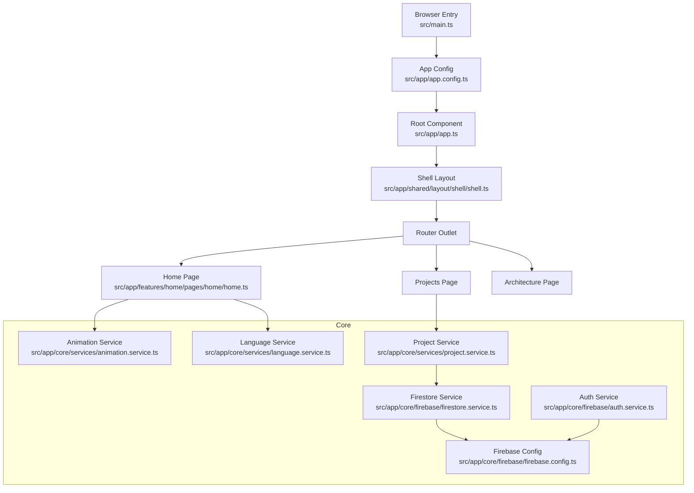
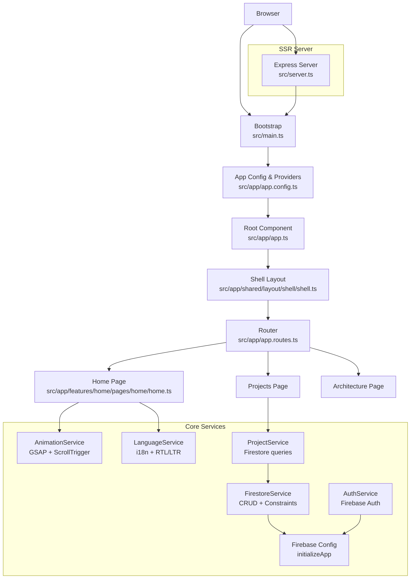
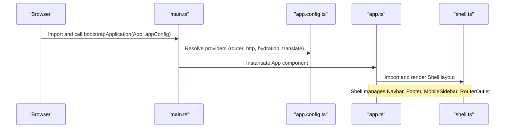
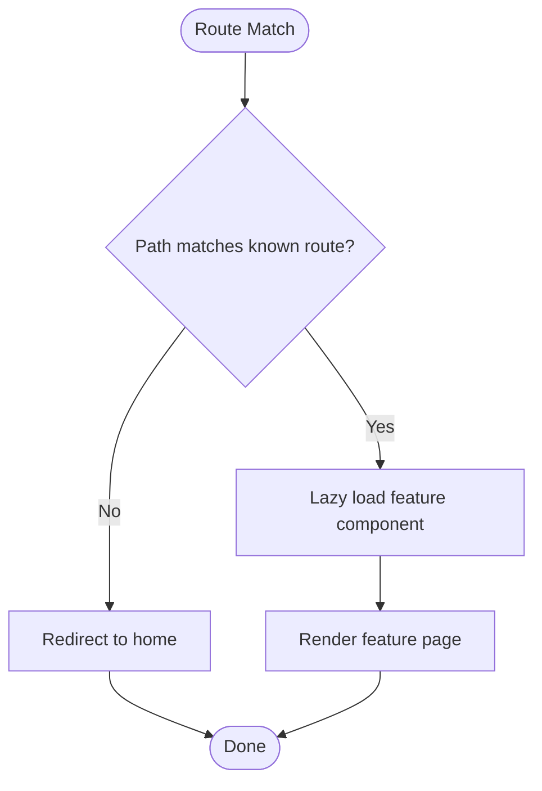
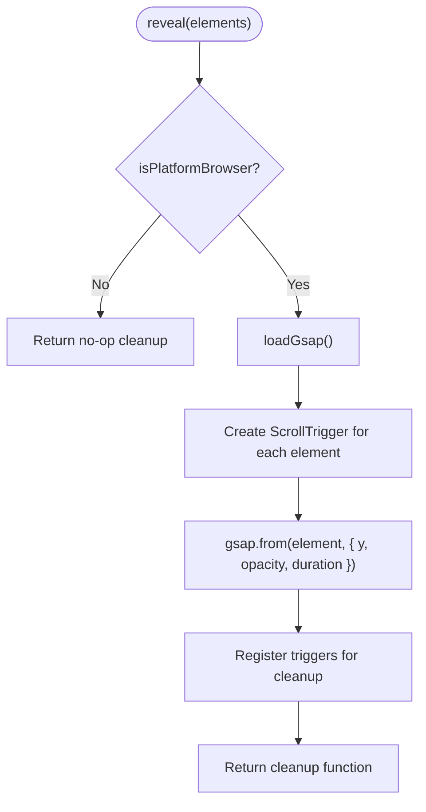
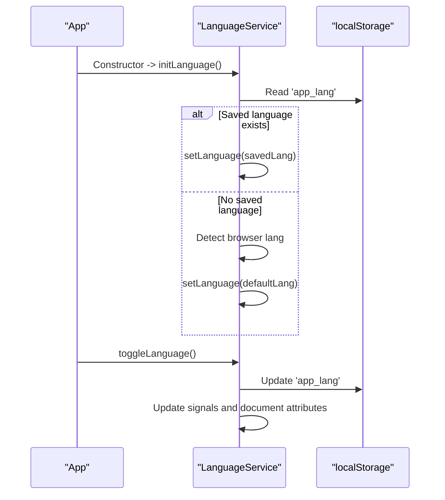
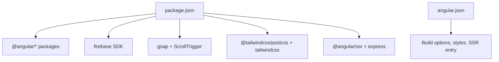

# System Architecture

<cite>
**Referenced Files in This Document**
- [package.json](file://package.json)
- [angular.json](file://angular.json)
- [src/main.ts](file://src/main.ts)
- [src/app/app.config.ts](file://src/app/app.config.ts)
- [src/app/app.ts](file://src/app/app.ts)
- [src/app/app.routes.ts](file://src/app/app.routes.ts)
- [src/server.ts](file://src/server.ts)
- [src/app/core/firebase/firebase.config.ts](file://src/app/core/firebase/firebase.config.ts)
- [src/app/core/firebase/auth.service.ts](file://src/app/core/firebase/auth.service.ts)
- [src/app/core/firebase/firestore.service.ts](file://src/app/core/firebase/firestore.service.ts)
- [src/app/core/services/animation.service.ts](file://src/app/core/services/animation.service.ts)
- [src/app/core/services/language.service.ts](file://src/app/core/services/language.service.ts)
- [src/app/core/services/project.service.ts](file://src/app/core/services/project.service.ts)
- [src/app/shared/layout/shell/shell.ts](file://src/app/shared/layout/shell/shell.ts)
- [src/app/features/home/pages/home/home.ts](file://src/app/features/home/pages/home/home.ts)
</cite>

## Table of Contents
1. Introduction
2. Project Structure
3. Core Components
4. Architecture Overview
5. Detailed Component Analysis
6. Dependency Analysis
7. Performance Considerations
8. Troubleshooting Guide
9. Conclusion

## Introduction
This document describes the MegaPortfolio system architecture using a feature-based modular design with clear separation between core services, feature modules, and shared components. It covers the application bootstrap process, dependency injection configuration, provider setup, technology stack (Angular 21 with standalone components, Firebase integration, GSAP animations, Tailwind CSS), build configuration, SSR setup, deployment architecture, system boundaries, external dependencies, and integration points with Firebase services.

## Project Structure
The application follows a feature-based layout under src/app:
- core: Shared infrastructure such as Firebase configuration, services, models, utilities, and interceptors.
- features: Feature modules organized by domain (home, projects, architecture, blog, contact, experience). Each feature contains pages and reusable components or sections.
- shared: Cross-cutting UI elements like layout shell, navbar, footer, mobile sidebar, empty/error states, and common directives/pipes.

Key entry points:
- Browser bootstrap: src/main.ts bootstraps the Angular app with app config and root component.
- Root component: src/app/app.ts composes the Shell layout.
- Routing: src/app/app.routes.ts defines lazy-loaded routes for each feature page.
- SSR server: src/server.ts is an Express server that serves static assets and renders Angular via @angular/ssr.



**Diagram sources**
- [src/main.ts:1-7](file://src/main.ts#L1-L7)
- [src/app/app.config.ts:1-26](file://src/app/app.config.ts#L1-L26)
- [src/app/app.ts:1-13](file://src/app/app.ts#L1-L13)
- [src/app/shared/layout/shell/shell.ts:1-26](file://src/app/shared/layout/shell/shell.ts#L1-L26)
- [src/app/features/home/pages/home/home.ts:1-25](file://src/app/features/home/pages/home/home.ts#L1-L25)
- [src/app/core/firebase/firebase.config.ts:1-13](file://src/app/core/firebase/firebase.config.ts#L1-L13)
- [src/app/core/firebase/firestore.service.ts:1-100](file://src/app/core/firebase/firestore.service.ts#L1-L100)
- [src/app/core/firebase/auth.service.ts:1-13](file://src/app/core/firebase/auth.service.ts#L1-L13)
- [src/app/core/services/animation.service.ts:1-72](file://src/app/core/services/animation.service.ts#L1-L72)
- [src/app/core/services/language.service.ts:1-62](file://src/app/core/services/language.service.ts#L1-L62)
- [src/app/core/services/project.service.ts:1-60](file://src/app/core/services/project.service.ts#L1-L60)

**Section sources**
- [src/main.ts:1-7](file://src/main.ts#L1-L7)
- [src/app/app.config.ts:1-26](file://src/app/app.config.ts#L1-L26)
- [src/app/app.ts:1-13](file://src/app/app.ts#L1-L13)
- [src/app/app.routes.ts:1-31](file://src/app/app.routes.ts#L1-L31)
- [src/server.ts:1-69](file://src/server.ts#L1-L69)

## Core Components
- Application Bootstrap and Providers
  - Browser bootstrap initializes the Angular application with providers for router, HTTP client, hydration, and i18n translation service.
  - Root component imports the Shell layout to provide consistent navigation and footer across pages.
- Routing and Lazy Loading
  - Routes are defined with lazy loading per feature page to optimize initial bundle size.
- Core Services
  - AnimationService: Wraps GSAP and ScrollTrigger with platform checks and cleanup on destroy.
  - LanguageService: Manages current language, RTL/LTR direction, and persistence via localStorage.
  - FirestoreService: Provides typed queries, CRUD operations, and constraint building for Firestore.
  - AuthService: Exposes Firebase Auth instance initialized from the shared Firebase app.
  - ProjectService: Domain-specific data access over Firestore for projects, including filtering and ordering.
- Shared Layout
  - Shell orchestrates Navbar, Footer, MobileSidebar, and RouterOutlet.

**Section sources**
- [src/main.ts:1-7](file://src/main.ts#L1-L7)
- [src/app/app.config.ts:1-26](file://src/app/app.config.ts#L1-L26)
- [src/app/app.ts:1-13](file://src/app/app.ts#L1-L13)
- [src/app/app.routes.ts:1-31](file://src/app/app.routes.ts#L1-L31)
- [src/app/core/services/animation.service.ts:1-72](file://src/app/core/services/animation.service.ts#L1-L72)
- [src/app/core/services/language.service.ts:1-62](file://src/app/core/services/language.service.ts#L1-L62)
- [src/app/core/firebase/firestore.service.ts:1-100](file://src/app/core/firebase/firestore.service.ts#L1-L100)
- [src/app/core/firebase/auth.service.ts:1-13](file://src/app/core/firebase/auth.service.ts#L1-L13)
- [src/app/core/services/project.service.ts:1-60](file://src/app/core/services/project.service.ts#L1-L60)
- [src/app/shared/layout/shell/shell.ts:1-26](file://src/app/shared/layout/shell/shell.ts#L1-L26)

## Architecture Overview
High-level architecture:
- Frontend: Angular 21 standalone components with lazy-loaded feature routes.
- State and Data: Services encapsulate business logic and data access; FirestoreService abstracts Firebase Firestore interactions.
- UI Layer: Shell provides global layout; feature pages compose reusable sections/components.
- SSR: Node.js Express server renders Angular on the server and serves static assets.



**Diagram sources**
- [src/main.ts:1-7](file://src/main.ts#L1-L7)
- [src/app/app.config.ts:1-26](file://src/app/app.config.ts#L1-L26)
- [src/app/app.ts:1-13](file://src/app/app.ts#L1-L13)
- [src/app/shared/layout/shell/shell.ts:1-26](file://src/app/shared/layout/shell/shell.ts#L1-L26)
- [src/app/app.routes.ts:1-31](file://src/app/app.routes.ts#L1-L31)
- [src/app/features/home/pages/home/home.ts:1-25](file://src/app/features/home/pages/home/home.ts#L1-L25)
- [src/app/core/services/animation.service.ts:1-72](file://src/app/core/services/animation.service.ts#L1-L72)
- [src/app/core/services/language.service.ts:1-62](file://src/app/core/services/language.service.ts#L1-L62)
- [src/app/core/services/project.service.ts:1-60](file://src/app/core/services/project.service.ts#L1-L60)
- [src/app/core/firebase/firestore.service.ts:1-100](file://src/app/core/firebase/firestore.service.ts#L1-L100)
- [src/app/core/firebase/auth.service.ts:1-13](file://src/app/core/firebase/auth.service.ts#L1-L13)
- [src/app/core/firebase/firebase.config.ts:1-13](file://src/app/core/firebase/firebase.config.ts#L1-L13)
- [src/server.ts:1-69](file://src/server.ts#L1-L69)

## Detailed Component Analysis

### Application Bootstrap and Dependency Injection
- Bootstrap sequence:
  - main.ts calls bootstrapApplication with App and appConfig.
  - appConfig registers router, HTTP client with fetch, client hydration with event replay, and i18n TranslateService with HTTP loader.
- Root component:
  - App imports Shell to render the application shell.
- SSR server:
  - server.ts sets up Express, serves static browser assets, and delegates requests to AngularNodeAppEngine for rendering.



**Diagram sources**
- [src/main.ts:1-7](file://src/main.ts#L1-L7)
- [src/app/app.config.ts:1-26](file://src/app/app.config.ts#L1-L26)
- [src/app/app.ts:1-13](file://src/app/app.ts#L1-L13)
- [src/app/shared/layout/shell/shell.ts:1-26](file://src/app/shared/layout/shell/shell.ts#L1-L26)

**Section sources**
- [src/main.ts:1-7](file://src/main.ts#L1-L7)
- [src/app/app.config.ts:1-26](file://src/app/app.config.ts#L1-L26)
- [src/app/app.ts:1-13](file://src/app/app.ts#L1-L13)
- [src/server.ts:1-69](file://src/server.ts#L1-L69)

### Routing and Lazy Loading
- Routes define lazy-loaded feature pages for home, projects, and architecture.
- The wildcard route redirects unknown paths to the home page.



**Diagram sources**
- [src/app/app.routes.ts:1-31](file://src/app/app.routes.ts#L1-L31)

**Section sources**
- [src/app/app.routes.ts:1-31](file://src/app/app.routes.ts#L1-L31)

### Firebase Integration
- Firebase initialization:
  - firebase.config.ts initializes the Firebase app with project credentials.
- Services:
  - AuthService exposes the Firebase Auth instance.
  - FirestoreService provides typed queries, CRUD operations, and constraint building for Firestore collections.
  - ProjectService uses FirestoreService to query projects with ordering and filtering.

```mermaid
classDiagram
class FirebaseConfig {
+firebaseConfig
+firebaseApp
}
class AuthService {
+auth
}
class FirestoreService {
+db
+getCollection(path, options) Promise~T[]~
+query(path, ...constraints) Promise~T[]~
+getDocument(path) Promise~T~
+create(path, data)
+update(path, id, data)
+delete(path, id)
-buildConstraints(options) QueryConstraint[]
}
class ProjectService {
+getProjects() Promise~Project[]~
+getFeaturedProjects() Promise~Project[]~
+getProjectsByCategory(category) Promise~Project[]~
+getProject(id) Promise~Project~
+getProjectBySlug(slug) Promise~Project~
+create(project) Promise~{id}~
+update(id, project) Promise~void~
+delete(id) Promise~void~
}
AuthService --> FirebaseConfig : "uses"
FirestoreService --> FirebaseConfig : "uses"
ProjectService --> FirestoreService : "uses"
```

**Diagram sources**
- [src/app/core/firebase/firebase.config.ts:1-13](file://src/app/core/firebase/firebase.config.ts#L1-L13)
- [src/app/core/firebase/auth.service.ts:1-13](file://src/app/core/firebase/auth.service.ts#L1-L13)
- [src/app/core/firebase/firestore.service.ts:1-100](file://src/app/core/firebase/firestore.service.ts#L1-L100)
- [src/app/core/services/project.service.ts:1-60](file://src/app/core/services/project.service.ts#L1-L60)

**Section sources**
- [src/app/core/firebase/firebase.config.ts:1-13](file://src/app/core/firebase/firebase.config.ts#L1-L13)
- [src/app/core/firebase/auth.service.ts:1-13](file://src/app/core/firebase/auth.service.ts#L1-L13)
- [src/app/core/firebase/firestore.service.ts:1-100](file://src/app/core/firebase/firestore.service.ts#L1-L100)
- [src/app/core/services/project.service.ts:1-60](file://src/app/core/services/project.service.ts#L1-L60)

### Animation Service (GSAP + ScrollTrigger)
- AnimationService lazily loads GSAP and ScrollTrigger only when needed and ensures cleanup on component destruction.
- Platform checks prevent SSR execution of DOM-dependent code.



**Diagram sources**
- [src/app/core/services/animation.service.ts:1-72](file://src/app/core/services/animation.service.ts#L1-L72)

**Section sources**
- [src/app/core/services/animation.service.ts:1-72](file://src/app/core/services/animation.service.ts#L1-L72)

### Language Service (i18n + RTL/LTR)
- LanguageService manages current language, RTL/LTR direction, and persistence via localStorage.
- Initializes default language based on saved preference or browser language.



**Diagram sources**
- [src/app/core/services/language.service.ts:1-62](file://src/app/core/services/language.service.ts#L1-L62)

**Section sources**
- [src/app/core/services/language.service.ts:1-62](file://src/app/core/services/language.service.ts#L1-L62)

### Home Page Composition
- Home page composes multiple sections: Hero, ArchitecturePreview, FeaturedProjects, SystemDesignLab, TechRadar, Stats.
- Demonstrates feature-based modular composition using standalone components.

**Section sources**
- [src/app/features/home/pages/home/home.ts:1-25](file://src/app/features/home/pages/home/home.ts#L1-L25)

## Dependency Analysis
Technology stack and build configuration:
- Angular 21 with standalone components and lazy loading.
- Firebase SDK for authentication and Firestore.
- GSAP for animations with ScrollTrigger plugin.
- Tailwind CSS via PostCSS plugin.
- SSR with @angular/ssr and Express server.



**Diagram sources**
- [package.json:1-49](file://package.json#L1-L49)
- [angular.json:1-95](file://angular.json#L1-L95)

**Section sources**
- [package.json:1-49](file://package.json#L1-L49)
- [angular.json:1-95](file://angular.json#L1-L95)

## Performance Considerations
- Lazy-loading feature routes reduces initial bundle size.
- Client hydration with event replay improves perceived performance and interactivity.
- GSAP modules are dynamically imported to avoid upfront cost.
- Production builds enable budgets and output hashing for caching efficiency.
- Static assets served with long cache headers via Express.

[No sources needed since this section provides general guidance]

## Troubleshooting Guide
- SSR Hydration Issues:
  - Ensure DOM-dependent code runs only in the browser (platform checks).
  - Verify hydration provider is configured and event replay is enabled.
- Firebase Initialization:
  - Confirm Firebase app is initialized before accessing Auth or Firestore instances.
  - Validate configuration values match the target project.
- GSAP Animations:
  - Check that ScrollTrigger is registered before creating triggers.
  - Ensure cleanup functions are called on component destroy to prevent memory leaks.
- Language Direction:
  - Verify document.documentElement.dir and rtl class toggling when switching languages.

**Section sources**
- [src/app/core/services/animation.service.ts:1-72](file://src/app/core/services/animation.service.ts#L1-L72)
- [src/app/core/firebase/firebase.config.ts:1-13](file://src/app/core/firebase/firebase.config.ts#L1-L13)
- [src/app/core/services/language.service.ts:1-62](file://src/app/core/services/language.service.ts#L1-L62)

## Conclusion
MegaPortfolio employs a clean, feature-based modular architecture with strong separation of concerns. Core services encapsulate cross-cutting concerns (animations, i18n, Firebase), while feature modules own their UI and data flows. The Angular 21 standalone components model, combined with lazy loading and SSR, delivers a performant, scalable application. Firebase integration is centralized through dedicated services, and GSAP animations are optimized with dynamic imports and proper lifecycle management. Tailwind CSS provides utility-first styling, and the Express-based SSR server enables server-side rendering and efficient static asset serving.