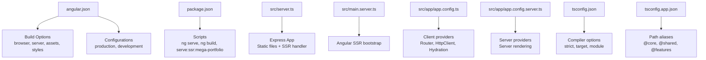
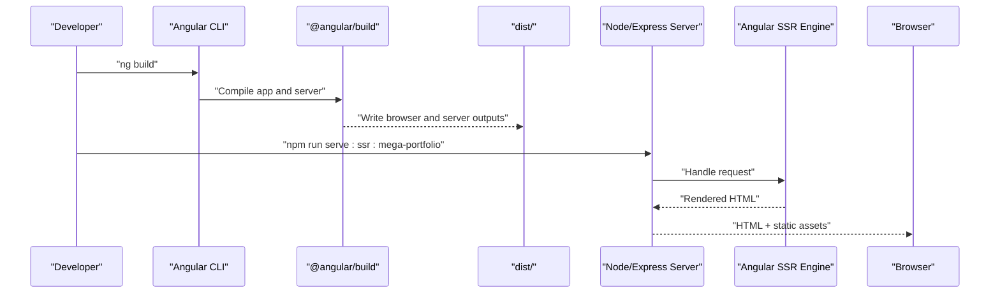
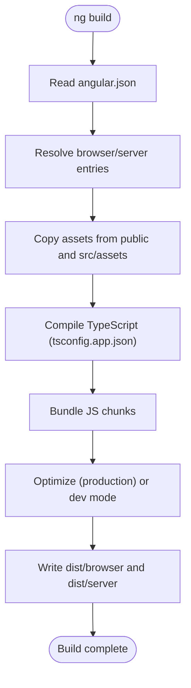
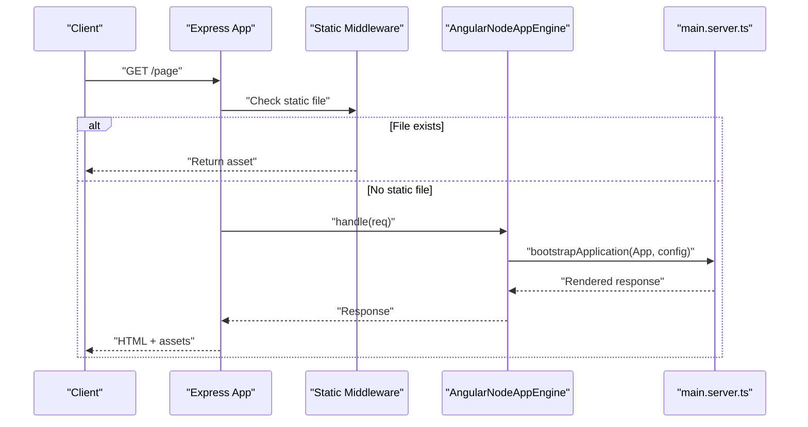
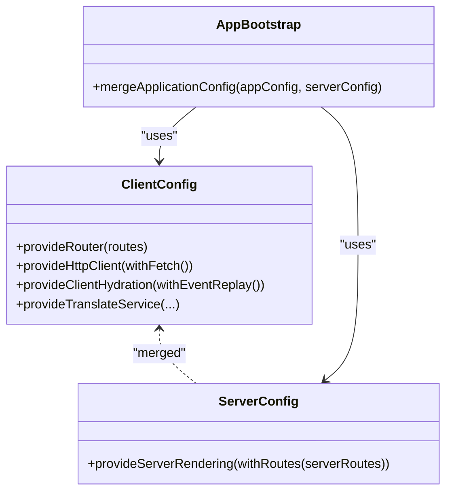
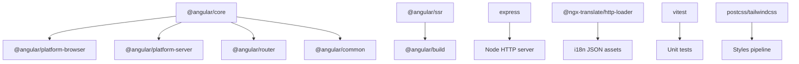

# Build & Deployment

<cite>
**Referenced Files in This Document**
- [package.json](file://package.json)
- [angular.json](file://angular.json)
- [tsconfig.app.json](file://tsconfig.app.json)
- [tsconfig.json](file://tsconfig.json)
- [src/main.server.ts](file://src/main.server.ts)
- [src/server.ts](file://src/server.ts)
- [src/app/app.config.ts](file://src/app/app.config.ts)
- [src/app/app.config.server.ts](file://src/app/app.config.server.ts)
- [README.md](file://README.md)
</cite>

## Table of Contents
1. [Introduction](#introduction)
2. [Project Structure](#project-structure)
3. [Core Components](#core-components)
4. [Architecture Overview](#architecture-overview)
5. [Detailed Component Analysis](#detailed-component-analysis)
6. [Dependency Analysis](#dependency-analysis)
7. [Performance Considerations](#performance-considerations)
8. [Troubleshooting Guide](#troubleshooting-guide)
9. [Conclusion](#conclusion)
10. [Appendices](#appendices)

## Introduction
This document provides comprehensive build and deployment guidance for the MegaPortfolio application, an Angular 21 project with Server-Side Rendering (SSR). It covers development builds using Angular CLI, production optimizations, SSR setup with Express, environment configuration, security headers, performance monitoring, CI/CD integration, testing automation, and troubleshooting common issues. The goal is to enable reliable local development, optimized production builds, and smooth deployments across static hosting, cloud platforms, and containerized environments.

## Project Structure
MegaPortfolio follows a standard Angular workspace layout:
- Application source code under src/app with feature modules and shared components
- Assets under public and src/assets
- SSR server entry points under src/server.ts and src/main.server.ts
- Angular CLI configuration in angular.json
- TypeScript configurations in tsconfig.json and tsconfig.app.json
- Scripts and dependencies in package.json

**Diagram sources**
- [angular.json:22-51](file://angular.json#L22-L51)
- [angular.json:52-74](file://angular.json#L52-L74)
- [package.json:4-11](file://package.json#L4-L11)
- [src/server.ts:10-48](file://src/server.ts#L10-L48)
- [src/main.server.ts:1-9](file://src/main.server.ts#L1-L9)
- [src/app/app.config.ts:10-25](file://src/app/app.config.ts#L10-L25)
- [src/app/app.config.server.ts:6-12](file://src/app/app.config.server.ts#L6-L12)
- [tsconfig.json:4-17](file://tsconfig.json#L4-L17)
- [tsconfig.app.json:5-12](file://tsconfig.app.json#L5-L12)

**Section sources**
- [angular.json:1-95](file://angular.json#L1-L95)
- [package.json:1-49](file://package.json#L1-L49)
- [tsconfig.json:1-34](file://tsconfig.json#L1-L34)
- [tsconfig.app.json:1-24](file://tsconfig.app.json#L1-L24)
- [src/server.ts:1-69](file://src/server.ts#L1-L69)
- [src/main.server.ts:1-9](file://src/main.server.ts#L1-L9)
- [src/app/app.config.ts:1-26](file://src/app/app.config.ts#L1-L26)
- [src/app/app.config.server.ts:1-13](file://src/app/app.config.server.ts#L1-L13)

## Core Components
Key build and runtime components:
- Angular CLI configuration defines build targets, assets, styles, SSR entry, and output modes
- Node.js Express server serves static browser artifacts and handles SSR requests
- Client and server application configs provide hydration and server rendering providers
- TypeScript settings enforce strict compilation and path aliases for clean imports

**Section sources**
- [angular.json:22-74](file://angular.json#L22-L74)
- [src/server.ts:10-48](file://src/server.ts#L10-L48)
- [src/app/app.config.ts:10-25](file://src/app/app.config.ts#L10-L25)
- [src/app/app.config.server.ts:6-12](file://src/app/app.config.server.ts#L6-L12)
- [tsconfig.json:4-17](file://tsconfig.json#L4-L17)
- [tsconfig.app.json:5-12](file://tsconfig.app.json#L5-L12)

## Architecture Overview
The build and runtime architecture integrates Angular CLI, SSR, and Express:
- Development: ng serve compiles on-the-fly and serves via dev-server
- Production: ng build generates optimized client bundles and server bundle; serve:ssr runs the Express server
- SSR flow: Express serves static assets and delegates non-static routes to AngularNodeAppEngine, which bootstraps the app via main.server.ts

**Diagram sources**
- [package.json:4-11](file://package.json#L4-L11)
- [angular.json:22-51](file://angular.json#L22-L51)
- [src/server.ts:10-48](file://src/server.ts#L10-L48)
- [src/main.server.ts:1-9](file://src/main.server.ts#L1-L9)

**Section sources**
- [package.json:4-11](file://package.json#L4-L11)
- [angular.json:22-51](file://angular.json#L22-L51)
- [src/server.ts:10-48](file://src/server.ts#L10-L48)
- [src/main.server.ts:1-9](file://src/main.server.ts#L1-L9)

## Detailed Component Analysis

### Angular CLI Build Configuration
- Build target uses @angular/build:application with browser and server entries
- Assets are copied from public and src/assets into dist
- Styles include fonts and global SCSS
- SSR entry is configured for server-side rendering
- Production configuration enables budgets, hashing, and optimization flags
- Development configuration disables optimization and enables source maps

**Diagram sources**
- [angular.json:22-51](file://angular.json#L22-L51)
- [angular.json:52-74](file://angular.json#L52-L74)
- [tsconfig.app.json:5-12](file://tsconfig.app.json#L5-L12)

**Section sources**
- [angular.json:22-74](file://angular.json#L22-L74)
- [tsconfig.app.json:1-24](file://tsconfig.app.json#L1-L24)

### SSR Server Setup (Express)
- Express serves static files from dist/browser with long cache headers
- Non-static requests are handled by AngularNodeAppEngine
- The server listens on PORT or defaults to 4000
- Request handler exported for Angular CLI and Firebase Cloud Functions

**Diagram sources**
- [src/server.ts:10-48](file://src/server.ts#L10-L48)
- [src/main.server.ts:1-9](file://src/main.server.ts#L1-L9)

**Section sources**
- [src/server.ts:1-69](file://src/server.ts#L1-L69)
- [src/main.server.ts:1-9](file://src/main.server.ts#L1-L9)

### Client and Server Application Configs
- Client config provides Router, HttpClient, hydration with event replay, and i18n loader
- Server config merges client config with server rendering providers and server routes

**Diagram sources**
- [src/app/app.config.ts:10-25](file://src/app/app.config.ts#L10-L25)
- [src/app/app.config.server.ts:6-12](file://src/app/app.config.server.ts#L6-L12)

**Section sources**
- [src/app/app.config.ts:1-26](file://src/app/app.config.ts#L1-L26)
- [src/app/app.config.server.ts:1-13](file://src/app/app.config.server.ts#L1-L13)

### TypeScript Compilation Settings
- Strict compiler options ensure type safety and consistent behavior
- Target ES2022 and preserve module for modern bundling
- Path aliases simplify imports across core, shared, and features

**Section sources**
- [tsconfig.json:4-17](file://tsconfig.json#L4-L17)
- [tsconfig.app.json:5-12](file://tsconfig.app.json#L5-L12)

## Dependency Analysis
Dependencies relevant to build and deployment:
- Angular platform packages for browser and server rendering
- Express for SSR server
- i18n loader for translations
- Testing tools (Vitest) and PostCSS/Tailwind for styling pipeline

**Diagram sources**
- [package.json:14-33](file://package.json#L14-L33)
- [package.json:34-47](file://package.json#L34-L47)

**Section sources**
- [package.json:14-47](file://package.json#L14-L47)

## Performance Considerations
Production build optimizations:
- Budgets enforce initial bundle size limits and per-component style limits
- Output hashing ensures cache busting for assets
- Optimization enabled in production configuration
- Long-term caching for static assets via maxAge header
- Hydration with event replay improves interactivity post-hydration

Recommendations:
- Monitor bundle sizes using Angular CLI’s built-in reports
- Use lazy loading for large feature modules
- Preload critical resources and defer non-critical scripts
- Enable compression at the hosting layer (gzip/brotli)
- Configure CDN for static assets

[No sources needed since this section provides general guidance]

## Troubleshooting Guide
Common build and deployment issues:
- Missing SSR entry: Ensure angular.json ssr.entry points to the correct server file
- Static assets not served: Verify browserDistFolder path and express.static middleware configuration
- Port conflicts: Set PORT environment variable or adjust server.listen default
- Hydration mismatches: Check that client and server providers match and avoid DOM APIs during server render
- i18n assets missing: Confirm assets prefix/suffix and availability under assets/i18n
- Test failures: Ensure jsdom and vitest are installed and configured

Debugging steps:
- Run ng build --configuration=development to inspect source maps
- Inspect dist/browser and dist/server outputs for expected files
- Validate Express logs for errors during SSR handling
- Use browser devtools to check network requests and hydration warnings

**Section sources**
- [angular.json:48-50](file://angular.json#L48-L50)
- [src/server.ts:10-36](file://src/server.ts#L10-L36)
- [src/server.ts:54-63](file://src/server.ts#L54-L63)
- [src/app/app.config.ts:16-23](file://src/app/app.config.ts#L16-L23)

## Conclusion
MegaPortfolio leverages Angular CLI for robust builds and SSR with Express for dynamic rendering. By following the provided configurations and best practices, you can achieve efficient development workflows, optimized production builds, and reliable deployments across multiple environments. Adopting performance monitoring, security headers, and CI/CD automation will further enhance reliability and user experience.

[No sources needed since this section summarizes without analyzing specific files]

## Appendices

### Development Build Commands
- Start dev server: npm start (ng serve)
- Watch mode: npm run watch (ng build --watch --configuration development)
- Unit tests: npm test (ng test)

**Section sources**
- [package.json:4-11](file://package.json#L4-L11)
- [README.md:5-13](file://README.md#L5-L13)
- [README.md:29-37](file://README.md#L29-L37)
- [README.md:39-45](file://README.md#L39-L45)

### Production Build and SSR Execution
- Build production: npm run build (ng build)
- Serve SSR: npm run serve:ssr:mega-portfolio (node dist/mega-portfolio/server/server.mjs)

**Section sources**
- [package.json:4-11](file://package.json#L4-L11)
- [README.md:29-37](file://README.md#L29-L37)

### Environment Variables and Security Headers
- PORT: Used by Express server to determine listening port
- Security headers: Add custom middleware in Express to set headers like Content-Security-Policy, X-Frame-Options, etc.
- Allowed hosts: Configure allowedHosts in angular.json security options for development

**Section sources**
- [src/server.ts:54-63](file://src/server.ts#L54-L63)
- [angular.json:45-47](file://angular.json#L45-L47)

### Deployment Scenarios
- Static hosting: Deploy dist/browser contents to services like Netlify, Vercel, or GitHub Pages
- Cloud platforms: Use Firebase Cloud Functions with reqHandler export or deploy Express server on AWS/GCP/Azure
- Containerized: Create Dockerfile to install dependencies, build app, and run Express server

[No sources needed since this section provides general guidance]

### CI/CD Pipeline Integration
- Install dependencies: npm ci
- Run linting and unit tests: npm test
- Build production: npm run build
- Upload artifacts: Publish dist/browser for static hosting or package server bundle for cloud/container deployment

[No sources needed since this section provides general guidance]