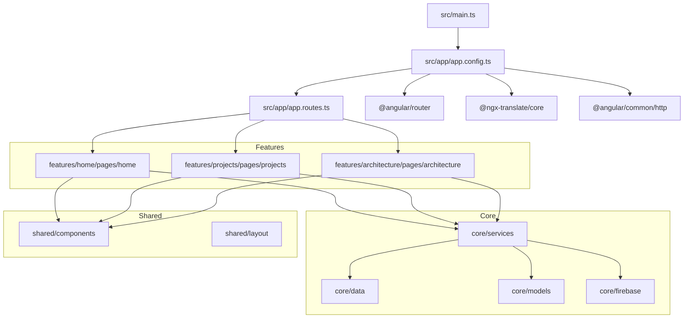
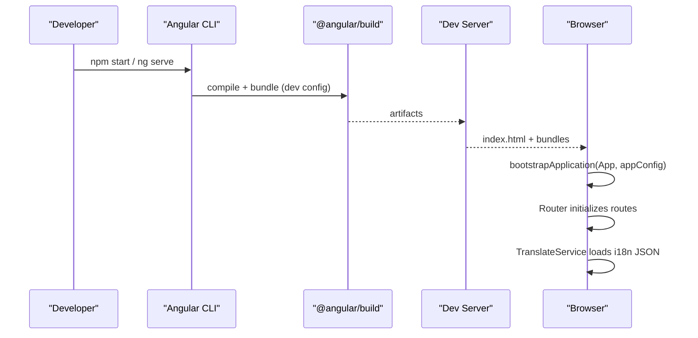
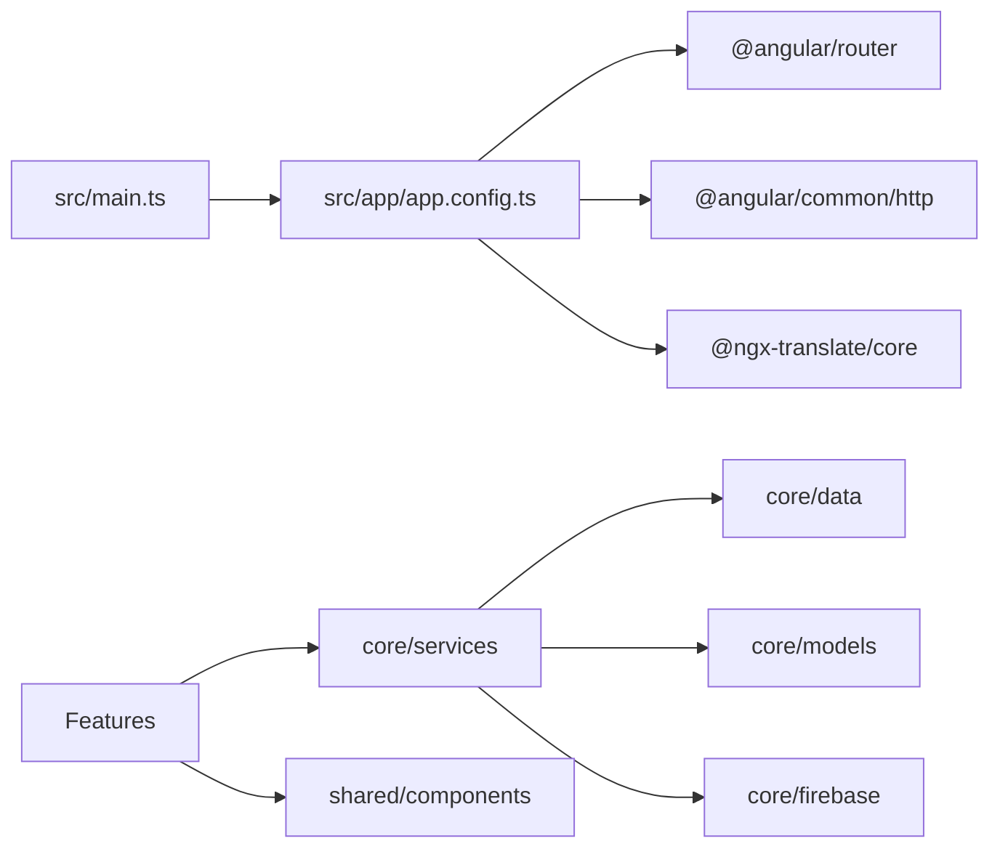

# Contributing Guide

<cite>
**Referenced Files in This Document**
- [package.json](file://package.json)
- [README.md](file://README.md)
- [angular.json](file://angular.json)
- [.prettierrc](file://.prettierrc)
- [.editorconfig](file://.editorconfig)
- [tsconfig.json](file://tsconfig.json)
- [tsconfig.spec.json](file://tsconfig.spec.json)
- [.gitignore](file://.gitignore)
- [src/main.ts](file://src/main.ts)
- [src/app/app.config.ts](file://src/app/app.config.ts)
- [src/app/app.spec.ts](file://src/app/app.spec.ts)
</cite>

## Table of Contents
1. Introduction
2. Project Structure
3. Core Components
4. Architecture Overview
5. Detailed Component Analysis
6. Dependency Analysis
7. Performance Considerations
8. Troubleshooting Guide
9. Conclusion
10. Appendices

## Introduction
This guide explains how to contribute to the MegaPortfolio project. It covers development workflow, branch and commit conventions, pull request process, code style standards (Prettier and EditorConfig), project structure conventions, testing requirements, code review and quality gates, environment setup, debugging techniques, local testing procedures, issue reporting, feature requests, community standards, and licensing considerations.

## Project Structure
MegaPortfolio is an Angular application with a feature-based layout under src/app:
- app/core: shared services, data, models, Firebase integration, interceptors, and utilities
- app/features: domain-driven features (home, projects, architecture, blog, contact, experience) each containing pages and components
- app/shared: reusable UI components, directives, pipes, and layout shell
- assets/i18n: internationalization JSON files
- public: static assets served as-is

Key configuration:
- angular.json defines build/serve/test targets, styles, SSR entry, and production budgets
- tsconfig.json enforces strict TypeScript and Angular compiler options
- tsconfig.spec.json configures Vitest for unit tests
- package.json provides scripts for dev, build, test, and SSR server

**Diagram sources**
- [src/main.ts:1-7](file://src/main.ts#L1-L7)
- [src/app/app.config.ts:1-26](file://src/app/app.config.ts#L1-L26)
- [angular.json:1-95](file://angular.json#L1-L95)

**Section sources**
- [angular.json:14-91](file://angular.json#L14-L91)
- [src/main.ts:1-7](file://src/main.ts#L1-L7)
- [src/app/app.config.ts:1-26](file://src/app/app.config.ts#L1-L26)

## Core Components
- Application bootstrap: main.ts bootstraps the root component using the application configuration.
- App configuration: app.config.ts wires routing, HTTP client, hydration, and i18n translation service.
- Testing baseline: app.spec.ts demonstrates the expected test pattern using TestBed.

Development workflow highlights:
- Start dev server: npm start or ng serve
- Build: npm run build
- Test: npm run test (Vitest via Angular CLI)
- SSR server: npm run serve:ssr:mega-portfolio

Quality and style:
- Prettier configured for single quotes and Angular HTML parser
- EditorConfig enforces UTF-8, 2-space indentation, trailing newline, and TS single quotes
- Strict TypeScript and Angular compiler flags enabled

**Section sources**
- [src/main.ts:1-7](file://src/main.ts#L1-L7)
- [src/app/app.config.ts:1-26](file://src/app/app.config.ts#L1-L26)
- [src/app/app.spec.ts:1-24](file://src/app/app.spec.ts#L1-L24)
- [.prettierrc:1-13](file://.prettierrc#L1-L13)
- [.editorconfig:1-18](file://.editorconfig#L1-L18)
- [tsconfig.json:1-34](file://tsconfig.json#L1-L34)
- [package.json:1-49](file://package.json#L1-L49)

## Architecture Overview
The application follows Angular best practices:
- Single entry point bootstraps the app with providers and routes
- Feature modules are organized by domain with pages and components
- Shared UI and layout components are reused across features
- Internationalization is provided via @ngx-translate with JSON resources
- SSR is configured through Angular’s SSR builder and entry points

**Diagram sources**
- [package.json:4-11](file://package.json#L4-L11)
- [angular.json:22-51](file://angular.json#L22-L51)
- [src/main.ts:1-7](file://src/main.ts#L1-L7)
- [src/app/app.config.ts:10-25](file://src/app/app.config.ts#L10-L25)

## Detailed Component Analysis

### Development Workflow and Branching
Recommended flow:
- Create a feature branch from main: feature/<short-description>
- Keep commits focused and descriptive
- Open a Pull Request (PR) targeting main
- Ensure all checks pass (lint, format, tests, build)
- Request reviews from maintainers
- Squash and merge after approval

Commit message convention (suggested):
- type(scope): description
- types: feat, fix, docs, style, refactor, test, chore
- scope: module or area (e.g., home, projects, core)
- description: imperative, lowercase, no period

Pull request checklist:
- Tests added/updated and passing
- No console errors or warnings
- Follows code style (Prettier, EditorConfig)
- Self-reviewed and documented if needed
- Updated README or comments where relevant

[No sources needed since this section provides general guidance]

### Code Style Standards
- Prettier:
  - Print width: 100
  - Single quotes
  - Angular HTML parser for *.html
- EditorConfig:
  - UTF-8, 2 spaces, final newline, trim trailing whitespace
  - TS files use single quotes
- TypeScript/Angular:
  - Strict mode and strict templates enabled
  - Target ES2022, module preserve

Run formatting:
- Use your editor’s “Format on Save” with Prettier
- Or run formatter via npm scripts if configured

**Section sources**
- [.prettierrc:1-13](file://.prettierrc#L1-L13)
- [.editorconfig:1-18](file://.editorconfig#L1-L18)
- [tsconfig.json:5-23](file://tsconfig.json#L5-L23)

### Project Structure Conventions and Naming
- Feature folders under src/app/features/<feature-name>/pages/<feature-name>/
- Components co-located with their page or placed in shared/components when reused
- Services under core/services or feature-specific services
- Data and models under core/data and core/models
- Styles: SCSS per component/page; global styles in src/styles.scss
- i18n keys under assets/i18n/*.json

Naming patterns:
- PascalCase for components, services, and classes
- camelCase for functions, variables, and methods
- kebab-case for file names and CSS classes
- HTML templates paired with .html next to .ts

**Section sources**
- [angular.json:14-42](file://angular.json#L14-L42)
- [src/app/app.config.ts:16-23](file://src/app/app.config.ts#L16-L23)

### Testing Requirements
- Framework: Vitest via Angular CLI
- Config: tsconfig.spec.json includes spec files and globals
- Pattern: Each component/page has a corresponding .spec.ts
- Run tests: npm run test

Test guidelines:
- Unit tests for services and pure logic
- Component tests render and assert behavior
- Avoid heavy async unless necessary; mock external dependencies
- Keep tests deterministic and fast

**Section sources**
- [tsconfig.spec.json:1-16](file://tsconfig.spec.json#L1-L16)
- [src/app/app.spec.ts:1-24](file://src/app/app.spec.ts#L1-L24)
- [package.json:9](file://package.json#L9)

### Code Review and Quality Gates
Quality gates:
- Lint/format passes (Prettier)
- All unit tests pass
- Build succeeds in both development and production configurations
- No regressions in key user flows

Review process:
- At least one maintainer review
- Address feedback promptly
- Re-run tests and build before requesting re-review

[No sources needed since this section provides general guidance]

### Setup Instructions
Prerequisites:
- Node.js LTS recommended
- npm (project specifies packageManager)

Setup steps:
- Install dependencies: npm install
- Start dev server: npm start
- Build: npm run build
- Run tests: npm run test
- SSR server: npm run serve:ssr:mega-portfolio

Environment notes:
- Development uses source maps and unoptimized builds
- Production enables budgets and output hashing

**Section sources**
- [package.json:4-11](file://package.json#L4-L11)
- [angular.json:52-74](file://angular.json#L52-L74)

### Debugging Techniques
- Browser DevTools: breakpoints in TS sources thanks to source maps
- Angular DevTools: inspect components, routes, and state
- Logging: use console logs sparingly; prefer structured logging in services
- SSR debugging: run SSR locally and inspect server logs

**Section sources**
- [angular.json:68-73](file://angular.json#L68-L73)

### Local Testing Procedures
- Unit tests: npm run test
- Coverage: optional via Vitest coverage plugin if configured
- Visual regression: not configured by default; add tools as needed

**Section sources**
- [tsconfig.spec.json:1-16](file://tsconfig.spec.json#L1-L16)
- [package.json:9](file://package.json#L9)

### Issue Reporting Guidelines
When opening an issue:
- Search existing issues first
- Provide a clear title and description
- Include steps to reproduce, expected vs actual behavior
- Attach screenshots or logs if applicable
- Specify environment (OS, browser, Node version)

Feature Requests:
- Describe the problem and proposed solution
- Explain benefits and potential trade-offs
- Link related issues or discussions

Community Standards:
- Be respectful and inclusive
- Follow the repository’s contribution guidelines
- Keep discussions focused and constructive

[No sources needed since this section provides general guidance]

### Licensing and Legal Considerations
- Check LICENSE file at repository root for exact terms
- Contributions are typically licensed under the same license as the project
- Do not include third-party code without proper attribution and licenses
- Respect trademarks and open-source obligations

[No sources needed since this section provides general guidance]

## Dependency Analysis
High-level dependency relationships:
- Bootstrap: main.ts -> app.config.ts -> router, http, translate
- Features depend on core services and shared components
- SSR configured via angular.json and server entry

**Diagram sources**
- [src/main.ts:1-7](file://src/main.ts#L1-L7)
- [src/app/app.config.ts:1-26](file://src/app/app.config.ts#L1-L26)

**Section sources**
- [package.json:14-33](file://package.json#L14-L33)
- [angular.json:22-51](file://angular.json#L22-L51)

## Performance Considerations
- Production builds enable optimization and hashing
- Budgets warn/error on initial bundle size and per-component styles
- Prefer lazy loading for large feature routes
- Minimize heavy synchronous operations in components
- Use OnPush change detection where appropriate

**Section sources**
- [angular.json:52-74](file://angular.json#L52-L74)

## Troubleshooting Guide
Common issues:
- Port conflicts: ensure port 4200 is free or configure a different port
- Module resolution errors: verify imports and paths
- SSR issues: check server entry and environment variables
- Test failures: ensure mocks align with current interfaces

Diagnostics:
- Enable verbose logging in Angular CLI
- Inspect network tab for asset loading issues
- Validate i18n JSON files for syntax errors

**Section sources**
- [angular.json:68-74](file://angular.json#L68-L74)
- [src/app/app.config.ts:16-23](file://src/app/app.config.ts#L16-L23)

## Conclusion
By following this guide, contributors can set up the environment, write consistent and testable code, and collaborate effectively. Adhering to the branching, commit, and review processes ensures high-quality contributions that integrate smoothly into the project.

## Appendices

### Quick Commands Reference
- Start dev server: npm start
- Build: npm run build
- Test: npm run test
- SSR server: npm run serve:ssr:mega-portfolio

**Section sources**
- [package.json:4-11](file://package.json#L4-L11)