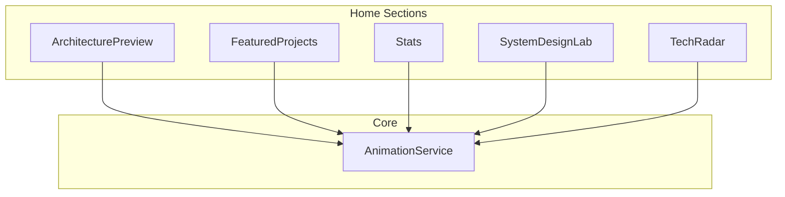
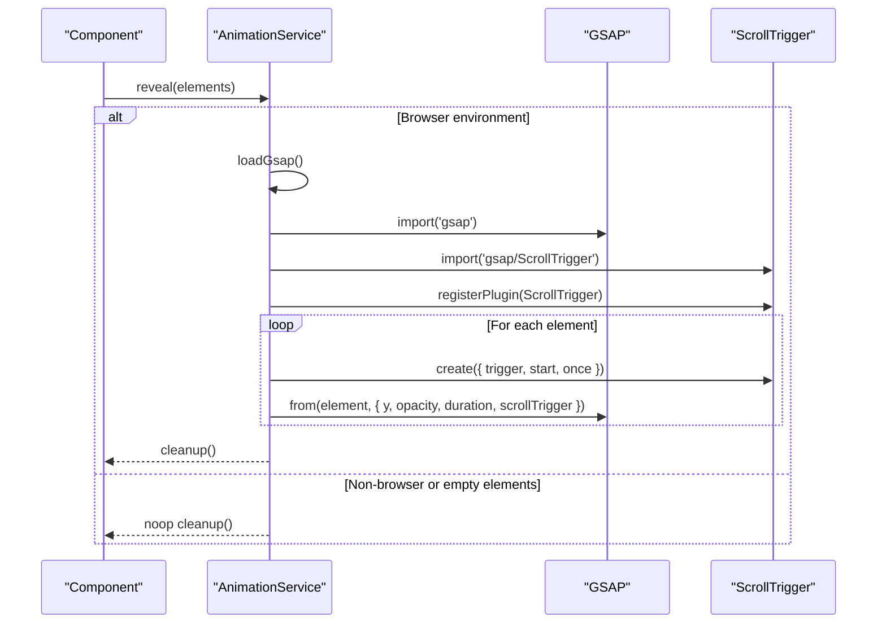
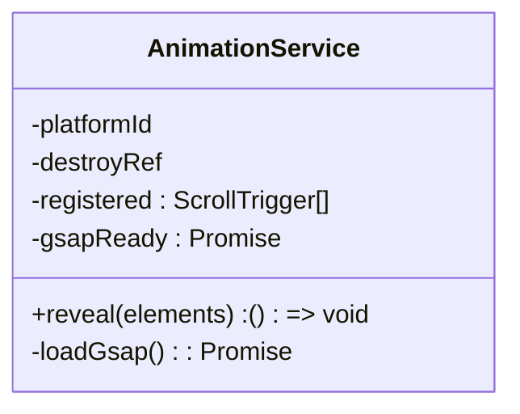
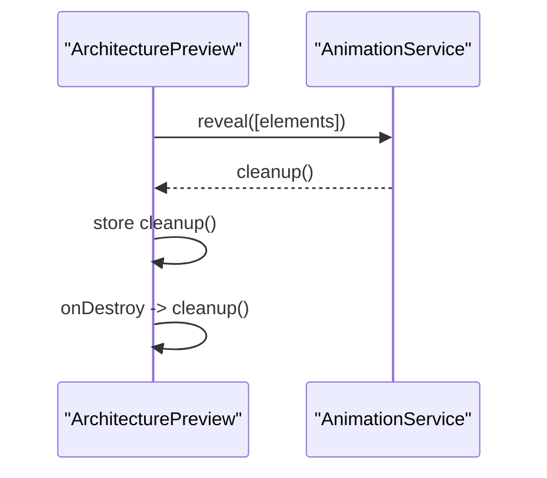
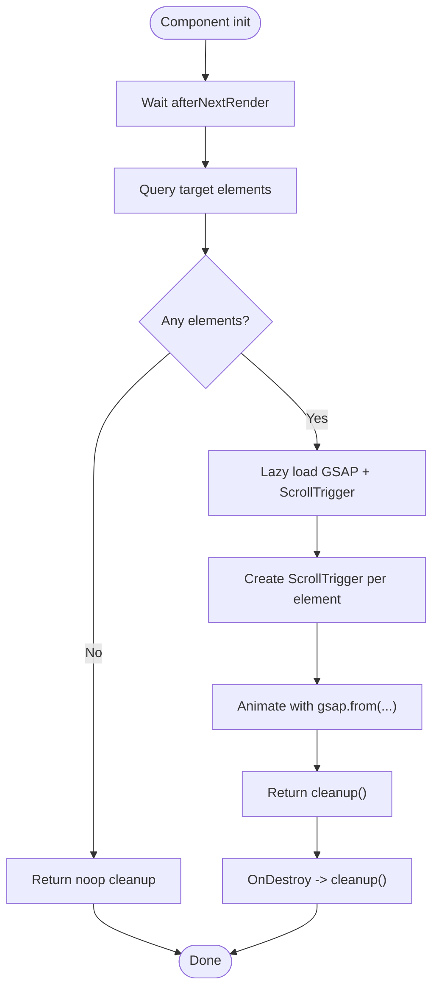
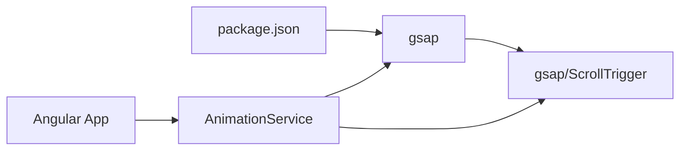

# Animation System Service

<cite>
**Referenced Files in This Document**
- [animation.service.ts](file://src/app/core/services/animation.service.ts)
- [architecture-preview.ts](file://src/app/features/home/sections/architecture-preview/architecture-preview.ts)
- [featured-projects.ts](file://src/app/features/home/sections/featured-projects/featured-projects.ts)
- [stats.ts](file://src/app/features/home/sections/stats/stats.ts)
- [system-design-lab.ts](file://src/app/features/home/sections/system-design-lab/system-design-lab.ts)
- [tech-radar.ts](file://src/app/features/home/sections/tech-radar/tech-radar.ts)
- [package.json](file://package.json)
</cite>

## Table of Contents
1. [Introduction](#introduction)
2. [Project Structure](#project-structure)
3. [Core Components](#core-components)
4. [Architecture Overview](#architecture-overview)
5. [Detailed Component Analysis](#detailed-component-analysis)
6. [Dependency Analysis](#dependency-analysis)
7. [Performance Considerations](#performance-considerations)
8. [Troubleshooting Guide](#troubleshooting-guide)
9. [Conclusion](#conclusion)

## Introduction
This document explains the AnimationService that integrates GSAP with Angular to deliver scroll-triggered animations while preventing memory leaks through robust cleanup and subscription management. It covers how components use the service, lifecycle hooks for safe initialization and teardown, and best practices for performance, accessibility, and browser compatibility.

## Project Structure
The animation system centers around a single core service and several feature components that consume it:
- Core service: AnimationService (GSAP integration, ScrollTrigger management, cleanup)
- Feature components: ArchitecturePreview, FeaturedProjects, Stats, SystemDesignLab, TechRadar
- Dependency declaration: GSAP is listed as a runtime dependency

**Diagram sources**
- [animation.service.ts](file://src/app/core/services/animation.service.ts)
- [architecture-preview.ts](file://src/app/features/home/sections/architecture-preview/architecture-preview.ts)
- [featured-projects.ts](file://src/app/features/home/sections/featured-projects/featured-projects.ts)
- [stats.ts](file://src/app/features/home/sections/stats/stats.ts)
- [system-design-lab.ts](file://src/app/features/home/sections/system-design-lab/system-design-lab.ts)
- [tech-radar.ts](file://src/app/features/home/sections/tech-radar/tech-radar.ts)

**Section sources**
- [animation.service.ts](file://src/app/core/services/animation.service.ts)
- [package.json](file://package.json)

## Core Components
- AnimationService
  - Provides a single method reveal(elements) that creates ScrollTrigger instances and GSAP animations for each element.
  - Lazily loads GSAP and ScrollTrigger only when needed.
  - Tracks all created triggers and ensures they are killed on component destruction or when explicitly cleaned up.
  - Guards against server-side rendering by checking platform before running any DOM-dependent code.

- Consuming Components
  - Use afterNextRender to safely access DOM elements after Angular renders them.
  - Query scoped elements within the component host using ElementRef.
  - Store the cleanup function returned by reveal and call it on DestroyRef.onDestroy to prevent memory leaks.

Key responsibilities:
- Safe initialization: defer until DOM is ready and available in the browser.
- Resource management: lazy load GSAP, track ScrollTrigger instances, kill on cleanup.
- SSR safety: no-op on non-browser platforms.

**Section sources**
- [animation.service.ts](file://src/app/core/services/animation.service.ts)
- [architecture-preview.ts](file://src/app/features/home/sections/architecture-preview/architecture-preview.ts)
- [featured-projects.ts](file://src/app/features/home/sections/featured-projects/featured-projects.ts)
- [stats.ts](file://src/app/features/home/sections/stats/stats.ts)
- [system-design-lab.ts](file://src/app/features/home/sections/system-design-lab/system-design-lab.ts)
- [tech-radar.ts](file://src/app/features/home/sections/tech-radar/tech-radar.ts)

## Architecture Overview
The service encapsulates GSAP usage behind a simple API. Components request animations for specific elements and receive a cleanup function to ensure proper teardown.

**Diagram sources**
- [animation.service.ts](file://src/app/core/services/animation.service.ts)

## Detailed Component Analysis

### AnimationService
Responsibilities:
- Lazy loading of GSAP and ScrollTrigger to avoid unnecessary bundle weight.
- Centralized tracking of ScrollTrigger instances to enable bulk cleanup.
- Returning a per-call cleanup function that kills only the triggers created by that call.
- Global cleanup via DestroyRef to handle service-level teardown.

Memory leak prevention:
- All ScrollTrigger instances are stored and killed either by the per-call cleanup or by the service’s onDestroy hook.
- The cleanup removes references from the internal registry to allow garbage collection.

SSR safety:
- Early return with a no-op cleanup when not in the browser or when no elements are provided.

**Diagram sources**
- [animation.service.ts](file://src/app/core/services/animation.service.ts)

**Section sources**
- [animation.service.ts](file://src/app/core/services/animation.service.ts)

### Component Integration Patterns

#### ArchitecturePreview
- Uses afterNextRender to query .architecture elements inside its host.
- Calls reveal and stores the cleanup function.
- Registers cleanup on DestroyRef.onDestroy.

**Diagram sources**
- [architecture-preview.ts](file://src/app/features/home/sections/architecture-preview/architecture-preview.ts)
- [animation.service.ts](file://src/app/core/services/animation.service.ts)

**Section sources**
- [architecture-preview.ts](file://src/app/features/home/sections/architecture-preview/architecture-preview.ts)

#### FeaturedProjects
- Queries .project-card elements within its host.
- Follows the same pattern: afterNextRender -> reveal -> store cleanup -> onDestroy.

**Section sources**
- [featured-projects.ts](file://src/app/features/home/sections/featured-projects/featured-projects.ts)

#### Stats
- Queries .stat-card elements within its host.
- Same lifecycle pattern as other components.

**Section sources**
- [stats.ts](file://src/app/features/home/sections/stats/stats.ts)

#### SystemDesignLab
- Queries .lab elements within its host.
- Demonstrates usage alongside an Angular signal for tab state.

**Section sources**
- [system-design-lab.ts](file://src/app/features/home/sections/system-design-lab/system-design-lab.ts)

#### TechRadar
- Queries .radar-card elements within its host.
- Consistent lifecycle and cleanup pattern.

**Section sources**
- [tech-radar.ts](file://src/app/features/home/sections/tech-radar/tech-radar.ts)

### Conceptual Overview
- Initialization: Defer until after render to ensure DOM nodes exist.
- Trigger creation: One ScrollTrigger per element with a consistent start threshold.
- Animation: Simple fade-in and slide-up effect tied to scroll visibility.
- Cleanup: Kill triggers and remove references to prevent memory leaks.

[No sources needed since this diagram shows conceptual workflow, not actual code structure]

## Dependency Analysis
External dependencies and their roles:
- GSAP and ScrollTrigger: Dynamically imported and registered at runtime to reduce initial bundle size and avoid SSR issues.
- Angular primitives: PLATFORM_ID for SSR checks, DestroyRef for lifecycle cleanup, afterNextRender for safe DOM access.

**Diagram sources**
- [package.json](file://package.json)
- [animation.service.ts](file://src/app/core/services/animation.service.ts)

**Section sources**
- [package.json](file://package.json)
- [animation.service.ts](file://src/app/core/services/animation.service.ts)

## Performance Considerations
- Lazy loading: GSAP and ScrollTrigger are loaded on demand, reducing initial payload.
- Minimal animations: Simple transforms (translateY and opacity) are GPU-friendly and performant.
- Single pass: Each element gets one ScrollTrigger; avoid re-querying or recreating triggers unnecessarily.
- Batch cleanup: Per-call cleanup returns a function that kills only relevant triggers, avoiding global scans.
- Avoid heavy work in scroll handlers: The service does not attach expensive logic to scroll events; animations are declarative.

Best practices:
- Keep animation durations short and consistent across sections.
- Prefer transform and opacity changes over layout-affecting properties.
- Reuse selectors and avoid deep queries where possible.
- Ensure elements exist before querying to prevent redundant operations.

[No sources needed since this section provides general guidance]

## Troubleshooting Guide
Common issues and resolutions:
- Animations do not run on the server
  - Cause: Running in non-browser environments.
  - Resolution: The service already guards with platform checks; ensure you are testing in the browser.

- Elements not animating
  - Cause: Elements not present when queried or wrong selectors.
  - Resolution: Use afterNextRender and verify selectors match rendered DOM.

- Memory leaks or warnings about destroyed instances
  - Cause: Not calling cleanup or relying solely on global destroy without per-call cleanup.
  - Resolution: Always store and invoke the cleanup function returned by reveal during component destruction.

- Duplicate animations after navigation
  - Cause: Re-creating triggers without cleaning up previous ones.
  - Resolution: Ensure cleanup runs before creating new triggers; rely on DestroyRef to auto-clean.

- Performance drops on long pages
  - Cause: Too many simultaneous animations or complex effects.
  - Resolution: Simplify effects, stagger if necessary, and limit concurrent animations.

Debugging techniques:
- Log the number of elements found before calling reveal.
- Temporarily disable ScrollTrigger registration to isolate GSAP vs. ScrollTrigger behavior.
- Use browser DevTools Memory panel to confirm triggers are being released after cleanup.

**Section sources**
- [animation.service.ts](file://src/app/core/services/animation.service.ts)
- [architecture-preview.ts](file://src/app/features/home/sections/architecture-preview/architecture-preview.ts)
- [featured-projects.ts](file://src/app/features/home/sections/featured-projects/featured-projects.ts)
- [stats.ts](file://src/app/features/home/sections/stats/stats.ts)
- [system-design-lab.ts](file://src/app/features/home/sections/system-design-lab/system-design-lab.ts)
- [tech-radar.ts](file://src/app/features/home/sections/tech-radar/tech-radar.ts)

## Conclusion
The AnimationService provides a clean, safe, and performant way to integrate GSAP-based scroll animations into Angular components. By leveraging lazy loading, explicit cleanup functions, and Angular’s lifecycle APIs, it prevents memory leaks and works reliably across SSR and client environments. Following the patterns shown here ensures maintainable, accessible, and high-performance animated experiences.