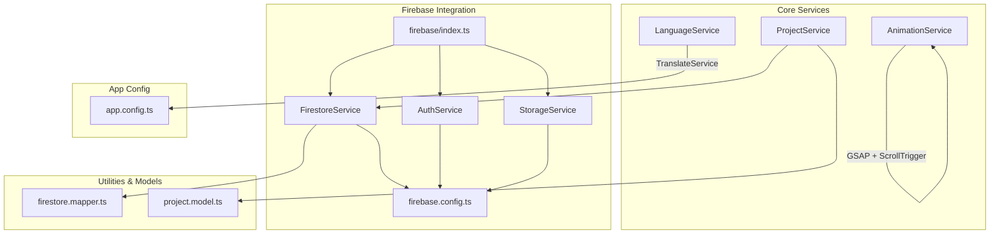
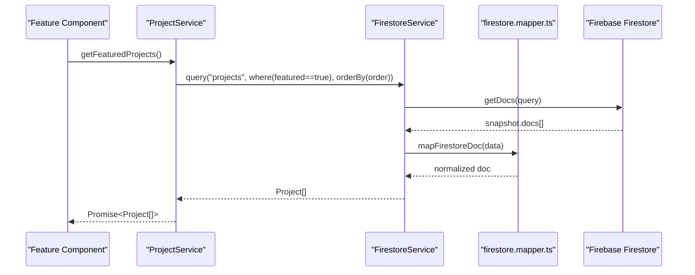
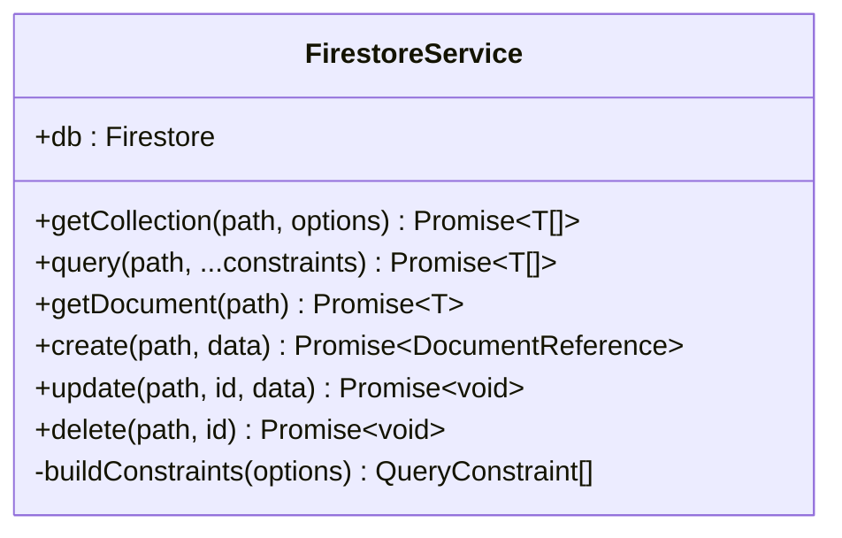
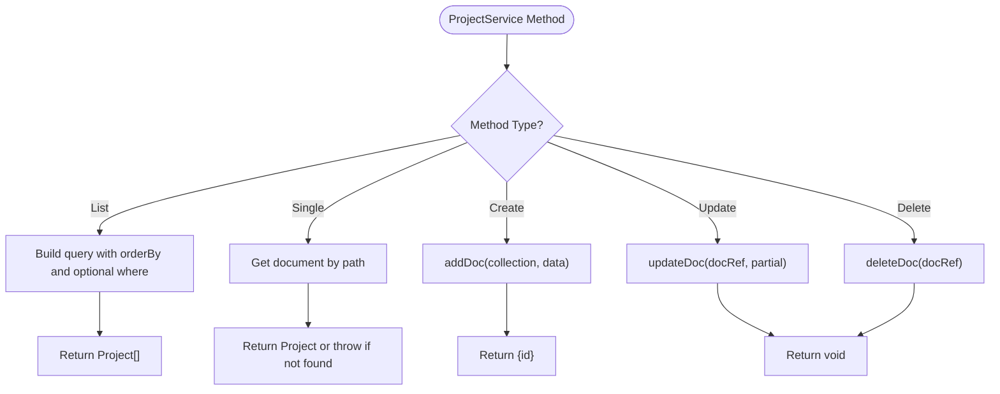
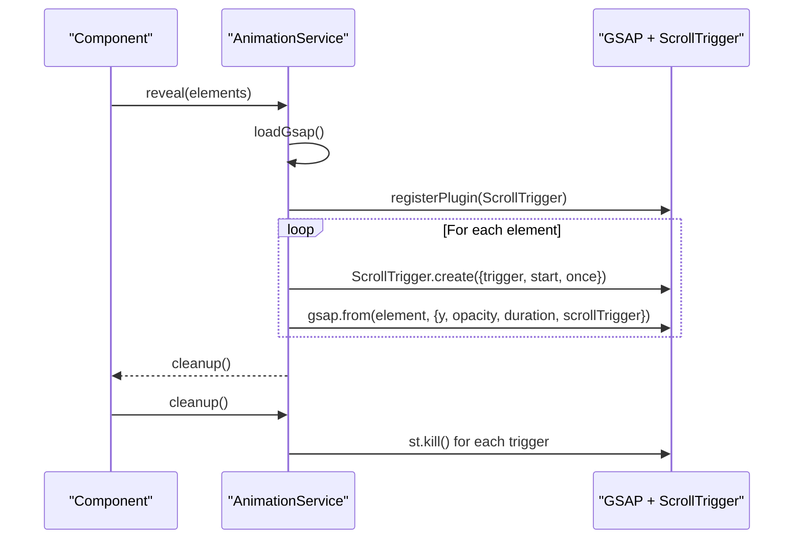
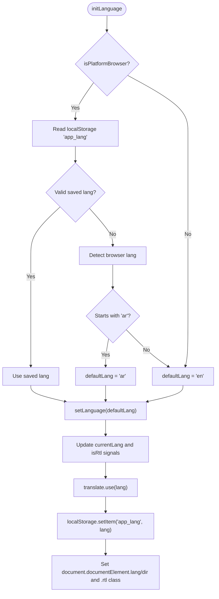
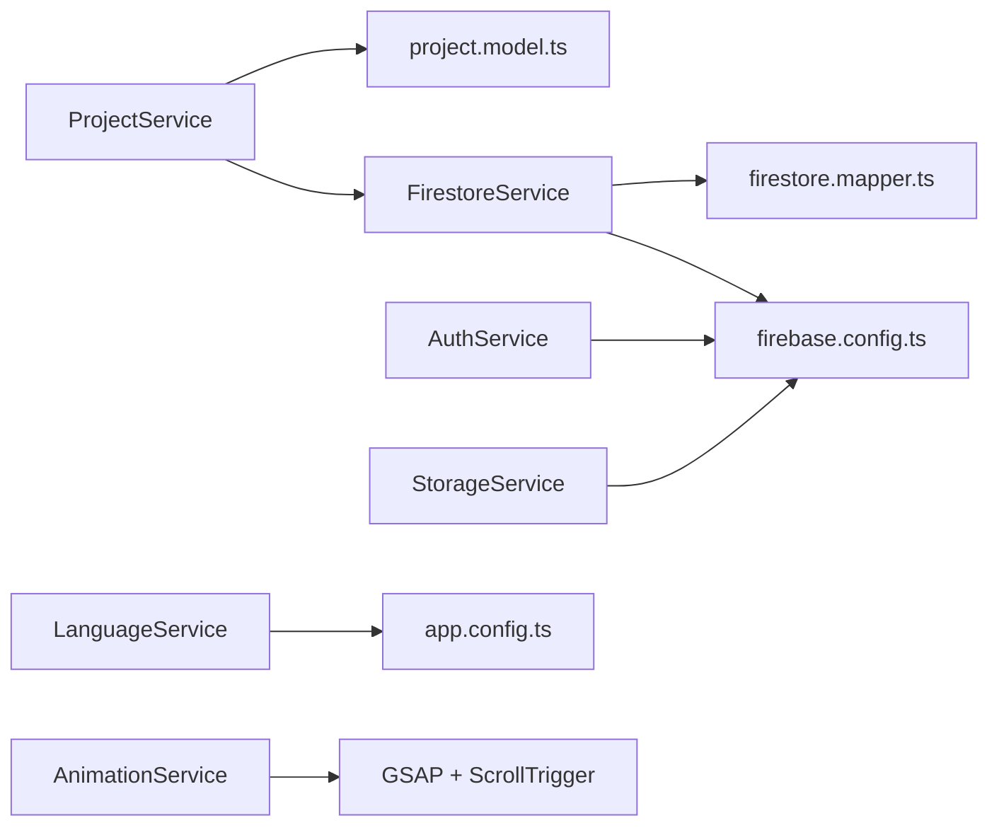

# Core Services

<cite>
**Referenced Files in This Document**
- [project.service.ts](file://src/app/core/services/project.service.ts)
- [animation.service.ts](file://src/app/core/services/animation.service.ts)
- [language.service.ts](file://src/app/core/services/language.service.ts)
- [firestore.service.ts](file://src/app/core/firebase/firestore.service.ts)
- [auth.service.ts](file://src/app/core/firebase/auth.service.ts)
- [storage.service.ts](file://src/app/core/firebase/storage.service.ts)
- [firebase.config.ts](file://src/app/core/firebase/firebase.config.ts)
- [index.ts](file://src/app/core/firebase/index.ts)
- [firestore.mapper.ts](file://src/app/core/utils/firestore.mapper.ts)
- [project.model.ts](file://src/app/core/models/project.model.ts)
- [app.config.ts](file://src/app/app.config.ts)
</cite>

## Table of Contents
1. [Introduction](#introduction)
2. [Project Structure](#project-structure)
3. [Core Components](#core-components)
4. [Architecture Overview](#architecture-overview)
5. [Detailed Component Analysis](#detailed-component-analysis)
6. [Dependency Analysis](#dependency-analysis)
7. [Performance Considerations](#performance-considerations)
8. [Troubleshooting Guide](#troubleshooting-guide)
9. [Conclusion](#conclusion)

## Introduction
This document provides comprehensive documentation for the core services layer of the MegaPortfolio application. It focuses on Firebase integration (Firestore, Authentication, Storage), data access and business logic via ProjectService, GSAP-based animations with scroll-triggered effects and memory leak prevention, and internationalization with RTL support through LanguageService. It also covers service configuration, dependency injection patterns, error handling strategies, public interfaces, usage examples, lifecycle management, caching strategies, and performance optimization techniques.

## Project Structure
The core services are organized under src/app/core:
- services: Application-level services (ProjectService, AnimationService, LanguageService)
- firebase: Firebase SDK wrappers and configuration (FirestoreService, AuthService, StorageService, firebase.config.ts, index.ts)
- utils: Shared utilities (Firestore document mapper)
- models: Domain types (Project model and related enums/constants)

**Diagram sources**
- [project.service.ts:10-59](file://src/app/core/services/project.service.ts#L10-L59)
- [animation.service.ts:7-71](file://src/app/core/services/animation.service.ts#L7-L71)
- [language.service.ts:10-61](file://src/app/core/services/language.service.ts#L10-L61)
- [firestore.service.ts:32-96](file://src/app/core/firebase/firestore.service.ts#L32-L96)
- [auth.service.ts:10-12](file://src/app/core/firebase/auth.service.ts#L10-L12)
- [storage.service.ts:10-12](file://src/app/core/firebase/storage.service.ts#L10-L12)
- [firebase.config.ts:12-12](file://src/app/core/firebase/firebase.config.ts#L12-L12)
- [index.ts:1-6](file://src/app/core/firebase/index.ts#L1-L6)
- [firestore.mapper.ts:5-18](file://src/app/core/utils/firestore.mapper.ts#L5-L18)
- [project.model.ts:1-44](file://src/app/core/models/project.model.ts#L1-L44)
- [app.config.ts:16-23](file://src/app/app.config.ts#L16-L23)

**Section sources**
- [project.service.ts:10-59](file://src/app/core/services/project.service.ts#L10-L59)
- [animation.service.ts:7-71](file://src/app/core/services/animation.service.ts#L7-L71)
- [language.service.ts:10-61](file://src/app/core/services/language.service.ts#L10-L61)
- [firestore.service.ts:32-96](file://src/app/core/firebase/firestore.service.ts#L32-L96)
- [auth.service.ts:10-12](file://src/app/core/firebase/auth.service.ts#L10-L12)
- [storage.service.ts:10-12](file://src/app/core/firebase/storage.service.ts#L10-L12)
- [firebase.config.ts:12-12](file://src/app/core/firebase/firebase.config.ts#L12-L12)
- [index.ts:1-6](file://src/app/core/firebase/index.ts#L1-L6)
- [firestore.mapper.ts:5-18](file://src/app/core/utils/firestore.mapper.ts#L5-L18)
- [project.model.ts:1-44](file://src/app/core/models/project.model.ts#L1-L44)
- [app.config.ts:16-23](file://src/app/app.config.ts#L16-L23)

## Core Components
- FirestoreService: A thin wrapper around Firebase Firestore providing typed query, getDocument, create, update, delete operations. It normalizes documents by mapping Firestore Timestamps to native Date objects.
- AuthService: Provides a singleton instance of Firebase Auth initialized with the app config.
- StorageService: Provides a singleton instance of Firebase Storage initialized with the app config.
- ProjectService: Business-layer service that encapsulates project-related queries and mutations using FirestoreService.
- AnimationService: Manages dynamic loading of GSAP and ScrollTrigger, creates scroll-triggered reveal animations, and ensures cleanup to prevent memory leaks.
- LanguageService: Manages current language, RTL layout direction, persistence in localStorage, and integrates with @ngx-translate/core.

Key responsibilities:
- Data access abstraction over Firestore
- Safe initialization and reuse of Firebase instances
- Clean animation lifecycle with automatic cleanup
- Internationalization with browser detection and persistence

**Section sources**
- [firestore.service.ts:32-96](file://src/app/core/firebase/firestore.service.ts#L32-L96)
- [auth.service.ts:10-12](file://src/app/core/firebase/auth.service.ts#L10-L12)
- [storage.service.ts:10-12](file://src/app/core/firebase/storage.service.ts#L10-L12)
- [project.service.ts:10-59](file://src/app/core/services/project.service.ts#L10-L59)
- [animation.service.ts:7-71](file://src/app/core/services/animation.service.ts#L7-L71)
- [language.service.ts:10-61](file://src/app/core/services/language.service.ts#L10-L61)

## Architecture Overview
The services follow a layered approach:
- Presentation layers consume ProjectService, AnimationService, and LanguageService.
- ProjectService depends on FirestoreService for data operations.
- FirestoreService depends on firebase.config.ts for app initialization and uses firestore.mapper.ts for type normalization.
- AuthService and StorageService expose Firebase SDK instances for feature modules.
- LanguageService integrates with TranslateService configured in app.config.ts.

**Diagram sources**
- [project.service.ts:17-23](file://src/app/core/services/project.service.ts#L17-L23)
- [firestore.service.ts:40-49](file://src/app/core/firebase/firestore.service.ts#L40-L49)
- [firestore.mapper.ts:5-18](file://src/app/core/utils/firestore.mapper.ts#L5-L18)

**Section sources**
- [project.service.ts:10-59](file://src/app/core/services/project.service.ts#L10-L59)
- [firestore.service.ts:32-96](file://src/app/core/firebase/firestore.service.ts#L32-L96)
- [firestore.mapper.ts:5-18](file://src/app/core/utils/firestore.mapper.ts#L5-L18)

## Detailed Component Analysis

### FirestoreService
Responsibilities:
- Initialize Firestore instance from firebase.config.ts
- Provide typed query(path, ...constraints) returning arrays of documents with id and mapped fields
- Provide getDocument(path) returning a single document or throwing an error if not found
- Provide create, update, delete operations for collections and documents
- Build constraints from QueryOptions for flexible querying

Public API:
- getCollection<T>(path, options?): Promise<T[]>
- query<T>(path, ...constraints): Promise<T[]>
- getDocument<T>(path): Promise<T>
- create(path, data): Promise<DocumentReference>
- update(path, id, data): Promise<void>
- delete(path, id): Promise<void>

Error handling:
- Throws an error when a requested document does not exist.

Data normalization:
- Uses mapFirestoreDoc to convert Firestore Timestamps to native Date for known date fields.

Complexity:
- query and getCollection perform network I/O; time complexity is O(n) for n documents returned.

Optimization opportunities:
- Add caching layer for frequently accessed collections.
- Use limit constraints to reduce payload size.

**Diagram sources**
- [firestore.service.ts:32-96](file://src/app/core/firebase/firestore.service.ts#L32-L96)

**Section sources**
- [firestore.service.ts:32-96](file://src/app/core/firebase/firestore.service.ts#L32-L96)
- [firestore.mapper.ts:5-18](file://src/app/core/utils/firestore.mapper.ts#L5-L18)

### AuthService
Responsibilities:
- Expose a singleton Firebase Auth instance initialized with the app configuration.

Usage:
- Feature modules can subscribe to auth state changes or call sign-in/sign-out methods directly on the exposed instance.

**Section sources**
- [auth.service.ts:10-12](file://src/app/core/firebase/auth.service.ts#L10-L12)
- [firebase.config.ts:12-12](file://src/app/core/firebase/firebase.config.ts#L12-L12)

### StorageService
Responsibilities:
- Expose a singleton Firebase Storage instance initialized with the app configuration.

Usage:
- Upload/download files using the exposed storage instance.

**Section sources**
- [storage.service.ts:10-12](file://src/app/core/firebase/storage.service.ts#L10-L12)
- [firebase.config.ts:12-12](file://src/app/core/firebase/firebase.config.ts#L12-L12)

### ProjectService
Responsibilities:
- Encapsulate project data access and business rules.
- Provide methods to fetch all projects, featured projects, projects by category, and by id/slug.
- Provide CRUD operations for projects.

Public API:
- getProjects(): Promise<Project[]>
- getFeaturedProjects(): Promise<Project[]>
- getProjectsByCategory(category): Promise<Project[]>
- getProject(id): Promise<Project>
- getProjectBySlug(slug): Promise<Project>
- create(project): Promise<{id: string}>
- update(id, project): Promise<void>
- delete(id): Promise<void>

Error handling:
- getProjectBySlug throws an error if no project matches the slug.

Data flow:
- Delegates to FirestoreService.query and getDocument, applying where and orderBy constraints.

**Diagram sources**
- [project.service.ts:13-58](file://src/app/core/services/project.service.ts#L13-L58)

**Section sources**
- [project.service.ts:10-59](file://src/app/core/services/project.service.ts#L10-L59)
- [project.model.ts:1-44](file://src/app/core/models/project.model.ts#L1-L44)

### AnimationService
Responsibilities:
- Dynamically load GSAP and ScrollTrigger only when needed.
- Create scroll-triggered reveal animations for provided elements.
- Track created ScrollTrigger instances and provide cleanup functions to kill them.
- Integrate with Angular’s DestroyRef to automatically clean up triggers on component destruction.

Public API:
- reveal(elements: Element[]): Promise<() => void>

Behavior:
- Skips animation on non-browser platforms.
- Returns a cleanup function that kills all ScrollTriggers created by the call.
- Registers triggers globally within the service to ensure cleanup on destroy.

Memory leak prevention:
- Kills ScrollTrigger instances on cleanup and removes them from the registered list.
- Subscribes to DestroyRef to kill all registered triggers when the service is destroyed.

**Diagram sources**
- [animation.service.ts:20-70](file://src/app/core/services/animation.service.ts#L20-L70)

**Section sources**
- [animation.service.ts:7-71](file://src/app/core/services/animation.service.ts#L7-L71)

### LanguageService
Responsibilities:
- Manage current language and RTL state using Angular signals.
- Detect default language from localStorage or browser language.
- Persist selected language in localStorage.
- Set document lang and dir attributes and toggle an rtl class for styling.
- Integrate with @ngx-translate/core to switch translations.

Public API:
- currentLang: signal<LanguageCode>
- isRtl: signal<boolean>
- setLanguage(lang): void
- toggleLanguage(): void

Behavior:
- On setLanguage, updates signals, calls TranslateService.use, persists to localStorage, sets document.documentElement.lang and dir, and toggles .rtl class.

**Diagram sources**
- [language.service.ts:21-55](file://src/app/core/services/language.service.ts#L21-L55)

**Section sources**
- [language.service.ts:10-61](file://src/app/core/services/language.service.ts#L10-L61)
- [app.config.ts:16-23](file://src/app/app.config.ts#L16-L23)

## Dependency Analysis
- ProjectService depends on FirestoreService and Project model types.
- FirestoreService depends on firebase.config.ts and firestore.mapper.ts.
- AuthService and StorageService depend on firebase.config.ts.
- LanguageService depends on @ngx-translate/core and app.config.ts provider setup.
- AnimationService depends on GSAP and ScrollTrigger, and Angular’s platform and lifecycle APIs.

**Diagram sources**
- [project.service.ts:10-59](file://src/app/core/services/project.service.ts#L10-L59)
- [firestore.service.ts:32-96](file://src/app/core/firebase/firestore.service.ts#L32-L96)
- [auth.service.ts:10-12](file://src/app/core/firebase/auth.service.ts#L10-L12)
- [storage.service.ts:10-12](file://src/app/core/firebase/storage.service.ts#L10-L12)
- [language.service.ts:10-61](file://src/app/core/services/language.service.ts#L10-L61)
- [animation.service.ts:7-71](file://src/app/core/services/animation.service.ts#L7-L71)

**Section sources**
- [project.service.ts:10-59](file://src/app/core/services/project.service.ts#L10-L59)
- [firestore.service.ts:32-96](file://src/app/core/firebase/firestore.service.ts#L32-L96)
- [auth.service.ts:10-12](file://src/app/core/firebase/auth.service.ts#L10-L12)
- [storage.service.ts:10-12](file://src/app/core/firebase/storage.service.ts#L10-L12)
- [language.service.ts:10-61](file://src/app/core/services/language.service.ts#L10-L61)
- [animation.service.ts:7-71](file://src/app/core/services/animation.service.ts#L7-L71)

## Performance Considerations
- FirestoreService:
  - Prefer using limit constraints to reduce payload sizes for large collections.
  - Reuse query constraints where possible to avoid redundant network requests.
  - Consider adding an in-memory cache for read-heavy endpoints like featured projects.
- AnimationService:
  - Lazy-load GSAP and ScrollTrigger to minimize initial bundle size.
  - Ensure cleanup of ScrollTrigger instances to prevent memory leaks.
  - Batch element animations to reduce reflows and repaints.
- LanguageService:
  - Cache language preference in localStorage to avoid repeated detection.
  - Avoid unnecessary DOM writes by batching lang/dir/class updates.
- ProjectService:
  - Use specific queries (e.g., getProjectBySlug) to avoid fetching full collections.
  - Implement optimistic updates for create/update/delete where appropriate.

[No sources needed since this section provides general guidance]

## Troubleshooting Guide
Common issues and resolutions:
- Document not found errors:
  - FirestoreService.getDocument throws an error when the document does not exist. Ensure IDs are correct and handle errors at the caller level.
- Project not found by slug:
  - ProjectService.getProjectBySlug throws an error if no matching project exists. Validate slugs before calling.
- Animations not triggering:
  - AnimationService skips execution on non-browser platforms. Verify isPlatformBrowser checks and ensure elements are available in the DOM.
- Memory leaks in animations:
  - Always call the cleanup function returned by reveal. Rely on DestroyRef subscription for automatic cleanup during component destruction.
- Language not persisting:
  - Confirm localStorage availability and that setLanguage is invoked after initialization. Check document.documentElement.dir and .rtl class updates.

**Section sources**
- [firestore.service.ts:51-62](file://src/app/core/firebase/firestore.service.ts#L51-L62)
- [project.service.ts:37-46](file://src/app/core/services/project.service.ts#L37-L46)
- [animation.service.ts:36-70](file://src/app/core/services/animation.service.ts#L36-L70)
- [language.service.ts:39-55](file://src/app/core/services/language.service.ts#L39-L55)

## Conclusion
The core services layer provides a robust foundation for data access, animations, and internationalization in MegaPortfolio. FirestoreService abstracts Firestore operations with typed queries and document normalization. ProjectService encapsulates business logic for project data. AnimationService offers efficient, memory-safe scroll-triggered animations using GSAP. LanguageService manages localization and RTL layout seamlessly. Together, these services enable scalable, maintainable, and performant features across the application.

[No sources needed since this section summarizes without analyzing specific files]