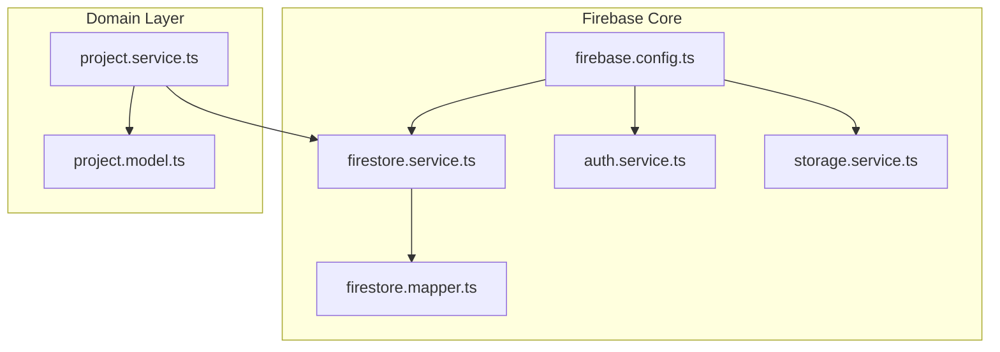
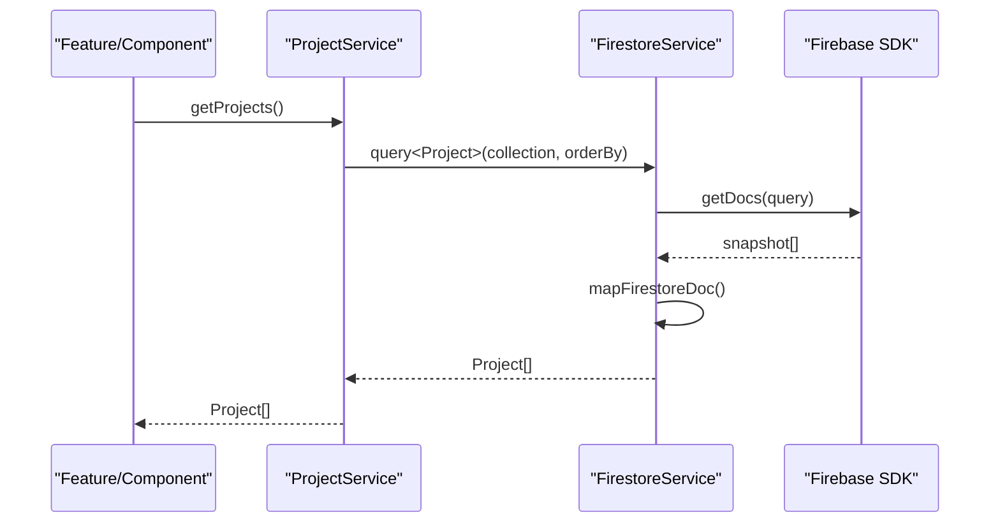
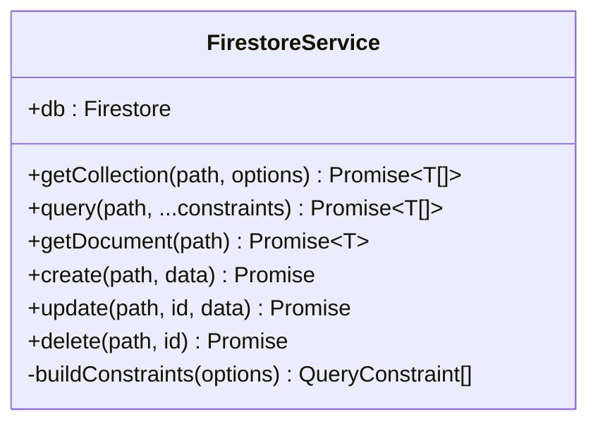
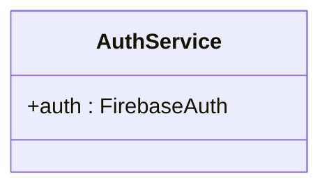
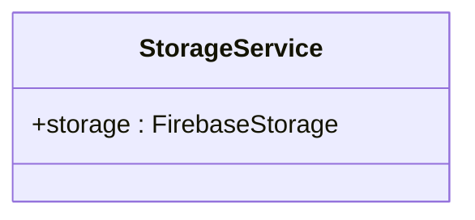
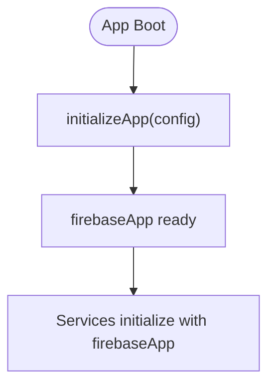
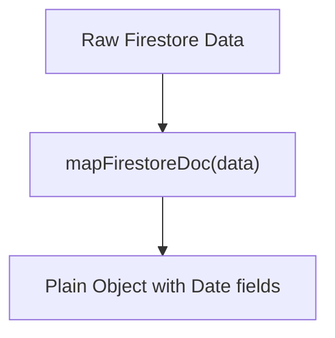
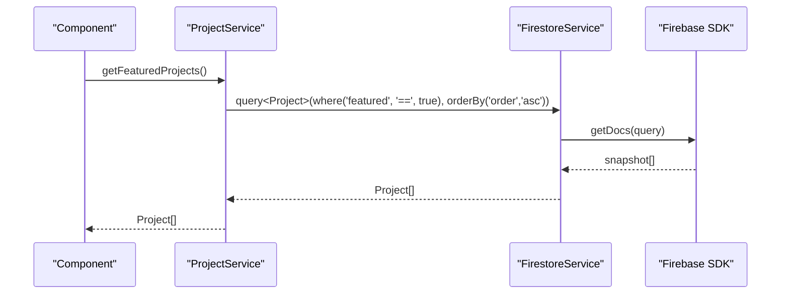
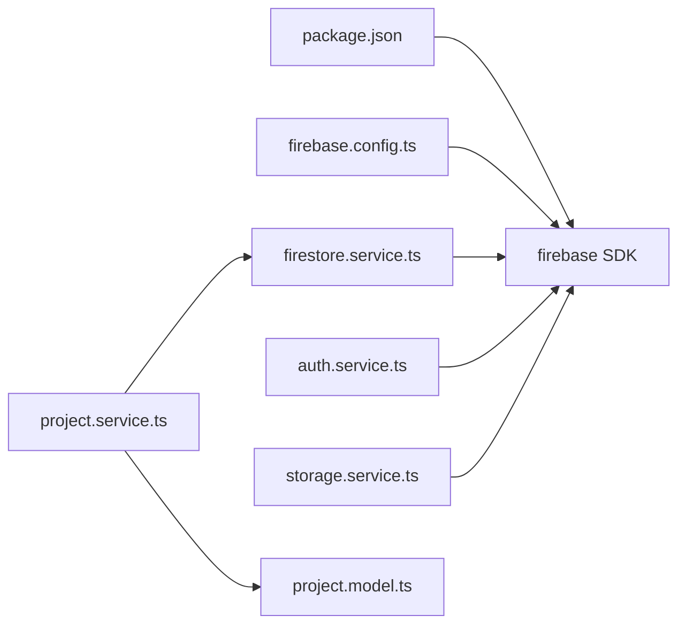

# Firebase Integration Services

<cite>
**Referenced Files in This Document**
- [firestore.service.ts](file://src/app/core/firebase/firestore.service.ts)
- [auth.service.ts](file://src/app/core/firebase/auth.service.ts)
- [storage.service.ts](file://src/app/core/firebase/storage.service.ts)
- [firebase.config.ts](file://src/app/core/firebase/firebase.config.ts)
- [index.ts](file://src/app/core/firebase/index.ts)
- [firestore.mapper.ts](file://src/app/core/utils/firestore.mapper.ts)
- [project.service.ts](file://src/app/core/services/project.service.ts)
- [project.model.ts](file://src/app/core/models/project.model.ts)
- [package.json](file://package.json)
</cite>

## Table of Contents
1. [Introduction](#introduction)
2. [Project Structure](#project-structure)
3. [Core Components](#core-components)
4. [Architecture Overview](#architecture-overview)
5. [Detailed Component Analysis](#detailed-component-analysis)
6. [Dependency Analysis](#dependency-analysis)
7. [Performance Considerations](#performance-considerations)
8. [Troubleshooting Guide](#troubleshooting-guide)
9. [Conclusion](#conclusion)
10. [Appendices](#appendices)

## Introduction
This document explains the Firebase integration services layer used by the Angular portfolio application. It focuses on:
- FirestoreService for CRUD operations, query building, and type-safe data access patterns
- AuthService as a thin wrapper around Firebase Auth
- StorageService as a thin wrapper around Firebase Storage
- Firebase configuration setup and environment considerations
- Error handling strategies, retry mechanisms, and offline persistence options
- Practical examples of common Firebase operations, data modeling patterns, and performance optimization techniques
- Authentication flows, security best practices, and debugging approaches

The implementation is intentionally minimal and composable, delegating most logic to the official Firebase SDKs while providing a consistent Angular-friendly API surface.

## Project Structure
The Firebase integration lives under src/app/core/firebase with supporting utilities and models:
- firebase.config.ts initializes the Firebase app instance
- firestore.service.ts provides typed CRUD and query helpers
- auth.service.ts exposes the Firebase Auth instance
- storage.service.ts exposes the Firebase Storage instance
- index.ts centralizes exports for easy consumption across the app
- utils/firestore.mapper.ts converts Firestore Timestamps to native Date objects
- core/services/project.service.ts demonstrates usage of FirestoreService for domain operations
- core/models/project.model.ts defines the Project data model used throughout

**Diagram sources**
- [firebase.config.ts:1-13](file://src/app/core/firebase/firebase.config.ts#L1-L13)
- [firestore.service.ts:1-100](file://src/app/core/firebase/firestore.service.ts#L1-L100)
- [auth.service.ts:1-13](file://src/app/core/firebase/auth.service.ts#L1-L13)
- [storage.service.ts:1-13](file://src/app/core/firebase/storage.service.ts#L1-L13)
- [firestore.mapper.ts:1-28](file://src/app/core/utils/firestore.mapper.ts#L1-L28)
- [project.service.ts:1-60](file://src/app/core/services/project.service.ts#L1-L60)
- [project.model.ts:1-44](file://src/app/core/models/project.model.ts#L1-L44)

**Section sources**
- [firebase.config.ts:1-13](file://src/app/core/firebase/firebase.config.ts#L1-L13)
- [firestore.service.ts:1-100](file://src/app/core/firebase/firestore.service.ts#L1-L100)
- [auth.service.ts:1-13](file://src/app/core/firebase/auth.service.ts#L1-L13)
- [storage.service.ts:1-13](file://src/app/core/firebase/storage.service.ts#L1-L13)
- [index.ts:1-6](file://src/app/core/firebase/index.ts#L1-L6)
- [firestore.mapper.ts:1-28](file://src/app/core/utils/firestore.mapper.ts#L1-L28)
- [project.service.ts:1-60](file://src/app/core/services/project.service.ts#L1-L60)
- [project.model.ts:1-44](file://src/app/core/models/project.model.ts#L1-L44)

## Core Components
- FirestoreService
  - Provides typed getCollection, query, getDocument, create, update, delete methods
  - Builds constraints from QueryOptions (where, orderBy, limit)
  - Maps Firestore documents to plain objects using mapFirestoreDoc
- AuthService
  - Exposes a single readonly auth instance initialized with the shared Firebase app
- StorageService
  - Exposes a single readonly storage instance initialized with the shared Firebase app
- Configuration
  - firebase.config.ts initializes the Firebase app with project-specific config values
- Data Mapping
  - firestore.mapper.ts converts known timestamp fields to native Date instances

Key responsibilities and boundaries:
- The services are thin wrappers that keep business logic in higher-level services (e.g., ProjectService)
- Type safety is achieved via generic typing and explicit mapping utilities
- All Firebase SDK calls remain centralized within these services for easier testing and future changes

**Section sources**
- [firestore.service.ts:1-100](file://src/app/core/firebase/firestore.service.ts#L1-L100)
- [auth.service.ts:1-13](file://src/app/core/firebase/auth.service.ts#L1-L13)
- [storage.service.ts:1-13](file://src/app/core/firebase/storage.service.ts#L1-L13)
- [firebase.config.ts:1-13](file://src/app/core/firebase/firebase.config.ts#L1-L13)
- [firestore.mapper.ts:1-28](file://src/app/core/utils/firestore.mapper.ts#L1-L28)

## Architecture Overview
At runtime, components and feature modules consume the Firebase services through Angular’s dependency injection. The flow typically goes:
- Feature or domain service calls FirestoreService methods
- FirestoreService uses the Firebase SDK to read/write data
- Documents are mapped to TypeScript types before being returned to callers
- Auth and Storage services provide direct access to their respective SDK instances

**Diagram sources**
- [project.service.ts:13-15](file://src/app/core/services/project.service.ts#L13-L15)
- [firestore.service.ts:40-49](file://src/app/core/firebase/firestore.service.ts#L40-L49)
- [firestore.mapper.ts:5-18](file://src/app/core/utils/firestore.mapper.ts#L5-L18)

## Detailed Component Analysis

### FirestoreService
Responsibilities:
- Build queries using where, orderBy, and limit constraints
- Execute reads via getDocs and getDoc
- Perform writes via addDoc, updateDoc, deleteDoc
- Normalize timestamps to Date objects for type-safe consumption

Query building:
- QueryOptions supports multiple where clauses, multiple orderBys, and a limit
- Constraints are composed into a single query object before execution

Type-safe data access:
- Generic methods return arrays or single objects typed to T
- Document mapping ensures consistent field shapes across the app

Error handling:
- Throws when a requested document does not exist
- Errors propagate to callers; consider adding retries at the caller level if needed

**Diagram sources**
- [firestore.service.ts:32-96](file://src/app/core/firebase/firestore.service.ts#L32-L96)

**Section sources**
- [firestore.service.ts:23-96](file://src/app/core/firebase/firestore.service.ts#L23-L96)

### AuthService
Responsibilities:
- Provide a singleton reference to the Firebase Auth instance
- Delegates authentication flows (sign-in, sign-out, user state) to the SDK

Usage pattern:
- Inject AuthService and call methods on its auth property
- Combine with RxJS operators to react to user state changes

**Diagram sources**
- [auth.service.ts:10-12](file://src/app/core/firebase/auth.service.ts#L10-L12)

**Section sources**
- [auth.service.ts:1-13](file://src/app/core/firebase/auth.service.ts#L1-L13)

### StorageService
Responsibilities:
- Provide a singleton reference to the Firebase Storage instance
- Delegates upload/download/delete operations to the SDK

Usage pattern:
- Inject StorageService and use its storage property to interact with buckets
- Combine with file input events and progress observables in components

**Diagram sources**
- [storage.service.ts:10-12](file://src/app/core/firebase/storage.service.ts#L10-L12)

**Section sources**
- [storage.service.ts:1-13](file://src/app/core/firebase/storage.service.ts#L1-L13)

### Firebase Configuration
- Initializes the Firebase app with project credentials
- Centralizes configuration values for reuse across services

Environment considerations:
- For production, move secrets out of source code and load them from environment variables or secure configuration providers
- Ensure correct authDomain, projectId, storageBucket, and appId values per environment

**Diagram sources**
- [firebase.config.ts:1-13](file://src/app/core/firebase/firebase.config.ts#L1-L13)

**Section sources**
- [firebase.config.ts:1-13](file://src/app/core/firebase/firebase.config.ts#L1-L13)

### Data Mapping Utility
- Converts Firestore Timestamp fields to native Date instances
- Keeps domain models free of SDK-specific types

**Diagram sources**
- [firestore.mapper.ts:5-18](file://src/app/core/utils/firestore.mapper.ts#L5-L18)

**Section sources**
- [firestore.mapper.ts:1-28](file://src/app/core/utils/firestore.mapper.ts#L1-L28)

### Example Usage: ProjectService
Demonstrates how to build typed queries and CRUD operations over the projects collection:
- List all projects ordered by a numeric field
- Filter featured projects
- Filter by category
- Fetch by ID or slug
- Create, update, delete projects

**Diagram sources**
- [project.service.ts:17-23](file://src/app/core/services/project.service.ts#L17-L23)
- [firestore.service.ts:40-49](file://src/app/core/firebase/firestore.service.ts#L40-L49)

**Section sources**
- [project.service.ts:1-60](file://src/app/core/services/project.service.ts#L1-L60)
- [project.model.ts:1-44](file://src/app/core/models/project.model.ts#L1-L44)

## Dependency Analysis
The Firebase services depend on the Firebase SDK and share a single initialized app instance. Higher-level services depend on FirestoreService for data operations.

**Diagram sources**
- [package.json:28-29](file://package.json#L28-L29)
- [firebase.config.ts:1-13](file://src/app/core/firebase/firebase.config.ts#L1-L13)
- [firestore.service.ts:1-22](file://src/app/core/firebase/firestore.service.ts#L1-L22)
- [auth.service.ts:1-6](file://src/app/core/firebase/auth.service.ts#L1-L6)
- [storage.service.ts:1-6](file://src/app/core/firebase/storage.service.ts#L1-L6)
- [project.service.ts:1-6](file://src/app/core/services/project.service.ts#L1-L6)
- [project.model.ts:1-4](file://src/app/core/models/project.model.ts#L1-L4)

**Section sources**
- [package.json:1-49](file://package.json#L1-L49)
- [firebase.config.ts:1-13](file://src/app/core/firebase/firebase.config.ts#L1-L13)
- [firestore.service.ts:1-22](file://src/app/core/firebase/firestore.service.ts#L1-L22)
- [auth.service.ts:1-6](file://src/app/core/firebase/auth.service.ts#L1-L6)
- [storage.service.ts:1-6](file://src/app/core/firebase/storage.service.ts#L1-L6)
- [project.service.ts:1-6](file://src/app/core/services/project.service.ts#L1-L6)
- [project.model.ts:1-4](file://src/app/core/models/project.model.ts#L1-L4)

## Performance Considerations
- Query efficiency
  - Use where and orderBy judiciously; ensure indexes match your queries
  - Limit result sets with limit to avoid large payloads
- Caching and offline
  - Enable Firestore offline persistence via Firebase settings to improve responsiveness and reduce network calls
- Real-time updates
  - Prefer onSnapshot listeners for live data; unsubscribe when components destroy to prevent memory leaks
- Payload minimization
  - Select only required fields; avoid storing large blobs in Firestore
- Storage optimization
  - Compress images and use appropriate formats; leverage CDN caching headers
- Error resilience
  - Implement retry with exponential backoff for transient errors at the service layer
- SSR considerations
  - Avoid blocking initialization on client-only features during server rendering

[No sources needed since this section provides general guidance]

## Troubleshooting Guide
Common issues and resolutions:
- Document not found
  - FirestoreService throws when a document does not exist; handle in callers with try/catch or fallback UI
- Network errors and timeouts
  - Wrap calls in retry logic; distinguish between transient and permanent failures
- Authentication state
  - Subscribe to auth state changes; guard routes and sensitive operations based on user role
- Storage permissions
  - Validate rules for read/write paths; log bucket path and operation details on failure
- Offline behavior
  - Verify persistence is enabled; check cache size limits and eviction policies

Debugging tips:
- Use Firebase Console logs and Firestore Emulator for local development
- Log query parameters and results in development builds
- Add structured error codes and messages for easier triage

**Section sources**
- [firestore.service.ts:51-62](file://src/app/core/firebase/firestore.service.ts#L51-L62)

## Conclusion
The Firebase integration layer provides a clean, typed, and extensible foundation for data and media operations. By centralizing SDK interactions in focused services and leveraging utility mappers, the application maintains strong separation of concerns and predictable data shapes. Extend the services with robust error handling, retries, and real-time subscriptions as your needs evolve, and always align Firestore indexes and Storage rules with your access patterns.

[No sources needed since this section summarizes without analyzing specific files]

## Appendices

### Practical Examples and Patterns
- Reading collections with filters and ordering
  - Use ProjectService methods to fetch featured or categorized projects
- Single document retrieval
  - Use getDocument with full path; handle not-found cases gracefully
- Creating and updating records
  - Use create and update with partial data; validate inputs before sending
- File uploads and downloads
  - Use StorageService to obtain the storage instance; implement upload tasks with progress tracking

[No sources needed since this section provides general guidance]

### Security Rules Integration
- Define Firestore rules to enforce read/write permissions per user and resource
- Configure Storage rules to restrict access by path and user attributes
- Test rules locally with the Firebase Emulator Suite

[No sources needed since this section provides general guidance]

### Environment Variables and Configuration
- Move secrets out of source control; inject via environment configuration
- Maintain separate configs for development, staging, and production
- Validate configuration at startup and fail fast on missing keys

[No sources needed since this section provides general guidance]