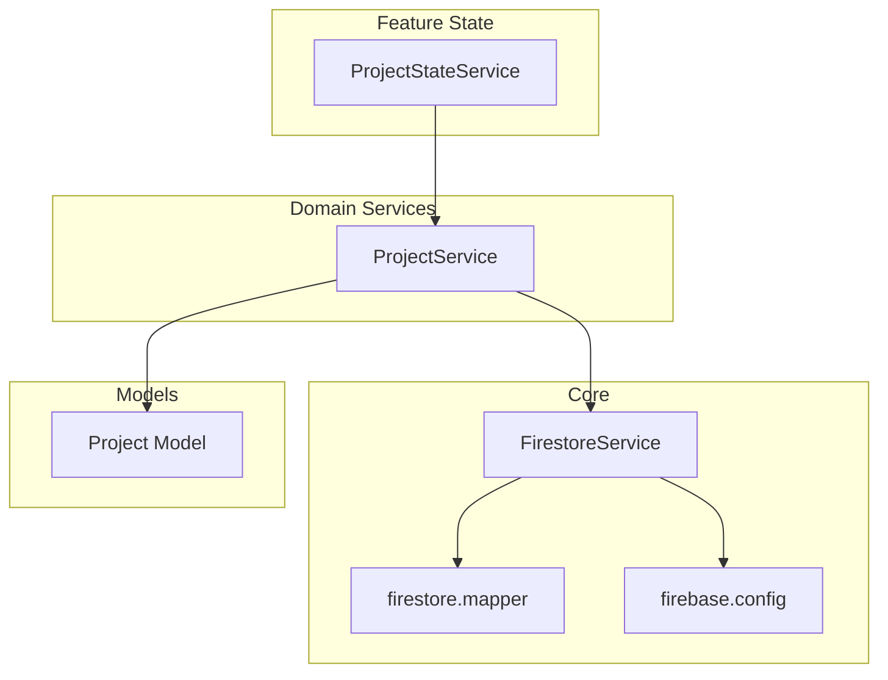
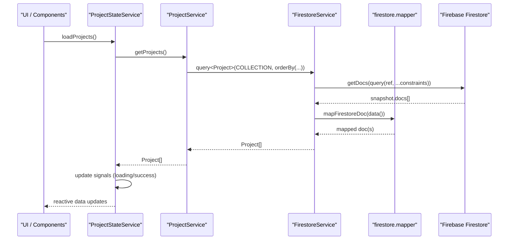
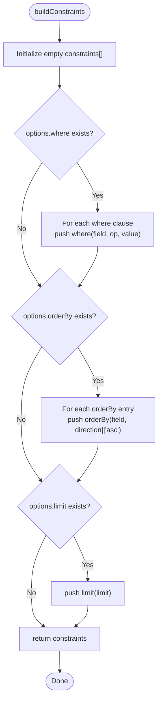
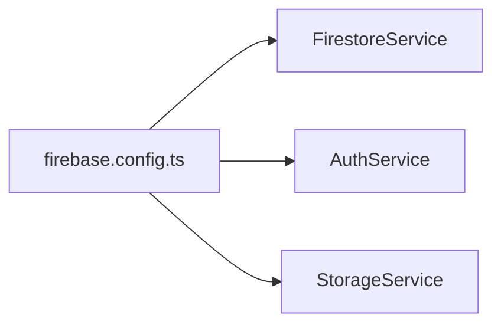
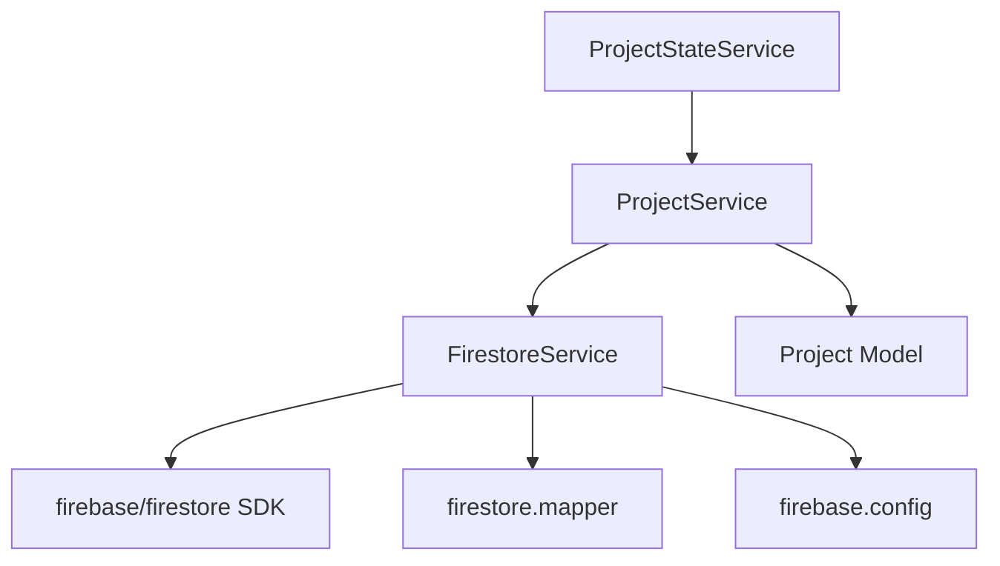

# Firestore Service

<cite>
**Referenced Files in This Document**
- [firestore.service.ts](file://src/app/core/firebase/firestore.service.ts)
- [firestore.mapper.ts](file://src/app/core/utils/firestore.mapper.ts)
- [firebase.config.ts](file://src/app/core/firebase/firebase.config.ts)
- [index.ts](file://src/app/core/firebase/index.ts)
- [project.service.ts](file://src/app/core/services/project.service.ts)
- [project-state.service.ts](file://src/app/features/projects/services/project-state.service.ts)
- [project.model.ts](file://src/app/core/models/project.model.ts)
</cite>

## Table of Contents
1. [Introduction](#introduction)
2. [Project Structure](#project-structure)
3. [Core Components](#core-components)
4. [Architecture Overview](#architecture-overview)
5. [Detailed Component Analysis](#detailed-component-analysis)
6. [Dependency Analysis](#dependency-analysis)
7. [Performance Considerations](#performance-considerations)
8. [Troubleshooting Guide](#troubleshooting-guide)
9. [Conclusion](#conclusion)
10. [Appendices](#appendices)

## Introduction
This document provides comprehensive documentation for the FirestoreService implementation used across the Angular application. It explains all CRUD operations, the QueryOptions interface for filtering/ordering/limiting, type-safe data access patterns using TypeScript generics, and the constraint building system for complex queries. It also covers integration with the firestore mapper for data transformation, error handling strategies, performance optimization techniques, and relationships with other Firebase services such as Auth and Storage.

## Project Structure
The Firestore service is part of the core Firebase module and is consumed by domain services (e.g., ProjectService) and feature state services (e.g., ProjectStateService). The mapper utility transforms Firestore Timestamps into native Date objects to align with TypeScript models.



**Diagram sources**
- [firestore.service.ts:1-99](file://src/app/core/firebase/firestore.service.ts#L1-L99)
- [firestore.mapper.ts:1-28](file://src/app/core/utils/firestore.mapper.ts#L1-L28)
- [firebase.config.ts:1-13](file://src/app/core/firebase/firebase.config.ts#L1-L13)
- [project.service.ts:1-60](file://src/app/core/services/project.service.ts#L1-L60)
- [project-state.service.ts:1-157](file://src/app/features/projects/services/project-state.service.ts#L1-L157)
- [project.model.ts:1-44](file://src/app/core/models/project.model.ts#L1-L44)

**Section sources**
- [firestore.service.ts:1-99](file://src/app/core/firebase/firestore.service.ts#L1-L99)
- [firestore.mapper.ts:1-28](file://src/app/core/utils/firestore.mapper.ts#L1-L28)
- [firebase.config.ts:1-13](file://src/app/core/firebase/firebase.config.ts#L1-L13)
- [project.service.ts:1-60](file://src/app/core/services/project.service.ts#L1-L60)
- [project-state.service.ts:1-157](file://src/app/features/projects/services/project-state.service.ts#L1-L157)
- [project.model.ts:1-44](file://src/app/core/models/project.model.ts#L1-L44)

## Core Components
- FirestoreService: Provides typed CRUD operations over Firestore collections and documents, query composition via constraints, and consistent data mapping.
- QueryOptions: A configuration object to declaratively specify where clauses, orderBy fields/directions, and limit counts.
- Firestore Mapper: Converts Firestore Timestamp instances on known date fields to native JavaScript Date objects, ensuring model compatibility.
- ProjectService: Domain service that composes Firestore queries using firebase/firestore constraint functions and returns strongly-typed results.
- ProjectStateService: Feature-level state management that orchestrates loading, filtering, pagination, and UI state around project data.

Key responsibilities:
- FirestoreService encapsulates low-level Firestore SDK calls and normalizes returned data.
- ProjectService abstracts collection-specific query logic and exposes simple methods to consumers.
- ProjectStateService manages reactive state and user interactions.

**Section sources**
- [firestore.service.ts:23-96](file://src/app/core/firebase/firestore.service.ts#L23-L96)
- [firestore.mapper.ts:1-28](file://src/app/core/utils/firestore.mapper.ts#L1-L28)
- [project.service.ts:1-60](file://src/app/core/services/project.service.ts#L1-L60)
- [project-state.service.ts:1-157](file://src/app/features/projects/services/project-state.service.ts#L1-L157)

## Architecture Overview
The architecture follows a layered approach:
- Data Access Layer: FirestoreService wraps firebase/firestore primitives and applies consistent mapping.
- Domain Layer: ProjectService defines business-oriented queries and mutations.
- State Layer: ProjectStateService holds reactive signals for UI consumption and orchestrates data flow.



**Diagram sources**
- [project-state.service.ts:99-115](file://src/app/features/projects/services/project-state.service.ts#L99-L115)
- [project.service.ts:13-15](file://src/app/core/services/project.service.ts#L13-L15)
- [firestore.service.ts:40-49](file://src/app/core/firebase/firestore.service.ts#L40-L49)
- [firestore.mapper.ts:5-18](file://src/app/core/utils/firestore.mapper.ts#L5-L18)

## Detailed Component Analysis

### FirestoreService
Responsibilities:
- Initialize Firestore instance from the shared Firebase app.
- Provide generic CRUD methods: getCollection, query, getDocument, create, update, delete.
- Build Firestore constraints from QueryOptions or direct constraint arguments.
- Map raw Firestore documents to typed results using the mapper.

Key methods:
- getCollection<T>(path, options?): Returns an array of typed entities with id and mapped fields.
- query<T>(path, ...constraints): Executes a query with optional constraints and maps results.
- getDocument<T>(path): Retrieves a single document; throws if not found.
- create(path, data): Adds a new document to a collection.
- update(path, id, data): Partially updates a document.
- delete(path, id): Deletes a document.
- buildConstraints(options?): Builds where, orderBy, and limit constraints.

Type safety:
- All read methods are generic, returning T[] or T with an injected id field.
- Consumers supply the expected model type to ensure compile-time checks.

Error handling:
- getDocument throws when the document does not exist.
- Errors from underlying Firestore calls propagate to callers.

```mermaid
classDiagram
class FirestoreService {
+db : Firestore
+getCollection~T~(path : string, options? : QueryOptions) Promise~T[]~
+query~T~(path : string, ...constraints : QueryConstraint[]) Promise~T[]~
+getDocument~T~(path : string) Promise~T~
+create(path : string, data : DocumentData) Promise~DocumentReference~
+update(path : string, id : string, data : Partial~DocumentData~) Promise~void~
+delete(path : string, id : string) Promise~void~
-buildConstraints(options? : QueryOptions) QueryConstraint[]
}
class QueryOptions {
+where? : { field : string; op : string; value : unknown }[]
+orderBy? : { field : string; direction? : 'asc'|'desc' }[]
+limit? : number
}
class FirestoreMapper {
+mapFirestoreDoc~T~(data : Record<string, unknown>) T
+mapFirestoreDocs~T~(docs : ...) (T & {id : string})[]
}
FirestoreService --> FirestoreMapper : "uses"
```

**Diagram sources**
- [firestore.service.ts:23-96](file://src/app/core/firebase/firestore.service.ts#L23-L96)
- [firestore.mapper.ts:5-27](file://src/app/core/utils/firestore.mapper.ts#L5-L27)

**Section sources**
- [firestore.service.ts:32-96](file://src/app/core/firebase/firestore.service.ts#L32-L96)
- [firestore.mapper.ts:1-28](file://src/app/core/utils/firestore.mapper.ts#L1-L28)

### QueryOptions Interface
Purpose:
- Declaratively define filters, ordering, and limits for collection queries.

Fields:
- where: Array of conditions with field name, operator string, and value.
- orderBy: Array of order specifications with field and optional direction ('asc' | 'desc').
- limit: Maximum number of documents to return.

Usage:
- Used by getCollection to construct constraints internally.
- Alternatively, pass firebase/firestore constraint functions directly to query for advanced scenarios.

Notes:
- Operators are passed through to the underlying where function; ensure they match Firestore-supported operators.
- Direction defaults to 'asc' when omitted.

**Section sources**
- [firestore.service.ts:23-27](file://src/app/core/firebase/firestore.service.ts#L23-L27)

### Constraint Building System
Behavior:
- Iterates over where clauses and pushes corresponding where constraints.
- Iterates over orderBy entries and pushes orderBy constraints with direction fallback.
- Appends a limit constraint if provided.

Complexity:
- O(n) over the number of where/orderBy entries; minimal overhead.

Edge cases:
- Empty options produce no constraints.
- Invalid operators will be forwarded to Firestore and may cause runtime errors; validation should occur at the caller layer.



**Diagram sources**
- [firestore.service.ts:76-96](file://src/app/core/firebase/firestore.service.ts#L76-L96)

**Section sources**
- [firestore.service.ts:76-96](file://src/app/core/firebase/firestore.service.ts#L76-L96)

### Type-Safe Data Access Patterns
- Generics: Methods like query<T>, getDocument<T>, and getCollection<T> enforce compile-time types for returned entities.
- Id injection: Each returned document includes an id field alongside mapped data.
- Mapper integration: Timestamps on known fields are converted to Date, aligning with model definitions.

Example usage pattern:
- Callers specify the target model type to receive strongly-typed arrays or single objects.

**Section sources**
- [firestore.service.ts:35-62](file://src/app/core/firebase/firestore.service.ts#L35-L62)
- [firestore.mapper.ts:5-18](file://src/app/core/utils/firestore.mapper.ts#L5-L18)
- [project.model.ts:1-44](file://src/app/core/models/project.model.ts#L1-L44)

### Integration with Firestore Mapper
- mapFirestoreDoc converts Firestore Timestamp instances on predefined fields to native Date objects.
- Ensures models expecting Date fields remain valid after retrieval.
- mapFirestoreDocs is available for batch transformations when needed.

Benefits:
- Reduces boilerplate conversion logic in services.
- Centralizes timestamp normalization rules.

**Section sources**
- [firestore.mapper.ts:1-28](file://src/app/core/utils/firestore.mapper.ts#L1-L28)

### Relationship with Other Firebase Services
- AuthService: Shares the same Firebase app instance for authentication-related operations.
- StorageService: Uses the same initialized Firebase app for storage operations.
- Configuration: All services derive from a centralized firebaseApp created in firebase.config.



**Diagram sources**
- [firebase.config.ts:1-13](file://src/app/core/firebase/firebase.config.ts#L1-L13)
- [firestore.service.ts:21-22](file://src/app/core/firebase/firestore.service.ts#L21-L22)
- [auth.service.ts:1-13](file://src/app/core/firebase/auth.service.ts#L1-L13)

**Section sources**
- [firebase.config.ts:1-13](file://src/app/core/firebase/firebase.config.ts#L1-L13)
- [auth.service.ts:1-13](file://src/app/core/firebase/auth.service.ts#L1-L13)

### Practical Examples of Common Operations
- Get all projects ordered by a numeric field:
  - Use ProjectService.getProjects which calls FirestoreService.query with orderBy.
- Get featured projects:
  - Use ProjectService.getFeaturedProjects with where('featured', '==', true) and orderBy.
- Filter by category:
  - Use ProjectService.getProjectsByCategory with where('category', '==', category).
- Retrieve a single project by id:
  - Use ProjectService.getProject with getDocument.
- Retrieve by slug:
  - Use ProjectService.getProjectBySlug with where('slug', '==', slug) and handle empty results.
- Create, update, delete:
  - Use ProjectService.create/update/delete which delegate to FirestoreService methods.

These examples demonstrate how domain services compose constraints and expose simple APIs to features.

**Section sources**
- [project.service.ts:13-58](file://src/app/core/services/project.service.ts#L13-L58)

## Dependency Analysis
- FirestoreService depends on:
  - firebase/firestore SDK functions (collection, getDocs, doc, getDoc, addDoc, updateDoc, deleteDoc, query, where, orderBy, limit).
  - firestore.mapper for data transformation.
  - firebase.config for the initialized Firebase app.
- ProjectService depends on:
  - FirestoreService for data access.
  - Project model for type definitions.
- ProjectStateService depends on:
  - ProjectService for data operations.
  - Angular signals for reactive state.



**Diagram sources**
- [firestore.service.ts:1-22](file://src/app/core/firebase/firestore.service.ts#L1-L22)
- [project.service.ts:1-11](file://src/app/core/services/project.service.ts#L1-L11)
- [project-state.service.ts:1-20](file://src/app/features/projects/services/project-state.service.ts#L1-L20)

**Section sources**
- [firestore.service.ts:1-22](file://src/app/core/firebase/firestore.service.ts#L1-L22)
- [project.service.ts:1-11](file://src/app/core/services/project.service.ts#L1-L11)
- [project-state.service.ts:1-20](file://src/app/features/projects/services/project-state.service.ts#L1-L20)

## Performance Considerations
- Prefer specific queries: Use where and orderBy to minimize client-side filtering.
- Limit result sets: Apply limit to reduce payload size and network usage.
- Indexing: Ensure Firestore indexes exist for frequently queried fields and composite orders.
- Avoid unnecessary reads: Use getDocument for single items instead of querying collections.
- Batch operations: When updating multiple documents, consider batching at the domain layer to reduce round trips.
- Caching strategy: Leverage Angular signals and computed properties to avoid redundant recomputation.
- Error boundaries: Centralize error handling in state services to prevent cascading failures.

[No sources needed since this section provides general guidance]

## Troubleshooting Guide
Common issues and resolutions:
- Document not found:
  - getDocument throws when the document does not exist. Handle this in callers or wrap with try/catch.
- Invalid query operators:
  - Ensure where operators match Firestore-supported values. Incorrect operators cause runtime errors.
- Missing indexes:
  - Firestore may require composite indexes for certain where + orderBy combinations. Follow Firestore index suggestions.
- Timestamp mismatches:
  - If models expect Date but receive Timestamp, verify mapper usage and field names.
- Network or auth errors:
  - Propagate errors to state services and display user-friendly messages.

Operational tips:
- Log query parameters and constraints during development.
- Validate inputs before constructing constraints.
- Use feature flags to toggle between local mock data and live Firestore during testing.

**Section sources**
- [firestore.service.ts:51-62](file://src/app/core/firebase/firestore.service.ts#L51-L62)
- [project-state.service.ts:105-115](file://src/app/features/projects/services/project-state.service.ts#L105-L115)

## Conclusion
FirestoreService provides a clean, type-safe abstraction over Firestore operations, enabling consistent CRUD workflows and powerful query composition. Combined with the mapper and domain services, it supports robust data access patterns suitable for scalable applications. By following best practices for indexing, limiting results, and centralizing error handling, teams can achieve reliable and performant data layers.

[No sources needed since this section summarizes without analyzing specific files]

## Appendices

### API Reference Summary
- FirestoreService
  - getCollection<T>(path, options?): Promise<T[]>
  - query<T>(path, ...constraints): Promise<T[]>
  - getDocument<T>(path): Promise<T>
  - create(path, data): Promise<DocumentReference>
  - update(path, id, data): Promise<void>
  - delete(path, id): Promise<void>
- QueryOptions
  - where?: { field: string; op: string; value: unknown }[]
  - orderBy?: { field: string; direction?: 'asc' | 'desc' }[]
  - limit?: number

**Section sources**
- [firestore.service.ts:23-96](file://src/app/core/firebase/firestore.service.ts#L23-L96)

### Export Surface
- Re-exported symbols for convenient imports:
  - FirestoreService, where, orderBy, limit
  - QueryOptions type
  - firebaseApp, firebaseConfig

**Section sources**
- [index.ts:1-6](file://src/app/core/firebase/index.ts#L1-L6)