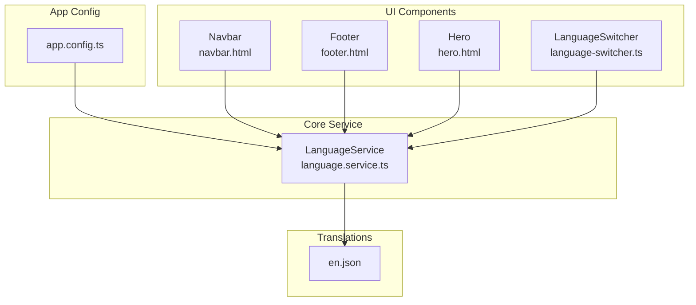
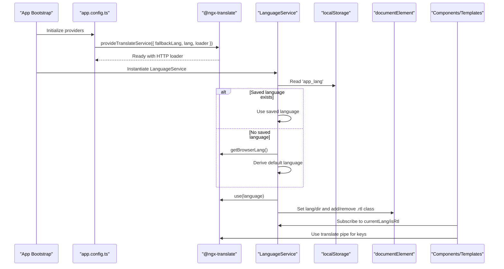
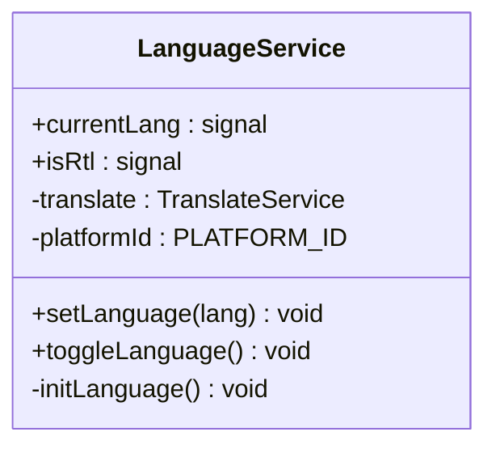
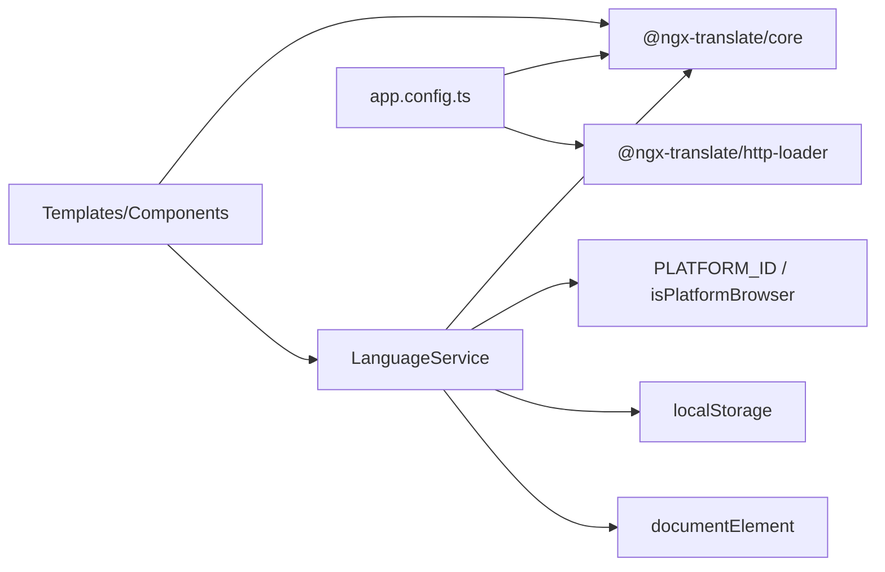

# Internationalization Service

<cite>
**Referenced Files in This Document**
- [language.service.ts](file://src/app/core/services/language.service.ts)
- [app.config.ts](file://src/app/app.config.ts)
- [en.json](file://src/assets/i18n/en.json)
- [language-switcher.ts](file://src/app/shared/components/language-switcher/language-switcher.ts)
- [navbar.html](file://src/app/shared/layout/navbar/navbar.html)
- [footer.html](file://src/app/shared/layout/footer/footer.html)
- [hero.html](file://src/app/features/home/sections/hero/hero.html)
</cite>

## Table of Contents
1. [Introduction](#introduction)
2. [Project Structure](#project-structure)
3. [Core Components](#core-components)
4. [Architecture Overview](#architecture-overview)
5. [Detailed Component Analysis](#detailed-component-analysis)
6. [Dependency Analysis](#dependency-analysis)
7. [Performance Considerations](#performance-considerations)
8. [Troubleshooting Guide](#troubleshooting-guide)
9. [Conclusion](#conclusion)
10. [Appendices](#appendices)

## Introduction
This document explains the LanguageService implementation that powers internationalization (i18n) and right-to-left (RTL) layout support in the application. It covers multi-language switching, translation key management, dynamic language loading, RTL layout behavior, locale-specific formatting, persistence of language preferences, browser language detection, and best practices for maintaining translations at scale.

## Project Structure
The i18n system is centered around:
- A root-level LanguageService that manages current language, RTL state, and persistence.
- An Angular app configuration that bootstraps @ngx-translate with an HTTP loader pointing to JSON files under assets/i18n.
- UI components that consume the service and use the translate pipe to render localized text.
- HTML templates that reference translation keys via the translate pipe.

**Diagram sources**
- [app.config.ts:16-23](file://src/app/app.config.ts#L16-L23)
- [language.service.ts:10-19](file://src/app/core/services/language.service.ts#L10-L19)
- [en.json:1-60](file://src/assets/i18n/en.json#L1-L60)
- [navbar.html:10-20](file://src/app/shared/layout/navbar/navbar.html#L10-L20)
- [footer.html:6-18](file://src/app/shared/layout/footer/footer.html#L6-L18)
- [hero.html:4-22](file://src/app/features/home/sections/hero/hero.html#L4-L22)
- [language-switcher.ts:14-22](file://src/app/shared/components/language-switcher/language-switcher.ts#L14-L22)

**Section sources**
- [app.config.ts:16-23](file://src/app/app.config.ts#L16-L23)
- [language.service.ts:10-19](file://src/app/core/services/language.service.ts#L10-L19)
- [en.json:1-60](file://src/assets/i18n/en.json#L1-L60)
- [navbar.html:10-20](file://src/app/shared/layout/navbar/navbar.html#L10-L20)
- [footer.html:6-18](file://src/app/shared/layout/footer/footer.html#L6-L18)
- [hero.html:4-22](file://src/app/features/home/sections/hero/hero.html#L4-L22)
- [language-switcher.ts:14-22](file://src/app/shared/components/language-switcher/language-switcher.ts#L14-L22)

## Core Components
- LanguageService: Provides current language, RTL flag, initialization logic, language switching, and persistence.
- App Configuration: Initializes @ngx-translate with a fallback language and an HTTP loader for JSON translation files.
- Translation Files: JSON dictionaries organized by namespaces (e.g., NAV, HERO, FOOTER).
- UI Integration: Components and templates use the translate pipe and the LanguageService to display localized content and toggle languages.

Key responsibilities:
- Detect and set default language from localStorage or browser settings.
- Persist user preference across sessions.
- Update DOM attributes and classes for correct text direction.
- Provide reactive signals for current language and RTL state.

**Section sources**
- [language.service.ts:10-61](file://src/app/core/services/language.service.ts#L10-L61)
- [app.config.ts:16-23](file://src/app/app.config.ts#L16-L23)
- [en.json:1-60](file://src/assets/i18n/en.json#L1-L60)
- [language-switcher.ts:14-22](file://src/app/shared/components/language-switcher/language-switcher.ts#L14-L22)

## Architecture Overview
The i18n architecture combines Angular’s dependency injection, @ngx-translate for runtime localization, and a lightweight LanguageService to manage state and side effects.

**Diagram sources**
- [app.config.ts:16-23](file://src/app/app.config.ts#L16-L23)
- [language.service.ts:21-55](file://src/app/core/services/language.service.ts#L21-L55)

## Detailed Component Analysis

### LanguageService
Responsibilities:
- Maintain reactive state for current language and RTL mode using Angular signals.
- Determine initial language from localStorage or browser language.
- Switch languages dynamically and persist the choice.
- Apply correct document-level attributes and CSS classes for RTL/LTR.

Behavior highlights:
- Initialization checks platform availability before accessing browser APIs.
- Language codes are strictly typed to prevent invalid values.
- Toggling switches between supported languages and updates all relevant state.

**Diagram sources**
- [language.service.ts:10-61](file://src/app/core/services/language.service.ts#L10-L61)

**Section sources**
- [language.service.ts:10-61](file://src/app/core/services/language.service.ts#L10-L61)

### App Configuration (@ngx-translate setup)
- Fallback language is configured to ensure graceful degradation when keys are missing.
- HTTP loader loads translation files from assets/i18n with a consistent prefix/suffix pattern.
- Initial language is set at bootstrap; LanguageService can override it based on user preference or browser settings.

**Section sources**
- [app.config.ts:16-23](file://src/app/app.config.ts#L16-L23)

### Translation Keys and Usage
Translation keys are organized into logical namespaces:
- NAV: Navigation labels
- HERO: Hero section copy
- FOOTER: Footer content
- LANG: Language names and toggle label

Usage patterns:
- Templates bind strings via the translate pipe with dot notation keys.
- Accessibility attributes like aria-label are also localized.

Examples of usage:
- Navbar navigation items
- Footer role and rights text
- Hero tagline, title, subtitle, and action buttons
- Language switcher accessibility label

**Section sources**
- [en.json:1-60](file://src/assets/i18n/en.json#L1-L60)
- [navbar.html:10-20](file://src/app/shared/layout/navbar/navbar.html#L10-L20)
- [footer.html:6-18](file://src/app/shared/layout/footer/footer.html#L6-L18)
- [hero.html:4-22](file://src/app/features/home/sections/hero/hero.html#L4-L22)
- [language-switcher.ts:14-22](file://src/app/shared/components/language-switcher/language-switcher.ts#L14-L22)

### Language Switcher Component
- Renders a button to toggle between supported languages.
- Uses the LanguageService to trigger language changes.
- Displays localized language name based on the current language.

**Section sources**
- [language-switcher.ts:14-22](file://src/app/shared/components/language-switcher/language-switcher.ts#L14-L22)

## Dependency Analysis
The i18n subsystem depends on:
- @ngx-translate/core for runtime localization and pipes.
- @ngx-translate/http-loader for loading JSON translation files.
- Angular’s PLATFORM_ID and isPlatformBrowser to guard browser-only code.
- localStorage for persistence of user language preference.
- DOM APIs to set lang/dir attributes and apply .rtl class.

**Diagram sources**
- [language.service.ts:1-12](file://src/app/core/services/language.service.ts#L1-L12)
- [app.config.ts:4-6](file://src/app/app.config.ts#L4-L6)

**Section sources**
- [language.service.ts:1-12](file://src/app/core/services/language.service.ts#L1-L12)
- [app.config.ts:4-6](file://src/app/app.config.ts#L4-L6)

## Performance Considerations
- Lazy loading of translation files: The HTTP loader fetches only the requested language file on demand. Ensure each language file contains only necessary keys to minimize payload size.
- Avoid heavy computations in initLanguage: Keep initialization fast by reading only essential storage and browser language data.
- Prefer signals for reactive updates: Signals avoid unnecessary change detection cycles when updating currentLang and isRtl.
- Defer non-critical work: If additional i18n features are added (e.g., pluralization rules), load them asynchronously after initial render.

[No sources needed since this section provides general guidance]

## Troubleshooting Guide
Common issues and resolutions:
- Missing translation keys: Verify that the key exists in the active language file. The fallback language will be used if not found.
- Incorrect RTL behavior: Ensure documentElement.dir and the .rtl class are applied when Arabic is selected. Check that no overriding styles force LTR.
- Persistence not working: Confirm localStorage is accessible in the environment and that the stored value matches one of the supported language codes.
- Browser language detection not triggering: Validate that getBrowserLang returns a string starting with the expected language code.

**Section sources**
- [language.service.ts:21-55](file://src/app/core/services/language.service.ts#L21-L55)
- [app.config.ts:16-23](file://src/app/app.config.ts#L16-L23)

## Conclusion
The LanguageService provides a robust foundation for i18n and RTL support by combining @ngx-translate with Angular signals and minimal DOM manipulation. It persists user preferences, detects browser language, and exposes reactive state for UI components. Following the guidelines in this document will help maintain consistency, performance, and accessibility across languages.

[No sources needed since this section summarizes without analyzing specific files]

## Appendices

### Adding a New Language
Steps:
- Create a new JSON file under assets/i18n named after the language code (e.g., ar.json).
- Mirror the structure of existing keys to ensure consistency.
- Extend the LanguageCode type to include the new code.
- Optionally update the language switcher to display the new language name.

**Section sources**
- [en.json:1-60](file://src/assets/i18n/en.json#L1-L60)
- [language.service.ts:5](file://src/app/core/services/language.service.ts#L5)
- [language-switcher.ts:14-22](file://src/app/shared/components/language-switcher/language-switcher.ts#L14-L22)

### Managing Translation Files
Best practices:
- Group keys by feature or namespace (e.g., NAV, HERO, FOOTER).
- Keep keys stable and descriptive to reduce churn in templates.
- Validate completeness across languages to avoid missing keys at runtime.

**Section sources**
- [en.json:1-60](file://src/assets/i18n/en.json#L1-L60)

### Handling Pluralization Rules
Current implementation does not include pluralization. To add:
- Introduce a pluralization strategy within LanguageService or leverage @ngx-translate’s built-in pluralization capabilities.
- Define plural forms per language and map keys accordingly.
- Update templates to pass count parameters where needed.

[No sources needed since this section outlines future enhancements]

### Date/Time, Number, and Currency Localization
Current implementation does not include locale-specific formatting. To add:
- Use Angular’s built-in date, number, and currency pipes with the appropriate locale.
- Configure locales in the application bootstrap or per component as needed.
- Ensure locale data is available for each supported language.

[No sources needed since this section outlines future enhancements]

### Maintaining Translation Consistency and Automated Workflows
Recommendations:
- Enforce key naming conventions and validate missing keys in CI pipelines.
- Use automated tools to detect untranslated keys and generate reports.
- Centralize translation management with a shared dictionary or CMS for collaborative editing.

[No sources needed since this section provides general guidance]