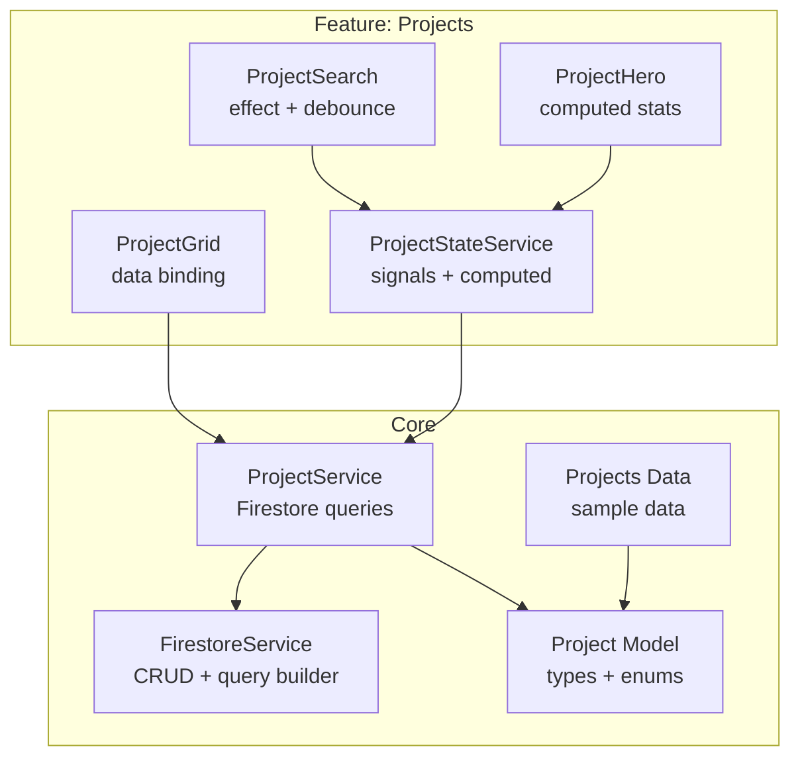
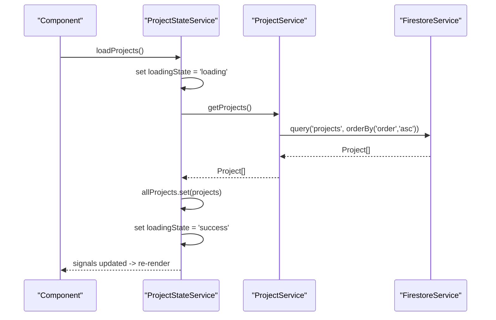
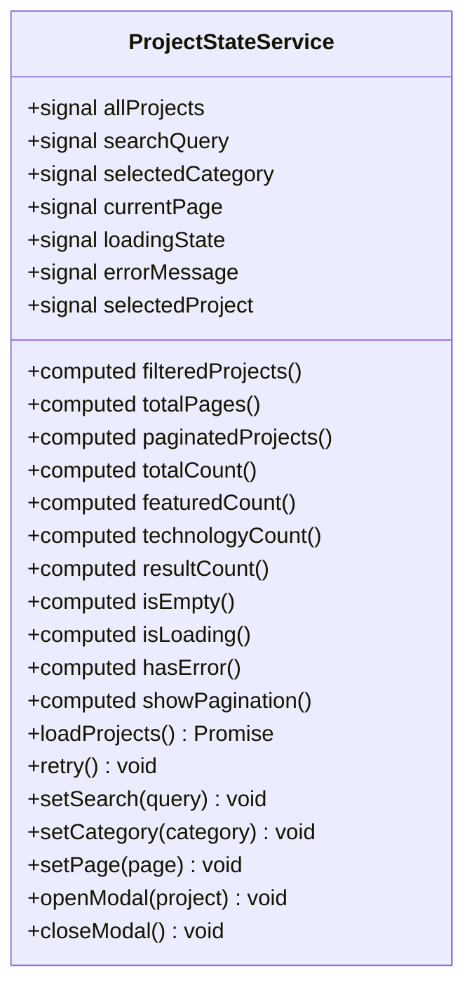
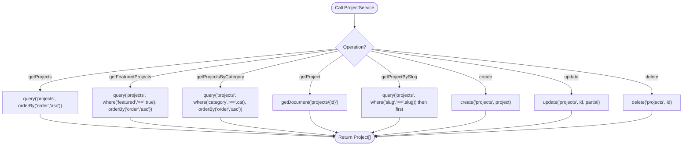
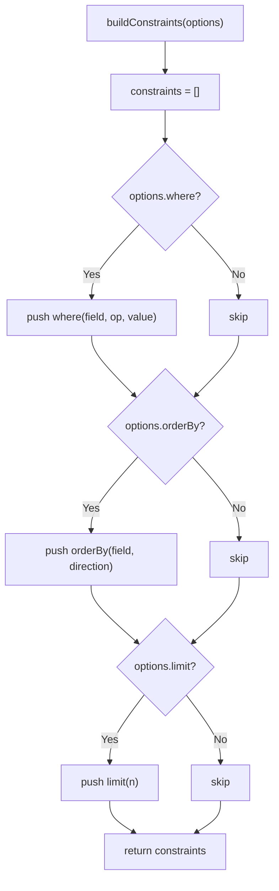
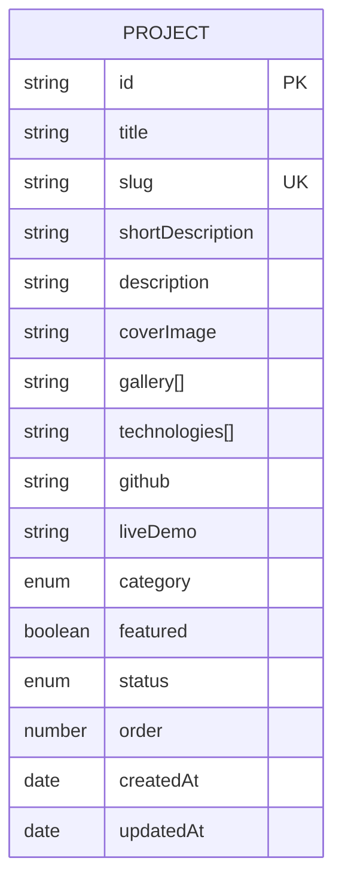
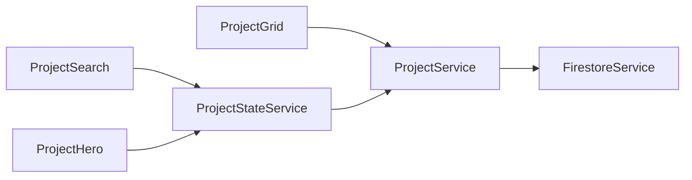

# State Management Services

<cite>
**Referenced Files in This Document**
- [project-state.service.ts](file://src/app/features/projects/services/project-state.service.ts)
- [project.service.ts](file://src/app/core/services/project.service.ts)
- [firestore.service.ts](file://src/app/core/firebase/firestore.service.ts)
- [project.model.ts](file://src/app/core/models/project.model.ts)
- [projects.data.ts](file://src/app/core/data/projects.data.ts)
- [project-search.ts](file://src/app/features/projects/components/project-search/project-search.ts)
- [project-hero.ts](file://src/app/features/projects/components/project-hero/project-hero.ts)
- [project-grid.ts](file://src/app/features/projects/components/project-grid/project-grid.ts)
</cite>

## Table of Contents
1. [Introduction](#introduction)
2. [Project Structure](#project-structure)
3. [Core Components](#core-components)
4. [Architecture Overview](#architecture-overview)
5. [Detailed Component Analysis](#detailed-component-analysis)
6. [Dependency Analysis](#dependency-analysis)
7. [Performance Considerations](#performance-considerations)
8. [Troubleshooting Guide](#troubleshooting-guide)
9. [Conclusion](#conclusion)
10. [Appendices](#appendices)

## Introduction
This document explains the signal-based state management and data access layers for the Projects feature. It focuses on:
- ProjectStateService: reactive state with signals, computed properties, and side effects
- ProjectService: data access abstraction over Firestore
- Signal lifecycle, memory optimization, and change detection strategies
- State composition, derived signals, optimistic updates, caching, and error recovery
- Testing approaches for signal-based components and services
- Migration guidance from Observables to Signals with performance insights

## Project Structure
The Projects feature is organized into a clear separation of concerns:
- Feature-level state service encapsulates UI state and derived values
- Core services abstract data access (Firestore)
- Models define types and constants
- Data fixtures provide sample data
- Components consume state via signals and computed values



**Diagram sources**
- [project-state.service.ts:17-156](file://src/app/features/projects/services/project-state.service.ts#L17-L156)
- [project-search.ts:13-42](file://src/app/features/projects/components/project-search/project-search.ts#L13-L42)
- [project-hero.ts:20-38](file://src/app/features/projects/components/project-hero/project-hero.ts#L20-L38)
- [project-grid.ts:15-19](file://src/app/features/projects/components/project-grid/project-grid.ts#L15-L19)
- [project.service.ts:9-59](file://src/app/core/services/project.service.ts#L9-L59)
- [firestore.service.ts:29-96](file://src/app/core/firebase/firestore.service.ts#L29-L96)
- [project.model.ts:1-44](file://src/app/core/models/project.model.ts#L1-L44)
- [projects.data.ts:1-59](file://src/app/core/data/projects.data.ts#L1-L59)

**Section sources**
- [project-state.service.ts:17-156](file://src/app/features/projects/services/project-state.service.ts#L17-L156)
- [project.service.ts:9-59](file://src/app/core/services/project.service.ts#L9-L59)
- [firestore.service.ts:29-96](file://src/app/core/firebase/firestore.service.ts#L29-L96)
- [project.model.ts:1-44](file://src/app/core/models/project.model.ts#L1-L44)
- [projects.data.ts:1-59](file://src/app/core/data/projects.data.ts#L1-L59)
- [project-search.ts:13-42](file://src/app/features/projects/components/project-search/project-search.ts#L13-L42)
- [project-hero.ts:20-38](file://src/app/features/projects/components/project-hero/project-hero.ts#L20-L38)
- [project-grid.ts:15-19](file://src/app/features/projects/components/project-grid/project-grid.ts#L15-L19)

## Core Components
- ProjectStateService: Centralized reactive state using Angular Signals. Manages loading, filtering, pagination, modal selection, and derived metrics.
- ProjectService: Thin data access layer that translates domain operations into Firestore queries.
- FirestoreService: Low-level Firestore client with typed query helpers and document mapping.
- Project model: Strongly-typed interfaces and enums for projects, categories, and status.

Key responsibilities:
- ProjectStateService owns UI state and derived signals; coordinates async load/retry; exposes safe setters.
- ProjectService encapsulates business rules around querying by category, featured, slug, and CRUD operations.
- FirestoreService builds constraints and maps Firestore documents to typed models.

**Section sources**
- [project-state.service.ts:17-156](file://src/app/features/projects/services/project-state.service.ts#L17-L156)
- [project.service.ts:9-59](file://src/app/core/services/project.service.ts#L9-L59)
- [firestore.service.ts:29-96](file://src/app/core/firebase/firestore.service.ts#L29-L96)
- [project.model.ts:1-44](file://src/app/core/models/project.model.ts#L1-L44)

## Architecture Overview
The architecture follows a unidirectional data flow:
- Components read signals and computed values for rendering
- User interactions update local component signals or call state service methods
- State service triggers data fetching via ProjectService
- ProjectService delegates to FirestoreService
- On success, state service updates signals, which propagate changes to subscribers automatically



**Diagram sources**
- [project-state.service.ts:99-115](file://src/app/features/projects/services/project-state.service.ts#L99-L115)
- [project.service.ts:13-15](file://src/app/core/services/project.service.ts#L13-L15)
- [firestore.service.ts:40-49](file://src/app/core/firebase/firestore.service.ts#L40-L49)

## Detailed Component Analysis

### ProjectStateService: Reactive State with Signals
- State signals:
  - allProjects, searchQuery, selectedCategory, currentPage, loadingState, errorMessage, selectedProject
- Derived signals (computed):
  - filteredProjects: applies category filter and text search across title, shortDescription, description, technologies
  - totalPages, paginatedProjects: slice based on ITEMS_PER_PAGE
  - totalCount, featuredCount, technologyCount, resultCount: aggregate metrics
  - isEmpty, isLoading, hasError, showPagination: UI flags
- Side effects and platform checks:
  - setPage scrolls to top only on browser
  - openModal/closeModal toggles body overflow only on browser
- Async operations:
  - loadProjects sets loading/error states and updates allProjects
  - retry resets state and reloads



**Diagram sources**
- [project-state.service.ts:17-156](file://src/app/features/projects/services/project-state.service.ts#L17-L156)

**Section sources**
- [project-state.service.ts:17-156](file://src/app/features/projects/services/project-state.service.ts#L17-L156)

### ProjectService: Data Access Abstraction
- Encapsulates Firestore queries with strong typing
- Provides:
  - getProjects(): ordered list
  - getFeaturedProjects(): where featured == true
  - getProjectsByCategory(category): where category == X
  - getProject(id), getProjectBySlug(slug): single document retrieval
  - create, update, delete: mutations



**Diagram sources**
- [project.service.ts:13-58](file://src/app/core/services/project.service.ts#L13-L58)

**Section sources**
- [project.service.ts:9-59](file://src/app/core/services/project.service.ts#L9-L59)

### FirestoreService: Query Builder and Mapping
- Builds constraints from options (where, orderBy, limit)
- Queries collections and maps documents to typed models
- Provides CRUD operations with consistent signatures



**Diagram sources**
- [firestore.service.ts:76-96](file://src/app/core/firebase/firestore.service.ts#L76-L96)

**Section sources**
- [firestore.service.ts:29-96](file://src/app/core/firebase/firestore.service.ts#L29-L96)

### Project Model and Sample Data
- Project interface defines all fields including metadata like order, createdAt, updatedAt
- ProjectCategory and ProjectStatus are strongly typed enums
- PROJECTS array provides sample data for development/demo



**Diagram sources**
- [project.model.ts:1-44](file://src/app/core/models/project.model.ts#L1-L44)

**Section sources**
- [project.model.ts:1-44](file://src/app/core/models/project.model.ts#L1-L44)
- [projects.data.ts:1-59](file://src/app/core/data/projects.data.ts#L1-L59)

### Component Integration: Search, Hero, Grid
- ProjectSearch uses a local signal and effect to debounce user input before updating global state
- ProjectHero computes display strings from state metrics
- ProjectGrid demonstrates direct consumption of data via ProjectService (alternative pattern)

```mermaid
sequenceDiagram
participant U as "User"
participant S as "ProjectSearch"
participant T as "Timer"
participant ST as "ProjectStateService"
U->>S : type in search box
S->>S : search.set(value)
S->>S : effect detects change
S->>T : clearTimeout if exists
S->>T : setTimeout(() => ST.setSearch(query), 280ms)
T-->>S : callback fires
S->>ST : setSearch(query)
ST->>ST : searchQuery.set(query); currentPage.set(1)
ST-->>S : resultCount/isLoading signals update
```

**Diagram sources**
- [project-search.ts:23-37](file://src/app/features/projects/components/project-search/project-search.ts#L23-L37)
- [project-state.service.ts:122-130](file://src/app/features/projects/services/project-state.service.ts#L122-L130)

**Section sources**
- [project-search.ts:13-42](file://src/app/features/projects/components/project-search/project-search.ts#L13-L42)
- [project-hero.ts:20-38](file://src/app/features/projects/components/project-hero/project-hero.ts#L20-L38)
- [project-grid.ts:15-19](file://src/app/features/projects/components/project-grid/project-grid.ts#L15-L19)

## Dependency Analysis
- ProjectStateService depends on ProjectService for data operations and PLATFORM_ID for SSR-safe DOM access
- ProjectService depends on FirestoreService for low-level Firestore operations
- Components depend on ProjectStateService for shared state and derived values
- No circular dependencies observed between these modules



**Diagram sources**
- [project-search.ts:13-42](file://src/app/features/projects/components/project-search/project-search.ts#L13-L42)
- [project-hero.ts:20-38](file://src/app/features/projects/components/project-hero/project-hero.ts#L20-L38)
- [project-grid.ts:15-19](file://src/app/features/projects/components/project-grid/project-grid.ts#L15-L19)
- [project-state.service.ts:17-21](file://src/app/features/projects/services/project-state.service.ts#L17-L21)
- [project.service.ts:9-12](file://src/app/core/services/project.service.ts#L9-L12)
- [firestore.service.ts:29-33](file://src/app/core/firebase/firestore.service.ts#L29-L33)

**Section sources**
- [project-state.service.ts:17-21](file://src/app/features/projects/services/project-state.service.ts#L17-L21)
- [project.service.ts:9-12](file://src/app/core/services/project.service.ts#L9-L12)
- [firestore.service.ts:29-33](file://src/app/core/firebase/firestore.service.ts#L29-L33)

## Performance Considerations
- Signal-based change detection:
  - Computed values are memoized and only recompute when their dependencies change
  - Subscribers receive precise updates without full tree diffing
- Debounced search:
  - Reduces unnecessary state updates during rapid typing
- Pagination:
  - Limits rendered items per page to reduce DOM size
- Platform checks:
  - Avoids SSR errors by guarding DOM access behind isPlatformBrowser
- Memory optimization:
  - Signals are lightweight and do not require manual subscriptions/unsubscribes
  - Effects run once per dependency change; avoid heavy work inside effects

[No sources needed since this section provides general guidance]

## Troubleshooting Guide
Common issues and resolutions:
- Loading stuck in 'loading':
  - Ensure loadProjects is called and not blocked by duplicate calls
  - Check network errors and verify error handling path sets loadingState to 'error'
- Empty results after search:
  - Verify searchQuery normalization (trim/lowercase) and filters applied correctly
  - Reset currentPage when search changes to avoid out-of-range pages
- SSR-related errors:
  - Confirm all DOM manipulations are guarded by isPlatformBrowser checks
- Modal scroll lock not working:
  - Ensure openModal/closeModal run on browser and reset body.overflow appropriately

**Section sources**
- [project-state.service.ts:99-115](file://src/app/features/projects/services/project-state.service.ts#L99-L115)
- [project-state.service.ts:132-139](file://src/app/features/projects/services/project-state.service.ts#L132-L139)
- [project-state.service.ts:141-155](file://src/app/features/projects/services/project-state.service.ts#L141-L155)

## Conclusion
The Projects feature demonstrates a robust, signal-first approach to state management:
- Clear separation between state (ProjectStateService) and data access (ProjectService/FirestoreService)
- Efficient derived computations and minimal re-renders
- Safe SSR practices and optimized user interactions (debounce, pagination)
- Extensible patterns for adding new features while maintaining performance

[No sources needed since this section summarizes without analyzing specific files]

## Appendices

### Signal Lifecycle and Change Detection
- Creation: signals initialized with default values
- Reading: accessed via function call syntax; tracked automatically in computed/effect contexts
- Writing: use setter methods to trigger updates; prefer immutable updates for arrays/objects
- Computed: memoized until dependencies change
- Effect: runs side effects when dependencies change; use untracked to bypass tracking when necessary

[No sources needed since this section provides general guidance]

### State Composition and Derived Signals
- Compose multiple base signals into derived ones (e.g., filteredProjects combines allProjects, searchQuery, selectedCategory)
- Aggregate metrics (totalCount, technologyCount) for UI indicators
- UI flags (isEmpty, isLoading, hasError) simplify template logic

**Section sources**
- [project-state.service.ts:30-97](file://src/app/features/projects/services/project-state.service.ts#L30-L97)

### Side Effects Handling
- Use effect for non-reactive side effects (timers, analytics, DOM manipulation)
- Debounce user input to prevent excessive updates
- Guard platform-specific code with isPlatformBrowser

**Section sources**
- [project-search.ts:23-37](file://src/app/features/projects/components/project-search/project-search.ts#L23-L37)
- [project-state.service.ts:132-139](file://src/app/features/projects/services/project-state.service.ts#L132-L139)

### Caching Strategies
- Current implementation fetches data on demand; consider adding an in-memory cache in ProjectStateService to avoid redundant requests
- Cache invalidation on explicit actions (e.g., create/update/delete) or time-based expiry

[No sources needed since this section provides general guidance]

### Optimistic Updates
- For mutations (create/update/delete), immediately update local signals to reflect expected state
- Roll back on failure by restoring previous state and showing error messages

[No sources needed since this section provides general guidance]

### Error Recovery Patterns
- Normalize errors and store messages in errorMessage signal
- Provide retry functionality to reattempt failed operations
- Display user-friendly messages and disable destructive actions during error states

**Section sources**
- [project-state.service.ts:109-115](file://src/app/features/projects/services/project-state.service.ts#L109-L115)
- [project-state.service.ts:117-120](file://src/app/features/projects/services/project-state.service.ts#L117-L120)

### Testing Approaches for Signal-Based Components and Services
- Unit tests for ProjectStateService:
  - Assert initial signal values
  - Simulate loadProjects and verify loadingState transitions
  - Validate computed outputs for various inputs (filters, pagination)
- Component tests:
  - Mock ProjectStateService signals and assert template bindings
  - Test debounced search behavior with fake timers
  - Verify SSR guards do not execute DOM operations in test environment

[No sources needed since this section provides general guidance]

### Migration Guide: Observables to Signals
- Replace RxJS streams with signals for simple state and derived values
- Convert hot observables to signals using effect to bridge legacy APIs
- Prefer computed for derived state instead of combining operators
- Benefits:
  - Simplified mental model
  - Automatic change detection
  - Reduced boilerplate (no subscriptions)
- Trade-offs:
  - Less built-in cancellation and backpressure compared to RxJS
  - Need to manage side effects explicitly with effect

[No sources needed since this section provides general guidance]

### Performance Comparison Insights
- Signals vs Observables:
  - Signals offer fine-grained updates and automatic dependency tracking
  - Observables can be more powerful for complex asynchronous flows but require careful subscription management
- Benchmarking recommendations:
  - Measure render times with large datasets using pagination
  - Profile effect usage to avoid heavy computations in hot paths
  - Compare memory usage with and without caching

[No sources needed since this section provides general guidance]