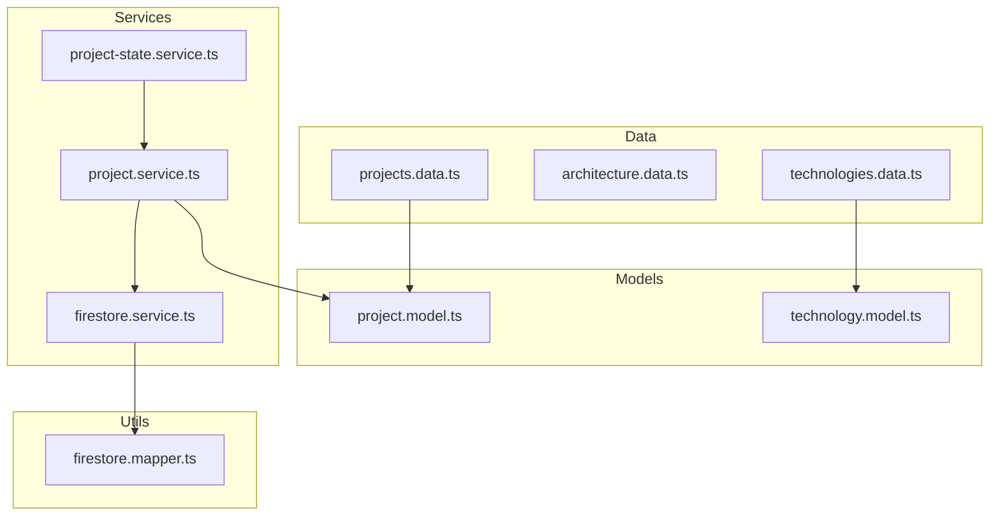
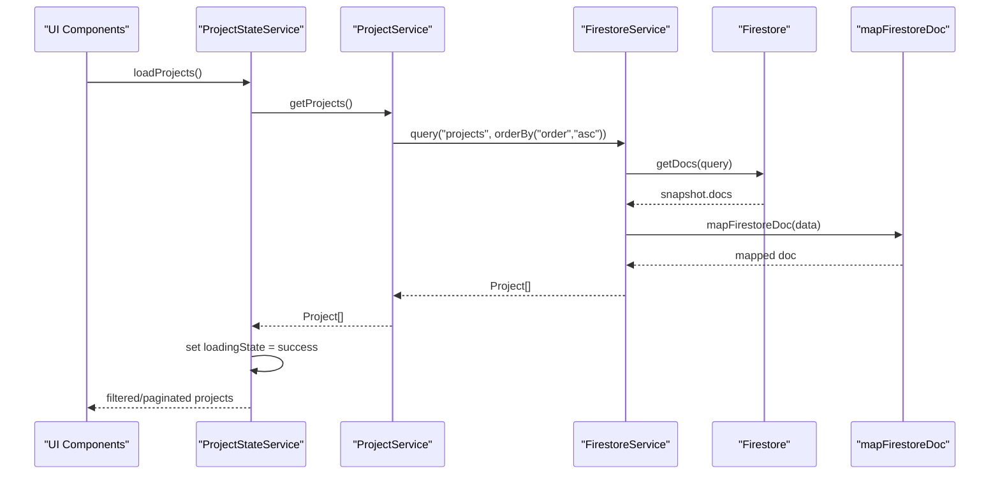
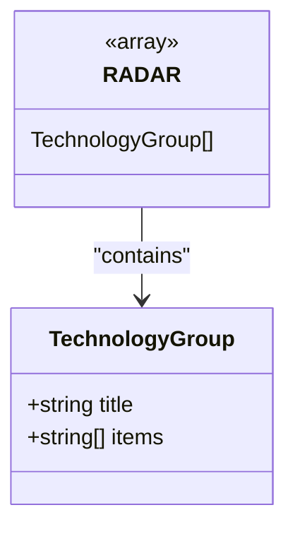
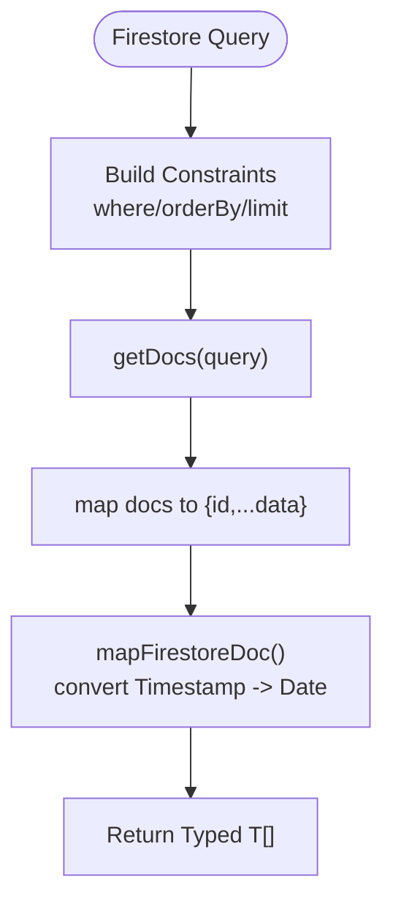
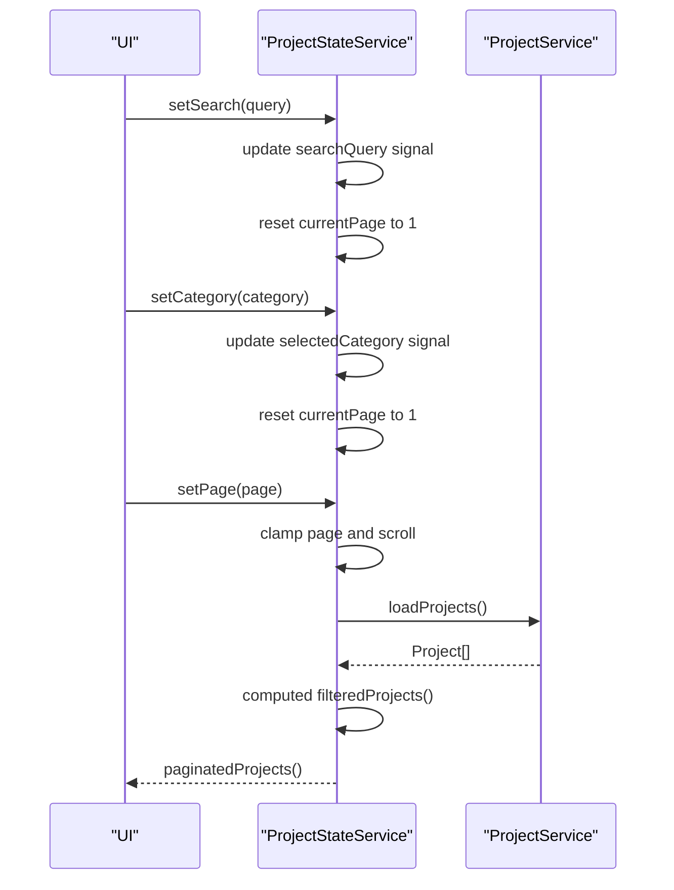
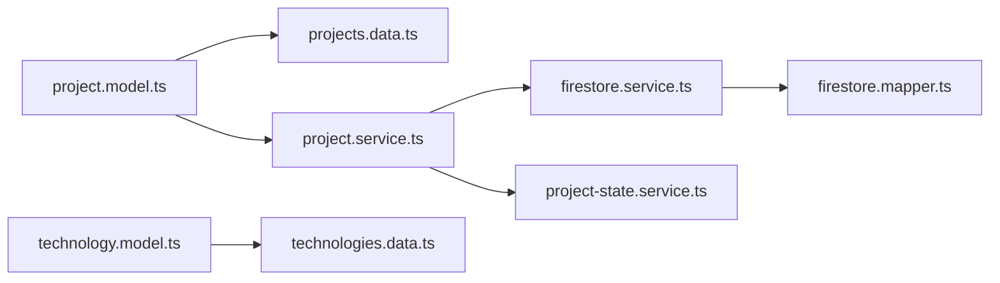

# Data Models & Types

<cite>
**Referenced Files in This Document**
- [project.model.ts](file://src/app/core/models/project.model.ts)
- [technology.model.ts](file://src/app/core/models/technology.model.ts)
- [projects.data.ts](file://src/app/core/data/projects.data.ts)
- [architecture.data.ts](file://src/app/core/data/architecture.data.ts)
- [technologies.data.ts](file://src/app/core/data/technologies.data.ts)
- [project.service.ts](file://src/app/core/services/project.service.ts)
- [firestore.service.ts](file://src/app/core/firebase/firestore.service.ts)
- [firestore.mapper.ts](file://src/app/core/utils/firestore.mapper.ts)
- [project-state.service.ts](file://src/app/features/projects/services/project-state.service.ts)
</cite>

## Table of Contents
1. [Introduction](#introduction)
2. [Project Structure](#project-structure)
3. [Core Components](#core-components)
4. [Architecture Overview](#architecture-overview)
5. [Detailed Component Analysis](#detailed-component-analysis)
6. [Dependency Analysis](#dependency-analysis)
7. [Performance Considerations](#performance-considerations)
8. [Troubleshooting Guide](#troubleshooting-guide)
9. [Conclusion](#conclusion)
10. [Appendices](#appendices)

## Introduction
This document provides a comprehensive data model and type reference for the MegaPortfolio application. It focuses on the Project interface, Technology model structure, enum-like types for categories and statuses, and sample data structures used across the app. It also documents validation rules, type constraints, business logic associated with models, and patterns for data manipulation, transformation, serialization, migration, versioning, and backward compatibility.

## Project Structure
The data models and related utilities are organized under core modules:
- Models define TypeScript interfaces and enumerations for domain entities.
- Data files provide static sample datasets used by UI components.
- Services encapsulate persistence and state management using Firebase Firestore and Angular signals.
- Utilities handle data mapping between Firestore types and application types.



**Diagram sources**
- [project.model.ts:1-44](file://src/app/core/models/project.model.ts#L1-L44)
- [technology.model.ts:1-5](file://src/app/core/models/technology.model.ts#L1-L5)
- [projects.data.ts:1-59](file://src/app/core/data/projects.data.ts#L1-L59)
- [architecture.data.ts:1-11](file://src/app/core/data/architecture.data.ts#L1-L11)
- [technologies.data.ts:1-24](file://src/app/core/data/technologies.data.ts#L1-L24)
- [project.service.ts:1-60](file://src/app/core/services/project.service.ts#L1-L60)
- [firestore.service.ts:1-100](file://src/app/core/firebase/firestore.service.ts#L1-L100)
- [firestore.mapper.ts:1-28](file://src/app/core/utils/firestore.mapper.ts#L1-L28)
- [project-state.service.ts:1-157](file://src/app/features/projects/services/project-state.service.ts#L1-L157)

**Section sources**
- [project.model.ts:1-44](file://src/app/core/models/project.model.ts#L1-L44)
- [technology.model.ts:1-5](file://src/app/core/models/technology.model.ts#L1-L5)
- [projects.data.ts:1-59](file://src/app/core/data/projects.data.ts#L1-L59)
- [architecture.data.ts:1-11](file://src/app/core/data/architecture.data.ts#L1-L11)
- [technologies.data.ts:1-24](file://src/app/core/data/technologies.data.ts#L1-L24)
- [project.service.ts:1-60](file://src/app/core/services/project.service.ts#L1-L60)
- [firestore.service.ts:1-100](file://src/app/core/firebase/firestore.service.ts#L1-L100)
- [firestore.mapper.ts:1-28](file://src/app/core/utils/firestore.mapper.ts#L1-L28)
- [project-state.service.ts:1-157](file://src/app/features/projects/services/project-state.service.ts#L1-L157)

## Core Components
This section defines the primary data models and their relationships.

### Project Model
- Purpose: Represents a portfolio project entity with metadata, media, links, categorization, status, and timestamps.
- Key properties:
  - id: Optional unique identifier (Firestore document ID).
  - title: Human-readable project name.
  - slug: URL-friendly identifier.
  - shortDescription: Brief summary for listings.
  - description: Detailed project description.
  - coverImage: Cover image path or URL.
  - gallery: Array of image paths or URLs.
  - technologies: Array of technology names used in the project.
  - github: Optional GitHub repository link.
  - liveDemo: Optional live demo link.
  - category: One of predefined categories.
  - featured: Boolean flag to highlight projects.
  - status: One of predefined statuses.
  - order: Numeric ordering value.
  - createdAt: Creation timestamp.
  - updatedAt: Last update timestamp.

- Enum-like types:
  - ProjectCategory: All, Backend, Frontend, Full Stack, DevOps, Mobile.
  - ProjectStatus: Completed, In Progress, Archived.

- Constants:
  - PROJECT_CATEGORIES: Array of valid category values.
  - PROJECT_STATUS_LABELS: Mapping from status to display labels.

**Section sources**
- [project.model.ts:1-44](file://src/app/core/models/project.model.ts#L1-L44)

### Technology Model
- Purpose: Groups technologies into labeled sets for radar or taxonomy views.
- Structure:
  - TechnologyGroup.title: Group label (e.g., ADOPT, TRIAL, ASSESS, LEARN).
  - TechnologyGroup.items: Array of technology names within the group.

**Section sources**
- [technology.model.ts:1-5](file://src/app/core/models/technology.model.ts#L1-L5)

### Sample Data Structures
- Projects dataset:
  - Provides example Project instances with realistic values for all fields.
  - Demonstrates usage of arrays for technologies and galleries, optional links, and boolean flags.

- Architecture services list:
  - Static array of service names used in architecture diagrams or sections.

- Technologies radar:
  - Array of TechnologyGroup objects defining technology tiers and items.

**Section sources**
- [projects.data.ts:1-59](file://src/app/core/data/projects.data.ts#L1-L59)
- [architecture.data.ts:1-11](file://src/app/core/data/architecture.data.ts#L1-L11)
- [technologies.data.ts:1-24](file://src/app/core/data/technologies.data.ts#L1-L24)

## Architecture Overview
The data flow integrates models, services, and persistence layers:
- ProjectService queries Firestore collections and maps results to Project types.
- FirestoreService builds queries and applies mappings to convert Firestore Timestamps to Date.
- ProjectStateService manages UI state with Angular signals, filtering, pagination, and error handling.



**Diagram sources**
- [project.service.ts:13-31](file://src/app/core/services/project.service.ts#L13-L31)
- [firestore.service.ts:40-49](file://src/app/core/firebase/firestore.service.ts#L40-L49)
- [firestore.mapper.ts:5-18](file://src/app/core/utils/firestore.mapper.ts#L5-L18)
- [project-state.service.ts:99-115](file://src/app/features/projects/services/project-state.service.ts#L99-L115)

## Detailed Component Analysis

### Project Model and Enums
- The Project interface enforces strict typing for all fields, ensuring consistency across UI and persistence layers.
- ProjectCategory and ProjectStatus are string literal unions that act as enums, providing compile-time safety.
- PROJECT_CATEGORIES and PROJECT_STATUS_LABELS offer centralized definitions for UI rendering and validation.

```mermaid
classDiagram
class Project {
+string id
+string title
+string slug
+string shortDescription
+string description
+string coverImage
+string[] gallery
+string[] technologies
+string github
+string liveDemo
+ProjectCategory category
+boolean featured
+ProjectStatus status
+number order
+Date createdAt
+Date updatedAt
}
class ProjectCategory {
<<type>>
"All" | "Backend" | "Frontend" | "Full Stack" | "DevOps" | "Mobile"
}
class ProjectStatus {
<<type>>
"Completed" | "In Progress" | "Archived"
}
Project --> ProjectCategory : "uses"
Project --> ProjectStatus : "uses"
```

**Diagram sources**
- [project.model.ts:1-28](file://src/app/core/models/project.model.ts#L1-L28)

**Section sources**
- [project.model.ts:1-44](file://src/app/core/models/project.model.ts#L1-L44)

### Technology Model and Radar Data
- TechnologyGroup groups technology names under descriptive titles, enabling structured visualization like a tech radar.
- RADAR is an array of TechnologyGroup instances representing different maturity levels or adoption stages.



**Diagram sources**
- [technology.model.ts:1-5](file://src/app/core/models/technology.model.ts#L1-L5)
- [technologies.data.ts:3-23](file://src/app/core/data/technologies.data.ts#L3-L23)

**Section sources**
- [technology.model.ts:1-5](file://src/app/core/models/technology.model.ts#L1-L5)
- [technologies.data.ts:1-24](file://src/app/core/data/technologies.data.ts#L1-L24)

### Data Persistence and Mapping
- ProjectService abstracts Firestore operations for projects, including querying by category, slug, and ordering.
- FirestoreService centralizes CRUD operations and query building, returning typed arrays and single documents.
- firestore.mapper.ts converts Firestore Timestamps to JavaScript Date objects for fields createdAt and updatedAt.



**Diagram sources**
- [firestore.service.ts:76-96](file://src/app/core/firebase/firestore.service.ts#L76-L96)
- [firestore.service.ts:40-49](file://src/app/core/firebase/firestore.service.ts#L40-L49)
- [firestore.mapper.ts:5-18](file://src/app/core/utils/firestore.mapper.ts#L5-L18)

**Section sources**
- [project.service.ts:13-46](file://src/app/core/services/project.service.ts#L13-L46)
- [firestore.service.ts:35-62](file://src/app/core/firebase/firestore.service.ts#L35-L62)
- [firestore.mapper.ts:1-28](file://src/app/core/utils/firestore.mapper.ts#L1-L28)

### State Management and Business Logic
- ProjectStateService uses Angular signals to manage loading states, search queries, category filters, pagination, and modal selection.
- Computed signals derive filtered and paginated lists based on current state.
- Error handling updates errorMessage and toggles loadingState accordingly.



**Diagram sources**
- [project-state.service.ts:122-139](file://src/app/features/projects/services/project-state.service.ts#L122-L139)
- [project-state.service.ts:30-52](file://src/app/features/projects/services/project-state.service.ts#L30-L52)
- [project-state.service.ts:99-115](file://src/app/features/projects/services/project-state.service.ts#L99-L115)

**Section sources**
- [project-state.service.ts:1-157](file://src/app/features/projects/services/project-state.service.ts#L1-L157)

## Dependency Analysis
- project.model.ts defines core types consumed by data files and services.
- projects.data.ts depends on Project interface for sample data.
- technologies.data.ts depends on TechnologyGroup interface.
- project.service.ts imports Project and ProjectCategory types and uses FirestoreService.
- firestore.service.ts relies on firebase/firestore APIs and mapper utility.
- project-state.service.ts orchestrates state using ProjectService and Project types.



**Diagram sources**
- [project.model.ts:1-44](file://src/app/core/models/project.model.ts#L1-L44)
- [projects.data.ts:1-59](file://src/app/core/data/projects.data.ts#L1-L59)
- [technology.model.ts:1-5](file://src/app/core/models/technology.model.ts#L1-L5)
- [technologies.data.ts:1-24](file://src/app/core/data/technologies.data.ts#L1-L24)
- [project.service.ts:1-60](file://src/app/core/services/project.service.ts#L1-L60)
- [firestore.service.ts:1-100](file://src/app/core/firebase/firestore.service.ts#L1-L100)
- [firestore.mapper.ts:1-28](file://src/app/core/utils/firestore.mapper.ts#L1-L28)
- [project-state.service.ts:1-157](file://src/app/features/projects/services/project-state.service.ts#L1-L157)

**Section sources**
- [project.model.ts:1-44](file://src/app/core/models/project.model.ts#L1-L44)
- [projects.data.ts:1-59](file://src/app/core/data/projects.data.ts#L1-L59)
- [technology.model.ts:1-5](file://src/app/core/models/technology.model.ts#L1-L5)
- [technologies.data.ts:1-24](file://src/app/core/data/technologies.data.ts#L1-L24)
- [project.service.ts:1-60](file://src/app/core/services/project.service.ts#L1-L60)
- [firestore.service.ts:1-100](file://src/app/core/firebase/firestore.service.ts#L1-L100)
- [firestore.mapper.ts:1-28](file://src/app/core/utils/firestore.mapper.ts#L1-L28)
- [project-state.service.ts:1-157](file://src/app/features/projects/services/project-state.service.ts#L1-L157)

## Performance Considerations
- Use orderBy and where constraints efficiently to minimize client-side filtering.
- Paginate large result sets to reduce memory usage and improve rendering performance.
- Avoid unnecessary recomputation by leveraging computed signals for derived state.
- Keep date conversions centralized in the mapper to prevent repeated transformations.

[No sources needed since this section provides general guidance]

## Troubleshooting Guide
Common issues and resolutions:
- Project not found by slug:
  - Ensure the slug exists in Firestore and matches exactly; errors are thrown when no documents match.
- Missing required fields:
  - Validate input before creating/updating projects; ensure title, slug, category, status, and timestamps are present.
- Timestamp conversion errors:
  - Confirm createdAt and updatedAt are stored as Firestore Timestamps; the mapper handles conversion automatically.
- Loading and error states:
  - Check loadingState and errorMessage signals; retry operations when transient failures occur.

**Section sources**
- [project.service.ts:37-46](file://src/app/core/services/project.service.ts#L37-L46)
- [firestore.service.ts:51-62](file://src/app/core/firebase/firestore.service.ts#L51-L62)
- [project-state.service.ts:109-115](file://src/app/features/projects/services/project-state.service.ts#L109-L115)

## Conclusion
The MegaPortfolio data models are strongly typed and well-structured, supporting robust filtering, pagination, and persistence via Firestore. Enums and constants ensure consistent categorization and status labeling. Services and utilities provide clear separation of concerns, enabling maintainable data flows and predictable behavior. Following the outlined validation, transformation, and migration strategies will help maintain backward compatibility and scalability as the application evolves.

[No sources needed since this section summarizes without analyzing specific files]

## Appendices

### Data Validation Rules and Type Constraints
- Required fields:
  - title, slug, shortDescription, description, coverImage, gallery, technologies, category, featured, status, order, createdAt, updatedAt.
- Optional fields:
  - id (document ID), github, liveDemo.
- Enum constraints:
  - category must be one of PROJECT_CATEGORIES.
  - status must be one of ProjectStatus values.
- Timestamps:
  - createdAt and updatedAt should be stored as Firestore Timestamps; they are converted to Date during retrieval.

**Section sources**
- [project.model.ts:1-44](file://src/app/core/models/project.model.ts#L1-L44)
- [firestore.mapper.ts:1-28](file://src/app/core/utils/firestore.mapper.ts#L1-L28)

### Examples of Data Manipulation, Transformation, and Serialization
- Filtering projects by category and search query:
  - Use ProjectStateService.computed.filteredProjects to derive results based on selectedCategory and searchQuery.
- Pagination:
  - Compute totalPages and slice filteredProjects to obtain paginatedProjects per page size.
- Serialization to Firestore:
  - Convert Date fields to Timestamps before create/update operations.
- Deserialization from Firestore:
  - Apply mapFirestoreDoc to convert Timestamps back to Date objects.

**Section sources**
- [project-state.service.ts:30-52](file://src/app/features/projects/services/project-state.service.ts#L30-L52)
- [project-state.service.ts:54-62](file://src/app/features/projects/services/project-state.service.ts#L54-L62)
- [firestore.service.ts:40-49](file://src/app/core/firebase/firestore.service.ts#L40-L49)
- [firestore.mapper.ts:5-18](file://src/app/core/utils/firestore.mapper.ts#L5-L18)

### Data Migration Strategies, Versioning, and Backward Compatibility
- Schema evolution:
  - Introduce new fields gradually with default values; avoid removing existing fields until clients are updated.
- Versioning:
  - Add a version field to Project if necessary to support migrations and conditional rendering.
- Backward compatibility:
  - Ensure old clients can ignore unknown fields; use partial updates and defensive checks.
- Firestore indexes:
  - Maintain indexes for frequently queried fields (category, status, order) to optimize performance.

[No sources needed since this section provides general guidance]