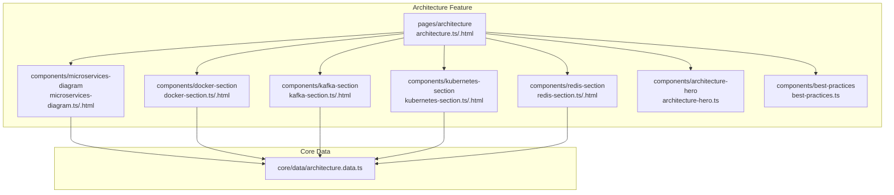
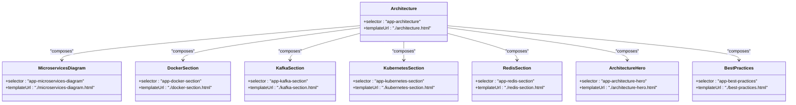
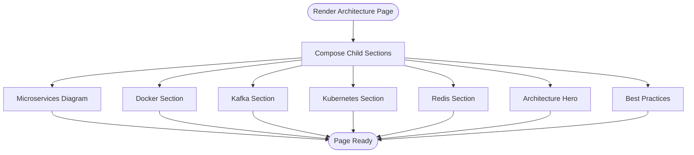
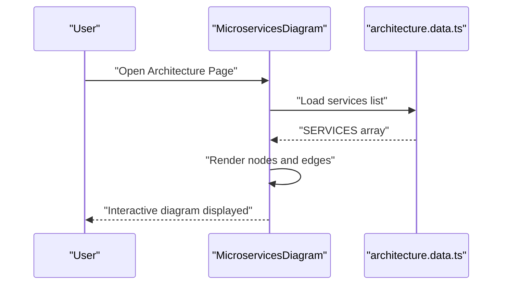
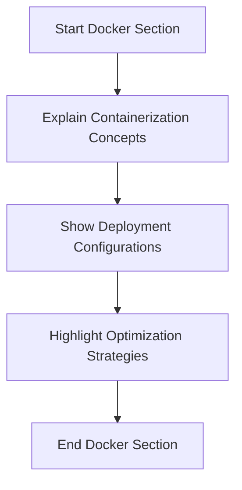
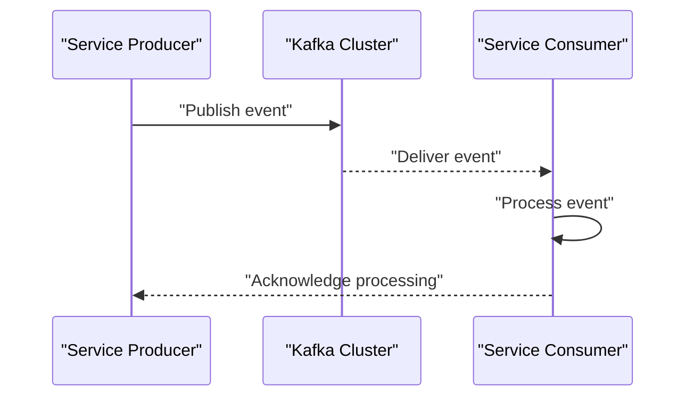
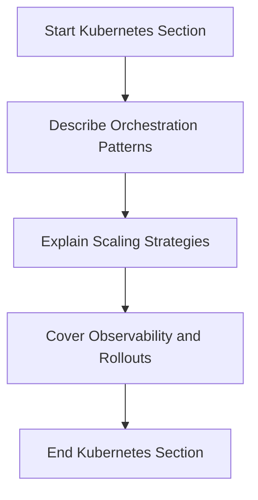
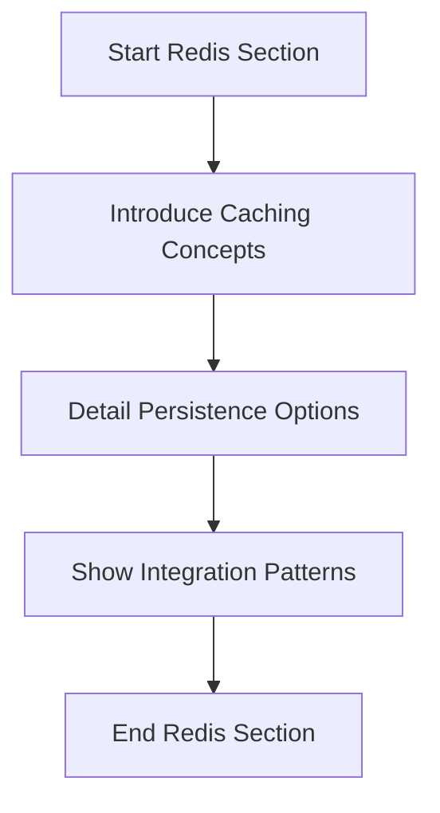
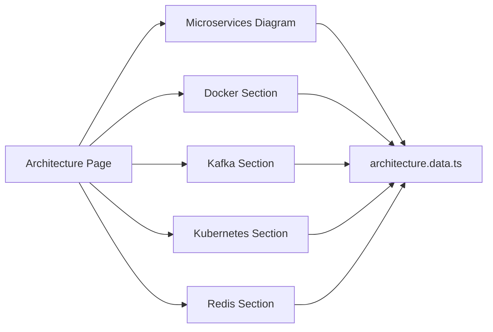

# Architecture Documentation Module

<cite>
**Referenced Files in This Document**
- [architecture.ts](file://src/app/features/architecture/pages/architecture/architecture.ts)
- [architecture.html](file://src/app/features/architecture/pages/architecture/architecture.html)
- [microservices-diagram.ts](file://src/app/features/architecture/components/microservices-diagram/microservices-diagram.ts)
- [microservices-diagram.html](file://src/app/features/architecture/components/microservices-diagram/microservices-diagram.html)
- [docker-section.ts](file://src/app/features/architecture/components/docker-section/docker-section.ts)
- [docker-section.html](file://src/app/features/architecture/components/docker-section/docker-section.html)
- [kafka-section.ts](file://src/app/features/architecture/components/kafka-section/kafka-section.ts)
- [kafka-section.html](file://src/app/features/architecture/components/kafka-section/kafka-section.html)
- [kubernetes-section.ts](file://src/app/features/architecture/components/kubernetes-section/kubernetes-section.ts)
- [kubernetes-section.html](file://src/app/features/architecture/components/kubernetes-section/kubernetes-section.html)
- [redis-section.ts](file://src/app/features/architecture/components/redis-section/redis-section.ts)
- [redis-section.html](file://src/app/features/architecture/components/redis-section/redis-section.html)
- [architecture-hero.ts](file://src/app/features/architecture/components/architecture-hero/architecture-hero.ts)
- [best-practices.ts](file://src/app/features/architecture/components/best-practices/best-practices.ts)
- [architecture.data.ts](file://src/app/core/data/architecture.data.ts)
</cite>

## Table of Contents
1. [Introduction](#introduction)
2. [Project Structure](#project-structure)
3. [Core Components](#core-components)
4. [Architecture Overview](#architecture-overview)
5. [Detailed Component Analysis](#detailed-component-analysis)
6. [Dependency Analysis](#dependency-analysis)
7. [Performance Considerations](#performance-considerations)
8. [Troubleshooting Guide](#troubleshooting-guide)
9. [Conclusion](#conclusion)

## Introduction
This document describes the Architecture Documentation Module for the MegaPortfolio application. It focuses on the main Architecture page component that acts as a container for all architecture-related content and details the specialized sections: Microservices Diagram, Docker, Kafka, Kubernetes, and Redis. The module is structured using Angular components with clear separation of concerns, enabling scalable expansion of educational content and interactive diagrams.

## Project Structure
The Architecture Documentation Module resides under the features layer and is organized by feature (architecture). Each section is implemented as its own component with a TypeScript class and an HTML template. Shared data for architecture topics is centralized in a dedicated data file.

**Diagram sources**
- [architecture.ts:1-10](file://src/app/features/architecture/pages/architecture/architecture.ts#L1-L10)
- [microservices-diagram.ts:1-10](file://src/app/features/architecture/components/microservices-diagram/microservices-diagram.ts#L1-L10)
- [docker-section.ts:1-10](file://src/app/features/architecture/components/docker-section/docker-section.ts#L1-L10)
- [kafka-section.ts:1-10](file://src/app/features/architecture/components/kafka-section/kafka-section.ts#L1-L10)
- [kubernetes-section.ts:1-10](file://src/app/features/architecture/components/kubernetes-section/kubernetes-section.ts#L1-L10)
- [redis-section.ts:1-10](file://src/app/features/architecture/components/redis-section/redis-section.ts#L1-L10)
- [architecture-hero.ts:1-10](file://src/app/features/architecture/components/architecture-hero/architecture-hero.ts#L1-L10)
- [best-practices.ts:1-10](file://src/app/features/architecture/components/best-practices/best-practices.ts#L1-L10)
- [architecture.data.ts:1-11](file://src/app/core/data/architecture.data.ts#L1-L11)

**Section sources**
- [architecture.ts:1-10](file://src/app/features/architecture/pages/architecture/architecture.ts#L1-L10)
- [architecture.html:1-2](file://src/app/features/architecture/pages/architecture/architecture.html#L1-L2)
- [architecture.data.ts:1-11](file://src/app/core/data/architecture.data.ts#L1-L11)

## Core Components
- Architecture Page (container): Declares the selector and template for the main architecture view. It serves as the root component for this feature and composes child sections.
- Microservices Diagram: Presents service relationships and communication patterns through an interactive diagram component.
- Docker Section: Documents containerization strategies and deployment configurations.
- Kafka Section: Explains event-driven messaging architecture and message flow.
- Kubernetes Section: Details orchestration patterns and scaling strategies.
- Redis Section: Covers caching strategies and data persistence approaches.
- Architecture Hero and Best Practices: Provide introductory context and guidance for architectural decisions.

Key responsibilities:
- Containerization of content via modular components.
- Centralized data access for shared architecture entities.
- Clear separation between presentation (HTML templates) and logic (TypeScript classes).

**Section sources**
- [architecture.ts:1-10](file://src/app/features/architecture/pages/architecture/architecture.ts#L1-L10)
- [microservices-diagram.ts:1-10](file://src/app/features/architecture/components/microservices-diagram/microservices-diagram.ts#L1-L10)
- [docker-section.ts:1-10](file://src/app/features/architecture/components/docker-section/docker-section.ts#L1-L10)
- [kafka-section.ts:1-10](file://src/app/features/architecture/components/kafka-section/kafka-section.ts#L1-L10)
- [kubernetes-section.ts:1-10](file://src/app/features/architecture/components/kubernetes-section/kubernetes-section.ts#L1-L10)
- [redis-section.ts:1-10](file://src/app/features/architecture/components/redis-section/redis-section.ts#L1-L10)
- [architecture-hero.ts:1-10](file://src/app/features/architecture/components/architecture-hero/architecture-hero.ts#L1-L10)
- [best-practices.ts:1-10](file://src/app/features/architecture/components/best-practices/best-practices.ts#L1-L10)

## Architecture Overview
The Architecture Documentation Module follows a feature-based architecture where each topic is encapsulated in its own component. The main Architecture page orchestrates these components to present a cohesive narrative about system design, deployment, and operational concerns.

**Diagram sources**
- [architecture.ts:1-10](file://src/app/features/architecture/pages/architecture/architecture.ts#L1-L10)
- [microservices-diagram.ts:1-10](file://src/app/features/architecture/components/microservices-diagram/microservices-diagram.ts#L1-L10)
- [docker-section.ts:1-10](file://src/app/features/architecture/components/docker-section/docker-section.ts#L1-L10)
- [kafka-section.ts:1-10](file://src/app/features/architecture/components/kafka-section/kafka-section.ts#L1-L10)
- [kubernetes-section.ts:1-10](file://src/app/features/architecture/components/kubernetes-section/kubernetes-section.ts#L1-L10)
- [redis-section.ts:1-10](file://src/app/features/architecture/components/redis-section/redis-section.ts#L1-L10)
- [architecture-hero.ts:1-10](file://src/app/features/architecture/components/architecture-hero/architecture-hero.ts#L1-L10)
- [best-practices.ts:1-10](file://src/app/features/architecture/components/best-practices/best-practices.ts#L1-L10)

## Detailed Component Analysis

### Architecture Page (Container)
The Architecture page is the entry point for the documentation module. It declares the component metadata and template path, acting as a composition root for all subsections.

- Responsibilities:
  - Define the component selector and template binding.
  - Host child components representing each architectural topic.
  - Maintain a clean surface area for future extensions.

**Diagram sources**
- [architecture.ts:1-10](file://src/app/features/architecture/pages/architecture/architecture.ts#L1-L10)
- [architecture.html:1-2](file://src/app/features/architecture/pages/architecture/architecture.html#L1-L2)

**Section sources**
- [architecture.ts:1-10](file://src/app/features/architecture/pages/architecture/architecture.ts#L1-L10)
- [architecture.html:1-2](file://src/app/features/architecture/pages/architecture/architecture.html#L1-L2)

### Microservices Diagram
The Microservices Diagram component visualizes service relationships and communication patterns. It can be extended to include interactive elements such as hover states, click-to-expand details, and animated connections.

- Key aspects:
  - Declarative template for rendering nodes and edges.
  - Potential integration with SVG or canvas for dynamic visuals.
  - Reusable across different architecture views.

**Diagram sources**
- [microservices-diagram.ts:1-10](file://src/app/features/architecture/components/microservices-diagram/microservices-diagram.ts#L1-L10)
- [microservices-diagram.html:1-2](file://src/app/features/architecture/components/microservices-diagram/microservices-diagram.html#L1-L2)
- [architecture.data.ts:1-11](file://src/app/core/data/architecture.data.ts#L1-L11)

**Section sources**
- [microservices-diagram.ts:1-10](file://src/app/features/architecture/components/microservices-diagram/microservices-diagram.ts#L1-L10)
- [microservices-diagram.html:1-2](file://src/app/features/architecture/components/microservices-diagram/microservices-diagram.html#L1-L2)
- [architecture.data.ts:1-11](file://src/app/core/data/architecture.data.ts#L1-L11)

### Docker Section
The Docker Section documents containerization strategies and deployment configurations. It provides educational content explaining how services are packaged, orchestrated, and deployed using containers.

- Focus areas:
  - Container image structure and best practices.
  - Environment configuration and secrets management.
  - Multi-stage builds and optimization techniques.

[No sources needed since this section explains conceptual content without analyzing specific files]

**Section sources**
- [docker-section.ts:1-10](file://src/app/features/architecture/components/docker-section/docker-section.ts#L1-L10)
- [docker-section.html:1-2](file://src/app/features/architecture/components/docker-section/docker-section.html#L1-L2)

### Kafka Section
The Kafka Section covers event-driven messaging architecture and message flow. It explains producers, consumers, topics, and the role of Kafka in decoupling services.

- Topics covered:
  - Event sourcing and streaming concepts.
  - Message routing and partitioning strategies.
  - Reliability guarantees and error handling.

[No sources needed since this section explains conceptual content without analyzing specific files]

**Section sources**
- [kafka-section.ts:1-10](file://src/app/features/architecture/components/kafka-section/kafka-section.ts#L1-L10)
- [kafka-section.html:1-2](file://src/app/features/architecture/components/kafka-section/kafka-section.html#L1-L2)

### Kubernetes Section
The Kubernetes Section details orchestration patterns and scaling strategies. It explains how microservices are scheduled, scaled, and managed within a cluster.

- Key themes:
  - Deployments, Services, and Ingress resources.
  - Horizontal Pod Autoscaling and resource quotas.
  - Health checks and rolling updates.

[No sources needed since this section explains conceptual content without analyzing specific files]

**Section sources**
- [kubernetes-section.ts:1-10](file://src/app/features/architecture/components/kubernetes-section/kubernetes-section.ts#L1-L10)
- [kubernetes-section.html:1-2](file://src/app/features/architecture/components/kubernetes-section/kubernetes-section.html#L1-L2)

### Redis Section
The Redis Section covers caching strategies and data persistence approaches. It explains how Redis accelerates read-heavy operations and ensures data durability when required.

- Highlights:
  - Cache invalidation policies and TTL usage.
  - Persistence modes (RDB vs AOF).
  - Integration patterns with microservices.

[No sources needed since this section explains conceptual content without analyzing specific files]

**Section sources**
- [redis-section.ts:1-10](file://src/app/features/architecture/components/redis-section/redis-section.ts#L1-L10)
- [redis-section.html:1-2](file://src/app/features/architecture/components/redis-section/redis-section.html#L1-L2)

### Architecture Hero and Best Practices
These components provide contextual introductions and guidance for architectural decisions. They set the stage for deeper dives into each section and offer actionable recommendations.

- Purpose:
  - Establish terminology and goals.
  - Present principles and trade-offs.
  - Guide readers through the module’s narrative.

**Section sources**
- [architecture-hero.ts:1-10](file://src/app/features/architecture/components/architecture-hero/architecture-hero.ts#L1-L10)
- [best-practices.ts:1-10](file://src/app/features/architecture/components/best-practices/best-practices.ts#L1-L10)

## Dependency Analysis
The Architecture page composes multiple child components, while shared data is centralized in a single data file. This structure promotes cohesion within components and loose coupling to shared data.

**Diagram sources**
- [architecture.ts:1-10](file://src/app/features/architecture/pages/architecture/architecture.ts#L1-L10)
- [microservices-diagram.ts:1-10](file://src/app/features/architecture/components/microservices-diagram/microservices-diagram.ts#L1-L10)
- [docker-section.ts:1-10](file://src/app/features/architecture/components/docker-section/docker-section.ts#L1-L10)
- [kafka-section.ts:1-10](file://src/app/features/architecture/components/kafka-section/kafka-section.ts#L1-L10)
- [kubernetes-section.ts:1-10](file://src/app/features/architecture/components/kubernetes-section/kubernetes-section.ts#L1-L10)
- [redis-section.ts:1-10](file://src/app/features/architecture/components/redis-section/redis-section.ts#L1-L10)
- [architecture.data.ts:1-11](file://src/app/core/data/architecture.data.ts#L1-L11)

**Section sources**
- [architecture.ts:1-10](file://src/app/features/architecture/pages/architecture/architecture.ts#L1-L10)
- [architecture.data.ts:1-11](file://src/app/core/data/architecture.data.ts#L1-L11)

## Performance Considerations
- Lazy loading: Ensure each section component is lazy-loaded to reduce initial bundle size.
- Memoization: Cache computed values for diagrams and lists to avoid unnecessary recalculations.
- Image and asset optimization: Use optimized assets for diagrams and animations.
- Scroll-triggered animations: Implement intersection observers to trigger animations only when sections enter the viewport.
- Memory management: Clean up event listeners and subscriptions in component lifecycle hooks.

[No sources needed since this section provides general guidance]

## Troubleshooting Guide
Common issues and resolutions:
- Missing selectors or templates: Verify component metadata matches actual file paths and selectors.
- Data not rendering: Confirm the shared data file exports the expected arrays and is imported correctly.
- Animation glitches: Check intersection observer thresholds and ensure DOM elements exist before triggering animations.
- Build errors: Validate Angular imports and ensure all referenced components are declared in the correct modules.

[No sources needed since this section provides general guidance]

## Conclusion
The Architecture Documentation Module provides a modular, extensible foundation for presenting system design, deployment, and operational topics. By separating concerns into focused components and centralizing shared data, the module supports rich educational content and interactive diagrams. Future enhancements can include advanced interactivity, richer visualizations, and expanded content for each architectural domain.

[No sources needed since this section summarizes without analyzing specific files]