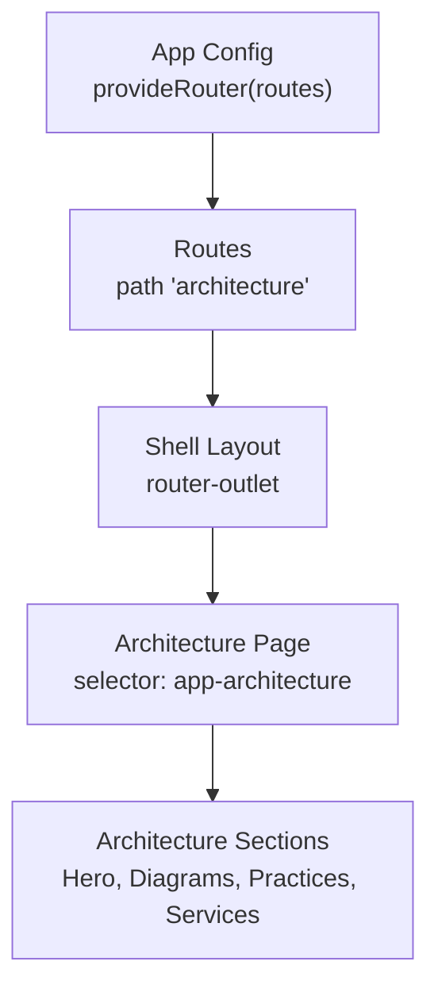
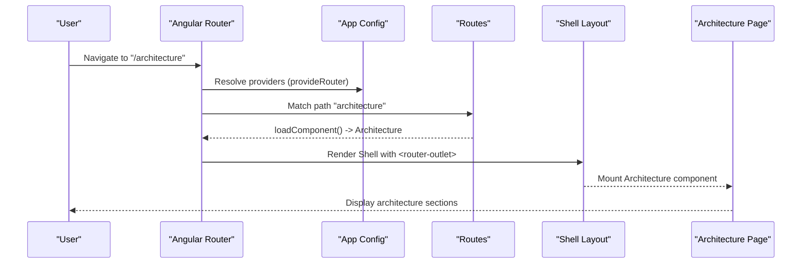
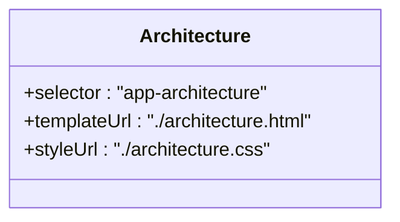
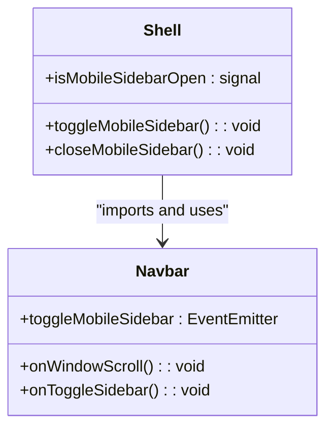
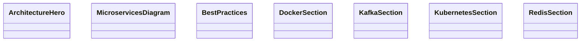
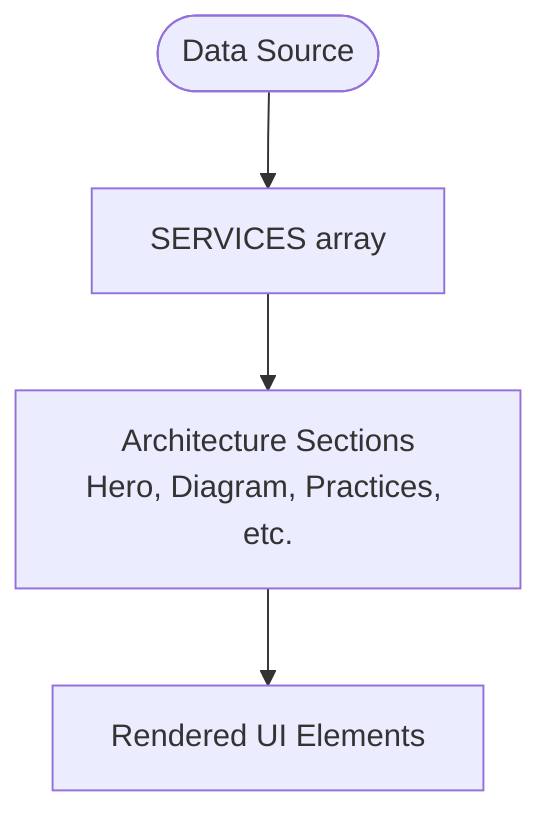
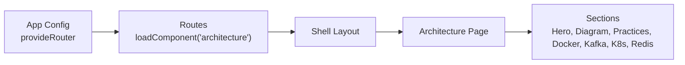

# Architecture Page Component

<cite>
**Referenced Files in This Document**
- [architecture.ts](file://src/app/features/architecture/pages/architecture/architecture.ts)
- [architecture.html](file://src/app/features/architecture/pages/architecture/architecture.html)
- [app.routes.ts](file://src/app/app.routes.ts)
- [app.config.ts](file://src/app/app.config.ts)
- [shell.ts](file://src/app/shared/layout/shell/shell.ts)
- [shell.html](file://src/app/shared/layout/shell/shell.html)
- [navbar.ts](file://src/app/shared/layout/navbar/navbar.ts)
- [architecture.data.ts](file://src/app/core/data/architecture.data.ts)
- [architecture-hero.ts](file://src/app/features/architecture/components/architecture-hero/architecture-hero.ts)
- [microservices-diagram.ts](file://src/app/features/architecture/components/microservices-diagram/microservices-diagram.ts)
- [best-practices.ts](file://src/app/features/architecture/components/best-practices/best-practices.ts)
- [docker-section.ts](file://src/app/features/architecture/components/docker-section/docker-section.ts)
- [kafka-section.ts](file://src/app/features/architecture/components/kafka-section/kafka-section.ts)
- [kubernetes-section.ts](file://src/app/features/architecture/components/kubernetes-section/kubernetes-section.ts)
- [redis-section.ts](file://src/app/features/architecture/components/redis-section/redis-section.ts)
</cite>

## Table of Contents
1. [Introduction](#introduction)
2. [Project Structure](#project-structure)
3. [Core Components](#core-components)
4. [Architecture Overview](#architecture-overview)
5. [Detailed Component Analysis](#detailed-component-analysis)
6. [Dependency Analysis](#dependency-analysis)
7. [Performance Considerations](#performance-considerations)
8. [Troubleshooting Guide](#troubleshooting-guide)
9. [Conclusion](#conclusion)

## Introduction
This document explains the Architecture Page component, which acts as the main container for all architecture-related content in the application. It covers how the page is routed and lazy-loaded, how it integrates with the global shell layout, and how it orchestrates multiple subcomponents that represent different architectural concepts (hero, microservices diagram, best practices, Docker, Kafka, Kubernetes, Redis). It also describes navigation patterns and user interactions within the architecture documentation.

## Project Structure
The Architecture feature follows a feature-based structure:
- A page-level component under features/architecture/pages/architecture serves as the route entry point.
- Feature-specific components live under features/architecture/components and encapsulate individual sections or diagrams.
- Shared layout (Shell, Navbar, Footer) wraps all pages via Angular Router’s outlet.
- Routing is configured centrally with lazy loading to load the Architecture page only when needed.

**Diagram sources**
- [app.config.ts:10-25](file://src/app/app.config.ts#L10-L25)
- [app.routes.ts:18-24](file://src/app/app.routes.ts#L18-L24)
- [shell.ts:10-14](file://src/app/shared/layout/shell/shell.ts#L10-L14)
- [shell.html:8-10](file://src/app/shared/layout/shell/shell.html#L8-L10)
- [architecture.ts:3-8](file://src/app/features/architecture/pages/architecture/architecture.ts#L3-L8)

**Section sources**
- [app.config.ts:10-25](file://src/app/app.config.ts#L10-L25)
- [app.routes.ts:18-24](file://src/app/app.routes.ts#L18-L24)
- [shell.ts:10-14](file://src/app/shared/layout/shell/shell.ts#L10-L14)
- [shell.html:8-10](file://src/app/shared/layout/shell/shell.html#L8-L10)
- [architecture.ts:3-8](file://src/app/features/architecture/pages/architecture/architecture.ts#L3-L8)

## Core Components
- Architecture Page: The top-level component for the /architecture route. It currently renders a minimal template and is intended to host the various architecture sections.
- Architecture Sections (components):
  - Hero section for introductory content.
  - Microservices diagram for visualizing service interactions.
  - Best practices for guidelines and recommendations.
  - Technology sections: Docker, Kafka, Kubernetes, Redis.
- Data source: Centralized constants for services used across architecture sections.

Key responsibilities:
- Provide a container for architecture content.
- Compose and render child sections declaratively in its template.
- Optionally consume shared data (e.g., services list) to populate UI elements.

**Section sources**
- [architecture.ts:3-8](file://src/app/features/architecture/pages/architecture/architecture.ts#L3-L8)
- [architecture.html:1-2](file://src/app/features/architecture/pages/architecture/architecture.html#L1-L2)
- [architecture-hero.ts:3-8](file://src/app/features/architecture/components/architecture-hero/architecture-hero.ts#L3-L8)
- [microservices-diagram.ts:3-8](file://src/app/features/architecture/components/microservices-diagram/microservices-diagram.ts#L3-L8)
- [best-practices.ts:3-8](file://src/app/features/architecture/components/best-practices/best-practices.ts#L3-L8)
- [docker-section.ts:3-8](file://src/app/features/architecture/components/docker-section/docker-section.ts#L3-L8)
- [kafka-section.ts:3-8](file://src/app/features/architecture/components/kafka-section/kafka-section.ts#L3-L8)
- [kubernetes-section.ts:3-8](file://src/app/features/architecture/components/kubernetes-section/kubernetes-section.ts#L3-L8)
- [redis-section.ts:3-8](file://src/app/features/architecture/components/redis-section/redis-section.ts#L3-L8)
- [architecture.data.ts:1-11](file://src/app/core/data/architecture.data.ts#L1-L11)

## Architecture Overview
The Architecture Page is loaded lazily via Angular Router. When users navigate to /architecture, the router dynamically imports the Architecture component and mounts it inside the Shell layout’s router-outlet. The Shell provides persistent chrome (Navbar, Footer, Mobile Sidebar), while the Architecture Page composes the relevant sections.

**Diagram sources**
- [app.config.ts:10-25](file://src/app/app.config.ts#L10-L25)
- [app.routes.ts:18-24](file://src/app/app.routes.ts#L18-L24)
- [shell.ts:10-14](file://src/app/shared/layout/shell/shell.ts#L10-L14)
- [shell.html:8-10](file://src/app/shared/layout/shell/shell.html#L8-L10)
- [architecture.ts:3-8](file://src/app/features/architecture/pages/architecture/architecture.ts#L3-L8)

## Detailed Component Analysis

### Architecture Page Container
- Purpose: Acts as the root for the architecture feature.
- Template: Currently minimal; should be extended to include child section components.
- Integration: Loaded by the router and rendered within the Shell layout.

**Diagram sources**
- [architecture.ts:3-8](file://src/app/features/architecture/pages/architecture/architecture.ts#L3-L8)
- [architecture.html:1-2](file://src/app/features/architecture/pages/architecture/architecture.html#L1-L2)

**Section sources**
- [architecture.ts:3-8](file://src/app/features/architecture/pages/architecture/architecture.ts#L3-L8)
- [architecture.html:1-2](file://src/app/features/architecture/pages/architecture/architecture.html#L1-L2)

### Shell Layout and Navigation
- Shell provides the persistent header, footer, and mobile sidebar, and hosts the current route via router-outlet.
- Navbar handles scroll state and emits events to toggle the mobile sidebar.

**Diagram sources**
- [shell.ts:10-14](file://src/app/shared/layout/shell/shell.ts#L10-L14)
- [shell.html:1-12](file://src/app/shared/layout/shell/shell.html#L1-L12)
- [navbar.ts:10-14](file://src/app/shared/layout/navbar/navbar.ts#L10-L14)
- [navbar.ts:15-29](file://src/app/shared/layout/navbar/navbar.ts#L15-L29)

**Section sources**
- [shell.ts:10-14](file://src/app/shared/layout/shell/shell.ts#L10-L14)
- [shell.html:1-12](file://src/app/shared/layout/shell/shell.html#L1-L12)
- [navbar.ts:10-14](file://src/app/shared/layout/navbar/navbar.ts#L10-L14)
- [navbar.ts:15-29](file://src/app/shared/layout/navbar/navbar.ts#L15-L29)

### Architecture Sections Components
Each section component is a standalone Angular component with its own template and styles. They are designed to be composed within the Architecture Page template to build the full documentation experience.

**Diagram sources**
- [architecture-hero.ts:3-8](file://src/app/features/architecture/components/architecture-hero/architecture-hero.ts#L3-L8)
- [microservices-diagram.ts:3-8](file://src/app/features/architecture/components/microservices-diagram/microservices-diagram.ts#L3-L8)
- [best-practices.ts:3-8](file://src/app/features/architecture/components/best-practices/best-practices.ts#L3-L8)
- [docker-section.ts:3-8](file://src/app/features/architecture/components/docker-section/docker-section.ts#L3-L8)
- [kafka-section.ts:3-8](file://src/app/features/architecture/components/kafka-section/kafka-section.ts#L3-L8)
- [kubernetes-section.ts:3-8](file://src/app/features/architecture/components/kubernetes-section/kubernetes-section.ts#L3-L8)
- [redis-section.ts:3-8](file://src/app/features/architecture/components/redis-section/redis-section.ts#L3-L8)

**Section sources**
- [architecture-hero.ts:3-8](file://src/app/features/architecture/components/architecture-hero/architecture-hero.ts#L3-L8)
- [microservices-diagram.ts:3-8](file://src/app/features/architecture/components/microservices-diagram/microservices-diagram.ts#L3-L8)
- [best-practices.ts:3-8](file://src/app/features/architecture/components/best-practices/best-practices.ts#L3-L8)
- [docker-section.ts:3-8](file://src/app/features/architecture/components/docker-section/docker-section.ts#L3-L8)
- [kafka-section.ts:3-8](file://src/app/features/architecture/components/kafka-section/kafka-section.ts#L3-L8)
- [kubernetes-section.ts:3-8](file://src/app/features/architecture/components/kubernetes-section/kubernetes-section.ts#L3-L8)
- [redis-section.ts:3-8](file://src/app/features/architecture/components/redis-section/redis-section.ts#L3-L8)

### Data Model for Architecture Content
A centralized data file exposes a list of services that can be consumed by architecture sections to display consistent information.

**Diagram sources**
- [architecture.data.ts:1-11](file://src/app/core/data/architecture.data.ts#L1-L11)

**Section sources**
- [architecture.data.ts:1-11](file://src/app/core/data/architecture.data.ts#L1-L11)

## Dependency Analysis
- Routing dependency: The Architecture Page is imported lazily through routes configuration.
- Layout dependency: All pages are wrapped by the Shell layout, which includes Navbar and Footer.
- Feature dependencies: Architecture sections are independent components that can be composed by the Architecture Page.

**Diagram sources**
- [app.config.ts:10-25](file://src/app/app.config.ts#L10-L25)
- [app.routes.ts:18-24](file://src/app/app.routes.ts#L18-L24)
- [shell.ts:10-14](file://src/app/shared/layout/shell/shell.ts#L10-L14)
- [architecture.ts:3-8](file://src/app/features/architecture/pages/architecture/architecture.ts#L3-L8)

**Section sources**
- [app.config.ts:10-25](file://src/app/app.config.ts#L10-L25)
- [app.routes.ts:18-24](file://src/app/app.routes.ts#L18-L24)
- [shell.ts:10-14](file://src/app/shared/layout/shell/shell.ts#L10-L14)
- [architecture.ts:3-8](file://src/app/features/architecture/pages/architecture/architecture.ts#L3-L8)

## Performance Considerations
- Lazy Loading: The Architecture Page is loaded on demand via loadComponent, reducing initial bundle size and improving first paint performance.
- Standalone Components: Each section is a standalone component, enabling tree-shaking and selective loading.
- Minimal Logic: Current components are presentational; keep business logic minimal to maintain fast rendering.
- Data Access: Prefer importing lightweight data arrays (like SERVICES) rather than heavy services for static content.

[No sources needed since this section provides general guidance]

## Troubleshooting Guide
- Route not found: Ensure the path "architecture" exists in routes and points to the correct loadComponent import.
- Blank page after navigation: Verify that the Shell layout is properly configured and that the router-outlet is present in the Shell template.
- Missing sections: Confirm that the Architecture Page template includes the necessary section components and that their selectors match usage.
- Navbar interactions: Check that the Navbar emits the toggle event and that the Shell listens to it to control the mobile sidebar.

**Section sources**
- [app.routes.ts:18-24](file://src/app/app.routes.ts#L18-L24)
- [shell.ts:10-14](file://src/app/shared/layout/shell/shell.ts#L10-L14)
- [shell.html:8-10](file://src/app/shared/layout/shell/shell.html#L8-L10)
- [navbar.ts:15-29](file://src/app/shared/layout/navbar/navbar.ts#L15-L29)

## Conclusion
The Architecture Page component is the central entry point for architecture documentation within the application. It is lazily loaded via Angular Router and rendered inside the Shell layout. While the current implementation is minimal, it is structured to compose multiple dedicated section components that cover hero content, microservices diagrams, best practices, and technology-specific sections. With this foundation, you can extend the Architecture Page template to orchestrate these sections and deliver a comprehensive, navigable architecture documentation experience.