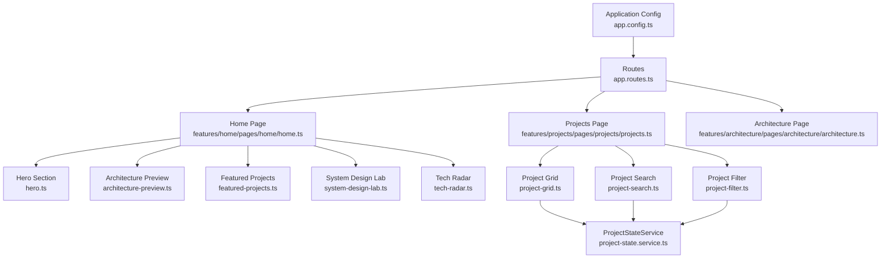
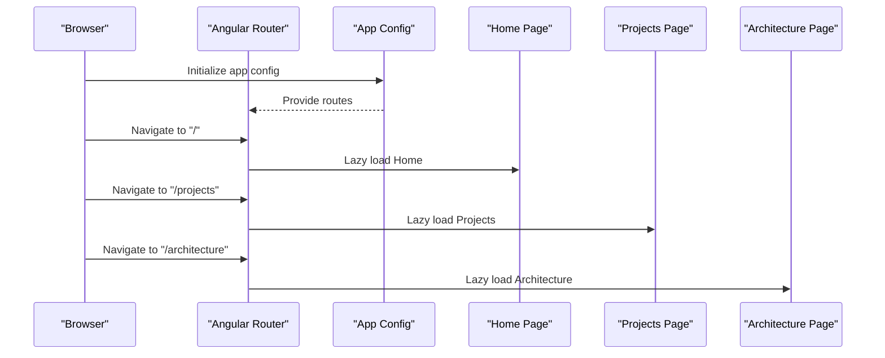
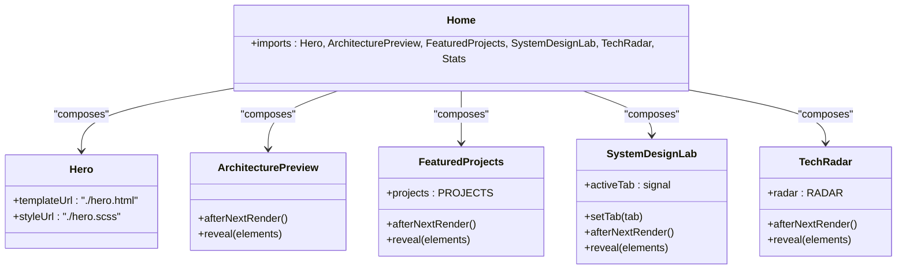
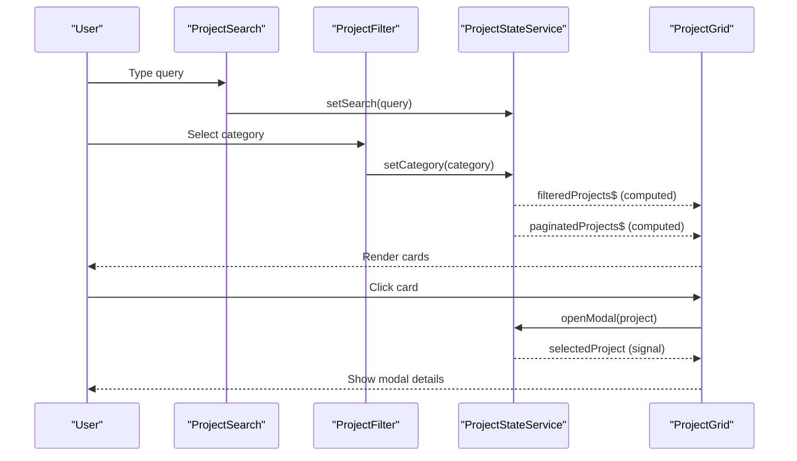
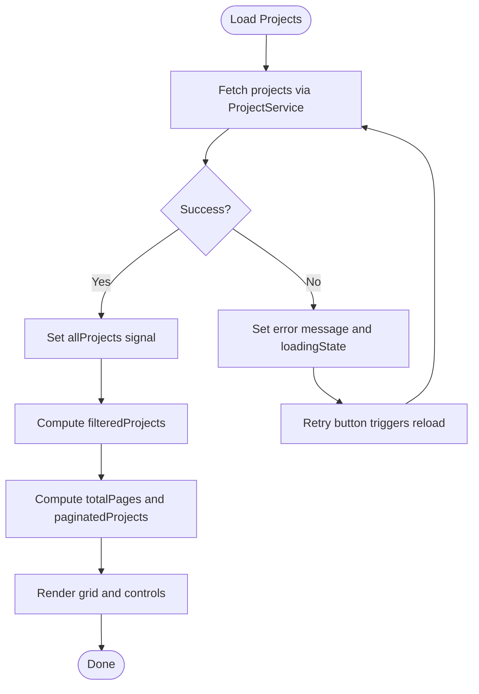
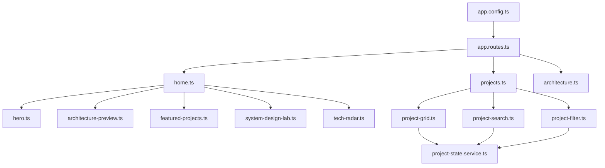

# Features & Modules

<cite>
**Referenced Files in This Document**
- [app.routes.ts](file://src/app/app.routes.ts)
- [app.config.ts](file://src/app/app.config.ts)
- [home.ts](file://src/app/features/home/pages/home/home.ts)
- [hero.ts](file://src/app/features/home/sections/hero/hero.ts)
- [architecture-preview.ts](file://src/app/features/home/sections/architecture-preview/architecture-preview.ts)
- [featured-projects.ts](file://src/app/features/home/sections/featured-projects/featured-projects.ts)
- [system-design-lab.ts](file://src/app/features/home/sections/system-design-lab/system-design-lab.ts)
- [tech-radar.ts](file://src/app/features/home/sections/tech-radar/tech-radar.ts)
- [projects.ts](file://src/app/features/projects/pages/projects/projects.ts)
- [project-grid.ts](file://src/app/features/projects/components/project-grid/project-grid.ts)
- [project-search.ts](file://src/app/features/projects/components/project-search/project-search.ts)
- [project-filter.ts](file://src/app/features/projects/components/project-filter/project-filter.ts)
- [project-state.service.ts](file://src/app/features/projects/services/project-state.service.ts)
- [projects.data.ts](file://src/app/core/data/projects.data.ts)
- [architecture.ts](file://src/app/features/architecture/pages/architecture/architecture.ts)
</cite>

## Table of Contents
1. [Introduction](#introduction)
2. [Project Structure](#project-structure)
3. [Core Components](#core-components)
4. [Architecture Overview](#architecture-overview)
5. [Detailed Component Analysis](#detailed-component-analysis)
6. [Dependency Analysis](#dependency-analysis)
7. [Performance Considerations](#performance-considerations)
8. [Troubleshooting Guide](#troubleshooting-guide)
9. [Conclusion](#conclusion)
10. [Appendices](#appendices)

## Introduction
This document provides comprehensive documentation for the MegaPortfolio application’s feature modules. It covers the home page features (hero, architecture preview, featured projects showcase, system design lab, tech radar visualization, and statistics counter), the projects management system (grid display, filtering, search, pagination, and modal details), and the architecture documentation module (microservices diagrams, Docker containerization, Kafka messaging, Kubernetes deployment, and Redis caching strategies). It also explains feature composition patterns, route definitions, component interactions, data binding, event handling, state management, responsive design considerations, and mobile-first implementation approaches.

## Project Structure
The application is organized into feature-based modules under src/app/features, with shared utilities and core services under src/app/core and shared UI components under src/app/shared. Routes are defined centrally and lazy-load feature pages. The home page composes multiple sections as standalone components. The projects feature composes a hero, search, filter, and grid, while delegating state to a root-level service. The architecture feature aggregates several subcomponents for microservices, Docker, Kafka, Kubernetes, and Redis.

**Diagram sources**
- [app.config.ts:1-26](file://src/app/app.config.ts#L1-L26)
- [app.routes.ts:1-31](file://src/app/app.routes.ts#L1-L31)
- [home.ts:1-25](file://src/app/features/home/pages/home/home.ts#L1-L25)
- [projects.ts:1-16](file://src/app/features/projects/pages/projects/projects.ts#L1-L16)
- [architecture.ts:1-10](file://src/app/features/architecture/pages/architecture/architecture.ts#L1-L10)
- [project-grid.ts:1-20](file://src/app/features/projects/components/project-grid/project-grid.ts#L1-L20)
- [project-search.ts:1-43](file://src/app/features/projects/components/project-search/project-search.ts#L1-L43)
- [project-filter.ts:1-35](file://src/app/features/projects/components/project-filter/project-filter.ts#L1-L35)
- [project-state.service.ts:1-157](file://src/app/features/projects/services/project-state.service.ts#L1-L157)

**Section sources**
- [app.config.ts:1-26](file://src/app/app.config.ts#L1-L26)
- [app.routes.ts:1-31](file://src/app/app.routes.ts#L1-L31)

## Core Components
- Home page composes six standalone sections: Hero, Architecture Preview, Featured Projects, System Design Lab, Tech Radar, and Stats. Each section is a standalone Angular component with its own template and styles.
- Projects page composes four components: ProjectHero, ProjectSearch, ProjectFilter, and ProjectGrid. Data flow is centralized via ProjectStateService using Angular signals and computed values.
- Architecture page serves as a container for architecture documentation components such as microservices diagram, Docker, Kafka, Kubernetes, and Redis sections.

Key responsibilities:
- Home sections handle presentation and localized text where applicable, and trigger animations on render.
- Projects components coordinate user input (search/filter) and display paginated results from the shared state.
- Architecture page integrates domain-specific visualizations and explanations.

**Section sources**
- [home.ts:1-25](file://src/app/features/home/pages/home/home.ts#L1-L25)
- [projects.ts:1-16](file://src/app/features/projects/pages/projects/projects.ts#L1-L16)
- [architecture.ts:1-10](file://src/app/features/architecture/pages/architecture/architecture.ts#L1-L10)

## Architecture Overview
The application uses Angular’s router to define top-level routes that lazy-load feature pages. Application configuration sets up routing, HTTP client, hydration, and internationalization. Feature pages import their respective components and compose them within templates.

**Diagram sources**
- [app.config.ts:1-26](file://src/app/app.config.ts#L1-L26)
- [app.routes.ts:1-31](file://src/app/app.routes.ts#L1-L31)

## Detailed Component Analysis

### Home Page Features
The home page is composed of several sections, each encapsulated as a standalone component. These sections provide rich visuals and interactive elements.

- Hero section: Displays introductory content with localization support.
- Architecture preview: Reveals architectural elements with animation on render.
- Featured projects showcase: Presents curated projects with animated reveal.
- System design lab: Provides tabbed content for exploring system design topics.
- Tech radar visualization: Shows technology categories and maturity levels.
- Statistics counter: Displays key metrics (e.g., project counts, technologies).

**Diagram sources**
- [home.ts:1-25](file://src/app/features/home/pages/home/home.ts#L1-L25)
- [hero.ts:1-12](file://src/app/features/home/sections/hero/hero.ts#L1-L12)
- [architecture-preview.ts:1-27](file://src/app/features/home/sections/architecture-preview/architecture-preview.ts#L1-L27)
- [featured-projects.ts:1-31](file://src/app/features/home/sections/featured-projects/featured-projects.ts#L1-L31)
- [system-design-lab.ts:1-34](file://src/app/features/home/sections/system-design-lab/system-design-lab.ts#L1-L34)
- [tech-radar.ts:1-31](file://src/app/features/home/sections/tech-radar/tech-radar.ts#L1-L31)

**Section sources**
- [home.ts:1-25](file://src/app/features/home/pages/home/home.ts#L1-L25)
- [hero.ts:1-12](file://src/app/features/home/sections/hero/hero.ts#L1-L12)
- [architecture-preview.ts:1-27](file://src/app/features/home/sections/architecture-preview/architecture-preview.ts#L1-L27)
- [featured-projects.ts:1-31](file://src/app/features/home/sections/featured-projects/featured-projects.ts#L1-L31)
- [system-design-lab.ts:1-34](file://src/app/features/home/sections/system-design-lab/system-design-lab.ts#L1-L34)
- [tech-radar.ts:1-31](file://src/app/features/home/sections/tech-radar/tech-radar.ts#L1-L31)

### Projects Management System
The projects feature implements a robust management system with grid display, filtering, search, pagination, and modal details.

- ProjectGrid subscribes to an observable stream of projects and renders cards.
- ProjectSearch binds to a signal with debounced updates to avoid excessive re-renders.
- ProjectFilter exposes selectable categories and updates global state.
- ProjectStateService centralizes all state using signals and computed properties, including filtering, pagination, loading states, and modal control.

**Diagram sources**
- [project-search.ts:1-43](file://src/app/features/projects/components/project-search/project-search.ts#L1-L43)
- [project-filter.ts:1-35](file://src/app/features/projects/components/project-filter/project-filter.ts#L1-L35)
- [project-state.service.ts:1-157](file://src/app/features/projects/services/project-state.service.ts#L1-L157)
- [project-grid.ts:1-20](file://src/app/features/projects/components/project-grid/project-grid.ts#L1-L20)

**Diagram sources**
- [project-state.service.ts:99-120](file://src/app/features/projects/services/project-state.service.ts#L99-L120)
- [project-state.service.ts:30-62](file://src/app/features/projects/services/project-state.service.ts#L30-L62)

**Section sources**
- [projects.ts:1-16](file://src/app/features/projects/pages/projects/projects.ts#L1-L16)
- [project-grid.ts:1-20](file://src/app/features/projects/components/project-grid/project-grid.ts#L1-L20)
- [project-search.ts:1-43](file://src/app/features/projects/components/project-search/project-search.ts#L1-L43)
- [project-filter.ts:1-35](file://src/app/features/projects/components/project-filter/project-filter.ts#L1-L35)
- [project-state.service.ts:1-157](file://src/app/features/projects/services/project-state.service.ts#L1-L157)
- [projects.data.ts:1-59](file://src/app/core/data/projects.data.ts#L1-L59)

### Architecture Documentation Module
The architecture module documents system design topics through dedicated sections. While the page component acts as a container, it typically includes subcomponents for microservices diagrams, Docker containerization, Kafka messaging, Kubernetes deployment, and Redis caching strategies. These components present structured content and visualizations tailored to each topic.

- Microservices diagram: Illustrates service boundaries, communication flows, and dependencies.
- Docker section: Describes containerization practices and images.
- Kafka section: Explains event-driven messaging and streaming.
- Kubernetes section: Details orchestration, scaling, and deployment strategies.
- Redis section: Covers caching strategies and data persistence.

Note: The specific subcomponent files exist under the architecture components directory; this section focuses on the conceptual integration and purpose of these sections within the architecture page.

[No sources needed since this section doesn't analyze specific files]

## Dependency Analysis
The application’s dependency graph shows clear separation between routing, feature composition, and state management.

**Diagram sources**
- [app.config.ts:1-26](file://src/app/app.config.ts#L1-L26)
- [app.routes.ts:1-31](file://src/app/app.routes.ts#L1-L31)
- [home.ts:1-25](file://src/app/features/home/pages/home/home.ts#L1-L25)
- [projects.ts:1-16](file://src/app/features/projects/pages/projects/projects.ts#L1-L16)
- [architecture.ts:1-10](file://src/app/features/architecture/pages/architecture/architecture.ts#L1-L10)
- [project-grid.ts:1-20](file://src/app/features/projects/components/project-grid/project-grid.ts#L1-L20)
- [project-search.ts:1-43](file://src/app/features/projects/components/project-search/project-search.ts#L1-L43)
- [project-filter.ts:1-35](file://src/app/features/projects/components/project-filter/project-filter.ts#L1-L35)
- [project-state.service.ts:1-157](file://src/app/features/projects/services/project-state.service.ts#L1-L157)

**Section sources**
- [app.config.ts:1-26](file://src/app/app.config.ts#L1-L26)
- [app.routes.ts:1-31](file://src/app/app.routes.ts#L1-L31)

## Performance Considerations
- Lazy loading: Routes use lazy loading to reduce initial bundle size and improve startup performance.
- Signals and computed: ProjectStateService leverages Angular signals and computed properties to minimize unnecessary re-renders and ensure efficient updates.
- Debounced search: ProjectSearch debounces input to limit frequent state updates during typing.
- Animation cleanup: Sections use destroy hooks to clean up animation subscriptions and prevent memory leaks.
- Hydration: Client hydration is enabled to improve SSR-to-client transition performance.

[No sources needed since this section provides general guidance]

## Troubleshooting Guide
Common issues and resolutions:
- Loading errors: If project loading fails, the state service sets an error message and allows retry. Check network requests and backend availability.
- Empty results: When no projects match filters or search, the state service computes isEmpty to show appropriate empty states.
- Modal scroll lock: Opening a modal locks body scroll; closing restores it. Ensure modal lifecycle methods are called correctly.
- Pagination behavior: Page changes clamp to valid ranges and smooth-scroll to a visible area. Verify platform checks for browser-only operations.

**Section sources**
- [project-state.service.ts:99-120](file://src/app/features/projects/services/project-state.service.ts#L99-L120)
- [project-state.service.ts:141-155](file://src/app/features/projects/services/project-state.service.ts#L141-L155)

## Conclusion
MegaPortfolio’s feature modules demonstrate modern Angular practices: modular feature organization, lazy-loaded routes, standalone components, reactive state with signals, and robust user interactions. The home page showcases rich visuals and animations, while the projects feature provides a scalable management system with filtering, search, pagination, and modal details. The architecture module consolidates technical documentation across microservices, containerization, messaging, orchestration, and caching. Together, these modules deliver a cohesive, performant, and maintainable portfolio application.

[No sources needed since this section summarizes without analyzing specific files]

## Appendices
- Responsive design and mobile-first approach:
  - Use CSS media queries and flexible layouts to adapt components across screen sizes.
  - Ensure touch-friendly interactions for search inputs, filters, and modals.
  - Optimize animations for mobile performance by reducing heavy effects and leveraging hardware acceleration.
  - Test navigation and content visibility on small screens to maintain usability.

[No sources needed since this section provides general guidance]