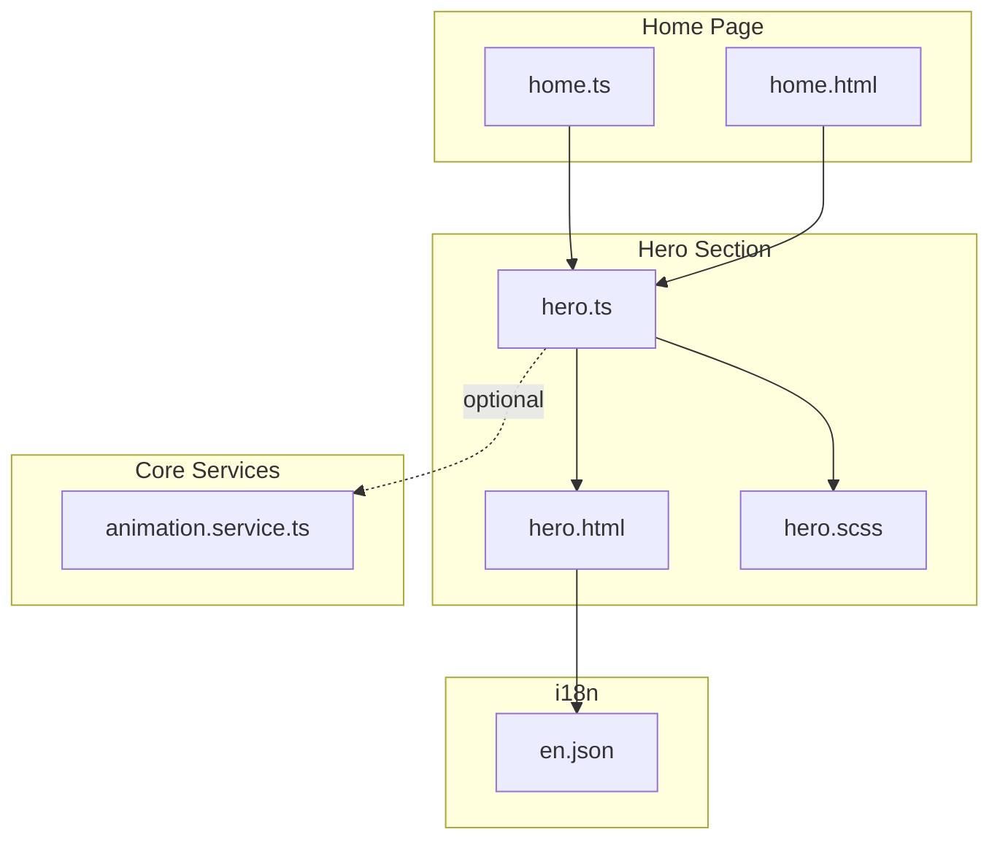
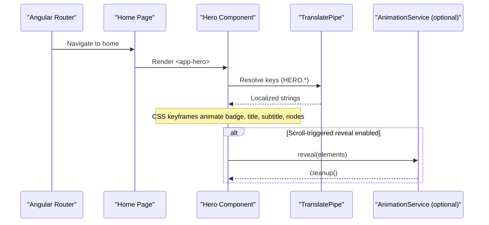
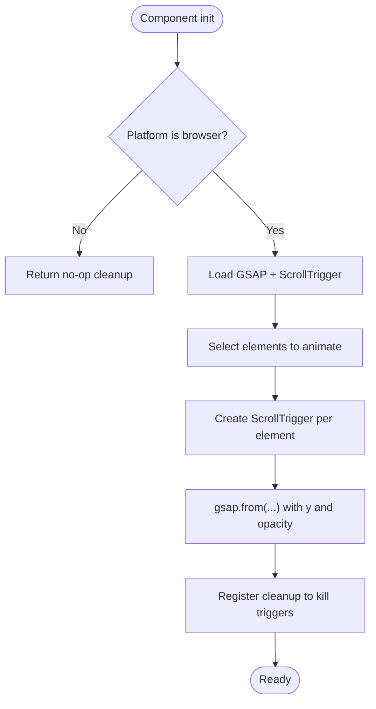
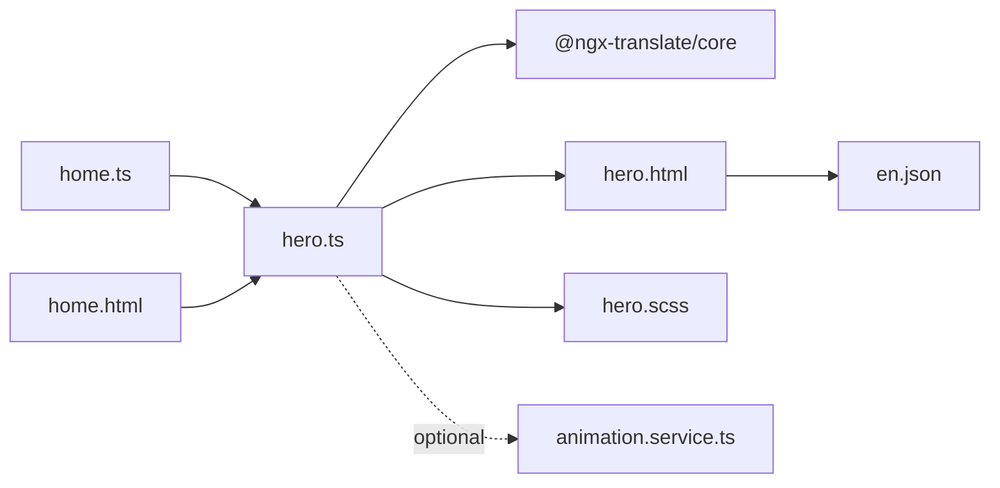

# Hero Section

<cite>
**Referenced Files in This Document**
- [hero.ts](file://src/app/features/home/sections/hero/hero.ts)
- [hero.html](file://src/app/features/home/sections/hero/hero.html)
- [hero.scss](file://src/app/features/home/sections/hero/hero.scss)
- [animation.service.ts](file://src/app/core/services/animation.service.ts)
- [home.ts](file://src/app/features/home/pages/home/home.ts)
- [home.html](file://src/app/features/home/pages/home/home.html)
- [en.json](file://src/assets/i18n/en.json)
</cite>

## Table of Contents
1. [Introduction](#introduction)
2. [Project Structure](#project-structure)
3. [Core Components](#core-components)
4. [Architecture Overview](#architecture-overview)
5. [Detailed Component Analysis](#detailed-component-analysis)
6. [Dependency Analysis](#dependency-analysis)
7. [Performance Considerations](#performance-considerations)
8. [Troubleshooting Guide](#troubleshooting-guide)
9. [Conclusion](#conclusion)
10. [Appendices](#appendices)

## Introduction
This document explains the Hero section component used on the home page. It covers:
- Animated introduction with CSS keyframes and optional GSAP integration via a shared service
- Call-to-action elements and how to customize their actions
- Responsive design patterns for desktop, tablet, and mobile
- Animation lifecycle, scroll-triggered effects (available through the shared service), and performance optimizations
- Accessibility considerations and integration with the main navigation system

## Project Structure
The Hero section is a standalone Angular component composed of three files:
- TypeScript class defining metadata and imports
- HTML template using internationalization
- SCSS styles with responsive breakpoints and animations

**Diagram sources**
- [home.ts:1-25](file://src/app/features/home/pages/home/home.ts#L1-L25)
- [home.html:1-11](file://src/app/features/home/pages/home/home.html#L1-L11)
- [hero.ts:1-12](file://src/app/features/home/sections/hero/hero.ts#L1-L12)
- [hero.html:1-36](file://src/app/features/home/sections/hero/hero.html#L1-L36)
- [hero.scss:1-162](file://src/app/features/home/sections/hero/hero.scss#L1-L162)
- [animation.service.ts:1-72](file://src/app/core/services/animation.service.ts#L1-L72)
- [en.json:14-21](file://src/assets/i18n/en.json#L14-L21)

**Section sources**
- [home.ts:1-25](file://src/app/features/home/pages/home/home.ts#L1-L25)
- [home.html:1-11](file://src/app/features/home/pages/home/home.html#L1-L11)
- [hero.ts:1-12](file://src/app/features/home/sections/hero/hero.ts#L1-L12)
- [hero.html:1-36](file://src/app/features/home/sections/hero/hero.html#L1-L36)
- [hero.scss:1-162](file://src/app/features/home/sections/hero/hero.scss#L1-L162)
- [animation.service.ts:1-72](file://src/app/core/services/animation.service.ts#L1-L72)
- [en.json:14-21](file://src/assets/i18n/en.json#L14-L21)

## Core Components
- Hero component: A minimal standalone component that renders localized text and two call-to-action buttons, plus a decorative network grid.
- Internationalization: Text content is provided via translation keys bound in the template.
- Styling and animation: CSS keyframes provide fade-in and floating effects; responsive rules adapt layout across screen sizes.

Key responsibilities:
- Render hero content and CTAs
- Provide hooks for future GSAP integration (e.g., via AnimationService)
- Maintain accessible markup and responsive behavior

**Section sources**
- [hero.ts:1-12](file://src/app/features/home/sections/hero/hero.ts#L1-L12)
- [hero.html:1-36](file://src/app/features/home/sections/hero/hero.html#L1-L36)
- [hero.scss:1-162](file://src/app/features/home/sections/hero/hero.scss#L1-L162)
- [en.json:14-21](file://src/assets/i18n/en.json#L14-L21)

## Architecture Overview
The Hero section integrates into the home page as a child component. It uses i18n for text and CSS for initial animations. The shared AnimationService provides GSAP-based scroll-triggered reveals that can be adopted by this component or others.

**Diagram sources**
- [home.html:1-11](file://src/app/features/home/pages/home/home.html#L1-L11)
- [hero.html:1-36](file://src/app/features/home/sections/hero/hero.html#L1-L36)
- [animation.service.ts:1-72](file://src/app/core/services/animation.service.ts#L1-L72)

## Detailed Component Analysis

### Template and Content Model
- Badge, title, subtitle, and two action buttons are rendered with i18n keys under HERO.*
- Decorative network nodes display technology names

Customization examples:
- Change text content: Update the corresponding keys in the i18n file
- Add new fields: Extend the template and add new keys in i18n
- Replace decorative nodes: Modify the node list in the template

Accessibility:
- Use semantic headings and paragraphs
- Ensure sufficient color contrast for badges and buttons
- Provide meaningful labels if icons are added later

**Section sources**
- [hero.html:1-36](file://src/app/features/home/sections/hero/hero.html#L1-L36)
- [en.json:14-21](file://src/assets/i18n/en.json#L14-L21)

### Styles and Responsive Design
- Uses CSS Grid for two-column layout on large screens
- clamp() for fluid typography
- Keyframe animations:
  - Fade-in for content and network grid
  - Floating effect for nodes
- Breakpoints:
  - Tablet: single column, centered text, stacked actions
  - Mobile: full-width buttons, smaller padding and node sizing

Performance notes:
- Animations use transform and opacity where possible
- Backdrop-filter applied to nodes; consider reducing complexity on low-end devices

**Section sources**
- [hero.scss:1-162](file://src/app/features/home/sections/hero/hero.scss#L1-L162)

### Animation Lifecycle and GSAP Integration
Current state:
- Hero relies on CSS keyframes for initial load animations
- No direct GSAP usage inside the Hero component itself

Optional enhancement path:
- Integrate AnimationService.reveal() to animate elements when they enter the viewport
- The service lazily loads GSAP and ScrollTrigger, registers triggers, and returns a cleanup function
- On component destroy, registered triggers are automatically killed to prevent memory leaks

Recommended integration steps:
- Inject AnimationService into the Hero component
- In ngAfterViewInit, select target elements (badge, h1, p, actions, nodes)
- Call reveal(elements) and store the returned cleanup function
- Optionally run cleanup on component destruction

**Diagram sources**
- [animation.service.ts:1-72](file://src/app/core/services/animation.service.ts#L1-L72)

**Section sources**
- [animation.service.ts:1-72](file://src/app/core/services/animation.service.ts#L1-L72)

### Call-to-Action Elements
- Primary button: “Explore Projects”
- Secondary button: “Get in Touch”

How to customize actions:
- Bind click handlers in the component class to navigate to routes or open modals
- For example, navigate to the projects route or contact form
- Keep keyboard accessibility: ensure focus management and Enter/Space activation

Example behaviors:
- Primary CTA navigates to the projects section
- Secondary CTA opens a contact modal or scrolls to the contact section

**Section sources**
- [hero.html:15-23](file://src/app/features/home/sections/hero/hero.html#L15-L23)
- [en.json:14-21](file://src/assets/i18n/en.json#L14-L21)

### Integration with Main Navigation
- The Hero section is included in the home page template
- The navbar is part of the shared layout and not directly coupled to Hero
- To link from Hero to other sections, prefer programmatic navigation or anchor scrolling within the same page

Integration points:
- Home page composes Hero alongside other sections
- Global navigation remains independent; Hero actions should not interfere with it

**Section sources**
- [home.html:1-11](file://src/app/features/home/pages/home/home.html#L1-L11)
- [home.ts:1-25](file://src/app/features/home/pages/home/home.ts#L1-L25)

## Dependency Analysis
- Hero depends on:
  - TranslatePipe for i18n
  - CSS for styling and animations
  - Optional dependency on AnimationService for GSAP-based scroll animations
- Home page imports Hero as a standalone component
- i18n keys for Hero are defined centrally

**Diagram sources**
- [hero.ts:1-12](file://src/app/features/home/sections/hero/hero.ts#L1-L12)
- [hero.html:1-36](file://src/app/features/home/sections/hero/hero.html#L1-L36)
- [hero.scss:1-162](file://src/app/features/home/sections/hero/hero.scss#L1-L162)
- [home.ts:1-25](file://src/app/features/home/pages/home/home.ts#L1-L25)
- [home.html:1-11](file://src/app/features/home/pages/home/home.html#L1-L11)
- [animation.service.ts:1-72](file://src/app/core/services/animation.service.ts#L1-L72)
- [en.json:14-21](file://src/assets/i18n/en.json#L14-L21)

**Section sources**
- [hero.ts:1-12](file://src/app/features/home/sections/hero/hero.ts#L1-L12)
- [home.ts:1-25](file://src/app/features/home/pages/home/home.ts#L1-L25)
- [animation.service.ts:1-72](file://src/app/core/services/animation.service.ts#L1-L72)
- [en.json:14-21](file://src/assets/i18n/en.json#L14-L21)

## Performance Considerations
- Lazy loading of GSAP: The AnimationService dynamically imports GSAP and ScrollTrigger only when needed
- Browser guard: Animations are skipped on non-browser platforms
- Memory safety: ScrollTrigger instances are tracked and killed on component destroy
- CSS performance: Animations primarily use transform and opacity; backdrop-filter is used sparingly
- Fluid typography: clamp() reduces reflows and improves scaling across viewports

Recommendations:
- Prefer CSS animations for simple entrance effects
- Use GSAP for complex timelines or scroll-driven sequences
- Debounce or throttle expensive operations if adding scroll listeners outside the service

[No sources needed since this section provides general guidance]

## Troubleshooting Guide
Common issues and resolutions:
- i18n keys missing: Ensure all HERO.* keys exist in the i18n file; otherwise, placeholders will render
- Buttons not responding: Verify click bindings in the component and ensure event propagation is not prevented
- Animations not triggering:
  - If using AnimationService, confirm platform is browser and elements are present in DOM
  - Ensure elements passed to reveal() are visible and have dimensions
- Memory leaks: Always use the cleanup function returned by reveal() and let DestroyRef handle teardown

Checklist:
- Validate i18n keys
- Confirm selectors for animated elements
- Inspect console for GSAP errors
- Test on mobile breakpoints for layout and touch targets

**Section sources**
- [animation.service.ts:1-72](file://src/app/core/services/animation.service.ts#L1-L72)
- [hero.html:1-36](file://src/app/features/home/sections/hero/hero.html#L1-L36)
- [en.json:14-21](file://src/assets/i18n/en.json#L14-L21)

## Conclusion
The Hero section is a lightweight, accessible, and responsive entry point for the portfolio. It leverages CSS animations for immediate visual feedback and offers a clear path to integrate GSAP-powered scroll animations via the shared AnimationService. With i18n-backed content and well-structured styles, it is easy to customize text, actions, and visuals while maintaining performance and accessibility.

[No sources needed since this section summarizes without analyzing specific files]

## Appendices

### Customization Examples
- Change text content: Update HERO.* keys in the i18n file
- Add new CTA: Extend the template and bind a click handler to navigate or open a modal
- Style changes: Adjust colors, spacing, and animations in the SCSS file
- Enable scroll-triggered animations: Inject AnimationService and call reveal() with target elements

**Section sources**
- [hero.html:1-36](file://src/app/features/home/sections/hero/hero.html#L1-L36)
- [hero.scss:1-162](file://src/app/features/home/sections/hero/hero.scss#L1-L162)
- [animation.service.ts:1-72](file://src/app/core/services/animation.service.ts#L1-L72)
- [en.json:14-21](file://src/assets/i18n/en.json#L14-L21)