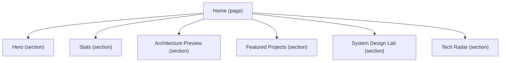
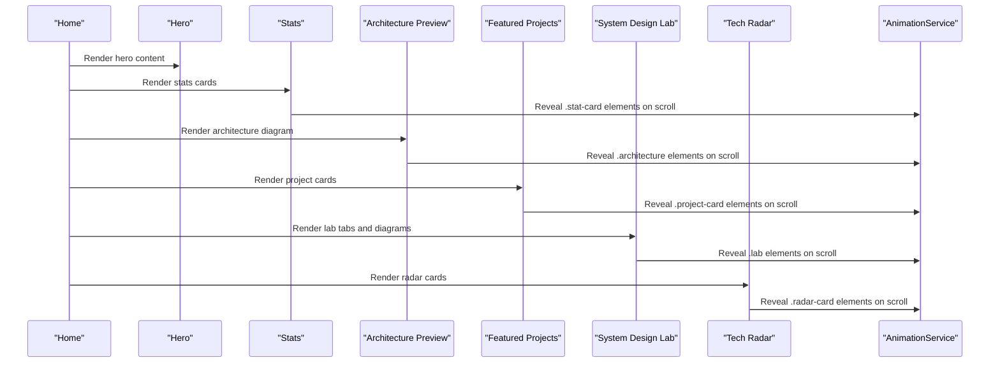
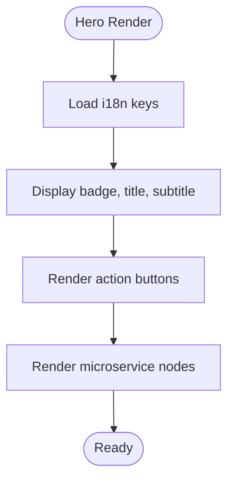
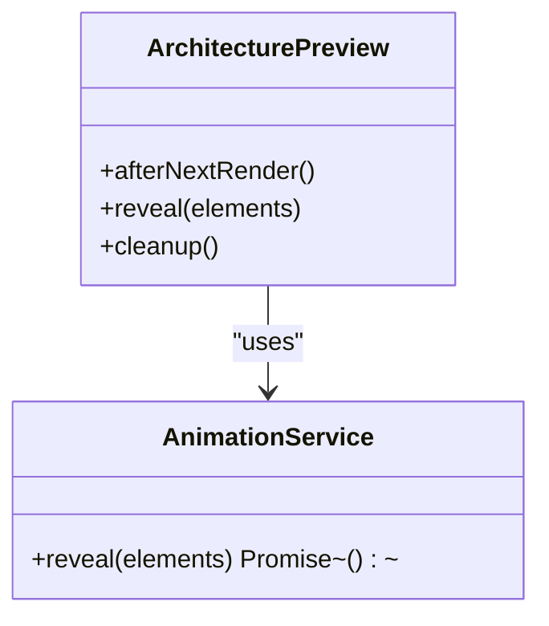
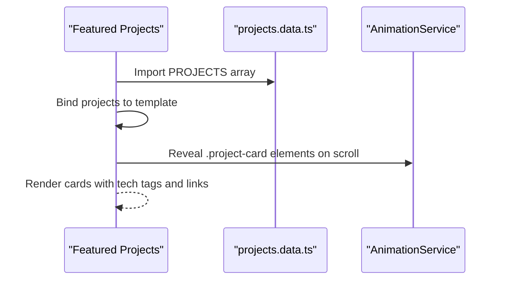
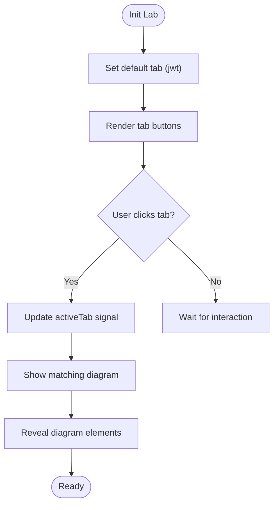
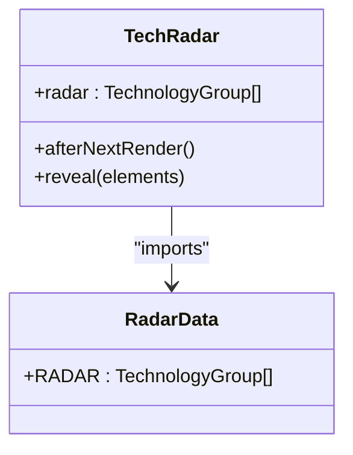
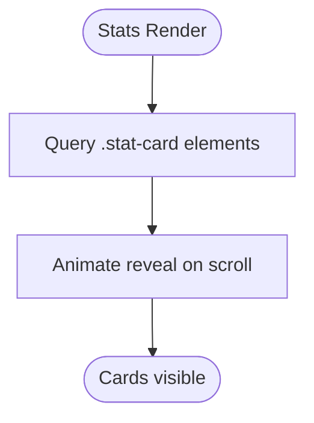
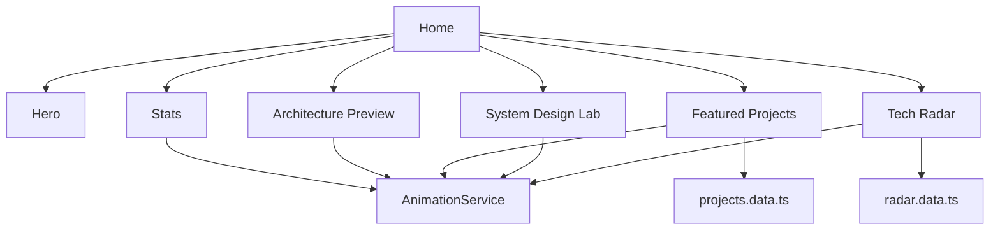

# Home Page Features

<cite>
**Referenced Files in This Document**
- [home.ts](file://src/app/features/home/pages/home/home.ts)
- [home.html](file://src/app/features/home/pages/home/home.html)
- [hero.ts](file://src/app/features/home/sections/hero/hero.ts)
- [hero.html](file://src/app/features/home/sections/hero/hero.html)
- [architecture-preview.ts](file://src/app/features/home/sections/architecture-preview/architecture-preview.ts)
- [architecture-preview.html](file://src/app/features/home/sections/architecture-preview/architecture-preview.html)
- [featured-projects.ts](file://src/app/features/home/sections/featured-projects/featured-projects.ts)
- [featured-projects.html](file://src/app/features/home/sections/featured-projects/featured-projects.html)
- [system-design-lab.ts](file://src/app/features/home/sections/system-design-lab/system-design-lab.ts)
- [system-design-lab.html](file://src/app/features/home/sections/system-design-lab/system-design-lab.html)
- [tech-radar.ts](file://src/app/features/home/sections/tech-radar/tech-radar.ts)
- [stats.ts](file://src/app/features/home/sections/stats/stats.ts)
- [animation.service.ts](file://src/app/core/services/animation.service.ts)
- [projects.data.ts](file://src/app/core/data/projects.data.ts)
- [radar.data.ts](file://src/app/core/data/radar.data.ts)
</cite>

## Table of Contents
1. [Introduction](#introduction)
2. [Project Structure](#project-structure)
3. [Core Components](#core-components)
4. [Architecture Overview](#architecture-overview)
5. [Detailed Component Analysis](#detailed-component-analysis)
6. [Dependency Analysis](#dependency-analysis)
7. [Performance Considerations](#performance-considerations)
8. [Troubleshooting Guide](#troubleshooting-guide)
9. [Conclusion](#conclusion)

## Introduction
This document explains the Home page features of the MegaPortfolio application. It covers the Hero section with animated introduction and call-to-action elements, the Architecture Preview component showcasing microservices diagrams, the Featured Projects showcase with highlights and quick access links, the System Design Lab interactive section for demonstrating architectural patterns, the Tech Radar visualization for technology assessment display, and the Statistics counter component with animated number counting. It also details component composition, data binding patterns, animation integration, and responsive design implementation across all home sections.

## Project Structure
The Home page is a standalone Angular component that composes several feature sections:
- Hero
- Stats
- Architecture Preview
- Featured Projects
- System Design Lab
- Tech Radar

Each section is implemented as a standalone component with its own template and styles. The Home page orchestrates these sections by importing them and rendering them in sequence.

**Diagram sources**
- [home.ts:10-24](file://src/app/features/home/pages/home/home.ts#L10-L24)
- [home.html:1-11](file://src/app/features/home/pages/home/home.html#L1-L11)

**Section sources**
- [home.ts:1-25](file://src/app/features/home/pages/home/home.ts#L1-L25)
- [home.html:1-11](file://src/app/features/home/pages/home/home.html#L1-L11)

## Core Components
- Hero: Displays localized title, subtitle, and action buttons; includes a network visualization area for microservice nodes.
- Stats: Presents key metrics with scroll-triggered reveal animations.
- Architecture Preview: Visualizes a distributed architecture diagram with services and event bus components.
- Featured Projects: Renders a grid of project cards with technologies and quick links to GitHub and live demos.
- System Design Lab: Interactive tabbed diagrams illustrating common backend patterns (JWT flow, Kafka, Redis cache, API Gateway, CQRS).
- Tech Radar: Displays technology groups categorized by adoption status.

All sections integrate with a shared AnimationService to perform scroll-triggered reveal animations using GSAP ScrollTrigger. Data for projects and radar categories comes from dedicated data modules.

**Section sources**
- [hero.ts:1-12](file://src/app/features/home/sections/hero/hero.ts#L1-L12)
- [hero.html:1-36](file://src/app/features/home/sections/hero/hero.html#L1-L36)
- [stats.ts:1-28](file://src/app/features/home/sections/stats/stats.ts#L1-L28)
- [architecture-preview.ts:1-27](file://src/app/features/home/sections/architecture-preview/architecture-preview.ts#L1-L27)
- [architecture-preview.html:1-66](file://src/app/features/home/sections/architecture-preview/architecture-preview.html#L1-L66)
- [featured-projects.ts:1-31](file://src/app/features/home/sections/featured-projects/featured-projects.ts#L1-L31)
- [featured-projects.html:1-75](file://src/app/features/home/sections/featured-projects/featured-projects.html#L1-L75)
- [system-design-lab.ts:1-34](file://src/app/features/home/sections/system-design-lab/system-design-lab.ts#L1-L34)
- [system-design-lab.html:1-176](file://src/app/features/home/sections/system-design-lab/system-design-lab.html#L1-L176)
- [tech-radar.ts:1-31](file://src/app/features/home/sections/tech-radar/tech-radar.ts#L1-L31)
- [projects.data.ts:1-59](file://src/app/core/data/projects.data.ts#L1-L59)
- [radar.data.ts:1-24](file://src/app/core/data/radar.data.ts#L1-L24)

## Architecture Overview
The Home page composes multiple independent sections. Each section uses the AnimationService to animate elements when they enter the viewport. Data is bound directly from static modules for projects and radar categories. The Hero section leverages internationalization via a translation pipe.

**Diagram sources**
- [home.html:1-11](file://src/app/features/home/pages/home/home.html#L1-L11)
- [animation.service.ts:36-70](file://src/app/core/services/animation.service.ts#L36-L70)
- [stats.ts:18-26](file://src/app/features/home/sections/stats/stats.ts#L18-L26)
- [architecture-preview.ts:17-25](file://src/app/features/home/sections/architecture-preview/architecture-preview.ts#L17-L25)
- [featured-projects.ts:21-29](file://src/app/features/home/sections/featured-projects/featured-projects.ts#L21-L29)
- [system-design-lab.ts:20-28](file://src/app/features/home/sections/system-design-lab/system-design-lab.ts#L20-L28)
- [tech-radar.ts:21-29](file://src/app/features/home/sections/tech-radar/tech-radar.ts#L21-L29)

## Detailed Component Analysis

### Hero Section
- Purpose: Introduce the portfolio with an animated headline, subtitle, and call-to-action buttons. Includes a visual network of microservice nodes.
- Internationalization: Uses a translation pipe for dynamic text.
- Interaction: Buttons provide primary and secondary actions; network nodes visually represent system components.
- Styling: SCSS file manages layout and responsive behavior.

**Diagram sources**
- [hero.html:1-36](file://src/app/features/home/sections/hero/hero.html#L1-L36)

**Section sources**
- [hero.ts:1-12](file://src/app/features/home/sections/hero/hero.ts#L1-L12)
- [hero.html:1-36](file://src/app/features/home/sections/hero/hero.html#L1-L36)

### Architecture Preview Component
- Purpose: Showcase a microservices architecture diagram highlighting API Gateway, Auth Service, Kafka Event Bus, Product/Order/Payment Services, Redis Cache, and Notification Service.
- Animation: Uses AnimationService to reveal diagram elements on scroll.
- Data Binding: Static HTML structure represents the architecture; styling drives visual emphasis.

**Diagram sources**
- [architecture-preview.ts:1-27](file://src/app/features/home/sections/architecture-preview/architecture-preview.ts#L1-L27)
- [animation.service.ts:36-70](file://src/app/core/services/animation.service.ts#L36-L70)

**Section sources**
- [architecture-preview.ts:1-27](file://src/app/features/home/sections/architecture-preview/architecture-preview.ts#L1-L27)
- [architecture-preview.html:1-66](file://src/app/features/home/sections/architecture-preview/architecture-preview.html#L1-L66)

### Featured Projects Showcase
- Purpose: Present highlighted projects with descriptions, technology stacks, and quick links to GitHub and live demos.
- Data Binding: Binds to a static array of project objects.
- Animation: Reveals each project card on scroll.
- Template: Uses Angular’s control flow for iterating over projects and technologies.

**Diagram sources**
- [featured-projects.ts:1-31](file://src/app/features/home/sections/featured-projects/featured-projects.ts#L1-L31)
- [projects.data.ts:1-59](file://src/app/core/data/projects.data.ts#L1-L59)
- [featured-projects.html:1-75](file://src/app/features/home/sections/featured-projects/featured-projects.html#L1-L75)

**Section sources**
- [featured-projects.ts:1-31](file://src/app/features/home/sections/featured-projects/featured-projects.ts#L1-L31)
- [featured-projects.html:1-75](file://src/app/features/home/sections/featured-projects/featured-projects.html#L1-L75)
- [projects.data.ts:1-59](file://src/app/core/data/projects.data.ts#L1-L59)

### System Design Lab
- Purpose: Interactive tabbed interface demonstrating common backend patterns: JWT Flow, Kafka Flow, Redis Cache, API Gateway, and CQRS.
- State Management: Uses a signal to track the active tab and toggles visibility of corresponding diagrams.
- Animation: Reveals lab elements on scroll.

**Diagram sources**
- [system-design-lab.ts:1-34](file://src/app/features/home/sections/system-design-lab/system-design-lab.ts#L1-L34)
- [system-design-lab.html:1-176](file://src/app/features/home/sections/system-design-lab/system-design-lab.html#L1-L176)

**Section sources**
- [system-design-lab.ts:1-34](file://src/app/features/home/sections/system-design-lab/system-design-lab.ts#L1-L34)
- [system-design-lab.html:1-176](file://src/app/features/home/sections/system-design-lab/system-design-lab.html#L1-L176)

### Tech Radar Visualization
- Purpose: Display technology groups categorized by adoption status (Adopt, Trial, Assess, Learn).
- Data Binding: Binds to a static array of technology groups.
- Animation: Reveals radar cards on scroll.

**Diagram sources**
- [tech-radar.ts:1-31](file://src/app/features/home/sections/tech-radar/tech-radar.ts#L1-L31)
- [radar.data.ts:1-24](file://src/app/core/data/radar.data.ts#L1-L24)

**Section sources**
- [tech-radar.ts:1-31](file://src/app/features/home/sections/tech-radar/tech-radar.ts#L1-L31)
- [radar.data.ts:1-24](file://src/app/core/data/radar.data.ts#L1-L24)

### Statistics Counter Component
- Purpose: Present key metrics with animated reveal on scroll.
- Animation: Uses AnimationService to trigger reveal animations for stat cards.
- Note: While the objective mentions animated number counting, the current implementation focuses on scroll-triggered reveal animations for stat cards. Number counting logic can be added within this component if required.

**Diagram sources**
- [stats.ts:1-28](file://src/app/features/home/sections/stats/stats.ts#L1-L28)
- [animation.service.ts:36-70](file://src/app/core/services/animation.service.ts#L36-L70)

**Section sources**
- [stats.ts:1-28](file://src/app/features/home/sections/stats/stats.ts#L1-L28)

## Dependency Analysis
The Home page depends on several core services and data modules:
- AnimationService provides reusable scroll-triggered animations.
- Data modules supply static datasets for projects and radar categories.
- Sections are loosely coupled and communicate through the Home page composition.

**Diagram sources**
- [home.ts:10-24](file://src/app/features/home/pages/home/home.ts#L10-L24)
- [projects.data.ts:1-59](file://src/app/core/data/projects.data.ts#L1-L59)
- [radar.data.ts:1-24](file://src/app/core/data/radar.data.ts#L1-L24)
- [animation.service.ts:1-72](file://src/app/core/services/animation.service.ts#L1-L72)

**Section sources**
- [home.ts:1-25](file://src/app/features/home/pages/home/home.ts#L1-L25)
- [projects.data.ts:1-59](file://src/app/core/data/projects.data.ts#L1-L59)
- [radar.data.ts:1-24](file://src/app/core/data/radar.data.ts#L1-L24)
- [animation.service.ts:1-72](file://src/app/core/services/animation.service.ts#L1-L72)

## Performance Considerations
- Lazy loading of GSAP: AnimationService loads GSAP and ScrollTrigger only when needed and caches the promise to avoid repeated imports.
- Cleanup of ScrollTriggers: Each reveal call returns a cleanup function that kills triggers on component destroy to prevent memory leaks.
- Platform checks: Animations run only in the browser environment to avoid SSR issues.
- Minimal DOM queries: Sections query only necessary elements for animation, reducing overhead.

[No sources needed since this section provides general guidance]

## Troubleshooting Guide
- Animations not triggering: Ensure elements have correct CSS classes used by AnimationService selectors (.stat-card, .project-card, .architecture, .lab, .radar-card). Verify platform is browser and elements exist before calling reveal.
- Memory leaks: Confirm cleanup functions returned by reveal are invoked on component destruction via DestroyRef.
- i18n keys missing: For Hero section, ensure translation keys are present in the i18n configuration; otherwise, placeholders may appear.
- Data binding issues: Verify that projects and radar arrays are correctly imported and typed.

**Section sources**
- [animation.service.ts:13-18](file://src/app/core/services/animation.service.ts#L13-L18)
- [animation.service.ts:36-70](file://src/app/core/services/animation.service.ts#L36-L70)
- [hero.html:1-36](file://src/app/features/home/sections/hero/hero.html#L1-L36)

## Conclusion
The Home page integrates multiple specialized sections to deliver a rich, interactive experience. Each component follows consistent patterns: standalone Angular components, clear data binding, and unified animation integration via AnimationService. The result is a scalable, maintainable architecture that showcases system design concepts, project highlights, and technology assessments effectively.

[No sources needed since this section summarizes without analyzing specific files]