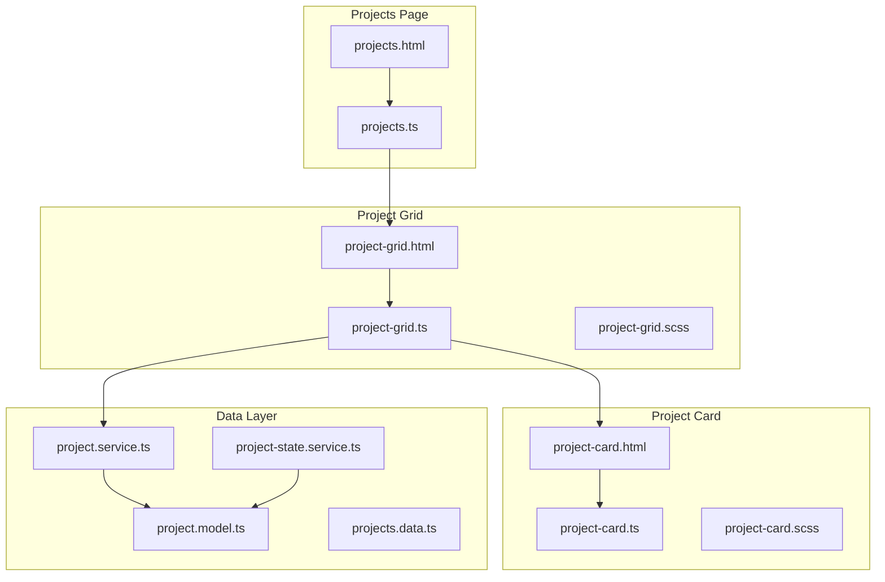
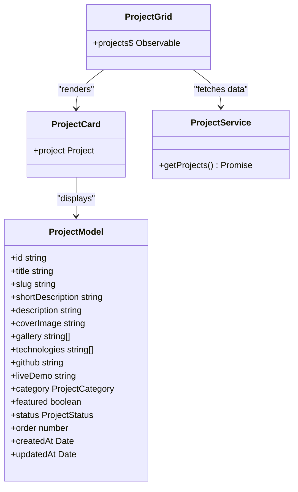
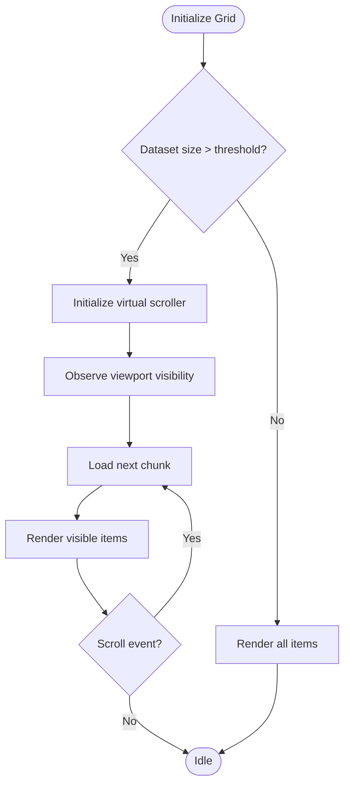
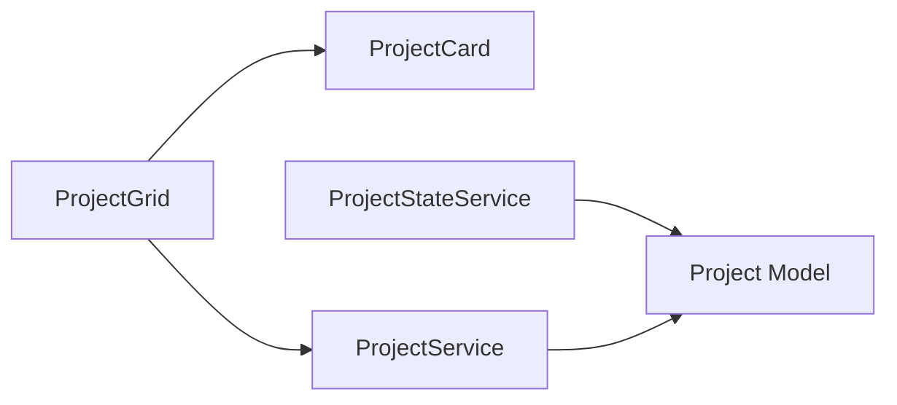

# Project Grid Component

<cite>
**Referenced Files in This Document**
- [project-grid.ts](file://src/app/features/projects/components/project-grid/project-grid.ts)
- [project-grid.html](file://src/app/features/projects/components/project-grid/project-grid.html)
- [project-grid.scss](file://src/app/features/projects/components/project-grid/project-grid.scss)
- [project-card.ts](file://src/app/features/projects/components/project-card/project-card.ts)
- [project-card.html](file://src/app/features/projects/components/project-card/project-card.html)
- [project-card.scss](file://src/app/features/projects/components/project-card/project-card.scss)
- [project-state.service.ts](file://src/app/features/projects/services/project-state.service.ts)
- [project.service.ts](file://src/app/core/services/project.service.ts)
- [project.model.ts](file://src/app/core/models/project.model.ts)
- [projects.data.ts](file://src/app/core/data/projects.data.ts)
- [projects.ts](file://src/app/features/projects/pages/projects/projects.ts)
- [projects.html](file://src/app/features/projects/pages/projects/projects.html)
</cite>

## Table of Contents
1. Introduction
2. Project Structure
3. Core Components
4. Architecture Overview
5. Detailed Component Analysis
6. Dependency Analysis
7. Performance Considerations
8. Troubleshooting Guide
9. Conclusion

## Introduction
This document provides comprehensive documentation for the Project Grid component that renders projects in a responsive grid layout. It explains how the component integrates with the data layer, how reactivity is achieved, and how to customize its appearance and behavior. It also outlines strategies for performance optimization, accessibility, and future enhancements such as virtual scrolling and advanced filtering.

## Project Structure
The Project Grid lives under the features/projects module and composes smaller components to render project cards. The page orchestrates hero, search, filter, and grid components.



**Diagram sources**
- [projects.html:1-7](file://src/app/features/projects/pages/projects/projects.html#L1-L7)
- [projects.ts:1-16](file://src/app/features/projects/pages/projects/projects.ts#L1-L16)
- [project-grid.html:1-14](file://src/app/features/projects/components/project-grid/project-grid.html#L1-L14)
- [project-grid.ts:1-20](file://src/app/features/projects/components/project-grid/project-grid.ts#L1-L20)
- [project-grid.scss:1-14](file://src/app/features/projects/components/project-grid/project-grid.scss#L1-L14)
- [project-card.html:1-49](file://src/app/features/projects/components/project-card/project-card.html#L1-L49)
- [project-card.ts:1-15](file://src/app/features/projects/components/project-card/project-card.ts#L1-L15)
- [project-card.scss:1-118](file://src/app/features/projects/components/project-card/project-card.scss#L1-L118)
- [project.service.ts:1-60](file://src/app/core/services/project.service.ts#L1-L60)
- [project-state.service.ts:1-157](file://src/app/features/projects/services/project-state.service.ts#L1-L157)
- [project.model.ts:1-44](file://src/app/core/models/project.model.ts#L1-L44)
- [projects.data.ts:1-59](file://src/app/core/data/projects.data.ts#L1-L59)

**Section sources**
- [projects.html:1-7](file://src/app/features/projects/pages/projects/projects.html#L1-L7)
- [projects.ts:1-16](file://src/app/features/projects/pages/projects/projects.ts#L1-L16)
- [project-grid.html:1-14](file://src/app/features/projects/components/project-grid/project-grid.html#L1-L14)
- [project-grid.ts:1-20](file://src/app/features/projects/components/project-grid/project-grid.ts#L1-L20)
- [project-grid.scss:1-14](file://src/app/features/projects/components/project-grid/project-grid.scss#L1-L14)
- [project-card.html:1-49](file://src/app/features/projects/components/project-card/project-card.html#L1-L49)
- [project-card.ts:1-15](file://src/app/features/projects/components/project-card/project-card.ts#L1-L15)
- [project-card.scss:1-118](file://src/app/features/projects/components/project-card/project-card.scss#L1-L118)
- [project.service.ts:1-60](file://src/app/core/services/project.service.ts#L1-L60)
- [project-state.service.ts:1-157](file://src/app/features/projects/services/project-state.service.ts#L1-L157)
- [project.model.ts:1-44](file://src/app/core/models/project.model.ts#L1-L44)
- [projects.data.ts:1-59](file://src/app/core/data/projects.data.ts#L1-L59)

## Core Components
- ProjectGrid: Standalone component that subscribes to an observable stream of projects and renders them using Angular’s control flow. It uses AsyncPipe to handle asynchronous data binding and ProjectCard to display each item.
- ProjectCard: Displays a single project’s cover image, title, short description, and technology tags. It accepts a Project input and applies hover animations via CSS transitions.
- ProjectService: Data access service that queries Firestore for projects ordered by their order field.
- ProjectStateService: Centralized state container using Angular signals for loading, filtering, pagination, and modal state. It exposes computed values for filtered and paginated results.
- Project model: Defines the shape of project data including category, status, and metadata.

Key responsibilities:
- ProjectGrid focuses on rendering and layout.
- ProjectCard focuses on presentation and micro-interactions.
- ProjectService abstracts data retrieval from Firestore.
- ProjectStateService encapsulates reactive state and derived computations.

**Section sources**
- [project-grid.ts:1-20](file://src/app/features/projects/components/project-grid/project-grid.ts#L1-L20)
- [project-grid.html:1-14](file://src/app/features/projects/components/project-grid/project-grid.html#L1-L14)
- [project-card.ts:1-15](file://src/app/features/projects/components/project-card/project-card.ts#L1-L15)
- [project-card.html:1-49](file://src/app/features/projects/components/project-card/project-card.html#L1-L49)
- [project.service.ts:1-60](file://src/app/core/services/project.service.ts#L1-L60)
- [project-state.service.ts:1-157](file://src/app/features/projects/services/project-state.service.ts#L1-L157)
- [project.model.ts:1-44](file://src/app/core/models/project.model.ts#L1-L44)

## Architecture Overview
The grid consumes an observable stream of projects through ProjectService and renders items reactively. While ProjectGrid currently binds directly to ProjectService, the architecture supports integration with ProjectStateService for advanced filtering, pagination, and reactivity.

```mermaid
sequenceDiagram
participant View as "project-grid.html"
participant Grid as "ProjectGrid"
participant Service as "ProjectService"
participant Firestore as "FirestoreService"
participant Model as "Project Model"
View->>Grid : Initialize component
Grid->>Service : getProjects()
Service->>Firestore : query("projects", orderBy("order"))
Firestore-->>Service : Promise<Project[]>
Service-->>Grid : Promise<Project[]>
Grid->>View : projects$ observable via AsyncPipe
View->>View : @for(project of projects; track project.id)
View->>View : Render app-project-card per project
```

**Diagram sources**
- [project-grid.html:1-14](file://src/app/features/projects/components/project-grid/project-grid.html#L1-L14)
- [project-grid.ts:1-20](file://src/app/features/projects/components/project-grid/project-grid.ts#L1-L20)
- [project.service.ts:1-60](file://src/app/core/services/project.service.ts#L1-L60)
- [project.model.ts:1-44](file://src/app/core/models/project.model.ts#L1-L44)

## Detailed Component Analysis

### ProjectGrid Component
- Purpose: Renders a responsive grid of project cards using Angular’s template syntax and AsyncPipe for reactive data binding.
- Inputs/Outputs: No direct inputs; reads projects$ from ProjectService.
- Template: Uses @if for async data availability and @for with track by id for efficient list rendering.
- Styling: CSS Grid with auto-fit columns and minmax ensures responsiveness across breakpoints.

Customization options:
- Layout mode (grid/list): Achieve by toggling CSS classes or adding a configuration input to switch between grid and flex-based list layouts.
- Column count: Adjust minmax(360px, 1fr) to change minimum card width and column density.
- Spacing and padding: Modify gap and padding-bottom to control spacing.

Accessibility considerations:
- Ensure images have descriptive alt attributes (already present in ProjectCard).
- Provide keyboard focus management if interactive elements are added inside cards.
- Use semantic HTML (section/article) which is already applied.

Performance notes:
- track project.id enables efficient DOM updates when the list changes.
- AsyncPipe avoids manual subscription management and prevents memory leaks.

**Section sources**
- [project-grid.ts:1-20](file://src/app/features/projects/components/project-grid/project-grid.ts#L1-L20)
- [project-grid.html:1-14](file://src/app/features/projects/components/project-grid/project-grid.html#L1-L14)
- [project-grid.scss:1-14](file://src/app/features/projects/components/project-grid/project-grid.scss#L1-L14)

#### Class Diagram


**Diagram sources**
- [project-grid.ts:1-20](file://src/app/features/projects/components/project-grid/project-grid.ts#L1-L20)
- [project-card.ts:1-15](file://src/app/features/projects/components/project-card/project-card.ts#L1-L15)
- [project.service.ts:1-60](file://src/app/core/services/project.service.ts#L1-L60)
- [project.model.ts:1-44](file://src/app/core/models/project.model.ts#L1-L44)

### ProjectCard Component
- Purpose: Presents a single project with cover image, featured badge, title, short description, and technology tags.
- Interactions: Hover effects via CSS transitions; can be extended to open modal or navigate to details.
- Accessibility: Semantic article element, img with alt text, and clear hierarchy.

Styling overrides:
- Override .card styles to change background, border radius, shadow, and hover transforms.
- Customize .stack span styles to adjust tag appearance.

Animation integration:
- Add entrance animations using Angular animations or GSAP by hooking into lifecycle hooks or using CSS keyframes.

**Section sources**
- [project-card.ts:1-15](file://src/app/features/projects/components/project-card/project-card.ts#L1-L15)
- [project-card.html:1-49](file://src/app/features/projects/components/project-card/project-card.html#L1-L49)
- [project-card.scss:1-118](file://src/app/features/projects/components/project-card/project-card.scss#L1-L118)

### Data Binding and Reactivity
- Current binding: ProjectGrid subscribes to ProjectService.getProjects() via AsyncPipe.
- Reactive state option: ProjectStateService provides signals for loading, filtering, pagination, and modal state. It computes filtered and paginated lists based on search query and selected category.

Integration patterns:
- Replace ProjectService usage in ProjectGrid with ProjectStateService to enable filtering and pagination.
- Expose paginatedProjects$ or filteredProjects$ as observables or convert signals to observables where needed.

**Section sources**
- [project-grid.ts:1-20](file://src/app/features/projects/components/project-grid/project-grid.ts#L1-L20)
- [project-state.service.ts:1-157](file://src/app/features/projects/services/project-state.service.ts#L1-L157)
- [project.service.ts:1-60](file://src/app/core/services/project.service.ts#L1-L60)

### Responsive Design Patterns
- CSS Grid with auto-fit and minmax creates a fluid grid that adapts to viewport width without media queries.
- Minimum card width controls the number of columns; increase or decrease to fit different screens.
- Gap and padding ensure consistent spacing and breathing room.

**Section sources**
- [project-grid.scss:1-14](file://src/app/features/projects/components/project-grid/project-grid.scss#L1-L14)

### Virtual Scrolling for Large Datasets
Current implementation renders all projects at once. For large datasets, consider:
- Using Angular CDK Virtual Scroll to render only visible items.
- Implementing windowed rendering with IntersectionObserver to load chunks as users scroll.
- Combining server-side pagination with client-side virtualization for optimal performance.

Conceptual flow for virtualization:


[No sources needed since this diagram shows conceptual workflow, not actual code structure]

### Layout Modes (Grid/List)
To support both grid and list modes:
- Add a configuration input to ProjectGrid to toggle layout.
- Switch CSS classes to apply either grid-template-columns or flex-direction: column.
- Optionally provide a user-facing toggle controlled by ProjectStateService.

**Section sources**
- [project-grid.scss:1-14](file://src/app/features/projects/components/project-grid/project-grid.scss#L1-L14)

### Customization Capabilities
- Styling overrides: Extend or override .project-grid and .card classes to match brand guidelines.
- Content customization: Extend ProjectCard to include additional fields like live demo links, GitHub icons, or status badges.
- Animation integration: Integrate Angular animations or GSAP for entrance and hover effects.

**Section sources**
- [project-card.scss:1-118](file://src/app/features/projects/components/project-card/project-card.scss#L1-L118)

### Accessibility Features
- Semantic markup: section and article elements improve screen reader navigation.
- Image alt text: Provided in ProjectCard for meaningful descriptions.
- Keyboard navigation: Ensure interactive elements within cards are focusable and operable.
- Color contrast: Verify sufficient contrast for text and badges against backgrounds.

**Section sources**
- [project-card.html:1-49](file://src/app/features/projects/components/project-card/project-card.html#L1-L49)

## Dependency Analysis
The grid depends on ProjectService for data and ProjectCard for rendering. ProjectStateService offers centralized state and derived computations.



**Diagram sources**
- [project-grid.ts:1-20](file://src/app/features/projects/components/project-grid/project-grid.ts#L1-L20)
- [project-card.ts:1-15](file://src/app/features/projects/components/project-card/project-card.ts#L1-L15)
- [project.service.ts:1-60](file://src/app/core/services/project.service.ts#L1-L60)
- [project-state.service.ts:1-157](file://src/app/features/projects/services/project-state.service.ts#L1-L157)
- [project.model.ts:1-44](file://src/app/core/models/project.model.ts#L1-L44)

**Section sources**
- [project-grid.ts:1-20](file://src/app/features/projects/components/project-grid/project-grid.ts#L1-L20)
- [project-card.ts:1-15](file://src/app/features/projects/components/project-card/project-card.ts#L1-L15)
- [project.service.ts:1-60](file://src/app/core/services/project.service.ts#L1-L60)
- [project-state.service.ts:1-157](file://src/app/features/projects/services/project-state.service.ts#L1-L157)
- [project.model.ts:1-44](file://src/app/core/models/project.model.ts#L1-L44)

## Performance Considerations
- Efficient change detection: Use track by unique id in @for loops to minimize DOM churn.
- Lazy loading: Implement virtual scrolling or intersection observer-based lazy loading for large lists.
- Image optimization: Serve appropriately sized images, use lazy loading attributes, and consider WebP formats.
- Server-side pagination: Combine with client-side pagination to reduce payload size.
- Memoization: Leverage computed properties in ProjectStateService to avoid redundant calculations.
- Avoid unnecessary subscriptions: Prefer AsyncPipe or signal-based approaches to prevent memory leaks.

[No sources needed since this section provides general guidance]

## Troubleshooting Guide
Common issues and resolutions:
- Empty grid: Ensure ProjectService returns data and that the collection exists in Firestore. Verify ordering and filters.
- Loading state stuck: Check error handling in ProjectStateService and network connectivity.
- Pagination not working: Confirm ITEMS_PER_PAGE and currentPage logic in ProjectStateService.
- Modal not closing: Verify closeModal resets selectedProject and restores body overflow style.

Debugging steps:
- Log loadingState and errorMessage in ProjectStateService during loadProjects.
- Inspect filteredProjects and totalPages computed values to validate filtering and pagination.
- Validate project IDs used in track expressions to ensure uniqueness.

**Section sources**
- [project-state.service.ts:1-157](file://src/app/features/projects/services/project-state.service.ts#L1-L157)
- [project.service.ts:1-60](file://src/app/core/services/project.service.ts#L1-L60)

## Conclusion
The Project Grid component provides a clean, responsive layout for displaying projects with strong separation of concerns. It leverages Angular’s reactive primitives and CSS Grid for adaptability. By integrating ProjectStateService, you can unlock powerful filtering, pagination, and reactivity. Future enhancements should prioritize virtual scrolling, image optimization, and robust accessibility to scale gracefully with large datasets and diverse user needs.

[No sources needed since this section summarizes without analyzing specific files]