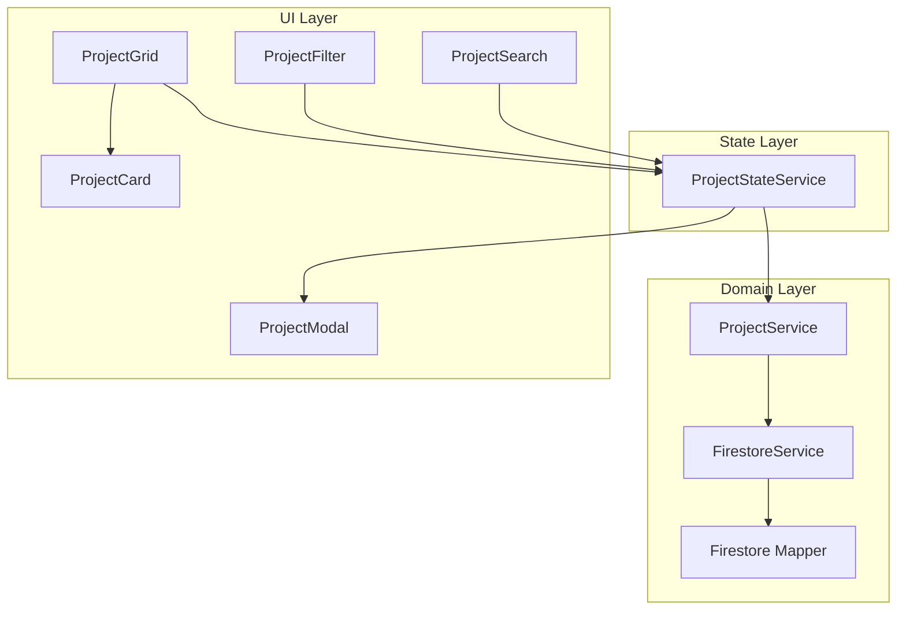
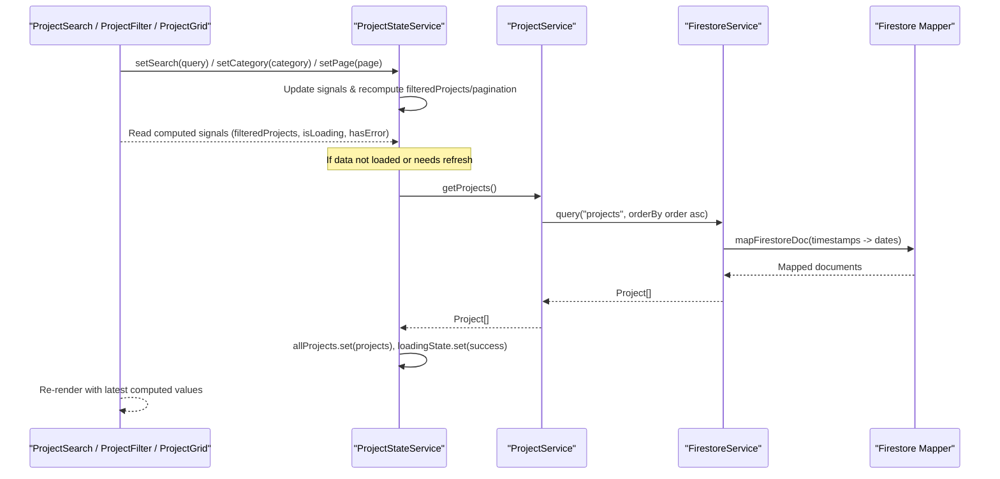
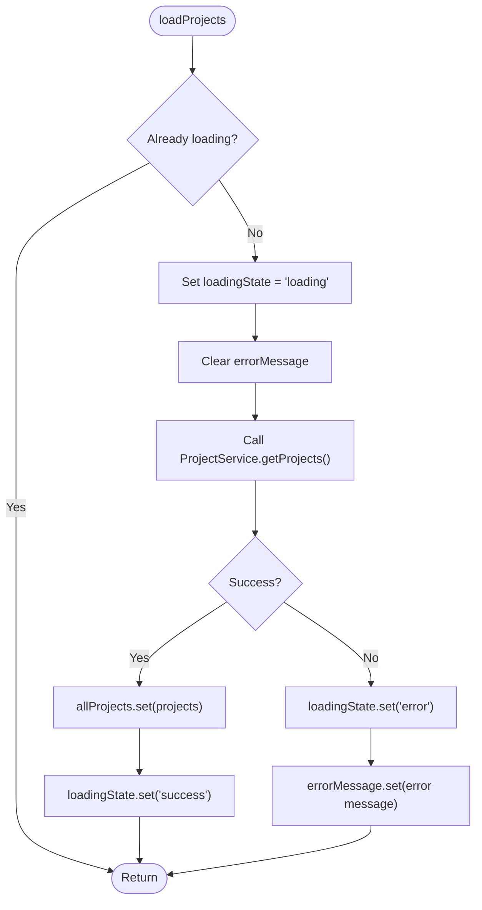
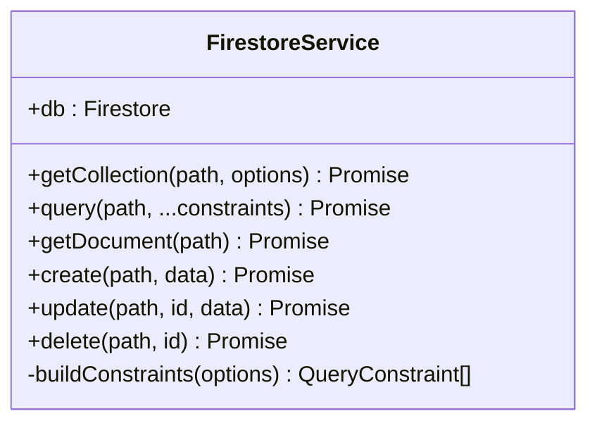
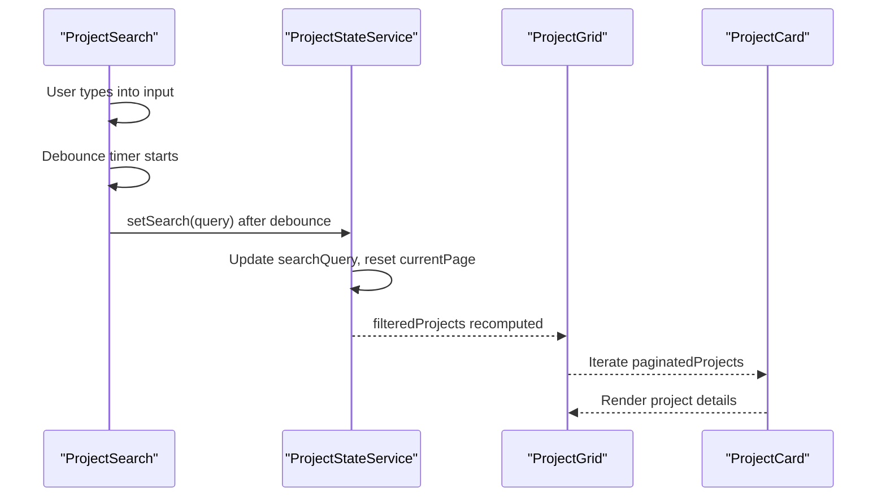
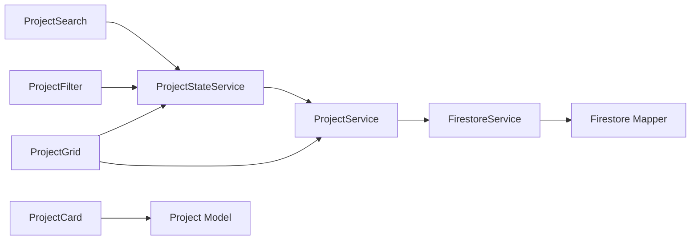

# Project State Service

<cite>
**Referenced Files in This Document**
- [project-state.service.ts](file://src/app/features/projects/services/project-state.service.ts)
- [project.service.ts](file://src/app/core/services/project.service.ts)
- [firestore.service.ts](file://src/app/core/firebase/firestore.service.ts)
- [firestore.mapper.ts](file://src/app/core/utils/firestore.mapper.ts)
- [project.model.ts](file://src/app/core/models/project.model.ts)
- [projects.data.ts](file://src/app/core/data/projects.data.ts)
- [project-search.ts](file://src/app/features/projects/components/project-search/project-search.ts)
- [project-search.html](file://src/app/features/projects/components/project-search/project-search.html)
- [project-grid.ts](file://src/app/features/projects/components/project-grid/project-grid.ts)
- [project-grid.html](file://src/app/features/projects/components/project-grid/project-grid.html)
- [project-filter.ts](file://src/app/features/projects/components/project-filter/project-filter.ts)
- [project-card.ts](file://src/app/features/projects/components/project-card/project-card.ts)
- [project-modal.ts](file://src/app/features/projects/components/project-modal/project-modal.ts)
</cite>

## Table of Contents
1. [Introduction](#introduction)
2. [Project Structure](#project-structure)
3. [Core Components](#core-components)
4. [Architecture Overview](#architecture-overview)
5. [Detailed Component Analysis](#detailed-component-analysis)
6. [Dependency Analysis](#dependency-analysis)
7. [Performance Considerations](#performance-considerations)
8. [Troubleshooting Guide](#troubleshooting-guide)
9. [Conclusion](#conclusion)
10. [Appendices](#appendices)

## Introduction
This document explains the Project State Service and its signal-based state management architecture for managing project data across the application. It covers reactive data flow using Angular signals, computed properties, pagination, filtering, loading states, error handling, and integration with Firebase Firestore via a dedicated service layer. It also provides guidance on subscribing to state changes, updating project data, handling asynchronous operations, and preventing memory leaks.

## Project Structure
The project state management is centered around:
- A state service that owns reactive signals and derived computed values
- A domain service that encapsulates data access (Firestore queries)
- UI components that read from signals and trigger state updates
- Models and mappers that define data shapes and transformations



**Diagram sources**
- [project-state.service.ts](file://src/app/features/projects/services/project-state.service.ts)
- [project.service.ts](file://src/app/core/services/project.service.ts)
- [firestore.service.ts](file://src/app/core/firebase/firestore.service.ts)
- [firestore.mapper.ts](file://src/app/core/utils/firestore.mapper.ts)
- [project-search.ts](file://src/app/features/projects/components/project-search/project-search.ts)
- [project-filter.ts](file://src/app/features/projects/components/project-filter/project-filter.ts)
- [project-grid.ts](file://src/app/features/projects/components/project-grid/project-grid.ts)
- [project-card.ts](file://src/app/features/projects/components/project-card/project-card.ts)
- [project-modal.ts](file://src/app/features/projects/components/project-modal/project-modal.ts)

**Section sources**
- [project-state.service.ts](file://src/app/features/projects/services/project-state.service.ts)
- [project.service.ts](file://src/app/core/services/project.service.ts)
- [firestore.service.ts](file://src/app/core/firebase/firestore.service.ts)
- [project-search.ts](file://src/app/features/projects/components/project-search/project-search.ts)
- [project-grid.ts](file://src/app/features/projects/components/project-grid/project-grid.ts)

## Core Components
- ProjectStateService: Centralized state holder using Angular signals for projects, search, category, pagination, loading, errors, and selected project. Provides computed values for filtered results, pagination, counts, and UI flags. Includes methods to load data, update filters, paginate, and manage modal state.
- ProjectService: Encapsulates Firestore queries for listing, filtering by category, fetching by id/slug, and CRUD operations.
- FirestoreService: Low-level Firestore client with query helpers and mapping utilities.
- Firestore mapper: Converts Firestore Timestamps to native Date objects.
- UI components: ProjectSearch debounces input and writes to state; ProjectGrid reads data; ProjectFilter drives category selection; ProjectCard renders individual items; ProjectModal manages modal visibility.

Key responsibilities:
- Reactive state: Signals for primitive and object state
- Derived state: Computed values for filtering, pagination, and UI flags
- Data lifecycle: Load, retry, error handling, and success transitions
- UI interactions: Search debounce, category filter, pagination scrolling, modal open/close

**Section sources**
- [project-state.service.ts](file://src/app/features/projects/services/project-state.service.ts)
- [project.service.ts](file://src/app/core/services/project.service.ts)
- [firestore.service.ts](file://src/app/core/firebase/firestore.service.ts)
- [firestore.mapper.ts](file://src/app/core/utils/firestore.mapper.ts)
- [project-search.ts](file://src/app/features/projects/components/project-search/project-search.ts)
- [project-grid.ts](file://src/app/features/projects/components/project-grid/project-grid.ts)
- [project-filter.ts](file://src/app/features/projects/components/project-filter/project-filter.ts)
- [project-card.ts](file://src/app/features/projects/components/project-card/project-card.ts)
- [project-modal.ts](file://src/app/features/projects/components/project-modal/project-modal.ts)

## Architecture Overview
The architecture follows a unidirectional data flow:
- UI components emit user actions (search, filter, pagination, modal)
- ProjectStateService updates signals and recomputes derived values
- ProjectService performs Firestore queries when needed
- FirestoreService executes queries and maps documents
- Computed signals propagate changes automatically to subscribed components



**Diagram sources**
- [project-state.service.ts](file://src/app/features/projects/services/project-state.service.ts)
- [project.service.ts](file://src/app/core/services/project.service.ts)
- [firestore.service.ts](file://src/app/core/firebase/firestore.service.ts)
- [firestore.mapper.ts](file://src/app/core/utils/firestore.mapper.ts)
- [project-search.ts](file://src/app/features/projects/components/project-search/project-search.ts)

## Detailed Component Analysis

### ProjectStateService
Responsibilities:
- Holds core signals: allProjects, searchQuery, selectedCategory, currentPage, loadingState, errorMessage, selectedProject
- Computes derived values: filteredProjects, totalPages, paginatedProjects, totalCount, featuredCount, technologyCount, resultCount, isEmpty, isLoading, hasError, showPagination
- Lifecycle methods: loadProjects, retry
- User interactions: setSearch, setCategory, setPage, openModal, closeModal

Signal composition patterns:
- Filtering pipeline: allProjects → optional category filter → optional text search across title, shortDescription, description, technologies
- Pagination pipeline: filteredProjects → slice by ITEMS_PER_PAGE based on currentPage
- UI flags: derived from loadingState and filteredProjects length

Data flow:
- loadProjects triggers async fetch via ProjectService and sets allProjects and loadingState
- setSearch and setCategory reset currentPage to 1 and update respective signals
- setPage clamps page number and scrolls smoothly in browser context
- openModal and closeModal toggle selectedProject and body overflow behavior

Error handling:
- Catches errors during loadProjects, sets loadingState to error and errorMessage
- retry resets state and reloads data

Memory and platform safety:
- Uses PLATFORM_ID checks before accessing window/document APIs
- Debounce timer in UI component prevents excessive state updates



**Diagram sources**
- [project-state.service.ts](file://src/app/features/projects/services/project-state.service.ts)

**Section sources**
- [project-state.service.ts](file://src/app/features/projects/services/project-state.service.ts)

### ProjectService
Responsibilities:
- Exposes typed queries for projects collection
- Supports ordering, filtering by category, fetching by id/slug
- Provides CRUD methods: create, update, delete

Integration points:
- Delegates to FirestoreService for raw queries and document operations
- Uses orderBy and where constraints for efficient queries

```mermaid
classDiagram
class ProjectService {
+getProjects() Promise<Project[]>
+getFeaturedProjects() Promise<Project[]>
+getProjectsByCategory(category) Promise<Project[]>
+getProject(id) Promise<Project>
+getProjectBySlug(slug) Promise<Project>
+create(project) Promise<{id : string}>
+update(id, project) Promise<void>
+delete(id) Promise<void>
}
```

**Diagram sources**
- [project.service.ts](file://src/app/core/services/project.service.ts)

**Section sources**
- [project.service.ts](file://src/app/core/services/project.service.ts)

### FirestoreService
Responsibilities:
- Wraps Firestore SDK with typed query helpers
- Builds constraints for where, orderBy, limit
- Maps documents using mapper utility



**Diagram sources**
- [firestore.service.ts](file://src/app/core/firebase/firestore.service.ts)

**Section sources**
- [firestore.service.ts](file://src/app/core/firebase/firestore.service.ts)

### Firestore Mapper
Responsibilities:
- Converts Firestore Timestamp fields to native Date objects
- Provides utilities for single and batch mappings

```mermaid
classDiagram
class FirestoreMapper {
+mapFirestoreDoc(data) T
+mapFirestoreDocs(docs) (T & {id : string})[]
}
```

**Diagram sources**
- [firestore.mapper.ts](file://src/app/core/utils/firestore.mapper.ts)

**Section sources**
- [firestore.mapper.ts](file://src/app/core/utils/firestore.mapper.ts)

### UI Components Integration
- ProjectSearch: Binds local signal to ngModel, debounces updates, and calls state.setSearch. Exposes resultCount and isLoading for template usage.
- ProjectFilter: Manages selected filter value and filter list.
- ProjectGrid: Currently uses ProjectService directly for data; can be refactored to use ProjectStateService for unified state.
- ProjectCard: Renders a single project item.
- ProjectModal: Placeholder for modal logic; state service exposes selectedProject for modal control.



**Diagram sources**
- [project-search.ts](file://src/app/features/projects/components/project-search/project-search.ts)
- [project-search.html](file://src/app/features/projects/components/project-search/project-search.html)
- [project-state.service.ts](file://src/app/features/projects/services/project-state.service.ts)
- [project-grid.ts](file://src/app/features/projects/components/project-grid/project-grid.ts)
- [project-card.ts](file://src/app/features/projects/components/project-card/project-card.ts)

**Section sources**
- [project-search.ts](file://src/app/features/projects/components/project-search/project-search.ts)
- [project-search.html](file://src/app/features/projects/components/project-search/project-search.html)
- [project-grid.ts](file://src/app/features/projects/components/project-grid/project-grid.ts)
- [project-grid.html](file://src/app/features/projects/components/project-grid/project-grid.html)
- [project-filter.ts](file://src/app/features/projects/components/project-filter/project-filter.ts)
- [project-card.ts](file://src/app/features/projects/components/project-card/project-card.ts)
- [project-modal.ts](file://src/app/features/projects/components/project-modal/project-modal.ts)

## Dependency Analysis
High-level dependencies:
- ProjectStateService depends on ProjectService for data retrieval and models for type definitions
- ProjectService depends on FirestoreService for database operations
- FirestoreService depends on Firestore SDK and mapper utilities
- UI components depend on ProjectStateService for reactive state and ProjectService for direct data access in some cases



**Diagram sources**
- [project-state.service.ts](file://src/app/features/projects/services/project-state.service.ts)
- [project.service.ts](file://src/app/core/services/project.service.ts)
- [firestore.service.ts](file://src/app/core/firebase/firestore.service.ts)
- [firestore.mapper.ts](file://src/app/core/utils/firestore.mapper.ts)
- [project-search.ts](file://src/app/features/projects/components/project-search/project-search.ts)
- [project-filter.ts](file://src/app/features/projects/components/project-filter/project-filter.ts)
- [project-grid.ts](file://src/app/features/projects/components/project-grid/project-grid.ts)
- [project-card.ts](file://src/app/features/projects/components/project-card/project-card.ts)
- [project.model.ts](file://src/app/core/models/project.model.ts)

**Section sources**
- [project-state.service.ts](file://src/app/features/projects/services/project-state.service.ts)
- [project.service.ts](file://src/app/core/services/project.service.ts)
- [firestore.service.ts](file://src/app/core/firebase/firestore.service.ts)
- [project-search.ts](file://src/app/features/projects/components/project-search/project-search.ts)
- [project-grid.ts](file://src/app/features/projects/components/project-grid/project-grid.ts)

## Performance Considerations
- Signal-based reactivity: Only components reading specific signals/computed values are updated, minimizing unnecessary re-renders
- Computed caching: filteredProjects, totalPages, paginatedProjects, and other derived values are cached until inputs change
- Debounced search: Prevents excessive state updates while typing
- Pagination slicing: Reduces DOM size by rendering only current page items
- Platform checks: Avoids SSR/Node environment issues by guarding browser-only APIs
- Firestore query optimization: Use orderBy and where constraints to reduce payload and improve performance

[No sources needed since this section provides general guidance]

## Troubleshooting Guide
Common issues and strategies:
- Loading state stuck: Ensure loadProjects is called once per view lifecycle and retry resets idle state
- Empty results: Verify searchQuery and selectedCategory combinations; check isEmpty flag which requires success state and zero filtered results
- Error messages: Inspect errorMessage after loadProjects failure; use retry to recover
- Pagination scroll: Confirm platform is browser before scrolling; setPage clamps page numbers
- Memory leaks: Debounce timers should be cleared on component destroy; avoid long-lived subscriptions outside effect scope

Operational tips:
- Use isLoading, hasError, and isEmpty to conditionally render skeletons, errors, or empty states
- For real-time sync, consider extending FirestoreService with snapshot listeners and pushing updates into allProjects signal
- Validate model fields against Project interface to prevent runtime mismatches

**Section sources**
- [project-state.service.ts](file://src/app/features/projects/services/project-state.service.ts)
- [project-search.ts](file://src/app/features/projects/components/project-search/project-search.ts)

## Conclusion
The Project State Service leverages Angular signals to provide a performant, reactive state management solution for project data. It centralizes filtering, pagination, loading, and error states while integrating cleanly with Firestore through a dedicated service layer. The architecture promotes clear separation of concerns, predictable data flow, and efficient UI updates. Extending it with real-time Firestore listeners and robust error recovery will further enhance reliability and responsiveness.

[No sources needed since this section summarizes without analyzing specific files]

## Appendices

### Data Model Reference
- Project: Defines project entity fields including identifiers, descriptions, media, technologies, category, status, timestamps
- ProjectCategory: Enumerates supported categories
- ProjectStatus: Enumerates lifecycle statuses
- PROJECTS: Static dataset used for development/demo purposes

**Section sources**
- [project.model.ts](file://src/app/core/models/project.model.ts)
- [projects.data.ts](file://src/app/core/data/projects.data.ts)

### Usage Examples

Subscribe to state changes:
- In templates, bind directly to signals and computed values exposed by ProjectStateService
- In TypeScript, read signals within effects or computed functions to react to changes

Updating project data:
- Use ProjectService.create/update/delete for mutations
- After mutation, call ProjectStateService.loadProjects to refresh state or implement optimistic updates by patching allProjects signal

Handling asynchronous operations:
- Await ProjectService methods within try/catch blocks
- Update loadingState and errorMessage accordingly

Real-time synchronization:
- Extend FirestoreService with snapshot listeners
- Push incoming changes into allProjects signal to keep UI in sync

Memory leak prevention:
- Clear debounce timers in component teardown
- Avoid storing large references in long-lived services unless necessary
- Guard browser-only APIs with PLATFORM_ID checks

**Section sources**
- [project-state.service.ts](file://src/app/features/projects/services/project-state.service.ts)
- [project.service.ts](file://src/app/core/services/project.service.ts)
- [firestore.service.ts](file://src/app/core/firebase/firestore.service.ts)
- [project-search.ts](file://src/app/features/projects/components/project-search/project-search.ts)