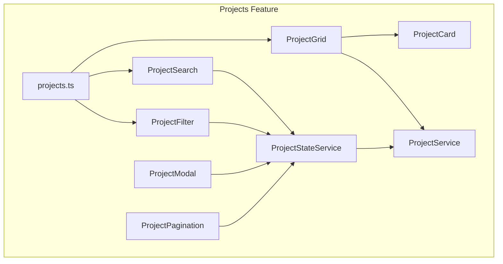
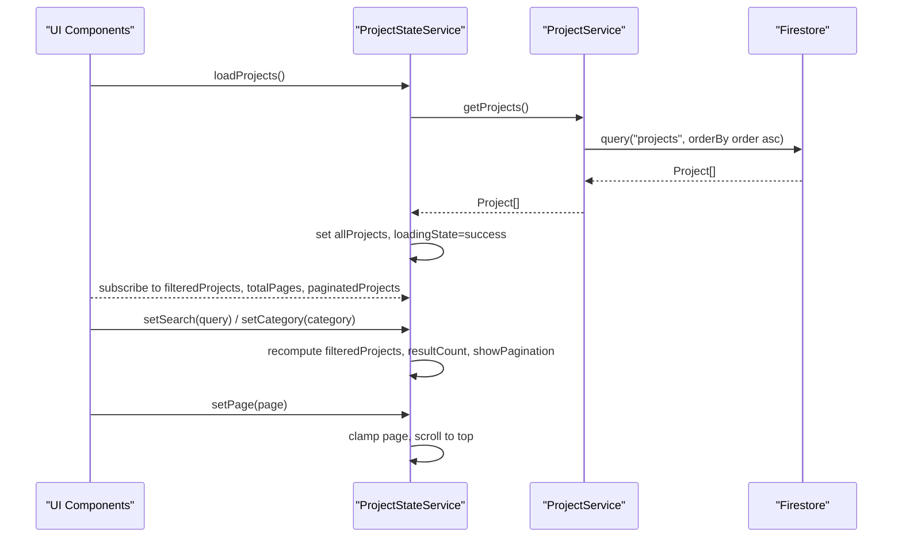
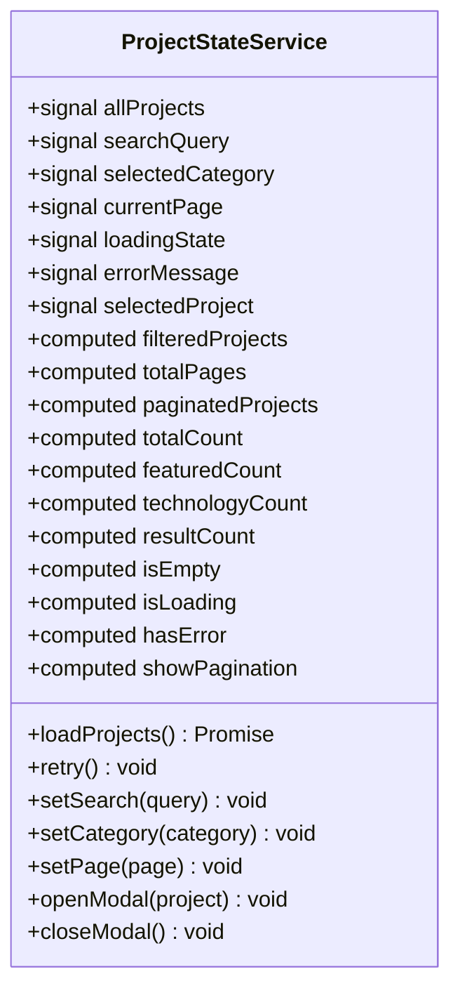
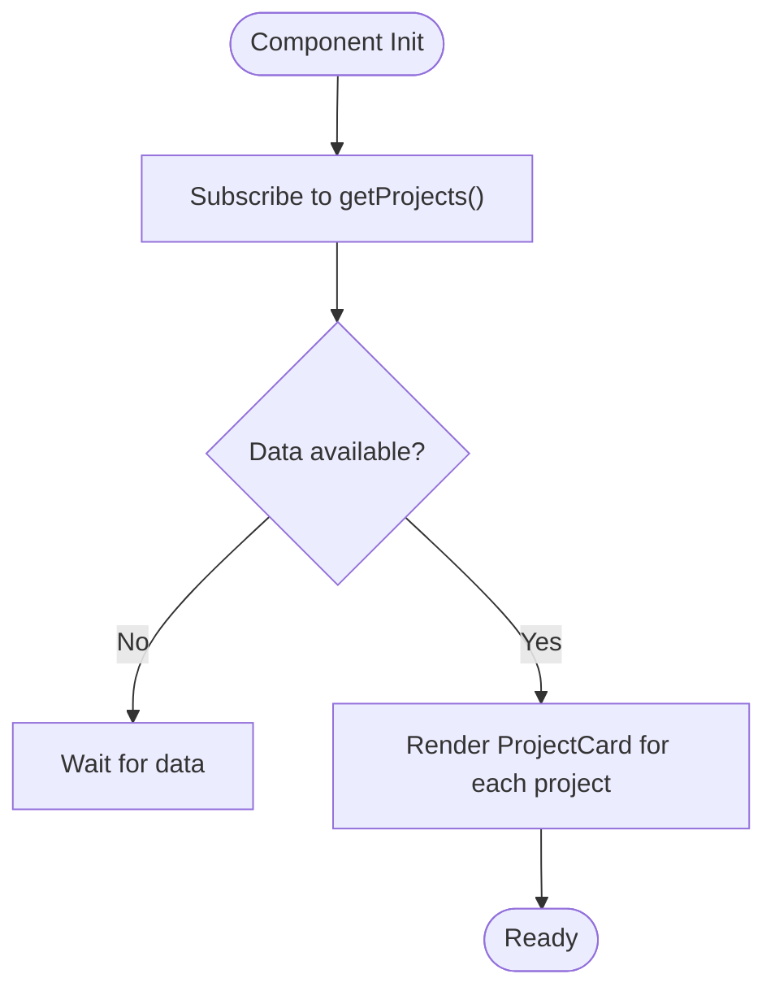
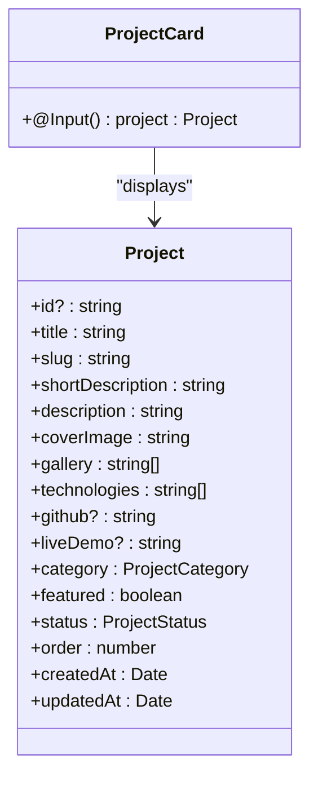
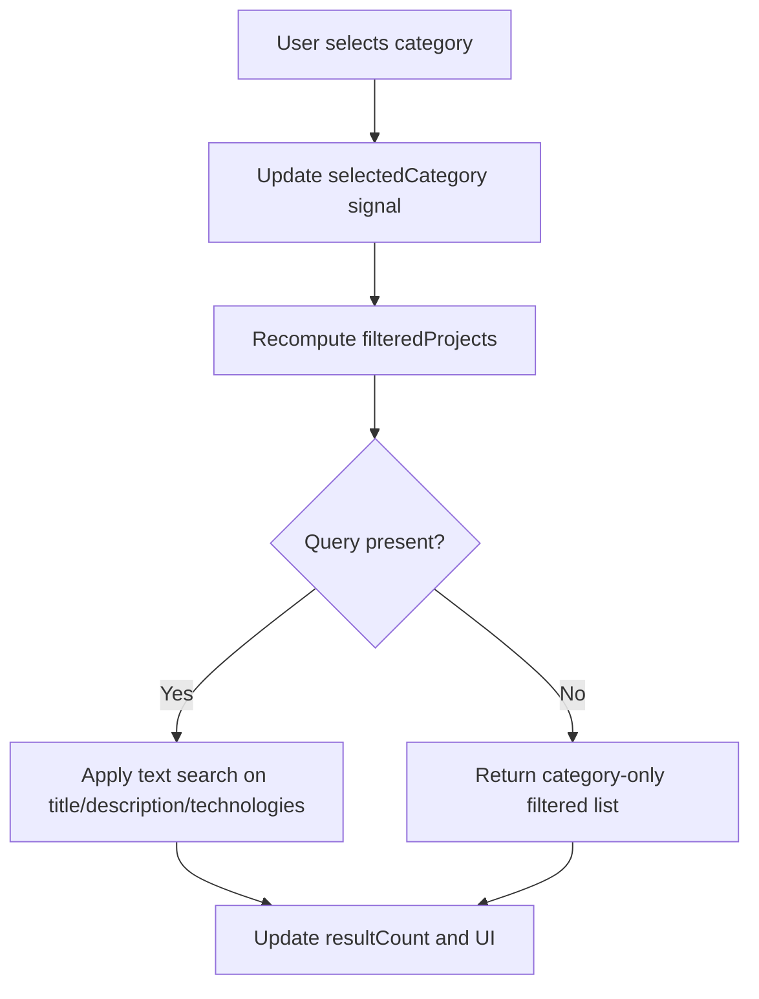
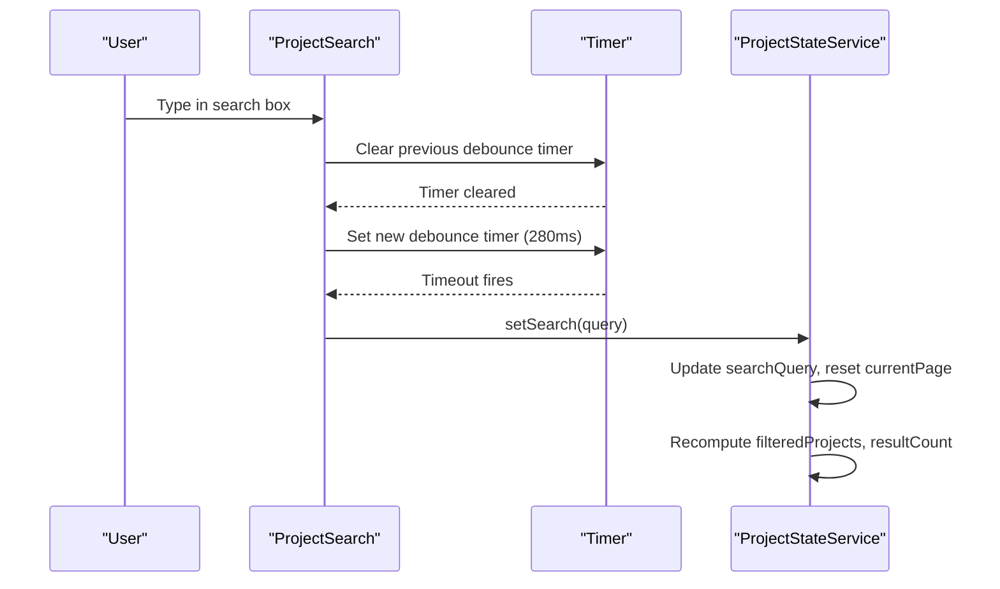
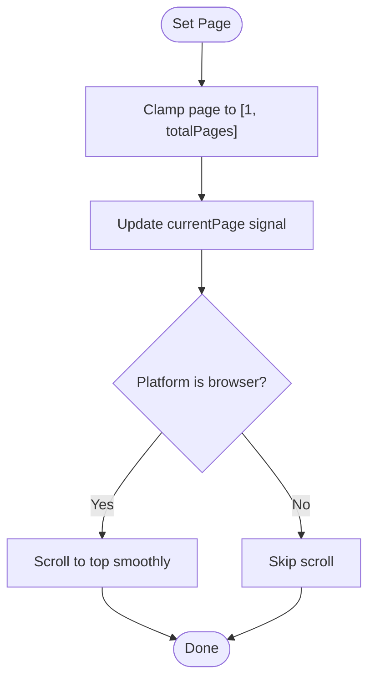
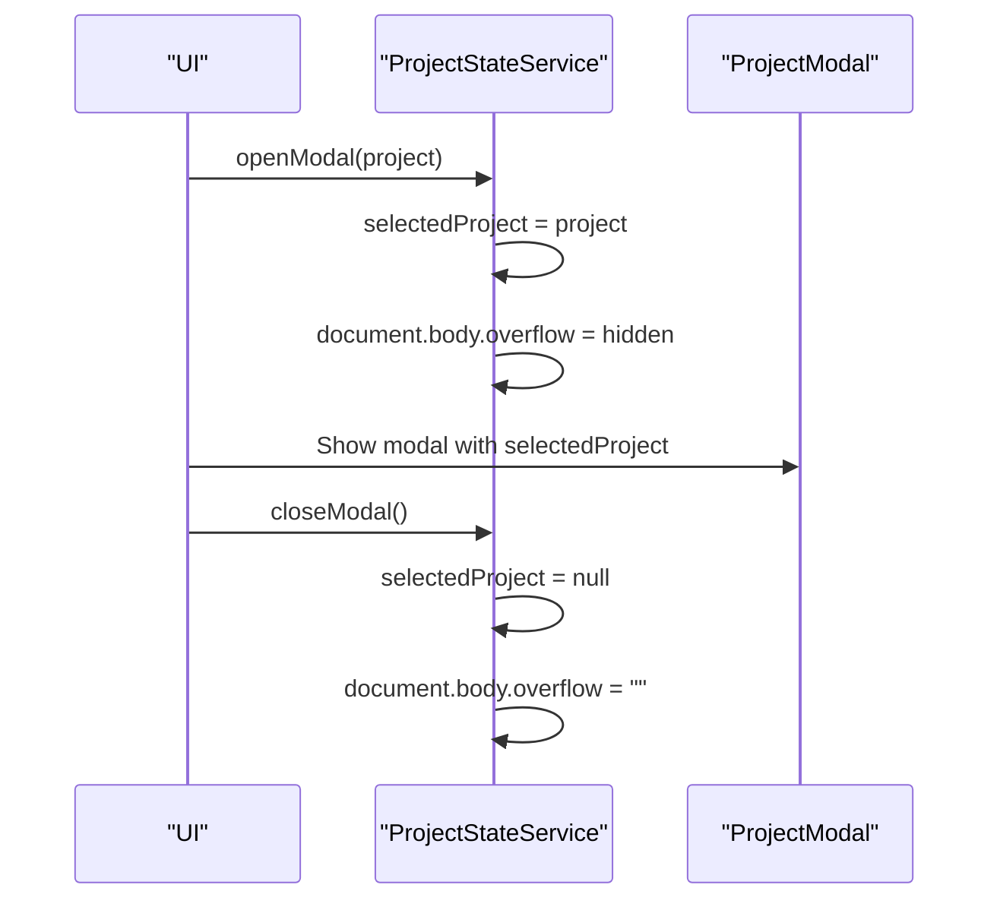
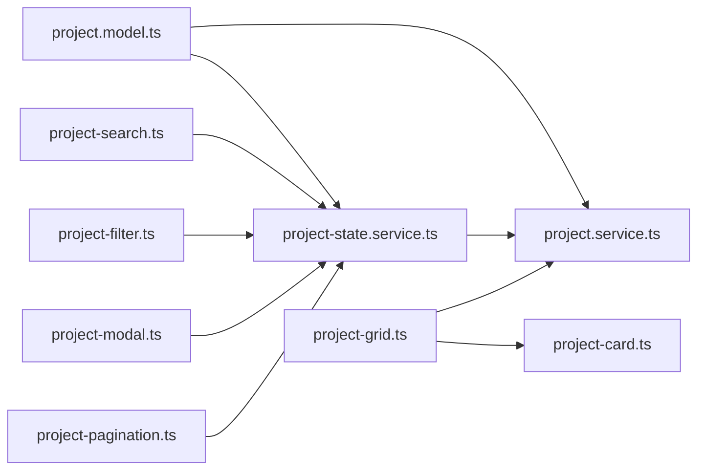

# Projects Management System

<cite>
**Referenced Files in This Document**
- [project-state.service.ts](file://src/app/features/projects/services/project-state.service.ts)
- [project-grid.ts](file://src/app/features/projects/components/project-grid/project-grid.ts)
- [project-grid.html](file://src/app/features/projects/components/project-grid/project-grid.html)
- [project-card.ts](file://src/app/features/projects/components/project-card/project-card.ts)
- [project-card.html](file://src/app/features/projects/components/project-card/project-card.html)
- [project-filter.ts](file://src/app/features/projects/components/project-filter/project-filter.ts)
- [project-filter.html](file://src/app/features/projects/components/project-filter/project-filter.html)
- [project-search.ts](file://src/app/features/projects/components/project-search/project-search.ts)
- [project-search.html](file://src/app/features/projects/components/project-search/project-search.html)
- [project-modal.ts](file://src/app/features/projects/components/project-modal/project-modal.ts)
- [project-modal.html](file://src/app/features/projects/components/project-modal/project-modal.html)
- [project-pagination.ts](file://src/app/features/projects/components/project-pagination/project-pagination.ts)
- [projects.ts](file://src/app/features/projects/pages/projects/projects.ts)
- [project.model.ts](file://src/app/core/models/project.model.ts)
- [project.service.ts](file://src/app/core/services/project.service.ts)
</cite>

## Table of Contents
1. Introduction
2. Project Structure
3. Core Components
4. Architecture Overview
5. Detailed Component Analysis
6. Dependency Analysis
7. Performance Considerations
8. Troubleshooting Guide
9. Conclusion

## Introduction
This document explains the Projects Management System within the MegaPortfolio application. It focuses on signal-based state management, reactive data flow, responsive grid rendering, advanced filtering, real-time search with debouncing, pagination logic, modal details, and project cards with quick actions. It also covers data synchronization with Firestore, error handling, loading states, and performance optimization strategies.

## Project Structure
The Projects feature is organized under src/app/features/projects with a clear separation between page orchestration, components, and services:
- Page: orchestrates hero, search, filter, and grid components
- Components: grid, card, filter, search, modal, pagination
- Services: state service (signals), data service (Firestore)
- Models: shared type definitions for projects

**Diagram sources**
- [projects.ts:1-16](file://src/app/features/projects/pages/projects/projects.ts#L1-L16)
- [project-state.service.ts:1-157](file://src/app/features/projects/services/project-state.service.ts#L1-L157)
- [project.service.ts:1-60](file://src/app/core/services/project.service.ts#L1-L60)
- [project-grid.ts:1-20](file://src/app/features/projects/components/project-grid/project-grid.ts#L1-L20)
- [project-card.ts:1-15](file://src/app/features/projects/components/project-card/project-card.ts#L1-L15)
- [project-filter.ts:1-35](file://src/app/features/projects/components/project-filter/project-filter.ts#L1-L35)
- [project-search.ts:1-43](file://src/app/features/projects/components/project-search/project-search.ts#L1-L43)
- [project-modal.ts:1-10](file://src/app/features/projects/components/project-modal/project-modal.ts#L1-L10)
- [project-pagination.ts:1-10](file://src/app/features/projects/components/project-pagination/project-pagination.ts#L1-L10)

**Section sources**
- [projects.ts:1-16](file://src/app/features/projects/pages/projects/projects.ts#L1-L16)

## Core Components
- Project State Service: Centralized signal store for all projects, filters, search, pagination, modal selection, and loading/error states. Provides computed values for filtered results, totals, and derived UI flags.
- Project Grid: Renders the full list of projects using async pipe and standalone component imports.
- Project Card: Displays individual project details including cover image, title, short description, technologies, and featured badge.
- Project Filter: Presents category buttons to narrow down projects by category.
- Project Search: Debounced search input that updates the global search query and resets pagination.
- Project Modal: Placeholder for detailed project view; integrates with selected project state.
- Project Pagination: Placeholder for pagination controls; integrates with page state.

Key responsibilities:
- Data fetching via ProjectService
- Reactive filtering and pagination via signals and computed properties
- User interactions updating shared state
- UI readiness through loading and error states

**Section sources**
- [project-state.service.ts:1-157](file://src/app/features/projects/services/project-state.service.ts#L1-L157)
- [project-grid.ts:1-20](file://src/app/features/projects/components/project-grid/project-grid.ts#L1-L20)
- [project-grid.html:1-14](file://src/app/features/projects/components/project-grid/project-grid.html#L1-L14)
- [project-card.ts:1-15](file://src/app/features/projects/components/project-card/project-card.ts#L1-L15)
- [project-card.html:1-49](file://src/app/features/projects/components/project-card/project-card.html#L1-L49)
- [project-filter.ts:1-35](file://src/app/features/projects/components/project-filter/project-filter.ts#L1-L35)
- [project-filter.html:1-13](file://src/app/features/projects/components/project-filter/project-filter.html#L1-L13)
- [project-search.ts:1-43](file://src/app/features/projects/components/project-search/project-search.ts#L1-L43)
- [project-search.html:1-24](file://src/app/features/projects/components/project-search/project-search.html#L1-L24)
- [project-modal.ts:1-10](file://src/app/features/projects/components/project-modal/project-modal.ts#L1-L10)
- [project-modal.html:1-2](file://src/app/features/projects/components/project-modal/project-modal.html#L1-L2)
- [project-pagination.ts:1-10](file://src/app/features/projects/components/project-pagination/project-pagination.ts#L1-L10)

## Architecture Overview
The system uses Angular signals for reactive state and computed values. The ProjectStateService holds the single source of truth for project data, filters, search, pagination, and modal state. Components subscribe to these signals or computed values to render UI reactively. Data is fetched from Firestore via ProjectService.

**Diagram sources**
- [project-state.service.ts:99-155](file://src/app/features/projects/services/project-state.service.ts#L99-L155)
- [project.service.ts:13-15](file://src/app/core/services/project.service.ts#L13-L15)

## Detailed Component Analysis

### Project State Service (Signal-Based State Management)
Responsibilities:
- Holds raw projects, search query, selected category, current page, loading state, error message, and selected project for modal
- Computes filtered projects based on category and search text
- Computes total pages and paginated slice
- Exposes derived booleans for empty, loading, error, and pagination visibility
- Loads data, handles errors, retries, and manages modal open/close with body scroll lock

Complexity:
- Filtering runs over all projects per change; O(n) where n is number of projects
- Pagination slicing is O(k) where k is items per page
- Computed values are memoized by Angular signals, minimizing recomputation

Error handling:
- Sets error state and message when fetch fails
- Retry resets state and reloads

Performance considerations:
- Debounced search input avoids excessive updates
- Signal computations avoid unnecessary renders
- Platform checks prevent SSR issues

**Diagram sources**
- [project-state.service.ts:1-157](file://src/app/features/projects/services/project-state.service.ts#L1-L157)

**Section sources**
- [project-state.service.ts:1-157](file://src/app/features/projects/services/project-state.service.ts#L1-L157)

### Project Grid (Responsive Layout and Dynamic Rendering)
Responsibilities:
- Subscribes to ProjectService.getProjects() via async pipe
- Iterates over projects and renders ProjectCard for each
- Uses track by id for efficient DOM updates

Rendering behavior:
- Async pipe ensures automatic subscription/unsubscription
- For-of loop with track improves change detection performance

**Diagram sources**
- [project-grid.ts:1-20](file://src/app/features/projects/components/project-grid/project-grid.ts#L1-L20)
- [project-grid.html:1-14](file://src/app/features/projects/components/project-grid/project-grid.html#L1-L14)

**Section sources**
- [project-grid.ts:1-20](file://src/app/features/projects/components/project-grid/project-grid.ts#L1-L20)
- [project-grid.html:1-14](file://src/app/features/projects/components/project-grid/project-grid.html#L1-L14)

### Project Card (Hover Effects and Quick Actions)
Responsibilities:
- Displays project cover image, title, short description, technologies, and featured badge
- Accepts project via @Input

Interaction:
- Visual feedback via CSS classes (hover effects defined in SCSS)
- Quick actions can be wired to open modal or navigate to details

**Diagram sources**
- [project-card.ts:1-15](file://src/app/features/projects/components/project-card/project-card.ts#L1-L15)
- [project-card.html:1-49](file://src/app/features/projects/components/project-card/project-card.html#L1-L49)
- [project.model.ts:1-44](file://src/app/core/models/project.model.ts#L1-L44)

**Section sources**
- [project-card.ts:1-15](file://src/app/features/projects/components/project-card/project-card.ts#L1-L15)
- [project-card.html:1-49](file://src/app/features/projects/components/project-card/project-card.html#L1-L49)

### Advanced Filtering System (Category and Status)
Responsibilities:
- Category filter UI presents options like All, Backend, Frontend, etc.
- Selected category updates state and triggers recomputation of filtered projects
- Status labels are available in models for display; status-based filtering can be integrated into the state service’s computed pipeline

Behavior:
- Clicking a filter button sets selected category
- State recomputes filteredProjects and resultCount

**Diagram sources**
- [project-filter.ts:1-35](file://src/app/features/projects/components/project-filter/project-filter.ts#L1-L35)
- [project-filter.html:1-13](file://src/app/features/projects/components/project-filter/project-filter.html#L1-L13)
- [project-state.service.ts:30-52](file://src/app/features/projects/services/project-state.service.ts#L30-L52)
- [project.model.ts:20-44](file://src/app/core/models/project.model.ts#L20-L44)

**Section sources**
- [project-filter.ts:1-35](file://src/app/features/projects/components/project-filter/project-filter.ts#L1-L35)
- [project-filter.html:1-13](file://src/app/features/projects/components/project-filter/project-filter.html#L1-L13)
- [project-state.service.ts:30-52](file://src/app/features/projects/services/project-state.service.ts#L30-L52)
- [project.model.ts:20-44](file://src/app/core/models/project.model.ts#L20-L44)

### Real-time Search Implementation (Debouncing and Fuzzy Matching)
Responsibilities:
- Debounces user input to reduce frequent updates
- Updates global search query and resets pagination to first page
- Filters across title, short description, description, and technologies

Algorithm:
- Debounce timer clears previous timeout and schedules new update
- Text matching uses lowercase includes for case-insensitive substring search
- Fuzzy matching can be extended by integrating a fuzzy comparator if needed

**Diagram sources**
- [project-search.ts:1-43](file://src/app/features/projects/components/project-search/project-search.ts#L1-L43)
- [project-search.html:1-24](file://src/app/features/projects/components/project-search/project-search.html#L1-L24)
- [project-state.service.ts:122-130](file://src/app/features/projects/services/project-state.service.ts#L122-L130)

**Section sources**
- [project-search.ts:1-43](file://src/app/features/projects/components/project-search/project-search.ts#L1-L43)
- [project-search.html:1-24](file://src/app/features/projects/components/project-search/project-search.html#L1-L24)
- [project-state.service.ts:122-130](file://src/app/features/projects/services/project-state.service.ts#L122-L130)

### Pagination Logic (Efficient Handling of Large Datasets)
Responsibilities:
- Calculates total pages based on filtered count and fixed items per page
- Slices filtered results to current page
- Clamps page numbers to valid range
- Scrolls to top on page change for better UX

Behavior:
- showPagination computed value hides controls when not needed
- setPage clamps and scrolls smoothly

**Diagram sources**
- [project-state.service.ts:54-62](file://src/app/features/projects/services/project-state.service.ts#L54-L62)
- [project-state.service.ts:132-139](file://src/app/features/projects/services/project-state.service.ts#L132-L139)

**Section sources**
- [project-state.service.ts:54-62](file://src/app/features/projects/services/project-state.service.ts#L54-L62)
- [project-state.service.ts:132-139](file://src/app/features/projects/services/project-state.service.ts#L132-L139)

### Project Modal Details (Comprehensive Project Information)
Responsibilities:
- Placeholder component for displaying detailed project information
- Integrates with selectedProject signal to open/close modal and manage body scroll lock

Integration:
- openModal sets selectedProject and locks body scroll
- closeModal resets selectedProject and restores body scroll

**Diagram sources**
- [project-modal.ts:1-10](file://src/app/features/projects/components/project-modal/project-modal.ts#L1-L10)
- [project-modal.html:1-2](file://src/app/features/projects/components/project-modal/project-modal.html#L1-L2)
- [project-state.service.ts:141-155](file://src/app/features/projects/services/project-state.service.ts#L141-L155)

**Section sources**
- [project-modal.ts:1-10](file://src/app/features/projects/components/project-modal/project-modal.ts#L1-L10)
- [project-modal.html:1-2](file://src/app/features/projects/components/project-modal/project-modal.html#L1-L2)
- [project-state.service.ts:141-155](file://src/app/features/projects/services/project-state.service.ts#L141-L155)

### Project Pagination (Placeholder Integration)
Responsibilities:
- Placeholder component ready to integrate with pagination state
- Can bind to setPage and showPagination computed values

**Section sources**
- [project-pagination.ts:1-10](file://src/app/features/projects/components/project-pagination/project-pagination.ts#L1-L10)

## Dependency Analysis
High-level dependencies:
- ProjectStateService depends on ProjectService for data access
- Components depend on ProjectStateService for reactive state
- ProjectGrid depends on ProjectService directly for async data stream
- Models define shared types used across services and components

**Diagram sources**
- [project.model.ts:1-44](file://src/app/core/models/project.model.ts#L1-L44)
- [project-state.service.ts:1-157](file://src/app/features/projects/services/project-state.service.ts#L1-L157)
- [project.service.ts:1-60](file://src/app/core/services/project.service.ts#L1-L60)
- [project-grid.ts:1-20](file://src/app/features/projects/components/project-grid/project-grid.ts#L1-L20)
- [project-card.ts:1-15](file://src/app/features/projects/components/project-card/project-card.ts#L1-L15)
- [project-search.ts:1-43](file://src/app/features/projects/components/project-search/project-search.ts#L1-L43)
- [project-filter.ts:1-35](file://src/app/features/projects/components/project-filter/project-filter.ts#L1-L35)
- [project-modal.ts:1-10](file://src/app/features/projects/components/project-modal/project-modal.ts#L1-L10)
- [project-pagination.ts:1-10](file://src/app/features/projects/components/project-pagination/project-pagination.ts#L1-L10)

**Section sources**
- [project.model.ts:1-44](file://src/app/core/models/project.model.ts#L1-L44)
- [project-state.service.ts:1-157](file://src/app/features/projects/services/project-state.service.ts#L1-L157)
- [project.service.ts:1-60](file://src/app/core/services/project.service.ts#L1-L60)

## Performance Considerations
- Use signals and computed values to minimize unnecessary recalculations and renders
- Debounce search input to reduce frequent state updates
- Track by unique IDs in templates for efficient DOM diffing
- Slice datasets for pagination to limit rendering cost
- Avoid heavy operations in computed functions; keep them pure and fast
- Leverage async pipe to auto-manage subscriptions and avoid memory leaks
- Guard against SSR issues with platform checks before accessing DOM APIs

[No sources needed since this section provides general guidance]

## Troubleshooting Guide
Common issues and resolutions:
- No data displayed: Ensure loadProjects is called and loadingState transitions to success; check ProjectService.getProjects() returns data
- Empty results after search: Verify search query trimming and case normalization; confirm filteredProjects computation includes desired fields
- Pagination not visible: Check showPagination computed condition; ensure filteredProjects length exceeds ITEMS_PER_PAGE
- Modal scroll lock not working: Confirm platform is browser before modifying document.body.overflow
- Error state persists: Inspect errorMessage and retry flow; validate network and Firestore permissions

**Section sources**
- [project-state.service.ts:99-120](file://src/app/features/projects/services/project-state.service.ts#L99-L120)
- [project-state.service.ts:141-155](file://src/app/features/projects/services/project-state.service.ts#L141-L155)
- [project.service.ts:13-15](file://src/app/core/services/project.service.ts#L13-L15)

## Conclusion
The Projects Management System leverages Angular signals for reactive state management, providing a clean separation of concerns and efficient UI updates. The combination of debounced search, category filtering, and pagination delivers a responsive experience even with large datasets. The modular component architecture supports easy extension, such as adding status-based filtering or enhancing fuzzy search capabilities. Proper error handling, loading states, and performance optimizations ensure robustness and scalability.

[No sources needed since this section summarizes without analyzing specific files]