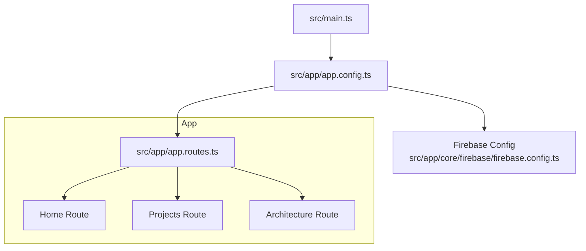
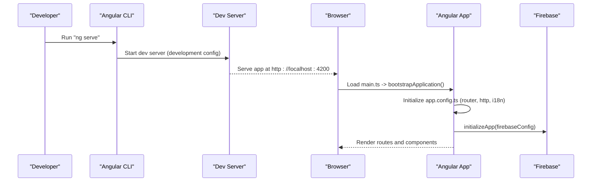
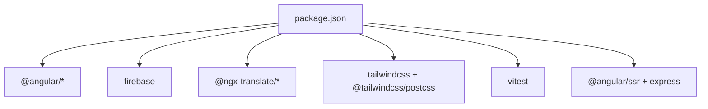

# Getting Started

<cite>
**Referenced Files in This Document**
- [package.json](file://package.json)
- [README.md](file://README.md)
- [angular.json](file://angular.json)
- [src/main.ts](file://src/main.ts)
- [src/app/app.config.ts](file://src/app/app.config.ts)
- [src/app/app.routes.ts](file://src/app/app.routes.ts)
- [src/app/core/firebase/firebase.config.ts](file://src/app/core/firebase/firebase.config.ts)
- [tsconfig.spec.json](file://tsconfig.spec.json)
- [src/app/app.spec.ts](file://src/app/app.spec.ts)
</cite>

## Table of Contents
1. Introduction
2. Project Structure
3. Core Components
4. Architecture Overview
5. Detailed Component Analysis
6. Dependency Analysis
7. Performance Considerations
8. Troubleshooting Guide
9. Conclusion

## Introduction
This guide helps you set up and run the MegaPortfolio project locally, configure Firebase, and start developing with Angular CLI. It covers prerequisites, installation steps, development server usage, code scaffolding, building for production, testing with Vitest, and common troubleshooting tips.

## Project Structure
MegaPortfolio is an Angular application with feature-based modules under src/app/features, shared UI components under src/app/shared, core services and configuration under src/app/core, and assets under src/assets. The entry point boots the Angular app from src/main.ts using the application configuration in src/app/app.config.ts. Routing is defined in src/app/app.routes.ts.

**Diagram sources**
- [src/main.ts:1-7](file://src/main.ts#L1-L7)
- [src/app/app.config.ts:1-26](file://src/app/app.config.ts#L1-L26)
- [src/app/app.routes.ts:1-31](file://src/app/app.routes.ts#L1-L31)
- [src/app/core/firebase/firebase.config.ts:1-13](file://src/app/core/firebase/firebase.config.ts#L1-L13)

**Section sources**
- [src/main.ts:1-7](file://src/main.ts#L1-L7)
- [src/app/app.config.ts:1-26](file://src/app/app.config.ts#L1-L26)
- [src/app/app.routes.ts:1-31](file://src/app/app.routes.ts#L1-L31)

## Core Components
- Application bootstrap: src/main.ts bootstraps the Angular application with the provided configuration.
- App configuration: src/app/app.config.ts sets up routing, HTTP client, hydration, and i18n translation loader.
- Routing: src/app/app.routes.ts defines lazy-loaded routes for Home, Projects, and Architecture.
- Firebase initialization: src/app/core/firebase/firebase.config.ts initializes the Firebase app with project credentials.

Key responsibilities:
- Bootstrap and providers are configured in the app config to enable router, HTTP, hydration, and translation.
- Routes use lazy loading for performance.
- Firebase is initialized once at startup to support authentication, Firestore, and storage features.

**Section sources**
- [src/main.ts:1-7](file://src/main.ts#L1-L7)
- [src/app/app.config.ts:1-26](file://src/app/app.config.ts#L1-L26)
- [src/app/app.routes.ts:1-31](file://src/app/app.routes.ts#L1-L31)
- [src/app/core/firebase/firebase.config.ts:1-13](file://src/app/core/firebase/firebase.config.ts#L1-L13)

## Architecture Overview
The application follows a standard Angular architecture:
- Entry point (main.ts) bootstraps the app with app.config.ts.
- Router directs users to feature pages that are lazily loaded.
- Firebase is initialized early to provide backend services.
- Build and serve configurations are managed by angular.json.

**Diagram sources**
- [package.json:4-11](file://package.json#L4-L11)
- [angular.json:76-87](file://angular.json#L76-L87)
- [src/main.ts:1-7](file://src/main.ts#L1-L7)
- [src/app/app.config.ts:1-26](file://src/app/app.config.ts#L1-L26)
- [src/app/core/firebase/firebase.config.ts:1-13](file://src/app/core/firebase/firebase.config.ts#L1-L13)

## Detailed Component Analysis

### Prerequisites
- Node.js: Install a compatible LTS version (Node 20+ recommended).
- npm: Comes with Node.js; verify with npm -v.
- Angular CLI: Installed via npm as a dev dependency in this project.
- Firebase account: Create a Firebase project and obtain web app credentials for initialization.

Notes:
- The project uses npm as the package manager.
- TypeScript and Angular compiler options are strict by default.

**Section sources**
- [package.json:1-13](file://package.json#L1-L13)
- [tsconfig.json:1-34](file://tsconfig.json#L1-L34)

### Installation Steps
1. Clone the repository:
   - git clone <repository-url>
   - cd mega-portfolio
2. Install dependencies:
   - npm install
3. Verify scripts:
   - npm run start
   - npm run build
   - npm test

**Section sources**
- [package.json:4-11](file://package.json#L4-L11)

### Environment Setup (Firebase)
- Open src/app/core/firebase/firebase.config.ts and replace the placeholder values with your Firebase web app credentials:
  - apiKey
  - authDomain
  - projectId
  - storageBucket
  - messagingSenderId
  - appId
- Ensure Firebase rules and required services (Authentication, Firestore, Storage) are enabled in the Firebase console.

**Section sources**
- [src/app/core/firebase/firebase.config.ts:1-13](file://src/app/core/firebase/firebase.config.ts#L1-L13)

### Development Server
- Start the local development server:
  - npm start or ng serve
- Open your browser and navigate to http://localhost:4200/
- The dev server supports hot reloading when source files change.

Configuration highlights:
- Default serve configuration is development.
- Production build target can be used with specific flags if needed.

**Section sources**
- [package.json:4-11](file://package.json#L4-L11)
- [angular.json:76-87](file://angular.json#L76-L87)
- [README.md:5-13](file://README.md#L5-L13)

### Code Scaffolding
Generate new Angular artifacts using Angular CLI:
- Component: ng generate component component-name
- Directive: ng generate directive directive-name
- Pipe: ng generate pipe pipe-name
- Service: ng generate service service-name
- Module: ng generate module module-name

For a full list of schematics, run:
- ng generate --help

**Section sources**
- [README.md:15-27](file://README.md#L15-L27)

### Building for Production
- Build command:
  - npm run build or ng build
- Output directory: dist/
- Production optimizations include minification, tree-shaking, and output hashing.
- Budgets are enforced in the production configuration.

Build configuration highlights:
- Default configuration is production.
- Development configuration disables optimization and enables source maps.

**Section sources**
- [package.json:4-11](file://package.json#L4-L11)
- [angular.json:22-74](file://angular.json#L22-L74)
- [README.md:29-37](file://README.md#L29-L37)

### Testing with Vitest
- Unit tests:
  - npm test or ng test
- Test runner: Vitest
- Configuration:
  - tsconfig.spec.json includes vitest/globals types and includes spec files.
- Example spec file:
  - src/app/app.spec.ts demonstrates TestBed setup and basic assertions.

To add new tests:
- Create a .spec.ts file next to the source file.
- Use TestBed to configure and render components.
- Assert behavior and rendered output.

**Section sources**
- [package.json:34-47](file://package.json#L34-L47)
- [tsconfig.spec.json:1-16](file://tsconfig.spec.json#L1-L16)
- [src/app/app.spec.ts:1-24](file://src/app/app.spec.ts#L1-L24)
- [README.md:39-45](file://README.md#L39-L45)

### End-to-End Testing
- Command:
  - ng e2e
- Note: Angular CLI does not ship with an e2e framework by default. Choose one that fits your needs and configure it accordingly.

**Section sources**
- [README.md:47-55](file://README.md#L47-L55)

## Dependency Analysis
High-level dependencies:
- Angular framework and platform packages
- Firebase SDK for authentication, Firestore, and storage
- Translation library (@ngx-translate)
- Tailwind CSS and PostCSS for styling
- Vitest for unit testing
- Express for SSR server

**Diagram sources**
- [package.json:14-47](file://package.json#L14-L47)

**Section sources**
- [package.json:14-47](file://package.json#L14-L47)

## Performance Considerations
- Lazy loading: Routes are configured to load components on demand.
- Production build: Optimizations include minification, dead code elimination, and asset hashing.
- Hydration: Client hydration is enabled for improved SSR performance.
- Fonts: External fonts are included via @fontsource packages.

Recommendations:
- Keep route-level lazy loading for large feature modules.
- Monitor bundle size using Angular’s built-in budgets.
- Use production builds for deployment.

**Section sources**
- [src/app/app.config.ts:1-26](file://src/app/app.config.ts#L1-L26)
- [angular.json:52-74](file://angular.json#L52-L74)

## Troubleshooting Guide
Common issues and resolutions:
- Port conflict (4200):
  - Change port with ng serve --port <number>.
- Node version mismatch:
  - Use Node 20+ as required by dependencies.
- Permission errors during npm install:
  - Run with appropriate permissions or use a process manager like nvm.
- Firebase initialization errors:
  - Verify firebase.config.ts values match your Firebase project settings.
  - Ensure required Firebase services are enabled in the console.
- Missing dependencies:
  - Delete node_modules and package-lock.json, then run npm install again.
- TypeScript strict mode errors:
  - Review tsconfig.json strict options and fix type issues in code.

Additional checks:
- Confirm angular.json paths and builders are correct.
- Validate that src/main.ts and src/app/app.config.ts are properly linked.

**Section sources**
- [angular.json:22-74](file://angular.json#L22-L74)
- [src/main.ts:1-7](file://src/main.ts#L1-L7)
- [src/app/app.config.ts:1-26](file://src/app/app.config.ts#L1-L26)
- [src/app/core/firebase/firebase.config.ts:1-13](file://src/app/core/firebase/firebase.config.ts#L1-L13)
- [tsconfig.json:1-34](file://tsconfig.json#L1-L34)

## Conclusion
You now have everything needed to set up, develop, and build the MegaPortfolio project. Use the development server for rapid iteration, scaffold new features with Angular CLI, build optimized production bundles, and write unit tests with Vitest. Configure Firebase credentials to enable backend features, and refer to the troubleshooting section for common setup issues.