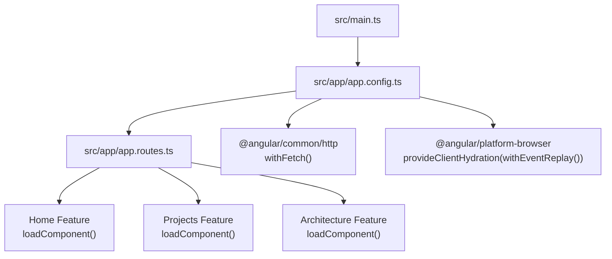
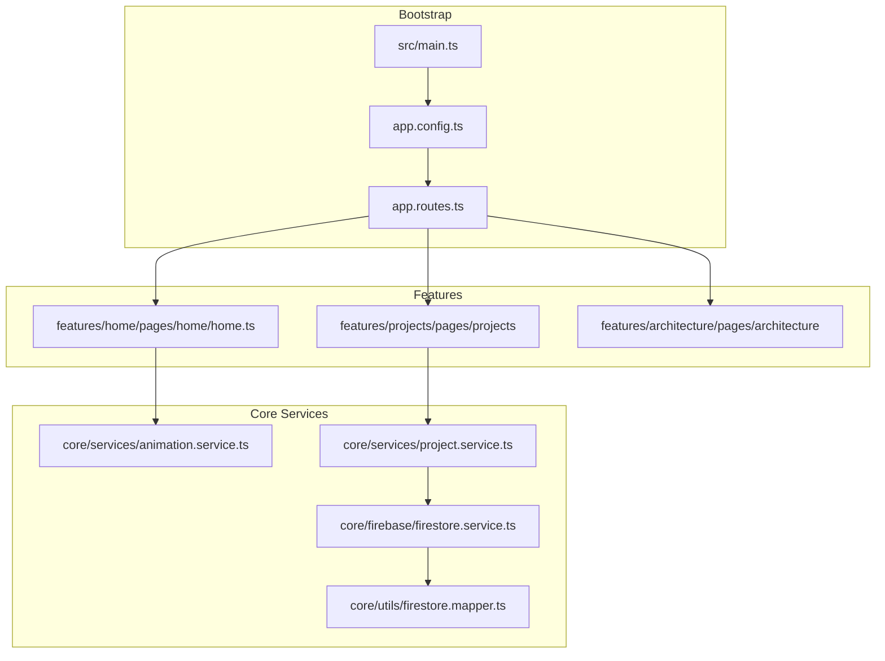
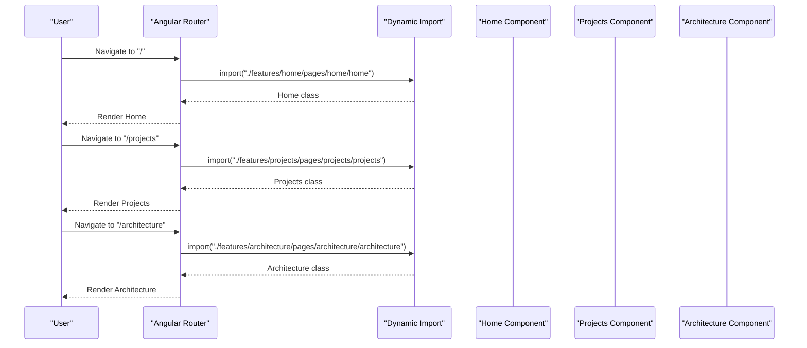
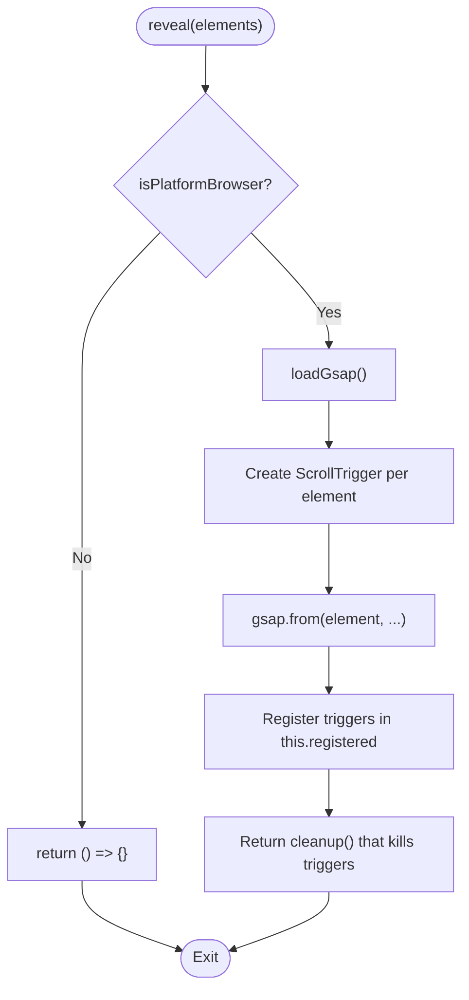
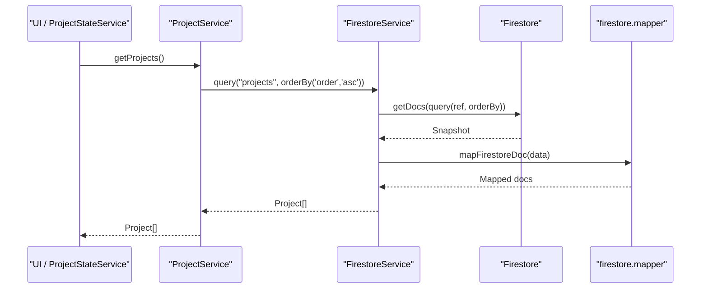
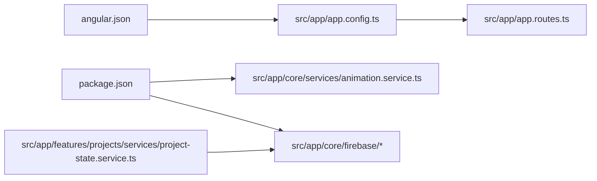

# Performance Optimization

<cite>
**Referenced Files in This Document**
- [package.json](file://package.json)
- [angular.json](file://angular.json)
- [src/main.ts](file://src/main.ts)
- [src/app/app.config.ts](file://src/app/app.config.ts)
- [src/app/app.routes.ts](file://src/app/app.routes.ts)
- [src/app/app.ts](file://src/app/app.ts)
- [src/app/features/home/pages/home/home.ts](file://src/app/features/home/pages/home/home.ts)
- [src/app/core/services/animation.service.ts](file://src/app/core/services/animation.service.ts)
- [src/app/core/firebase/firebase.config.ts](file://src/app/core/firebase/firebase.config.ts)
- [src/app/core/firebase/firestore.service.ts](file://src/app/core/firebase/firestore.service.ts)
- [src/app/core/utils/firestore.mapper.ts](file://src/app/core/utils/firestore.mapper.ts)
- [src/app/core/services/project.service.ts](file://src/app/core/services/project.service.ts)
- [src/app/features/projects/services/project-state.service.ts](file://src/app/features/projects/services/project-state.service.ts)
</cite>

## Table of Contents
1. Introduction
2. Project Structure
3. Core Components
4. Architecture Overview
5. Detailed Component Analysis
6. Dependency Analysis
7. Performance Considerations
8. Troubleshooting Guide
9. Conclusion

## Introduction
This document provides a comprehensive performance optimization guide for the MegaPortfolio application. It focuses on:
- Lazy loading with route-based code splitting and on-demand module loading
- Signal-based state management benefits (automatic change detection, efficient updates)
- Animation performance using GSAP with proper cleanup and memory management
- Bundle size optimization via tree-shaking, dead code elimination, and asset optimization
- Memory leak prevention for animations and subscriptions
- Caching strategies, Firestore query optimization, and Firebase tuning
- Rendering performance, image optimization, and CDN utilization
- Profiling tools and techniques to identify bottlenecks

## Project Structure
MegaPortfolio is an Angular 21 application with standalone components, SSR enabled, and Firebase integration. Key performance-related configuration includes:
- Route-level lazy loading for feature pages
- Client hydration with event replay
- Production budgets and output hashing
- Fonts loaded via CSS imports
- HTTP client configured with fetch



**Diagram sources**
- [src/main.ts:1-7](file://src/main.ts#L1-L7)
- [src/app/app.config.ts:1-26](file://src/app/app.config.ts#L1-L26)
- [src/app/app.routes.ts:1-31](file://src/app/app.routes.ts#L1-L31)

**Section sources**
- [package.json:1-49](file://package.json#L1-L49)
- [angular.json:1-95](file://angular.json#L1-L95)
- [src/main.ts:1-7](file://src/main.ts#L1-L7)
- [src/app/app.config.ts:1-26](file://src/app/app.config.ts#L1-L26)
- [src/app/app.routes.ts:1-31](file://src/app/app.routes.ts#L1-L31)

## Core Components
Key performance-critical components and services:
- Application bootstrap and providers
- Router with lazy-loaded routes
- Animation service with GSAP and ScrollTrigger
- Firestore service and mapper
- Project state service using signals and computed values

**Section sources**
- [src/app/app.config.ts:1-26](file://src/app/app.config.ts#L1-L26)
- [src/app/app.routes.ts:1-31](file://src/app/app.routes.ts#L1-L31)
- [src/app/core/services/animation.service.ts:1-72](file://src/app/core/services/animation.service.ts#L1-L72)
- [src/app/core/firebase/firestore.service.ts:1-100](file://src/app/core/firebase/firestore.service.ts#L1-L100)
- [src/app/core/utils/firestore.mapper.ts:1-28](file://src/app/core/utils/firestore.mapper.ts#L1-L28)
- [src/app/core/services/project.service.ts:1-60](file://src/app/core/services/project.service.ts#L1-L60)
- [src/app/features/projects/services/project-state.service.ts:1-157](file://src/app/features/projects/services/project-state.service.ts#L1-L157)

## Architecture Overview
The runtime architecture emphasizes lazy loading, signal-driven UI, and efficient data access through Firestore.



**Diagram sources**
- [src/main.ts:1-7](file://src/main.ts#L1-L7)
- [src/app/app.config.ts:1-26](file://src/app/app.config.ts#L1-L26)
- [src/app/app.routes.ts:1-31](file://src/app/app.routes.ts#L1-L31)
- [src/app/features/home/pages/home/home.ts:1-25](file://src/app/features/home/pages/home/home.ts#L1-L25)
- [src/app/core/services/animation.service.ts:1-72](file://src/app/core/services/animation.service.ts#L1-L72)
- [src/app/core/services/project.service.ts:1-60](file://src/app/core/services/project.service.ts#L1-L60)
- [src/app/core/firebase/firestore.service.ts:1-100](file://src/app/core/firebase/firestore.service.ts#L1-L100)
- [src/app/core/utils/firestore.mapper.ts:1-28](file://src/app/core/utils/firestore.mapper.ts#L1-L28)

## Detailed Component Analysis

### Lazy Loading and Code Splitting
- Routes use loadComponent to split bundles per page.
- The root app component imports only shared layout; feature modules are not eagerly imported.
- Hydration is enabled with event replay to improve perceived performance.



**Diagram sources**
- [src/app/app.routes.ts:1-31](file://src/app/app.routes.ts#L1-L31)
- [src/app/features/home/pages/home/home.ts:1-25](file://src/app/features/home/pages/home/home.ts#L1-L25)

**Section sources**
- [src/app/app.routes.ts:1-31](file://src/app/app.routes.ts#L1-L31)
- [src/app/app.config.ts:1-26](file://src/app/app.config.ts#L1-L26)

### Signal-Based State Management
ProjectStateService demonstrates:
- Signals for reactive state (allProjects, searchQuery, selectedCategory, currentPage, loadingState, errorMessage, selectedProject).
- Computed values for derived state (filteredProjects, totalPages, paginatedProjects, totalCount, featuredCount, technologyCount, resultCount, isEmpty, isLoading, hasError, showPagination).
- Efficient updates without manual change detection.

```mermaid
classDiagram
class ProjectStateService {
+signal allProjects
+signal searchQuery
+signal selectedCategory
+signal currentPage
+signal loadingState
+signal errorMessage
+signal selectedProject
+computed filteredProjects()
+computed totalPages()
+computed paginatedProjects()
+computed totalCount()
+computed featuredCount()
+computed technologyCount()
+computed resultCount()
+computed isEmpty()
+computed isLoading()
+computed hasError()
+computed showPagination()
+loadProjects() Promise~void~
+retry() void
+setSearch(query) void
+setCategory(category) void
+setPage(page) void
+openModal(project) void
+closeModal() void
}
class ProjectService {
+getProjects() Promise~Project[]~
+getFeaturedProjects() Promise~Project[]~
+getProjectsByCategory(category) Promise~Project[]~
+getProject(id) Promise~Project~
+getProjectBySlug(slug) Promise~Project~
+create(project) Promise~{id}~
+update(id, project) Promise~void~
+delete(id) Promise~void~
}
ProjectStateService --> ProjectService : "uses"
```

**Diagram sources**
- [src/app/features/projects/services/project-state.service.ts:1-157](file://src/app/features/projects/services/project-state.service.ts#L1-L157)
- [src/app/core/services/project.service.ts:1-60](file://src/app/core/services/project.service.ts#L1-L60)

**Section sources**
- [src/app/features/projects/services/project-state.service.ts:1-157](file://src/app/features/projects/services/project-state.service.ts#L1-L157)

### Animation Performance with GSAP
AnimationService implements:
- On-demand dynamic imports of GSAP and ScrollTrigger.
- Browser-only execution guard.
- Centralized registration and cleanup of ScrollTrigger instances via DestroyRef.
- Returns a cleanup function per reveal call to ensure no leaks.



**Diagram sources**
- [src/app/core/services/animation.service.ts:1-72](file://src/app/core/services/animation.service.ts#L1-L72)

**Section sources**
- [src/app/core/services/animation.service.ts:1-72](file://src/app/core/services/animation.service.ts#L1-L72)

### Firestore Data Access and Query Optimization
FirestoreService centralizes queries and mappings:
- Uses getDocs with constraints (where, orderBy, limit).
- Maps Firestore Timestamps to native Date objects.
- ProjectService composes queries for listing, filtering, and single-document retrieval.



**Diagram sources**
- [src/app/core/services/project.service.ts:1-60](file://src/app/core/services/project.service.ts#L1-L60)
- [src/app/core/firebase/firestore.service.ts:1-100](file://src/app/core/firebase/firestore.service.ts#L1-L100)
- [src/app/core/utils/firestore.mapper.ts:1-28](file://src/app/core/utils/firestore.mapper.ts#L1-L28)

**Section sources**
- [src/app/core/services/project.service.ts:1-60](file://src/app/core/services/project.service.ts#L1-L60)
- [src/app/core/firebase/firestore.service.ts:1-100](file://src/app/core/firebase/firestore.service.ts#L1-L100)
- [src/app/core/utils/firestore.mapper.ts:1-28](file://src/app/core/utils/firestore.mapper.ts#L1-L28)

## Dependency Analysis
External dependencies relevant to performance:
- GSAP for animations
- Firebase SDK for backend services
- RxJS for reactive streams (used by Angular internally)
- Angular build tooling for optimization



**Diagram sources**
- [package.json:1-49](file://package.json#L1-L49)
- [angular.json:1-95](file://angular.json#L1-L95)
- [src/app/app.config.ts:1-26](file://src/app/app.config.ts#L1-L26)
- [src/app/app.routes.ts:1-31](file://src/app/app.routes.ts#L1-L31)
- [src/app/core/services/animation.service.ts:1-72](file://src/app/core/services/animation.service.ts#L1-L72)
- [src/app/core/firebase/firebase.config.ts:1-13](file://src/app/core/firebase/firebase.config.ts#L1-L13)
- [src/app/features/projects/services/project-state.service.ts:1-157](file://src/app/features/projects/services/project-state.service.ts#L1-L157)

**Section sources**
- [package.json:1-49](file://package.json#L1-L49)
- [angular.json:1-95](file://angular.json#L1-L95)

## Performance Considerations

### Lazy Loading and Code Splitting
- All top-level routes use loadComponent to defer bundle loading until navigation.
- Keep feature components small and co-locate heavy dependencies within feature modules to maximize split points.
- Avoid importing large libraries at the root level; prefer dynamic imports inside services or components.

**Section sources**
- [src/app/app.routes.ts:1-31](file://src/app/app.routes.ts#L1-L31)

### Signal-Based State Management
- Use signals for fine-grained reactivity; avoid unnecessary recomputation by keeping computed functions pure and minimal.
- Prefer direct signal updates over complex RxJS chains when possible to reduce overhead.
- Memoize expensive computations using computed where appropriate.

**Section sources**
- [src/app/features/projects/services/project-state.service.ts:1-157](file://src/app/features/projects/services/project-state.service.ts#L1-L157)

### Animation Performance and Memory Management
- Dynamically import GSAP and ScrollTrigger only when needed.
- Always kill ScrollTrigger instances on component destruction; leverage DestroyRef to centralize cleanup.
- Return explicit cleanup functions from animation helpers to ensure deterministic teardown.

**Section sources**
- [src/app/core/services/animation.service.ts:1-72](file://src/app/core/services/animation.service.ts#L1-L72)

### Bundle Size Optimization
- Enable production builds with output hashing and budgets to catch regressions.
- Rely on Angular’s tree-shaking and dead code elimination; avoid side effects in top-level scopes.
- Prefer font files via CSS imports and consider preloading critical fonts.

**Section sources**
- [angular.json:1-95](file://angular.json#L1-L95)
- [package.json:1-49](file://package.json#L1-L49)

### Caching Strategies and Firestore Tuning
- Use limited, specific queries (where, orderBy, limit) to minimize payload sizes.
- Cache frequently accessed data in memory using signals or a lightweight cache layer.
- Consider Firestore indexes for fields used in where and orderBy clauses.

**Section sources**
- [src/app/core/firebase/firestore.service.ts:1-100](file://src/app/core/firebase/firestore.service.ts#L1-L100)
- [src/app/core/services/project.service.ts:1-60](file://src/app/core/services/project.service.ts#L1-L60)

### Rendering Performance
- Leverage Angular’s default change detection; signals reduce unnecessary checks.
- Use trackBy-like patterns in templates when rendering lists (e.g., iterate over paginatedProjects).
- Defer non-critical work off the main thread where feasible.

[No sources needed since this section provides general guidance]

### Image Optimization and CDN Utilization
- Serve images in modern formats (WebP/AVIF), apply responsive srcset, and lazy-load below-the-fold images.
- Host static assets on a CDN with caching headers; enable compression.
- Preconnect to CDN origins and preload critical resources.

[No sources needed since this section provides general guidance]

### SSR and Hydration
- Use provideClientHydration(withEventReplay()) to improve interactivity after SSR.
- Ensure server-side rendering does not trigger browser-only APIs.

**Section sources**
- [src/app/app.config.ts:1-26](file://src/app/app.config.ts#L1-L26)

## Troubleshooting Guide
Common performance pitfalls and resolutions:
- Memory leaks from animations: Ensure all ScrollTrigger instances are killed on destroy; verify cleanup functions are invoked.
- Excessive re-renders: Audit signal usage; avoid creating new objects/arrays on each render.
- Large initial bundle: Inspect lazy-loading boundaries; move heavy dependencies into features or dynamic imports.
- Slow Firestore queries: Validate indexes, constrain queries with limit, and avoid fetching entire collections.

**Section sources**
- [src/app/core/services/animation.service.ts:1-72](file://src/app/core/services/animation.service.ts#L1-L72)
- [src/app/features/projects/services/project-state.service.ts:1-157](file://src/app/features/projects/services/project-state.service.ts#L1-L157)
- [src/app/core/firebase/firestore.service.ts:1-100](file://src/app/core/firebase/firestore.service.ts#L1-L100)

## Conclusion
MegaPortfolio employs modern Angular performance practices:
- Route-based lazy loading reduces initial payload.
- Signals deliver efficient, granular updates.
- GSAP animations are lazily loaded and properly cleaned up.
- Firestore queries are constrained and mapped efficiently.
Adopt the outlined strategies to maintain fast load times, smooth interactions, and stable memory usage across the application lifecycle.