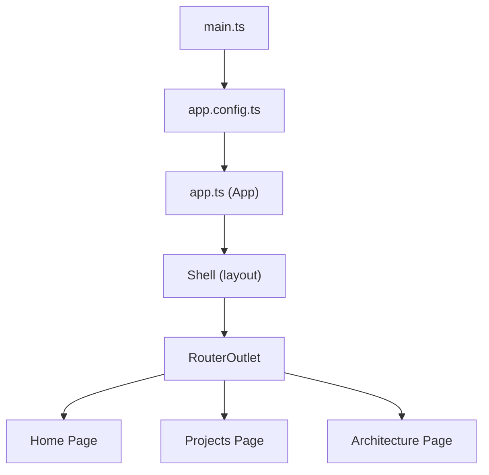
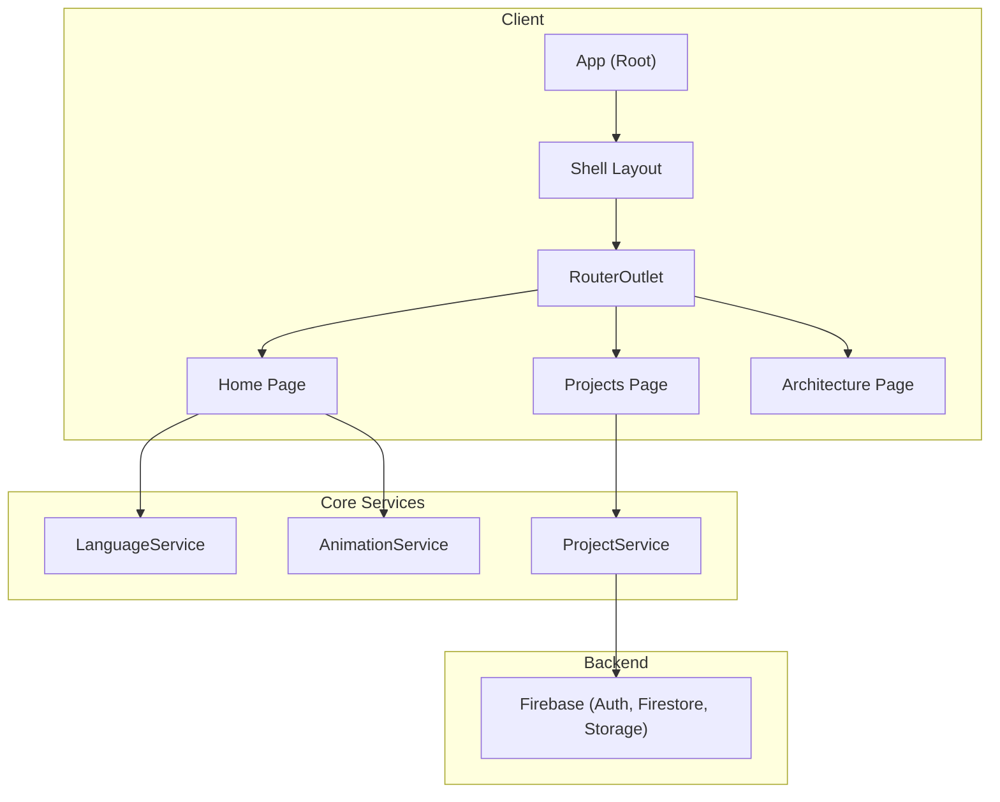
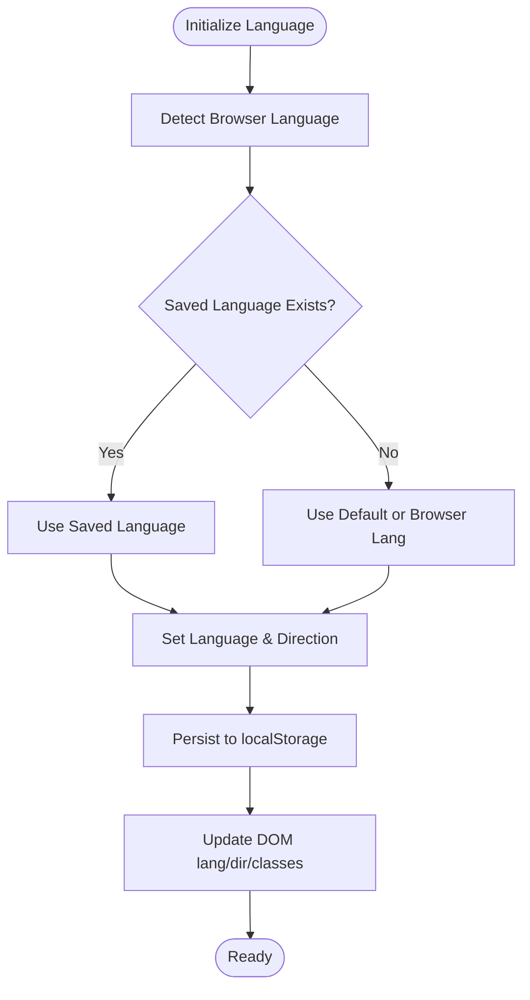
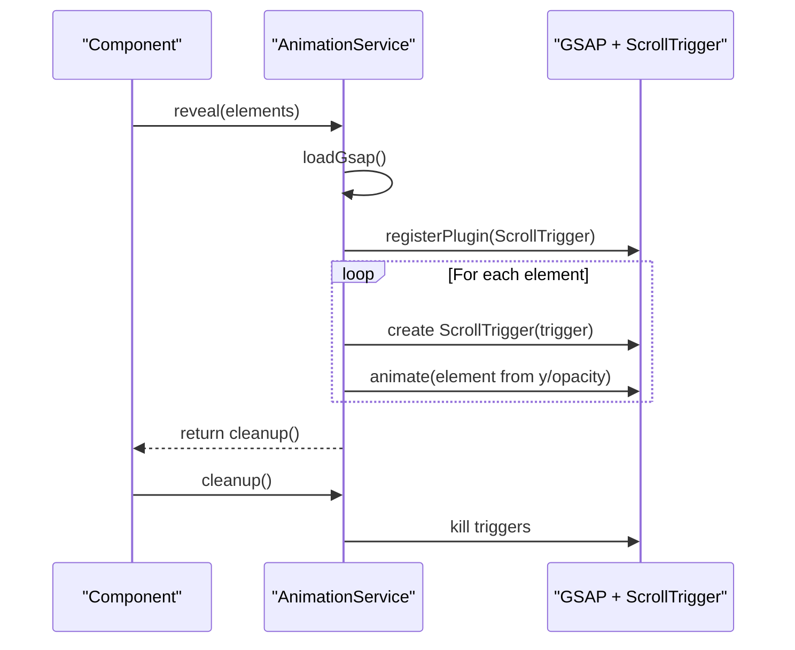
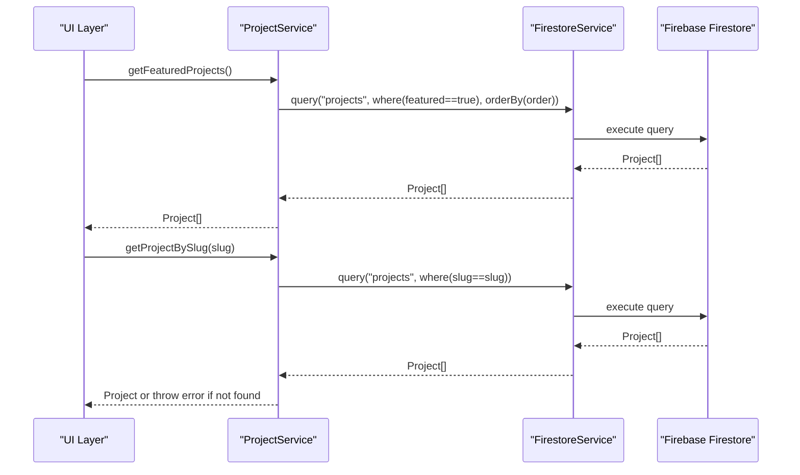
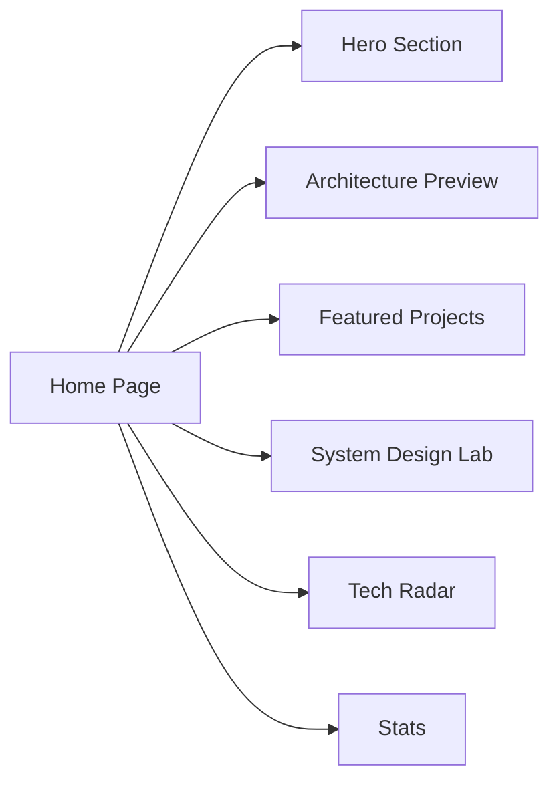
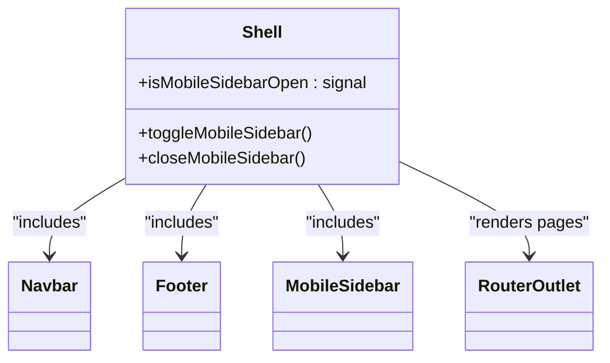
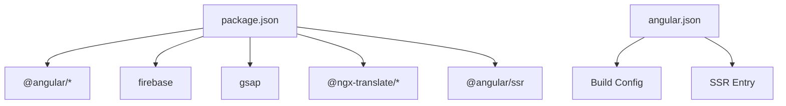

# Project Overview

<cite>
**Referenced Files in This Document**
- [README.md](file://README.md)
- [package.json](file://package.json)
- [angular.json](file://angular.json)
- [src/main.ts](file://src/main.ts)
- [src/app/app.config.ts](file://src/app/app.config.ts)
- [src/app/app.routes.ts](file://src/app/app.routes.ts)
- [src/app/app.ts](file://src/app/app.ts)
- [src/app/core/firebase/firebase.config.ts](file://src/app/core/firebase/firebase.config.ts)
- [src/app/core/services/language.service.ts](file://src/app/core/services/language.service.ts)
- [src/app/core/services/animation.service.ts](file://src/app/core/services/animation.service.ts)
- [src/app/core/services/project.service.ts](file://src/app/core/services/project.service.ts)
- [src/app/core/models/project.model.ts](file://src/app/core/models/project.model.ts)
- [src/app/core/data/projects.data.ts](file://src/app/core/data/projects.data.ts)
- [src/app/features/home/pages/home/home.ts](file://src/app/features/home/pages/home/home.ts)
- [src/app/shared/layout/shell/shell.ts](file://src/app/shared/layout/shell/shell.ts)
</cite>

## Table of Contents
1. [Introduction](#introduction)
2. [Project Structure](#project-structure)
3. [Core Components](#core-components)
4. [Architecture Overview](#architecture-overview)
5. [Detailed Component Analysis](#detailed-component-analysis)
6. [Dependency Analysis](#dependency-analysis)
7. [Performance Considerations](#performance-considerations)
8. [Troubleshooting Guide](#troubleshooting-guide)
9. [Conclusion](#conclusion)

## Introduction
MegaPortfolio is a modern Angular-based portfolio website designed to showcase technical projects, system architecture knowledge, and professional experience. It emphasizes high performance, accessibility, and a rich user experience through advanced animations, real-time data synchronization via Firebase, multi-language support, and responsive design. The project targets developers and professionals who want to demonstrate their technical expertise with a polished, scalable, and maintainable application.

Key features:
- Dynamic project showcase with filtering, search, and pagination
- Interactive system architecture visualization sections
- Real-time data synchronization via Firebase (Firestore)
- Multi-language support with English and Arabic (RTL)
- Advanced scroll-triggered animations powered by GSAP
- Responsive design built with Tailwind CSS and SCSS
- Server-Side Rendering (SSR) for improved SEO and initial load performance

Target audience:
- Software engineers, architects, and technical leads showcasing work
- Recruiters and hiring managers evaluating candidates
- Open-source contributors and collaborators reviewing project structure and practices

Technology stack summary:
- Angular 21.2.x with standalone components and signals
- Firebase integration for authentication, Firestore, and storage
- GSAP for advanced animations and ScrollTrigger
- Tailwind CSS for utility-first styling
- SSR enabled via @angular/ssr and Express server

**Section sources**
- [README.md:1-60](file://README.md#L1-L60)
- [package.json:14-33](file://package.json#L14-L33)
- [angular.json:43-50](file://angular.json#L43-L50)

## Project Structure
The application follows a feature-based modular architecture with shared utilities and core services. Key directories:
- src/app/core: Shared services, models, data, interceptors, and Firebase configuration
- src/app/features: Feature modules organized by domain (home, projects, architecture, blog, contact, experience)
- src/app/shared: Reusable UI components, layout shell, directives, pipes
- src/assets/i18n: Localization resources for multi-language support

Entry points and bootstrapping:
- Application bootstrap via main.ts using Angular’s bootstrapApplication
- Root component App imports the Shell layout
- Routes are defined with lazy-loaded feature components



**Diagram sources**
- [src/main.ts:1-7](file://src/main.ts#L1-L7)
- [src/app/app.config.ts:10-25](file://src/app/app.config.ts#L10-L25)
- [src/app/app.ts:5-12](file://src/app/app.ts#L5-L12)
- [src/app/shared/layout/shell/shell.ts:8-14](file://src/app/shared/layout/shell/shell.ts#L8-L14)
- [src/app/app.routes.ts:3-30](file://src/app/app.routes.ts#L3-L30)

**Section sources**
- [src/main.ts:1-7](file://src/main.ts#L1-L7)
- [src/app/app.config.ts:10-25](file://src/app/app.config.ts#L10-L25)
- [src/app/app.routes.ts:3-30](file://src/app/app.routes.ts#L3-L30)
- [src/app/app.ts:5-12](file://src/app/app.ts#L5-L12)
- [src/app/shared/layout/shell/shell.ts:8-14](file://src/app/shared/layout/shell/shell.ts#L8-L14)

## Core Components
This section highlights the foundational services and models that power the portfolio’s functionality.

- LanguageService: Manages current language, RTL/LTR direction, and persistence via localStorage. Integrates with @ngx-translate for runtime localization.
- AnimationService: Dynamically loads GSAP and ScrollTrigger on the browser, creates scroll-triggered reveal animations, and ensures cleanup on component destroy.
- ProjectService: Provides CRUD operations and queries against Firebase Firestore for projects, including filtering by category and featured status.
- Project model: Defines the shape of project data, categories, statuses, and labels used across features.
- Home page: Composes multiple sections (Hero, ArchitecturePreview, FeaturedProjects, SystemDesignLab, TechRadar, Stats) into a cohesive landing experience.
- Shell layout: Wraps the app with Navbar, Footer, and MobileSidebar, exposing signal-based state for mobile navigation.

```mermaid
classDiagram
class LanguageService {
+currentLang : signal
+isRtl : signal
+setLanguage(lang)
+toggleLanguage()
}
class AnimationService {
+reveal(elements) Promise~cleanup~
-loadGsap() Promise
}
class ProjectService {
+getProjects() Promise~Project[]~
+getFeaturedProjects() Promise~Project[]~
+getProjectsByCategory(category) Promise~Project[]~
+getProject(id) Promise~Project~
+getProjectBySlug(slug) Promise~Project~
+create(project) Promise~{id}~
+update(id, project) Promise~void~
+delete(id) Promise~void~
}
class Project {
+id : string?
+title : string
+slug : string
+shortDescription : string
+description : string
+coverImage : string
+gallery : string[]
+technologies : string[]
+github : string?
+liveDemo : string?
+category : ProjectCategory
+featured : boolean
+status : ProjectStatus
+order : number
+createdAt : Date
+updatedAt : Date
}
class Home {
+imports : Hero, ArchitecturePreview, FeaturedProjects, SystemDesignLab, TechRadar, Stats
}
class Shell {
+isMobileSidebarOpen : signal<boolean>
+toggleMobileSidebar()
+closeMobileSidebar()
}
ProjectService --> Project : "queries"
Home --> Shell : "renders within"
LanguageService <.. Home : "used for i18n"
AnimationService <.. Home : "used for animations"
```

**Diagram sources**
- [src/app/core/services/language.service.ts:10-61](file://src/app/core/services/language.service.ts#L10-L61)
- [src/app/core/services/animation.service.ts:7-71](file://src/app/core/services/animation.service.ts#L7-L71)
- [src/app/core/services/project.service.ts:9-59](file://src/app/core/services/project.service.ts#L9-L59)
- [src/app/core/models/project.model.ts:1-44](file://src/app/core/models/project.model.ts#L1-L44)
- [src/app/features/home/pages/home/home.ts:10-24](file://src/app/features/home/pages/home/home.ts#L10-L24)
- [src/app/shared/layout/shell/shell.ts:8-25](file://src/app/shared/layout/shell/shell.ts#L8-L25)

**Section sources**
- [src/app/core/services/language.service.ts:10-61](file://src/app/core/services/language.service.ts#L10-L61)
- [src/app/core/services/animation.service.ts:7-71](file://src/app/core/services/animation.service.ts#L7-L71)
- [src/app/core/services/project.service.ts:9-59](file://src/app/core/services/project.service.ts#L9-L59)
- [src/app/core/models/project.model.ts:1-44](file://src/app/core/models/project.model.ts#L1-L44)
- [src/app/features/home/pages/home/home.ts:10-24](file://src/app/features/home/pages/home/home.ts#L10-L24)
- [src/app/shared/layout/shell/shell.ts:8-25](file://src/app/shared/layout/shell/shell.ts#L8-L25)

## Architecture Overview
MegaPortfolio uses a feature-based modular architecture with standalone components and signal-based state management. The service layer encapsulates business logic and data access, while routes lazily load feature components. Firebase provides backend capabilities for real-time data synchronization.



**Diagram sources**
- [src/app/app.ts:5-12](file://src/app/app.ts#L5-L12)
- [src/app/shared/layout/shell/shell.ts:8-14](file://src/app/shared/layout/shell/shell.ts#L8-L14)
- [src/app/app.routes.ts:3-30](file://src/app/app.routes.ts#L3-L30)
- [src/app/core/services/language.service.ts:10-61](file://src/app/core/services/language.service.ts#L10-L61)
- [src/app/core/services/animation.service.ts:7-71](file://src/app/core/services/animation.service.ts#L7-L71)
- [src/app/core/services/project.service.ts:9-59](file://src/app/core/services/project.service.ts#L9-L59)
- [src/app/core/firebase/firebase.config.ts:1-13](file://src/app/core/firebase/firebase.config.ts#L1-L13)

## Detailed Component Analysis

### Language Service (i18n and RTL Support)
LanguageService initializes the application language based on browser detection or persisted preference, toggles between English and Arabic, and updates document directionality and classes for RTL styling. It integrates with @ngx-translate for dynamic content switching.



**Diagram sources**
- [src/app/core/services/language.service.ts:17-55](file://src/app/core/services/language.service.ts#L17-L55)

**Section sources**
- [src/app/core/services/language.service.ts:10-61](file://src/app/core/services/language.service.ts#L10-L61)

### Animation Service (GSAP Scroll Triggers)
AnimationService dynamically loads GSAP and ScrollTrigger only when needed, registers scroll-triggered animations for elements, and ensures proper cleanup on component destruction to prevent memory leaks.



**Diagram sources**
- [src/app/core/services/animation.service.ts:20-70](file://src/app/core/services/animation.service.ts#L20-L70)

**Section sources**
- [src/app/core/services/animation.service.ts:7-71](file://src/app/core/services/animation.service.ts#L7-L71)

### Project Service (Firebase Integration)
ProjectService abstracts Firestore interactions for projects, offering methods to fetch all projects, featured projects, filtered by category, and individual projects by id or slug. It also supports create, update, and delete operations.



**Diagram sources**
- [src/app/core/services/project.service.ts:13-46](file://src/app/core/services/project.service.ts#L13-L46)

**Section sources**
- [src/app/core/services/project.service.ts:9-59](file://src/app/core/services/project.service.ts#L9-L59)
- [src/app/core/models/project.model.ts:1-44](file://src/app/core/models/project.model.ts#L1-L44)

### Home Page Composition
The Home page composes multiple sections to deliver a rich landing experience, including hero, architecture preview, featured projects, system design lab, tech radar, and stats. Each section is a standalone component imported directly into the page.



**Diagram sources**
- [src/app/features/home/pages/home/home.ts:10-24](file://src/app/features/home/pages/home/home.ts#L10-L24)

**Section sources**
- [src/app/features/home/pages/home/home.ts:10-24](file://src/app/features/home/pages/home/home.ts#L10-L24)

### Shell Layout and Navigation
The Shell component wraps the application with consistent layout elements: Navbar, Footer, and MobileSidebar. It exposes signal-based state to control mobile sidebar visibility and integrates with Angular Router for outlet rendering.



**Diagram sources**
- [src/app/shared/layout/shell/shell.ts:8-25](file://src/app/shared/layout/shell/shell.ts#L8-L25)

**Section sources**
- [src/app/shared/layout/shell/shell.ts:8-25](file://src/app/shared/layout/shell/shell.ts#L8-L25)

## Dependency Analysis
The application’s dependencies are managed via npm and include Angular framework packages, Firebase SDK, GSAP, Tailwind CSS, and translation libraries. SSR is configured through @angular/ssr and an Express server.



**Diagram sources**
- [package.json:14-33](file://package.json#L14-L33)
- [angular.json:43-50](file://angular.json#L43-L50)

**Section sources**
- [package.json:14-33](file://package.json#L14-L33)
- [angular.json:43-50](file://angular.json#L43-L50)

## Performance Considerations
- Lazy loading: Routes use loadComponent to defer feature module loading until needed.
- Standalone components: Reduce bundle size and simplify dependency graphs.
- Signal-based state: Minimizes change detection overhead compared to RxJS-heavy patterns.
- Dynamic imports: GSAP is loaded on demand to avoid blocking initial render.
- SSR: Improves first paint and SEO by pre-rendering content on the server.
- Asset optimization: Production builds enable hashing and budgets; fonts and styles are bundled efficiently.

[No sources needed since this section provides general guidance]

## Troubleshooting Guide
- Firebase initialization: Ensure firebaseConfig values are correct and accessible in the environment. Misconfiguration can cause auth or Firestore errors.
- i18n issues: Verify language files exist under assets/i18n and that TranslateService loader prefix/suffix matches file naming conventions.
- Animation glitches: Confirm GSAP plugins are registered and elements exist before triggering animations; ensure cleanup functions are called on destroy.
- Routing problems: Validate route definitions and lazy-loading paths; ensure components export default classes and are importable.
- SSR hydration: Check platform checks (isPlatformBrowser) to avoid accessing window/document during server-side execution.

**Section sources**
- [src/app/core/firebase/firebase.config.ts:1-13](file://src/app/core/firebase/firebase.config.ts#L1-L13)
- [src/app/app.config.ts:16-23](file://src/app/app.config.ts#L16-L23)
- [src/app/core/services/animation.service.ts:13-18](file://src/app/core/services/animation.service.ts#L13-L18)
- [src/app/app.routes.ts:3-30](file://src/app/app.routes.ts#L3-L30)

## Conclusion
MegaPortfolio demonstrates a modern, scalable Angular application with a clear separation of concerns, robust service layer, and rich user experience features. Its architecture supports dynamic content, real-time data synchronization, internationalization, and advanced animations while maintaining performance and maintainability. The project serves as both a portfolio showcase and a reference implementation for building high-quality web applications.

[No sources needed since this section summarizes without analyzing specific files]