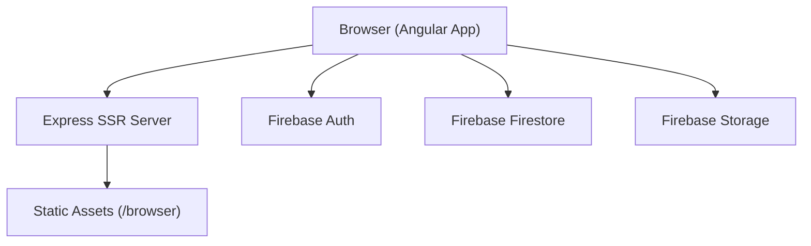
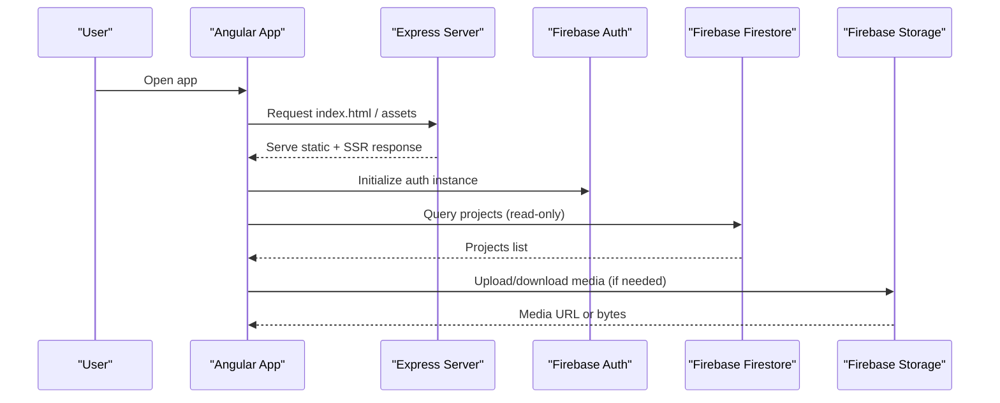
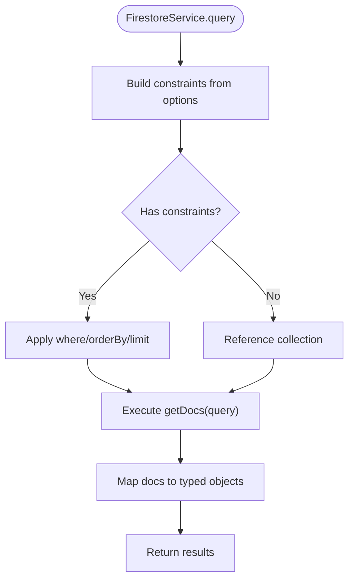
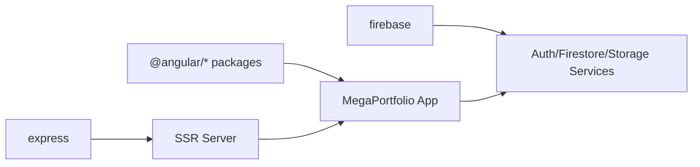

# Security Considerations

<cite>
**Referenced Files in This Document**
- [firebase.config.ts](file://src/app/core/firebase/firebase.config.ts)
- [auth.service.ts](file://src/app/core/firebase/auth.service.ts)
- [firestore.service.ts](file://src/app/core/firebase/firestore.service.ts)
- [storage.service.ts](file://src/app/core/firebase/storage.service.ts)
- [index.ts](file://src/app/core/firebase/index.ts)
- [project.service.ts](file://src/app/core/services/project.service.ts)
- [app.config.ts](file://src/app/app.config.ts)
- [server.ts](file://src/server.ts)
- [angular.json](file://angular.json)
- [package.json](file://package.json)
- [index.html](file://src/index.html)
</cite>

## Table of Contents
1. Introduction
2. Project Structure
3. Core Components
4. Architecture Overview
5. Detailed Component Analysis
6. Dependency Analysis
7. Performance Considerations
8. Troubleshooting Guide
9. Conclusion
10. Appendices

## Introduction
This document provides comprehensive security guidance for the MegaPortfolio application, focusing on Firebase integration, authentication and authorization patterns, data validation, input sanitization, secure configuration management, server hardening, and client-side protections. It also includes best practices for API security, rate limiting, abuse prevention, content security policies, and a practical audit checklist tailored to this codebase.

## Project Structure
The application is an Angular SPA with SSR support using Express. Firebase SDK is integrated via dedicated services for Auth, Firestore, and Storage. The server entry point serves static assets and renders the Angular app. Configuration is centralized in Angular’s app config and build settings.

**Diagram sources**
- [server.ts:1-69](file://src/server.ts#L1-L69)
- [firebase.config.ts:1-13](file://src/app/core/firebase/firebase.config.ts#L1-L13)
- [auth.service.ts:1-13](file://src/app/core/firebase/auth.service.ts#L1-L13)
- [firestore.service.ts:1-100](file://src/app/core/firebase/firestore.service.ts#L1-L100)
- [storage.service.ts:1-13](file://src/app/core/firebase/storage.service.ts#L1-L13)

**Section sources**
- [server.ts:1-69](file://src/server.ts#L1-L69)
- [angular.json:1-95](file://angular.json#L1-L95)
- [package.json:1-49](file://package.json#L1-L49)

## Core Components
- Firebase initialization and configuration are centralized in a single module.
- Authentication, Firestore, and Storage access are exposed through typed services.
- A project service demonstrates typical read/write operations against Firestore collections.

Key responsibilities:
- Initialize Firebase once per app instance.
- Provide typed access to Auth, Firestore, and Storage.
- Encapsulate common query patterns and error handling.

**Section sources**
- [firebase.config.ts:1-13](file://src/app/core/firebase/firebase.config.ts#L1-L13)
- [auth.service.ts:1-13](file://src/app/core/firebase/auth.service.ts#L1-L13)
- [firestore.service.ts:1-100](file://src/app/core/firebase/firestore.service.ts#L1-L100)
- [storage.service.ts:1-13](file://src/app/core/firebase/storage.service.ts#L1-L13)
- [index.ts:1-6](file://src/app/core/firebase/index.ts#L1-L6)
- [project.service.ts:1-60](file://src/app/core/services/project.service.ts#L1-L60)

## Architecture Overview
The runtime architecture combines a Node/Express SSR server with an Angular SPA that communicates directly with Firebase services. Security boundaries exist at:
- Client-side: Input validation, safe rendering, and least-privilege Firebase rules.
- Server-side: Static asset serving, request handling, and optional API endpoints.
- Backend-as-a-service: Firebase Auth, Firestore, and Storage governed by security rules.

**Diagram sources**
- [server.ts:1-69](file://src/server.ts#L1-L69)
- [auth.service.ts:1-13](file://src/app/core/firebase/auth.service.ts#L1-L13)
- [firestore.service.ts:1-100](file://src/app/core/firebase/firestore.service.ts#L1-L100)
- [storage.service.ts:1-13](file://src/app/core/firebase/storage.service.ts#L1-L13)

## Detailed Component Analysis

### Firebase Initialization and Configuration
- Centralized configuration object initializes the Firebase app instance.
- All services receive the same app instance to ensure consistent configuration.

Security considerations:
- Avoid committing secrets; use environment variables or secret managers.
- Restrict Firebase project keys to browser-scoped APIs where possible.

**Section sources**
- [firebase.config.ts:1-13](file://src/app/core/firebase/firebase.config.ts#L1-L13)
- [index.ts:1-6](file://src/app/core/firebase/index.ts#L1-L6)

### Authentication Service
- Provides a singleton Auth instance bound to the initialized Firebase app.
- Intended as the foundation for login flows, token observation, and session state.

Security considerations:
- Implement explicit sign-in/sign-out flows.
- Observe auth state changes to guard routes and UI.
- Store minimal session state; rely on Firebase ID tokens.

**Section sources**
- [auth.service.ts:1-13](file://src/app/core/firebase/auth.service.ts#L1-L13)

### Firestore Service and Data Access Patterns
- Wraps Firestore SDK with typed methods for queries, reads, creates, updates, and deletes.
- Builds constraints from options to keep queries predictable and bounded.

Security considerations:
- Enforce read/write permissions via Firebase Security Rules.
- Validate inputs before mutations; sanitize strings.
- Limit result sets with limit() and avoid unbounded queries.

**Diagram sources**
- [firestore.service.ts:35-96](file://src/app/core/firebase/firestore.service.ts#L35-L96)

**Section sources**
- [firestore.service.ts:1-100](file://src/app/core/firebase/firestore.service.ts#L1-L100)

### Storage Service
- Exposes a storage instance tied to the shared Firebase app.
- Use for uploading/downloading files when required by features.

Security considerations:
- Restrict file paths and sizes via Storage rules.
- Validate file types and sizes client-side before upload.

**Section sources**
- [storage.service.ts:1-13](file://src/app/core/firebase/storage.service.ts#L1-L13)

### Project Service (Example of CRUD usage)
- Demonstrates querying projects with ordering and filtering.
- Includes create/update/delete wrappers around FirestoreService.

Security considerations:
- Ensure only authorized users can mutate data.
- Validate category/slug values and enforce allowed enums.

**Section sources**
- [project.service.ts:1-60](file://src/app/core/services/project.service.ts#L1-L60)

### Application Configuration and HTTP
- Angular app providers include router, hydration, and HTTP client setup.
- No custom interceptors are present in the analyzed files.

Security considerations:
- Add CSP and security headers via server middleware.
- Configure CORS explicitly if calling external APIs.

**Section sources**
- [app.config.ts:1-26](file://src/app/app.config.ts#L1-L26)

### SSR Server (Express)
- Serves static assets and renders Angular responses.
- Uses environment variable PORT with a default fallback.

Security considerations:
- Enforce HTTPS upstream (e.g., reverse proxy).
- Add security headers (HSTS, X-Frame-Options, etc.).
- Implement rate limiting and request size limits.

**Section sources**
- [server.ts:1-69](file://src/server.ts#L1-L69)

## Dependency Analysis
The application depends on Angular, Express, and Firebase SDKs. Dependencies are declared in package manifests. SSR is configured in Angular CLI settings.

**Diagram sources**
- [package.json:1-49](file://package.json#L1-L49)
- [angular.json:1-95](file://angular.json#L1-L95)

**Section sources**
- [package.json:1-49](file://package.json#L1-L49)
- [angular.json:1-95](file://angular.json#L1-L95)

## Performance Considerations
- Prefer immutable data structures and avoid unnecessary re-renders in components.
- Cache frequently accessed data client-side when appropriate.
- Use pagination and limit Firestore queries to reduce payload size.
- Enable production optimizations in builds and leverage CDN caching for static assets.

[No sources needed since this section provides general guidance]

## Troubleshooting Guide
Common issues and mitigations:
- Firebase initialization errors: Verify configuration values and network reachability.
- Firestore permission denied: Review Firebase Security Rules and user auth state.
- SSR port conflicts: Ensure PORT is available or adjust server binding.
- Missing security headers: Add them in Express middleware or via reverse proxy.

**Section sources**
- [server.ts:54-63](file://src/server.ts#L54-L63)
- [firestore.service.ts:51-62](file://src/app/core/firebase/firestore.service.ts#L51-L62)

## Conclusion
Securely operating MegaPortfolio requires layered defenses: strict Firebase rules, validated and sanitized inputs, hardened server configuration, and robust client-side protections. Adopting the patterns outlined here will significantly reduce attack surface and improve resilience.

[No sources needed since this section summarizes without analyzing specific files]

## Appendices

### Firebase Security Rules Implementation Guide
- Authentication: Require authenticated users for write operations; allow anonymous or public reads where appropriate.
- Authorization: Scope writes to resource owners; validate roles and ownership in rules.
- Data Validation: Enforce field types, lengths, and allowed values in rules.
- Rate Limiting: Use Firebase-native throttling or backend proxies for write-heavy endpoints.

[No sources needed since this section provides general guidance]

### Input Validation and Sanitization Patterns
- Validate all user inputs on the client and server (when applicable).
- Sanitize HTML content before rendering; prefer Angular’s built-in DOM sanitization.
- Reject unexpected characters and enforce whitelists for identifiers.

[No sources needed since this section provides general guidance]

### Secure Authentication Flows and Token Management
- Use Firebase Auth sign-in methods and observe auth state changes.
- Store minimal session state; rely on Firebase ID tokens for verification.
- Implement logout flows that clear local state and revoke sessions where supported.

[No sources needed since this section provides general guidance]

### Environment Variables and Secret Management
- Do not commit secrets to version control.
- Use environment variables or secret managers for sensitive configuration.
- Rotate credentials regularly and restrict scope.

[No sources needed since this section provides general guidance]

### HTTPS Enforcement, CORS, and Security Headers
- Enforce HTTPS via reverse proxy or hosting platform.
- Configure CORS to allow only trusted origins.
- Set security headers: HSTS, X-Content-Type-Options, X-Frame-Options, Content-Security-Policy.

[No sources needed since this section provides general guidance]

### API Security Best Practices
- Validate and authenticate all requests.
- Implement rate limiting and request size limits.
- Log and monitor suspicious activity.

[No sources needed since this section provides general guidance]

### Client-Side Security Considerations
- Use Angular’s DomSanitizer for any dynamic content.
- Define a strict Content Security Policy.
- Keep dependencies updated and run vulnerability scans.

[No sources needed since this section provides general guidance]

### Security Audit Checklist
- Confirm Firebase rules enforce least privilege.
- Verify no secrets in source code.
- Ensure HTTPS is enforced end-to-end.
- Validate input/output handling and sanitization.
- Check for outdated dependencies and known vulnerabilities.
- Review server headers and CORS configuration.
- Test authentication and authorization flows thoroughly.

[No sources needed since this section provides general guidance]

### Common Pitfalls to Avoid
- Hardcoding API keys or secrets.
- Overly permissive Firebase rules.
- Rendering unsanitized user input.
- Missing security headers.
- Unbounded Firestore queries leading to data leaks.

[No sources needed since this section provides general guidance]