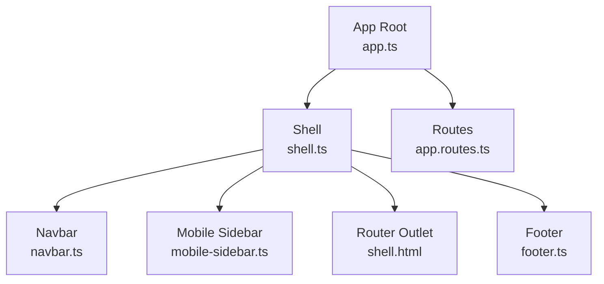
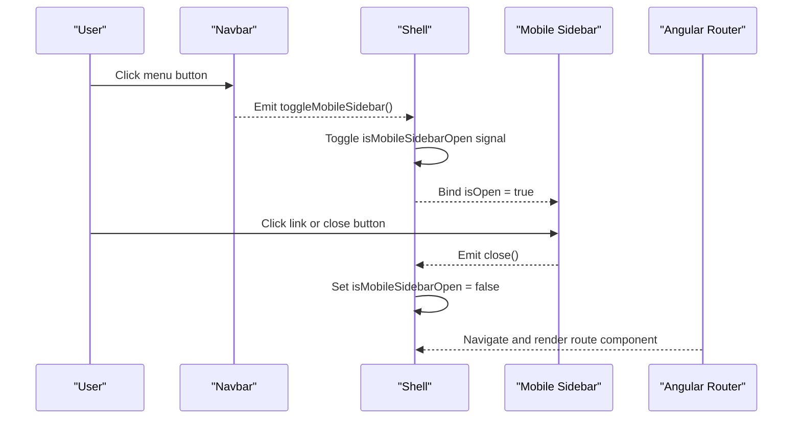
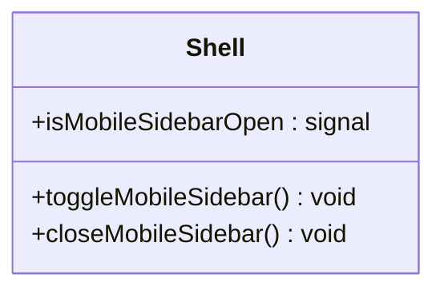
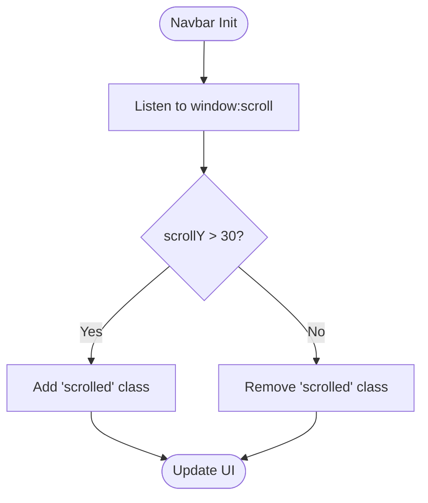
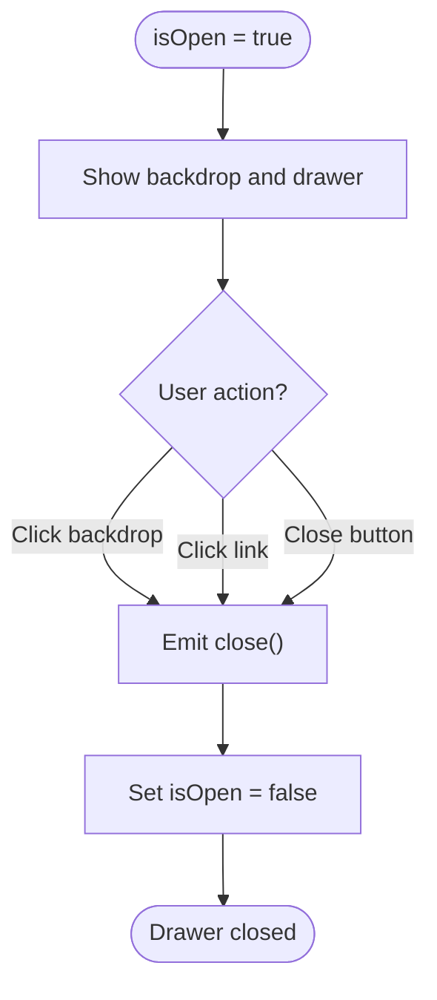
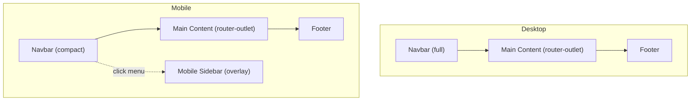
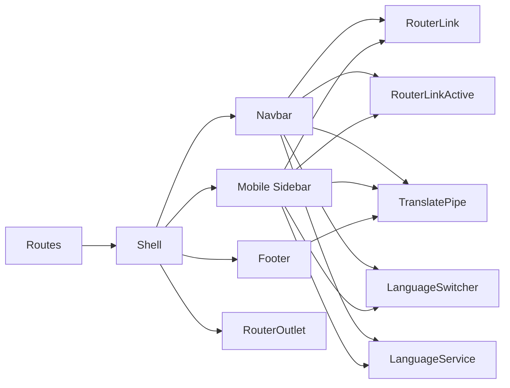

# Layout Components

<cite>
**Referenced Files in This Document**
- [shell.ts](file://src/app/shared/layout/shell/shell.ts)
- [shell.html](file://src/app/shared/layout/shell/shell.html)
- [shell.scss](file://src/app/shared/layout/shell/shell.scss)
- [navbar.ts](file://src/app/shared/layout/navbar/navbar.ts)
- [navbar.html](file://src/app/shared/layout/navbar/navbar.html)
- [navbar.scss](file://src/app/shared/layout/navbar/navbar.scss)
- [footer.ts](file://src/app/shared/layout/footer/footer.ts)
- [footer.html](file://src/app/shared/layout/footer/footer.html)
- [footer.scss](file://src/app/shared/layout/footer/footer.scss)
- [mobile-sidebar.ts](file://src/app/shared/components/mobile-sidebar/mobile-sidebar.ts)
- [mobile-sidebar.html](file://src/app/shared/components/mobile-sidebar/mobile-sidebar.html)
- [mobile-sidebar.scss](file://src/app/shared/components/mobile-sidebar/mobile-sidebar.scss)
- [app.routes.ts](file://src/app/app.routes.ts)
- [app.ts](file://src/app/app.ts)
- [app.html](file://src/app/app.html)
</cite>

## Table of Contents
1. [Introduction](#introduction)
2. [Project Structure](#project-structure)
3. [Core Components](#core-components)
4. [Architecture Overview](#architecture-overview)
5. [Detailed Component Analysis](#detailed-component-analysis)
6. [Dependency Analysis](#dependency-analysis)
7. [Performance Considerations](#performance-considerations)
8. [Troubleshooting Guide](#troubleshooting-guide)
9. [Conclusion](#conclusion)

## Introduction
This document explains the layout components that form the structural foundation of the application: Shell, Navbar, Footer, and Mobile Sidebar. It covers how these components integrate with Angular Router, manage mobile sidebar state, handle responsive behavior, and provide accessibility features. The documentation also outlines component props, events, styling approaches, and integration patterns to help you build a cohesive user interface across screen sizes.

## Project Structure
The layout is composed of standalone Angular components under shared/layout and shared/components. The root app component mounts the Shell, which orchestrates the top-level structure including the Navbar, Mobile Sidebar, main content area (router outlet), and Footer. Routes are defined separately and loaded lazily for performance.

**Diagram sources**
- [app.ts:1-13](file://src/app/app.ts#L1-L13)
- [app.html:1-1](file://src/app/app.html#L1-L1)
- [shell.ts:1-26](file://src/app/shared/layout/shell/shell.ts#L1-L26)
- [shell.html:1-12](file://src/app/shared/layout/shell/shell.html#L1-L12)
- [navbar.ts:1-30](file://src/app/shared/layout/navbar/navbar.ts#L1-L30)
- [mobile-sidebar.ts:1-25](file://src/app/shared/components/mobile-sidebar/mobile-sidebar.ts#L1-L25)
- [footer.ts:1-12](file://src/app/shared/layout/footer/footer.ts#L1-L12)
- [app.routes.ts:1-31](file://src/app/app.routes.ts#L1-L31)

**Section sources**
- [app.ts:1-13](file://src/app/app.ts#L1-L13)
- [app.html:1-1](file://src/app/app.html#L1-L1)
- [shell.ts:1-26](file://src/app/shared/layout/shell/shell.ts#L1-L26)
- [shell.html:1-12](file://src/app/shared/layout/shell/shell.html#L1-L12)
- [app.routes.ts:1-31](file://src/app/app.routes.ts#L1-L31)

## Core Components
- Shell: Application container that composes Navbar, Mobile Sidebar, router-outlet, and Footer. Manages mobile sidebar open/close state using an Angular signal and exposes methods to toggle and close the sidebar.
- Navbar: Top navigation bar with desktop links, language switcher, resume button, and a menu button on mobile. Emits an event to toggle the mobile sidebar and detects scroll state to apply visual changes.
- Footer: Simple footer with role text, social links, and copyright notice. Uses translation pipe for internationalization.
- Mobile Sidebar: Slide-in drawer with overlay backdrop, navigation links, language switcher, and resume button. Supports RTL via language service and emits close events.

Key responsibilities:
- Shell coordinates layout and state.
- Navbar handles navigation and responsive UI toggles.
- Mobile Sidebar provides accessible mobile navigation with overlay behavior.
- Footer presents static information and links.

**Section sources**
- [shell.ts:1-26](file://src/app/shared/layout/shell/shell.ts#L1-L26)
- [shell.html:1-12](file://src/app/shared/layout/shell/shell.html#L1-L12)
- [navbar.ts:1-30](file://src/app/shared/layout/navbar/navbar.ts#L1-L30)
- [navbar.html:1-40](file://src/app/shared/layout/navbar/navbar.html#L1-L40)
- [mobile-sidebar.ts:1-25](file://src/app/shared/components/mobile-sidebar/mobile-sidebar.ts#L1-L25)
- [mobile-sidebar.html:1-62](file://src/app/shared/components/mobile-sidebar/mobile-sidebar.html#L1-L62)
- [footer.ts:1-12](file://src/app/shared/layout/footer/footer.ts#L1-L12)
- [footer.html:1-19](file://src/app/shared/layout/footer/footer.html#L1-L19)

## Architecture Overview
The Shell acts as the root layout component. It binds the Navbar’s toggle event to its own method, passes the sidebar open state to the Mobile Sidebar, and renders page content via router-outlet. The Navbar listens to window scroll to update its appearance and emits a toggle event when the mobile menu button is clicked. The Mobile Sidebar uses an input for visibility and emits a close event to reset state.

**Diagram sources**
- [navbar.html:30-38](file://src/app/shared/layout/navbar/navbar.html#L30-L38)
- [navbar.ts:16-28](file://src/app/shared/layout/navbar/navbar.ts#L16-L28)
- [shell.html:1-12](file://src/app/shared/layout/shell/shell.html#L1-L12)
- [shell.ts:16-24](file://src/app/shared/layout/shell/shell.ts#L16-L24)
- [mobile-sidebar.html:1-62](file://src/app/shared/components/mobile-sidebar/mobile-sidebar.html#L1-L62)
- [mobile-sidebar.ts:16-24](file://src/app/shared/components/mobile-sidebar/mobile-sidebar.ts#L16-L24)
- [app.routes.ts:1-31](file://src/app/app.routes.ts#L1-L31)

## Detailed Component Analysis

### Shell Component
- Purpose: Compose the application shell, manage mobile sidebar state, and host the router outlet.
- Props/Events:
  - Exposes methods toggleMobileSidebar() and closeMobileSidebar().
  - Binds isOpen to Mobile Sidebar and subscribes to its close event.
- Styling:
  - Main content area ensures minimum height and prevents horizontal overflow.
- Integration:
  - Imports Navbar, Footer, Mobile Sidebar, and RouterOutlet.
  - Renders pages via <router-outlet>.

**Diagram sources**
- [shell.ts:15-24](file://src/app/shared/layout/shell/shell.ts#L15-L24)

**Section sources**
- [shell.ts:1-26](file://src/app/shared/layout/shell/shell.ts#L1-L26)
- [shell.html:1-12](file://src/app/shared/layout/shell/shell.html#L1-L12)
- [shell.scss:1-7](file://src/app/shared/layout/shell/shell.scss#L1-L7)

### Navbar Component
- Purpose: Provide top navigation with active route detection, language switching, and mobile menu trigger.
- Props/Events:
  - Emits toggleMobileSidebar event when the mobile menu button is clicked.
- Behavior:
  - Detects window scroll to add a scrolled class for visual feedback.
  - Uses RouterLinkActive to highlight active routes; exact match for home.
- Styling:
  - Fixed header with blur and shadow on scroll.
  - Responsive: hides desktop nav and actions below a breakpoint, shows menu button.

**Diagram sources**
- [navbar.ts:18-24](file://src/app/shared/layout/navbar/navbar.ts#L18-L24)
- [navbar.html:1-40](file://src/app/shared/layout/navbar/navbar.html#L1-L40)
- [navbar.scss:1-151](file://src/app/shared/layout/navbar/navbar.scss#L1-L151)

**Section sources**
- [navbar.ts:1-30](file://src/app/shared/layout/navbar/navbar.ts#L1-L30)
- [navbar.html:1-40](file://src/app/shared/layout/navbar/navbar.html#L1-L40)
- [navbar.scss:1-151](file://src/app/shared/layout/navbar/navbar.scss#L1-L151)

### Footer Component
- Purpose: Display branding, role description, external links, and copyright.
- Content Organization:
  - Header with name, role paragraph, links section, and copyright line.
- Internationalization:
  - Uses TranslatePipe for role and rights text.
- Styling:
  - Centered content, subtle borders, and hover effects on links.

**Section sources**
- [footer.ts:1-12](file://src/app/shared/layout/footer/footer.ts#L1-L12)
- [footer.html:1-19](file://src/app/shared/layout/footer/footer.html#L1-L19)
- [footer.scss:1-60](file://src/app/shared/layout/footer/footer.scss#L1-L60)

### Mobile Sidebar Component
- Purpose: Provide a slide-in navigation drawer for mobile devices with overlay and accessibility support.
- Props/Events:
  - Input isOpen controls visibility.
  - Emits close event to request closing the drawer.
- Behavior:
  - Backdrop click closes the drawer.
  - Navigation links close the drawer after selection.
  - Supports RTL by applying a class based on language service.
- Accessibility:
  - aria-label attributes on buttons.
  - Focus management can be enhanced if needed.
- Styling:
  - Fixed overlay with backdrop blur.
  - Drawer slides from right; flips to left in RTL mode.

**Diagram sources**
- [mobile-sidebar.html:1-62](file://src/app/shared/components/mobile-sidebar/mobile-sidebar.html#L1-L62)
- [mobile-sidebar.ts:16-24](file://src/app/shared/components/mobile-sidebar/mobile-sidebar.ts#L16-L24)
- [mobile-sidebar.scss:1-156](file://src/app/shared/components/mobile-sidebar/mobile-sidebar.scss#L1-L156)

**Section sources**
- [mobile-sidebar.ts:1-25](file://src/app/shared/components/mobile-sidebar/mobile-sidebar.ts#L1-L25)
- [mobile-sidebar.html:1-62](file://src/app/shared/components/mobile-sidebar/mobile-sidebar.html#L1-L62)
- [mobile-sidebar.scss:1-156](file://src/app/shared/components/mobile-sidebar/mobile-sidebar.scss#L1-L156)

### Conceptual Overview
The layout components work together to create a consistent experience across devices:
- Desktop: Navbar displays all links; Mobile Sidebar remains hidden.
- Mobile: Navbar collapses to a compact view with a menu button; Mobile Sidebar appears as an overlay when triggered.
- Routing: RouterOutlet renders feature pages within the Shell’s main content area.

[No sources needed since this diagram shows conceptual workflow, not actual code structure]

## Dependency Analysis
- Shell depends on Navbar, Footer, Mobile Sidebar, and RouterOutlet.
- Navbar depends on RouterLink, RouterLinkActive, TranslatePipe, LanguageSwitcher, and LanguageService.
- Mobile Sidebar depends on RouterLink, RouterLinkActive, TranslatePipe, LanguageSwitcher, and LanguageService.
- Footer depends on TranslatePipe.
- Routes define lazy-loaded feature modules mounted inside Shell’s router-outlet.

**Diagram sources**
- [shell.ts:1-14](file://src/app/shared/layout/shell/shell.ts#L1-L14)
- [navbar.ts:1-14](file://src/app/shared/layout/navbar/navbar.ts#L1-L14)
- [mobile-sidebar.ts:1-14](file://src/app/shared/components/mobile-sidebar/mobile-sidebar.ts#L1-L14)
- [footer.ts:1-11](file://src/app/shared/layout/footer/footer.ts#L1-L11)
- [app.routes.ts:1-31](file://src/app/app.routes.ts#L1-L31)

**Section sources**
- [shell.ts:1-14](file://src/app/shared/layout/shell/shell.ts#L1-L14)
- [navbar.ts:1-14](file://src/app/shared/layout/navbar/navbar.ts#L1-L14)
- [mobile-sidebar.ts:1-14](file://src/app/shared/components/mobile-sidebar/mobile-sidebar.ts#L1-L14)
- [footer.ts:1-11](file://src/app/shared/layout/footer/footer.ts#L1-L11)
- [app.routes.ts:1-31](file://src/app/app.routes.ts#L1-L31)

## Performance Considerations
- Lazy loading: Routes use loadComponent to defer feature module loading until navigation occurs.
- Signals: Shell uses an Angular signal for reactive state updates, minimizing change detection overhead.
- Event listeners: Navbar attaches a single window:scroll listener; ensure it is cleaned up if the component lifecycle requires it.
- CSS transitions: Smooth animations for navbar scroll state and sidebar drawer improve perceived performance without heavy JS.

[No sources needed since this section provides general guidance]

## Troubleshooting Guide
- Sidebar does not close:
  - Ensure the close event is emitted from Mobile Sidebar and handled by Shell’s closeMobileSidebar method.
  - Verify isOpen binding matches the signal value.
- Active route not highlighted:
  - Confirm routerLinkActive and routerLinkActiveOptions are set correctly, especially for exact matching on the home route.
- Navbar scroll effect not applied:
  - Check that the window:scroll listener updates isScrolled and that the template binds the scrolled class.
- RTL behavior issues:
  - Validate that languageService.isRtl() returns expected values and that the rtl class is applied to the drawer.

**Section sources**
- [mobile-sidebar.ts:16-24](file://src/app/shared/components/mobile-sidebar/mobile-sidebar.ts#L16-L24)
- [mobile-sidebar.html:1-62](file://src/app/shared/components/mobile-sidebar/mobile-sidebar.html#L1-L62)
- [shell.ts:16-24](file://src/app/shared/layout/shell/shell.ts#L16-L24)
- [navbar.ts:18-24](file://src/app/shared/layout/navbar/navbar.ts#L18-L24)
- [navbar.html:1-40](file://src/app/shared/layout/navbar/navbar.html#L1-L40)

## Conclusion
The Shell, Navbar, Footer, and Mobile Sidebar components collaborate to deliver a robust, responsive layout. Shell centralizes state and composition, Navbar manages navigation and responsiveness, Mobile Sidebar offers accessible mobile navigation with overlay behavior, and Footer provides essential site information. Together with Angular Router and internationalization tools, they form a scalable foundation for the application’s user interface.