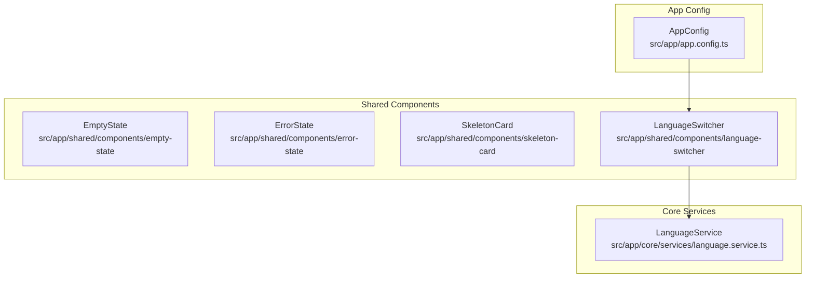
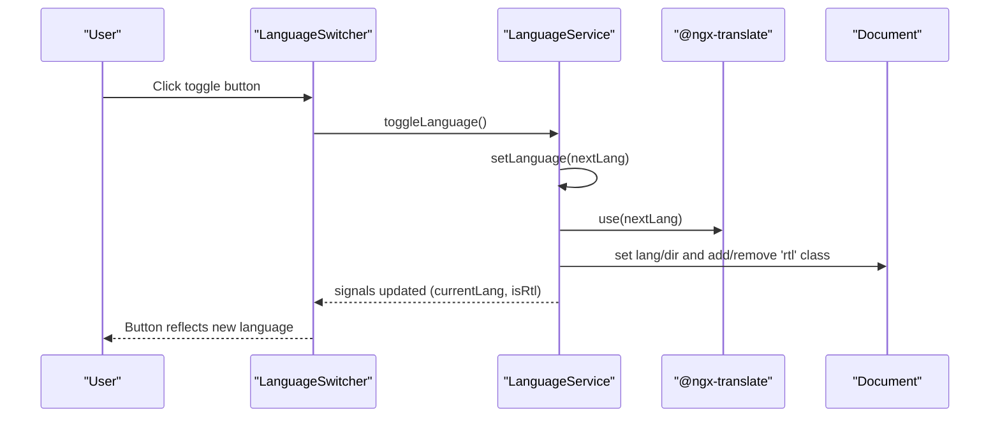
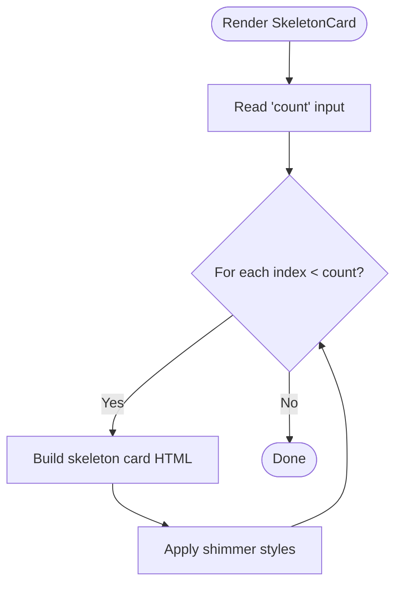
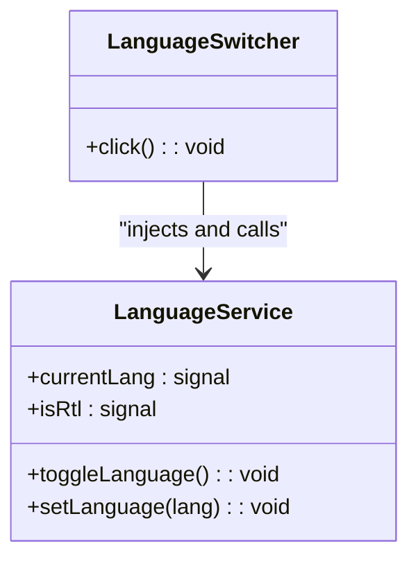
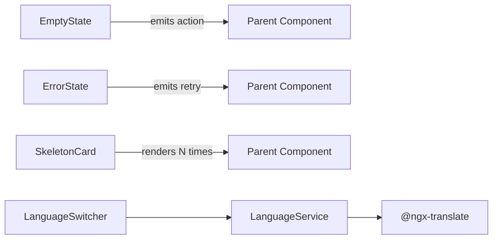

# Reusable UI Components

<cite>
**Referenced Files in This Document**
- [empty-state.ts](file://src/app/shared/components/empty-state/empty-state.ts)
- [empty-state.html](file://src/app/shared/components/empty-state/empty-state.html)
- [empty-state.scss](file://src/app/shared/components/empty-state/empty-state.scss)
- [error-state.ts](file://src/app/shared/components/error-state/error-state.ts)
- [error-state.html](file://src/app/shared/components/error-state/error-state.html)
- [error-state.scss](file://src/app/shared/components/error-state/error-state.scss)
- [skeleton-card.ts](file://src/app/shared/components/skeleton-card/skeleton-card.ts)
- [skeleton-card.html](file://src/app/shared/components/skeleton-card/skeleton-card.html)
- [skeleton-card.scss](file://src/app/shared/components/skeleton-card/skeleton-card.scss)
- [language-switcher.ts](file://src/app/shared/components/language-switcher/language-switcher.ts)
- [language.service.ts](file://src/app/core/services/language.service.ts)
- [app.config.ts](file://src/app/app.config.ts)
</cite>

## Table of Contents
1. [Introduction](#introduction)
2. [Project Structure](#project-structure)
3. [Core Components](#core-components)
4. [Architecture Overview](#architecture-overview)
5. [Detailed Component Analysis](#detailed-component-analysis)
6. [Dependency Analysis](#dependency-analysis)
7. [Performance Considerations](#performance-considerations)
8. [Troubleshooting Guide](#troubleshooting-guide)
9. [Conclusion](#conclusion)

## Introduction
This document provides comprehensive, developer-friendly documentation for the reusable UI components used across the MegaPortfolio application. It covers:
- Empty State component for placeholder content when no data is available
- Error State component for error scenarios with retry actions
- Skeleton Card component for loading states with shimmer animation and count control
- Language Switcher component for internationalization (i18n), including RTL layout handling and language persistence

For each component, you will find APIs (inputs, outputs), styling customization guidance, accessibility considerations, responsive behavior, cross-browser compatibility notes, and performance tips.

## Project Structure
The reusable components are located under src/app/shared/components. The i18n service lives under src/app/core/services. The Angular app config wires up @ngx-translate.

**Diagram sources**
- [empty-state.ts:1-21](file://src/app/shared/components/empty-state/empty-state.ts#L1-L21)
- [error-state.ts:1-19](file://src/app/shared/components/error-state/error-state.ts#L1-L19)
- [skeleton-card.ts:1-12](file://src/app/shared/components/skeleton-card/skeleton-card.ts#L1-L12)
- [language-switcher.ts:1-61](file://src/app/shared/components/language-switcher/language-switcher.ts#L1-L61)
- [language.service.ts:1-62](file://src/app/core/services/language.service.ts#L1-L62)
- [app.config.ts:1-25](file://src/app/app.config.ts#L1-L25)

**Section sources**
- [empty-state.ts:1-21](file://src/app/shared/components/empty-state/empty-state.ts#L1-L21)
- [error-state.ts:1-19](file://src/app/shared/components/error-state/error-state.ts#L1-L19)
- [skeleton-card.ts:1-12](file://src/app/shared/components/skeleton-card/skeleton-card.ts#L1-L12)
- [language-switcher.ts:1-61](file://src/app/shared/components/language-switcher/language-switcher.ts#L1-L61)
- [language.service.ts:1-62](file://src/app/core/services/language.service.ts#L1-L62)
- [app.config.ts:1-25](file://src/app/app.config.ts#L1-L25)

## Core Components
- EmptyState: Displays a title, message, optional icon, and an optional action button that emits an event.
- ErrorState: Displays an error message and a retry button that emits an event.
- SkeletonCard: Renders multiple skeleton placeholders using a count input; includes a shimmer animation.
- LanguageSwitcher: A button that toggles between English and Arabic, persists selection, and updates RTL/LTR layout.

Key highlights:
- All components are standalone Angular components.
- Events use Angular’s output API to communicate with parent components.
- Styling uses SCSS modules scoped per component.
- i18n integration leverages @ngx-translate and a dedicated LanguageService.

**Section sources**
- [empty-state.ts:1-21](file://src/app/shared/components/empty-state/empty-state.ts#L1-L21)
- [error-state.ts:1-19](file://src/app/shared/components/error-state/error-state.ts#L1-L19)
- [skeleton-card.ts:1-12](file://src/app/shared/components/skeleton-card/skeleton-card.ts#L1-L12)
- [language-switcher.ts:1-61](file://src/app/shared/components/language-switcher/language-switcher.ts#L1-L61)

## Architecture Overview
The LanguageSwitcher depends on LanguageService to manage current language, RTL state, and persistence. The app config initializes @ngx-translate with a JSON loader.

**Diagram sources**
- [language-switcher.ts:1-61](file://src/app/shared/components/language-switcher/language-switcher.ts#L1-L61)
- [language.service.ts:1-62](file://src/app/core/services/language.service.ts#L1-L62)
- [app.config.ts:1-25](file://src/app/app.config.ts#L1-L25)

## Detailed Component Analysis

### EmptyState
Purpose: Show friendly placeholder content when there is no data to display.

API
- Inputs
  - title: string (required)
  - message: string (required)
  - icon: string (default: “🔍”)
  - actionLabel: string (optional; if provided, renders an action button)
- Outputs
  - action: void emitted when the action button is clicked

Template structure
- Icon, heading, paragraph, and conditional action button.

Styling customization
- Container uses flex centering, dashed border, subtle background.
- Action button has hover lift and glow effects.
- Override styles via host or by extending CSS classes (.empty-state, .action).

Accessibility
- Use descriptive aria-label on any interactive elements if needed.
- Ensure sufficient color contrast for text and icons.

Responsive behavior
- Centered layout adapts well to various screen sizes.
- Max-width constraints keep readability on large screens.

Cross-browser compatibility
- Uses standard Flexbox and CSS variables; widely supported.

Performance
- Lightweight; no heavy animations.

Usage example
- Bind title/message from your data layer and handle action via (action)="...".

**Section sources**
- [empty-state.ts:1-21](file://src/app/shared/components/empty-state/empty-state.ts#L1-L21)
- [empty-state.html:1-12](file://src/app/shared/components/empty-state/empty-state.html#L1-L12)
- [empty-state.scss:1-49](file://src/app/shared/components/empty-state/empty-state.scss#L1-L49)

### ErrorState
Purpose: Communicate errors to users with a clear message and a retry action.

API
- Inputs
  - message: string (required)
  - retryLabel: string (default: “Try Again”)
- Outputs
  - retry: void emitted when the retry button is clicked

Template structure
- Icon area, heading, message paragraph, and retry button.

Styling customization
- Red-tinted container and icon circle.
- Retry button styled with subtle borders and hover effects.

Accessibility
- Provide meaningful labels for buttons and ensure keyboard focusability.

Responsive behavior
- Centered layout scales gracefully.

Cross-browser compatibility
- Standard CSS properties; broad support.

Performance
- Minimal DOM and no animations.

Usage example
- Display when network or parsing fails; bind (retry)="onRetry()" to reattempt operations.

**Section sources**
- [error-state.ts:1-19](file://src/app/shared/components/error-state/error-state.ts#L1-L19)
- [error-state.html:1-9](file://src/app/shared/components/error-state/error-state.html#L1-L9)
- [error-state.scss:1-57](file://src/app/shared/components/error-state/error-state.scss#L1-L57)

### SkeletonCard
Purpose: Render placeholder cards while content loads.

API
- Inputs
  - count: number (default: 1) — number of skeleton cards to render

Template structure
- Iterates over an array created from count and renders skeleton cover, body lines, and tags with shimmer effect.

Animation properties
- Shimmer animation applied via CSS pseudo-element and keyframes.
- Animation runs continuously until replaced by real content.

Styling customization
- Dark theme card with rounded corners and subtle borders.
- Width variants for skeleton lines (w-70, w-full, w-90).
- Tag shapes are pill-like.

Accessibility
- Skeletons should not be focusable; they represent non-interactive placeholders.

Responsive behavior
- Cards adapt within grid/flex containers; adjust widths as needed.

Cross-browser compatibility
- CSS animations and transforms are well-supported.

Performance
- Avoid rendering excessive counts; prefer small batches during initial load.

Usage example
- Render SkeletonCard with count equal to expected items while fetching data.

**Diagram sources**
- [skeleton-card.html:1-16](file://src/app/shared/components/skeleton-card/skeleton-card.html#L1-L16)
- [skeleton-card.scss:1-75](file://src/app/shared/components/skeleton-card/skeleton-card.scss#L1-L75)

**Section sources**
- [skeleton-card.ts:1-12](file://src/app/shared/components/skeleton-card/skeleton-card.ts#L1-L12)
- [skeleton-card.html:1-16](file://src/app/shared/components/skeleton-card/skeleton-card.html#L1-L16)
- [skeleton-card.scss:1-75](file://src/app/shared/components/skeleton-card/skeleton-card.scss#L1-L75)

### LanguageSwitcher
Purpose: Toggle between English and Arabic, persist user choice, and update document direction (LTR/RTL).

API
- No inputs/outputs; interacts directly with LanguageService.

Behavior
- On click, calls LanguageService.toggleLanguage().
- Updates button label based on current language.
- Uses TranslatePipe for accessible label.

Internationalization and RTL
- LanguageService maintains currentLang and isRtl signals.
- Persists selected language in localStorage.
- Sets document.documentElement.lang and dir attributes.
- Adds/removes 'rtl' class on root element for global RTL styling.

Integration
- Requires @ngx-translate configuration in app config.

Accessibility
- Button has aria-label bound to a translated key.
- Keyboard navigable and visible focus indicator inherited from global styles.

Responsive behavior
- Compact inline-flex design suitable for toolbars and headers.

Cross-browser compatibility
- Relies on standard DOM APIs and CSS; works across modern browsers.

Performance
- Lightweight; minimal re-renders due to signal usage.

Usage example
- Place anywhere in the shell (e.g., navbar) to allow users to switch languages.

**Diagram sources**
- [language-switcher.ts:1-61](file://src/app/shared/components/language-switcher/language-switcher.ts#L1-L61)
- [language.service.ts:1-62](file://src/app/core/services/language.service.ts#L1-L62)

**Section sources**
- [language-switcher.ts:1-61](file://src/app/shared/components/language-switcher/language-switcher.ts#L1-L61)
- [language.service.ts:1-62](file://src/app/core/services/language.service.ts#L1-L62)
- [app.config.ts:1-25](file://src/app/app.config.ts#L1-L25)

## Dependency Analysis
- EmptyState and ErrorState are self-contained and emit events upward.
- SkeletonCard is self-contained and driven by a single numeric input.
- LanguageSwitcher depends on LanguageService and @ngx-translate.
- LanguageService depends on TranslateService and browser APIs (localStorage, document).

**Diagram sources**
- [empty-state.ts:1-21](file://src/app/shared/components/empty-state/empty-state.ts#L1-L21)
- [error-state.ts:1-19](file://src/app/shared/components/error-state/error-state.ts#L1-L19)
- [skeleton-card.ts:1-12](file://src/app/shared/components/skeleton-card/skeleton-card.ts#L1-L12)
- [language-switcher.ts:1-61](file://src/app/shared/components/language-switcher/language-switcher.ts#L1-L61)
- [language.service.ts:1-62](file://src/app/core/services/language.service.ts#L1-L62)

**Section sources**
- [empty-state.ts:1-21](file://src/app/shared/components/empty-state/empty-state.ts#L1-L21)
- [error-state.ts:1-19](file://src/app/shared/components/error-state/error-state.ts#L1-L19)
- [skeleton-card.ts:1-12](file://src/app/shared/components/skeleton-card/skeleton-card.ts#L1-L12)
- [language-switcher.ts:1-61](file://src/app/shared/components/language-switcher/language-switcher.ts#L1-L61)
- [language.service.ts:1-62](file://src/app/core/services/language.service.ts#L1-L62)

## Performance Considerations
- EmptyState and ErrorState: Very lightweight; avoid unnecessary re-renders by stabilizing inputs.
- SkeletonCard: Limit count to realistic values; consider virtualization if lists grow large.
- LanguageSwitcher: Signal-based state minimizes change detection overhead; avoid frequent toggles.
- i18n: Ensure translation files are loaded efficiently; leverage lazy loading per feature if needed.

[No sources needed since this section provides general guidance]

## Troubleshooting Guide
Common issues and resolutions:
- EmptyState action not firing
  - Ensure the parent binds to (action) and handles the event.
  - Verify actionLabel is provided to render the button.
- ErrorState retry not working
  - Confirm (retry) is bound and the handler retries the operation.
  - Check for unhandled errors in upstream services.
- SkeletonCard not animating
  - Verify shimmer CSS is included and not overridden.
  - Ensure the component is not hidden via display:none which can break animations.
- Language switching not persisting
  - Confirm localStorage is accessible (no strict CSP blocking it).
  - Validate that LanguageService.setLanguage is called and document.dir/lang are updated.
- i18n keys missing
  - Ensure translation JSON files exist under assets/i18n and match configured prefix/suffix.
  - Check fallback language configuration in app config.

**Section sources**
- [empty-state.ts:1-21](file://src/app/shared/components/empty-state/empty-state.ts#L1-L21)
- [error-state.ts:1-19](file://src/app/shared/components/error-state/error-state.ts#L1-L19)
- [skeleton-card.scss:1-75](file://src/app/shared/components/skeleton-card/skeleton-card.scss#L1-L75)
- [language.service.ts:1-62](file://src/app/core/services/language.service.ts#L1-L62)
- [app.config.ts:1-25](file://src/app/app.config.ts#L1-L25)

## Conclusion
These four reusable components provide consistent UX patterns across the MegaPortfolio application:
- EmptyState and ErrorState offer clear messaging and actionable recovery paths.
- SkeletonCard improves perceived performance during data loading.
- LanguageSwitcher enables robust i18n and RTL support with persistence.

Adopt these components to maintain visual consistency, improve accessibility, and streamline development across features.

[No sources needed since this section summarizes without analyzing specific files]