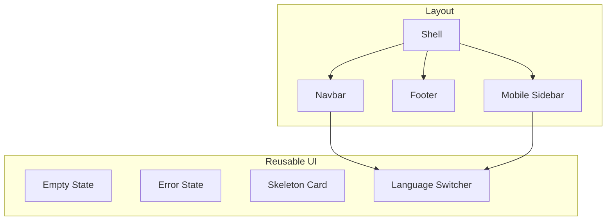
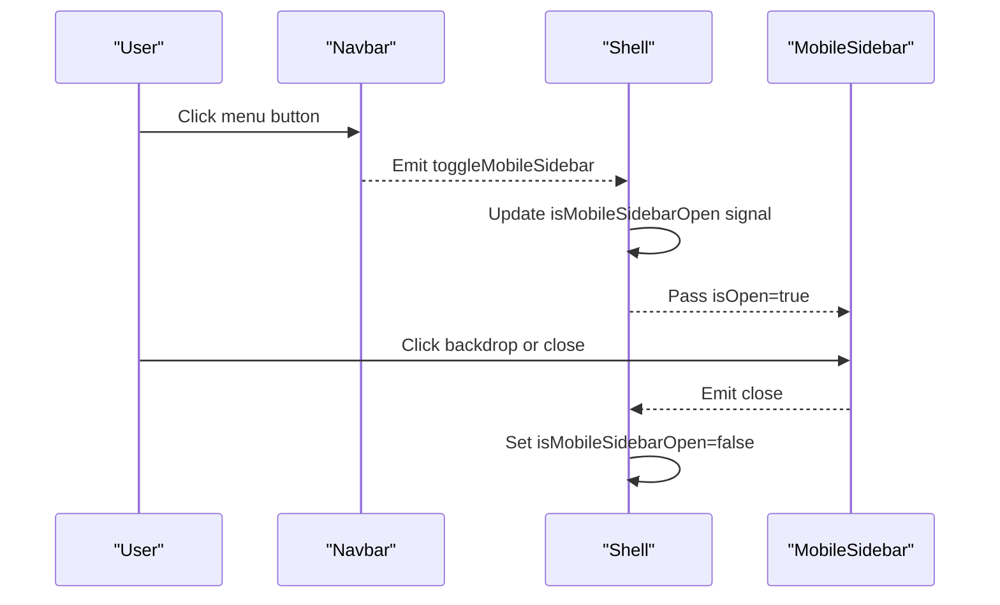
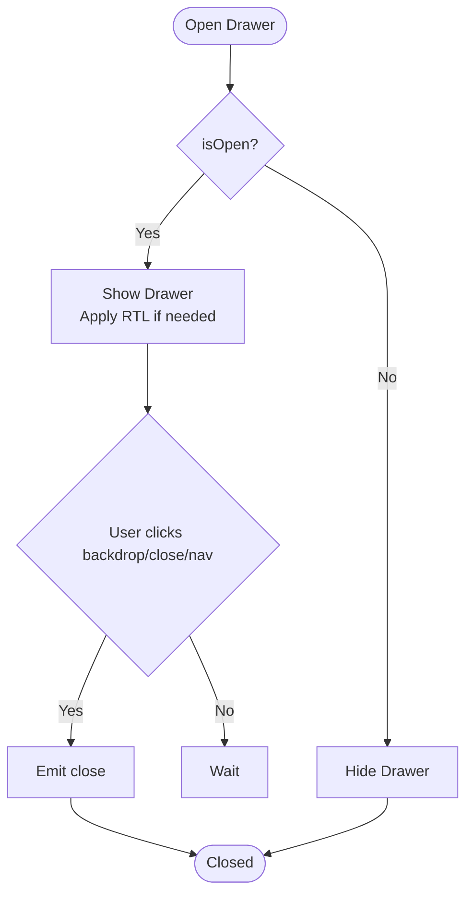
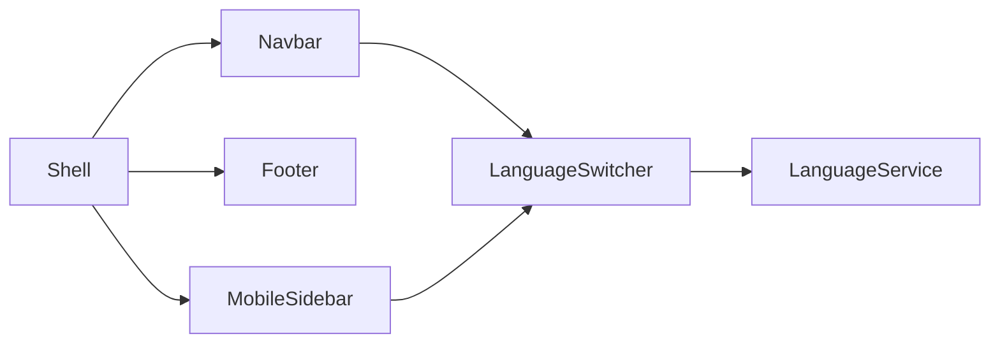

# Shared Components Library

<cite>
**Referenced Files in This Document**
- [shell.ts](file://src/app/shared/layout/shell/shell.ts)
- [shell.html](file://src/app/shared/layout/shell/shell.html)
- [navbar.ts](file://src/app/shared/layout/navbar/navbar.ts)
- [navbar.html](file://src/app/shared/layout/navbar/navbar.html)
- [footer.ts](file://src/app/shared/layout/footer/footer.ts)
- [footer.html](file://src/app/shared/layout/footer/footer.html)
- [mobile-sidebar.ts](file://src/app/shared/components/mobile-sidebar/mobile-sidebar.ts)
- [mobile-sidebar.html](file://src/app/shared/components/mobile-sidebar/mobile-sidebar.html)
- [language-switcher.ts](file://src/app/shared/components/language-switcher/language-switcher.ts)
- [empty-state.ts](file://src/app/shared/components/empty-state/empty-state.ts)
- [empty-state.html](file://src/app/shared/components/empty-state/empty-state.html)
- [error-state.ts](file://src/app/shared/components/error-state/error-state.ts)
- [error-state.html](file://src/app/shared/components/error-state/error-state.html)
- [skeleton-card.ts](file://src/app/shared/components/skeleton-card/skeleton-card.ts)
- [skeleton-card.html](file://src/app/shared/components/skeleton-card/skeleton-card.html)
</cite>

## Table of Contents
1. Introduction
2. Project Structure
3. Core Components
4. Architecture Overview
5. Detailed Component Analysis
6. Dependency Analysis
7. Performance Considerations
8. Troubleshooting Guide
9. Conclusion

## Introduction
This document describes the shared components library used across the MegaPortfolio application. It covers layout components (shell, navbar, footer, mobile sidebar) and reusable UI components (empty state, error state, skeleton cards, language switcher). For each component, you will find props, events, slots, customization options, styling approach with Tailwind CSS classes and SCSS variables, usage examples, accessibility guidance, responsive behavior, cross-browser considerations, and best practices for composition and extension.

## Project Structure
The shared library is organized under src/app/shared:
- Layout components live in shared/layout (shell, navbar, footer).
- Reusable UI components live in shared/components (empty-state, error-state, skeleton-card, language-switcher, mobile-sidebar).
- Templates use Angular’s template syntax and i18n via TranslatePipe.
- Styling uses SCSS files per component and Tailwind utility classes within templates.

[No sources needed since this diagram shows conceptual structure]

## Core Components
- Shell: Application shell that composes Navbar, Footer, and MobileSidebar and manages mobile sidebar open/close state using an Angular signal.
- Navbar: Top navigation bar with scroll detection, internationalized links, language switcher, resume button, and a menu button to toggle the mobile sidebar.
- Footer: Internationalized footer with role text, social links, and copyright notice.
- Mobile Sidebar: Drawer-style navigation for small screens with backdrop, RTL support, and integrated language switcher.
- Empty State: Displays a title, message, optional icon, and optional action button emitting an event.
- Error State: Displays a message and retry button emitting a retry event.
- Skeleton Card: Renders a configurable number of placeholder cards with shimmer effects.
- Language Switcher: Toggles between languages using the injected LanguageService and displays current language labels.

**Section sources**
- [shell.ts:1-26](file://src/app/shared/layout/shell/shell.ts#L1-L26)
- [shell.html:1-12](file://src/app/shared/layout/shell/shell.html#L1-L12)
- [navbar.ts:1-30](file://src/app/shared/layout/navbar/navbar.ts#L1-L30)
- [navbar.html:1-40](file://src/app/shared/layout/navbar/navbar.html#L1-L40)
- [footer.ts:1-12](file://src/app/shared/layout/footer/footer.ts#L1-L12)
- [footer.html:1-19](file://src/app/shared/layout/footer/footer.html#L1-L19)
- [mobile-sidebar.ts:1-25](file://src/app/shared/components/mobile-sidebar/mobile-sidebar.ts#L1-L25)
- [mobile-sidebar.html:1-62](file://src/app/shared/components/mobile-sidebar/mobile-sidebar.html#L1-L62)
- [empty-state.ts:1-21](file://src/app/shared/components/empty-state/empty-state.ts#L1-L21)
- [empty-state.html:1-12](file://src/app/shared/components/empty-state/empty-state.html#L1-L12)
- [error-state.ts:1-19](file://src/app/shared/components/error-state/error-state.ts#L1-L19)
- [error-state.html:1-9](file://src/app/shared/components/error-state/error-state.html#L1-L9)
- [skeleton-card.ts:1-12](file://src/app/shared/components/skeleton-card/skeleton-card.ts#L1-L12)
- [skeleton-card.html:1-16](file://src/app/shared/components/skeleton-card/skeleton-card.html#L1-L16)
- [language-switcher.ts:1-61](file://src/app/shared/components/language-switcher/language-switcher.ts#L1-L61)

## Architecture Overview
The Shell orchestrates the top-level layout and mobile drawer state. The Navbar emits a toggle event to open the MobileSidebar. Both Navbar and MobileSidebar integrate the LanguageSwitcher for consistent i18n toggling. Content pages are rendered via RouterOutlet inside the Shell.

**Diagram sources**
- [navbar.html:30-38](file://src/app/shared/layout/navbar/navbar.html#L30-L38)
- [shell.html:1-6](file://src/app/shared/layout/shell/shell.html#L1-L6)
- [mobile-sidebar.html:1-16](file://src/app/shared/components/mobile-sidebar/mobile-sidebar.html#L1-L16)

**Section sources**
- [shell.ts:15-25](file://src/app/shared/layout/shell/shell.ts#L15-L25)
- [shell.html:1-6](file://src/app/shared/layout/shell/shell.html#L1-L6)
- [navbar.ts:15-29](file://src/app/shared/layout/navbar/navbar.ts#L15-L29)
- [mobile-sidebar.ts:15-24](file://src/app/shared/components/mobile-sidebar/mobile-sidebar.ts#L15-L24)

## Detailed Component Analysis

### Shell Layout
- Purpose: Provides the application frame, integrates Navbar, Footer, and MobileSidebar, and controls mobile drawer visibility.
- Props/Inputs: None directly; manages internal state via signals.
- Events: Emits no direct events; coordinates child interactions internally.
- Slots: Uses RouterOutlet for page content.
- Styling: SCSS file for layout; relies on Tailwind utilities in child components.
- Accessibility: Ensures proper semantic structure; child components handle ARIA attributes.
- Responsive behavior: Hides desktop nav on small screens and shows MobileSidebar.
- Cross-browser compatibility: Uses standard Angular APIs and CSS transitions.

Usage example:
- Place <app-shell> at the root of your app routes to wrap all feature pages.

**Section sources**
- [shell.ts:1-26](file://src/app/shared/layout/shell/shell.ts#L1-L26)
- [shell.html:1-12](file://src/app/shared/layout/shell/shell.html#L1-L12)

### Navbar
- Purpose: Desktop navigation with internationalized links, resume CTA, and mobile menu trigger.
- Inputs: None.
- Outputs: toggleMobileSidebar emits when the menu button is clicked.
- Behavior: Tracks window scroll to apply a scrolled class for visual feedback.
- Styling: SCSS + Tailwind utilities; includes hover and focus states.
- Accessibility: Menu button has aria-label; active link states are managed by routerLinkActive.
- Responsive behavior: Shows desktop nav on larger screens; hides it on mobile and exposes menu button.
- Integration: Injects LanguageService for i18n; embeds LanguageSwitcher.

Usage example:
- Include <app-navbar (toggleMobileSidebar)="onToggle()"></app-navbar> in your shell or container.

**Section sources**
- [navbar.ts:1-30](file://src/app/shared/layout/navbar/navbar.ts#L1-L30)
- [navbar.html:1-40](file://src/app/shared/layout/navbar/navbar.html#L1-L40)

### Footer
- Purpose: Displays role description, external links, and copyright text with i18n.
- Inputs: None.
- Outputs: None.
- Styling: SCSS file; uses Tailwind classes for spacing and typography.
- Accessibility: Links include target="_blank" and rel="noopener" for security.
- Cross-browser compatibility: Standard HTML anchor elements.

Usage example:
- Place <app-footer></app-footer> at the bottom of the Shell.

**Section sources**
- [footer.ts:1-12](file://src/app/shared/layout/footer/footer.ts#L1-L12)
- [footer.html:1-19](file://src/app/shared/layout/footer/footer.html#L1-L19)

### Mobile Sidebar
- Purpose: Drawer-style navigation for mobile devices with backdrop and RTL support.
- Inputs: isOpen boolean controls visibility.
- Outputs: close emits when the user closes the drawer (backdrop, close button, or navigation click).
- Behavior: Applies RTL class based on current language direction; closes on backdrop click.
- Styling: SCSS file; uses Tailwind utilities for layout and transitions.
- Accessibility: Close button has aria-label; drawer is keyboard accessible through native elements.
- Integration: Embeds LanguageSwitcher and uses TranslatePipe for localized labels.

Usage example:
- Bind [isOpen]="isMobileSidebarOpen()" and (close)="closeMobileSidebar()" from Shell.

**Diagram sources**
- [mobile-sidebar.html:1-16](file://src/app/shared/components/mobile-sidebar/mobile-sidebar.html#L1-L16)
- [mobile-sidebar.ts:15-24](file://src/app/shared/components/mobile-sidebar/mobile-sidebar.ts#L15-L24)

**Section sources**
- [mobile-sidebar.ts:1-25](file://src/app/shared/components/mobile-sidebar/mobile-sidebar.ts#L1-L25)
- [mobile-sidebar.html:1-62](file://src/app/shared/components/mobile-sidebar/mobile-sidebar.html#L1-L62)

### Empty State
- Purpose: Communicates empty data scenarios with optional action.
- Inputs:
  - title (required): Primary heading text.
  - message (required): Descriptive text.
  - icon (optional): Icon character or emoji.
  - actionLabel (optional): Button label; when provided, action button appears.
- Outputs: action emits when the action button is clicked.
- Styling: SCSS file; uses Tailwind utilities for layout and typography.
- Accessibility: Button is a native type="button".
- Customization: Provide custom icon and action label; bind action handler to perform navigation or data refresh.

Usage example:
- <app-empty-state title="No projects" message="Create your first project" actionLabel="Create" (action)="createProject()"></app-empty-state>

**Section sources**
- [empty-state.ts:1-21](file://src/app/shared/components/empty-state/empty-state.ts#L1-L21)
- [empty-state.html:1-12](file://src/app/shared/components/empty-state/empty-state.html#L1-L12)

### Error State
- Purpose: Displays error messages with a retry action.
- Inputs:
  - message (required): Error description.
  - retryLabel (optional): Retry button label.
- Outputs: retry emits when the retry button is clicked.
- Styling: SCSS file; uses Tailwind utilities.
- Accessibility: Native button element.
- Customization: Override retryLabel; bind retry handler to re-fetch data or reset state.

Usage example:
- <app-error-state message="Failed to load data" retryLabel="Retry" (retry)="loadData()"></app-error-state>

**Section sources**
- [error-state.ts:1-19](file://src/app/shared/components/error-state/error-state.ts#L1-L19)
- [error-state.html:1-9](file://src/app/shared/components/error-state/error-state.html#L1-L9)

### Skeleton Card
- Purpose: Placeholder loading indicator for lists or grids.
- Inputs:
  - count (optional, default 1): Number of skeleton items to render.
- Styling: SCSS file; uses Tailwind utilities and shimmer animation classes.
- Usage: Render while data is loading to improve perceived performance.

Usage example:
- <app-skeleton-card [count]="5"></app-skeleton-card>

**Section sources**
- [skeleton-card.ts:1-12](file://src/app/shared/components/skeleton-card/skeleton-card.ts#L1-L12)
- [skeleton-card.html:1-16](file://src/app/shared/components/skeleton-card/skeleton-card.html#L1-L16)

### Language Switcher
- Purpose: Toggles the application language and displays current language labels.
- Inputs: None.
- Outputs: None; directly calls LanguageService.toggleLanguage().
- Styling: Inline styles define button appearance and hover effects.
- Accessibility: Button has aria-label bound to a translated key.
- Integration: Requires LanguageService to be available in the DI tree.

Usage example:
- <app-language-switcher></app-language-switcher>

**Section sources**
- [language-switcher.ts:1-61](file://src/app/shared/components/language-switcher/language-switcher.ts#L1-L61)

## Dependency Analysis
- Shell depends on Navbar, Footer, and MobileSidebar.
- Navbar depends on RouterLink, RouterLinkActive, TranslatePipe, and LanguageSwitcher.
- MobileSidebar depends on RouterLink, RouterLinkActive, TranslatePipe, and LanguageSwitcher.
- LanguageSwitcher depends on LanguageService.
- EmptyState and ErrorState are standalone and emit events to parent components.
- SkeletonCard is standalone and purely presentational.

**Diagram sources**
- [shell.ts:1-14](file://src/app/shared/layout/shell/shell.ts#L1-L14)
- [navbar.ts:1-14](file://src/app/shared/layout/navbar/navbar.ts#L1-L14)
- [mobile-sidebar.ts:1-14](file://src/app/shared/components/mobile-sidebar/mobile-sidebar.ts#L1-L14)
- [language-switcher.ts:1-10](file://src/app/shared/components/language-switcher/language-switcher.ts#L1-L10)

**Section sources**
- [shell.ts:1-26](file://src/app/shared/layout/shell/shell.ts#L1-L26)
- [navbar.ts:1-30](file://src/app/shared/layout/navbar/navbar.ts#L1-L30)
- [mobile-sidebar.ts:1-25](file://src/app/shared/components/mobile-sidebar/mobile-sidebar.ts#L1-L25)
- [language-switcher.ts:1-61](file://src/app/shared/components/language-switcher/language-switcher.ts#L1-L61)

## Performance Considerations
- Use SkeletonCard during async data loads to avoid layout shifts and improve perceived performance.
- Keep MobileSidebar closed by default and only open on user interaction to minimize initial DOM size.
- Avoid heavy computations in templates; rely on services like LanguageService for state.
- Prefer @for loops and track identifiers for efficient rendering of skeletons.
- Debounce scroll listeners if additional logic is added beyond simple class toggling.

[No sources needed since this section provides general guidance]

## Troubleshooting Guide
- Mobile sidebar not closing: Ensure the close event is emitted and the parent Shell updates its signal accordingly. Verify backdrop click handler is wired.
- Navbar scroll effect not working: Confirm window scroll listener is active and the scrolled class is applied conditionally.
- Language switcher not changing language: Verify LanguageService is provided and toggleLanguage() is called; ensure i18n keys exist.
- Empty/Error states not showing actions: Check that actionLabel/retryLabel inputs are set and handlers are bound.
- RTL issues in MobileSidebar: Ensure LanguageService.isRtl() returns correct value and the rtl class is applied.

**Section sources**
- [shell.html:3-6](file://src/app/shared/layout/shell/shell.html#L3-L6)
- [navbar.ts:21-24](file://src/app/shared/layout/navbar/navbar.ts#L21-L24)
- [language-switcher.ts:10-23](file://src/app/shared/components/language-switcher/language-switcher.ts#L10-L23)
- [mobile-sidebar.html:1-16](file://src/app/shared/components/mobile-sidebar/mobile-sidebar.html#L1-L16)

## Conclusion
The shared components library provides a robust foundation for MegaPortfolio’s layout and reusable UI patterns. By following the documented props, events, and styling approaches, developers can compose consistent, accessible, and responsive interfaces. Adhering to the integration patterns and best practices ensures maintainability and scalability across the application.

[No sources needed since this section summarizes without analyzing specific files]