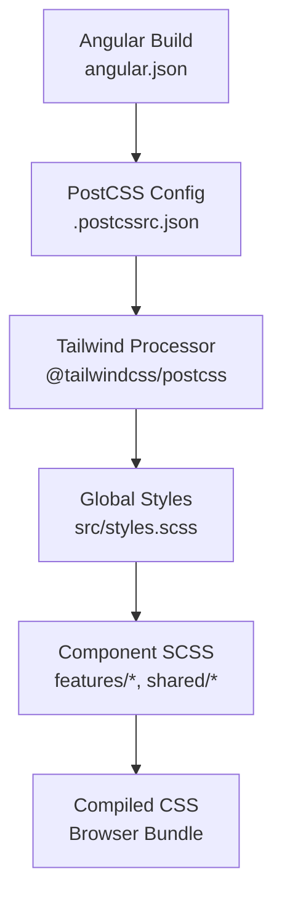
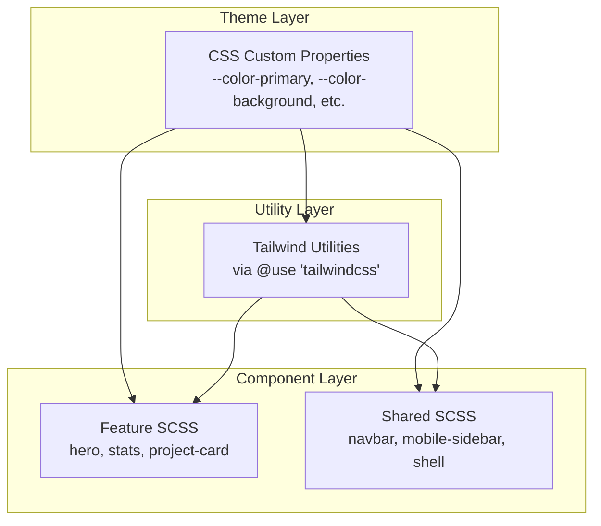
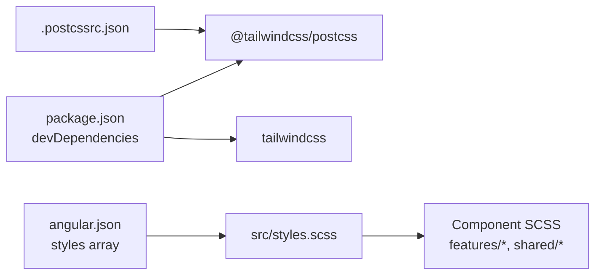

# Styling & Theming

<cite>
**Referenced Files in This Document**
- [styles.scss](file://src/styles.scss)
- [.postcssrc.json](file://.postcssrc.json)
- [package.json](file://package.json)
- [angular.json](file://angular.json)
- [navbar.scss](file://src/app/shared/layout/navbar/navbar.scss)
- [hero.scss](file://src/app/features/home/sections/hero/hero.scss)
- [project-card.scss](file://src/app/features/projects/components/project-card/project-card.scss)
- [stats.scss](file://src/app/features/home/sections/stats/stats.scss)
- [system-design-lab.scss](file://src/app/features/home/sections/system-design-lab/system-design-lab.scss)
- [mobile-sidebar.scss](file://src/app/shared/components/mobile-sidebar/mobile-sidebar.scss)
- [shell.scss](file://src/app/shared/layout/shell/shell.scss)
</cite>

## Table of Contents
1. Introduction
2. Project Structure
3. Core Components
4. Architecture Overview
5. Detailed Component Analysis
6. Dependency Analysis
7. Performance Considerations
8. Troubleshooting Guide
9. Conclusion

## Introduction
This document explains the styling and theming system used by the MegaPortfolio application. It covers the Tailwind CSS integration, the utility-first approach, custom SCSS architecture (global styles, component-specific styles, theme variables), responsive design patterns using media queries and a mobile-first methodology, and best practices for organization, naming, and performance optimization. It also documents how styles are scoped within Angular components and how to extend or customize the design consistently.

## Project Structure
The styling system is centered around a global stylesheet that initializes Tailwind and defines theme tokens, with component-level SCSS files providing localized styles. The build pipeline integrates PostCSS with the Tailwind plugin to process styles during development and production builds.

Key points:
- Global entry point: src/styles.scss
- Tailwind integration via @use 'tailwindcss' and PostCSS configuration
- Component-scoped SCSS co-located with their TypeScript components
- Fonts loaded as external CSS assets through Angular’s styles array

**Diagram sources**
- [angular.json:38-42](file://angular.json#L38-L42)
- [.postcssrc.json:1-5](file://.postcssrc.json#L1-L5)
- [styles.scss:1-13](file://src/styles.scss#L1-L13)

**Section sources**
- [angular.json:38-42](file://angular.json#L38-L42)
- [.postcssrc.json:1-5](file://.postcssrc.json#L1-L5)
- [package.json:38-44](file://package.json#L38-L44)

## Core Components
- Global styles and theme tokens are defined in the root stylesheet, establishing colors, backgrounds, surfaces, text, and muted tones. These tokens are exposed via CSS custom properties and can be referenced throughout the app.
- Utility-first styling is enabled through Tailwind, allowing rapid composition of layouts and visual states directly in templates where appropriate.
- Component-specific SCSS files encapsulate layout, typography, spacing, and interactions for each feature and shared component.

Highlights from the global stylesheet:
- Tailwind import and theme block defining color tokens
- Base resets and smooth scrolling
- Body defaults including background and font stack
- RTL support via dir attribute
- Shared hover transitions for interactive cards and nodes

**Section sources**
- [styles.scss:1-13](file://src/styles.scss#L1-L13)
- [styles.scss:15-44](file://src/styles.scss#L15-L44)
- [styles.scss:54-78](file://src/styles.scss#L54-L78)

## Architecture Overview
The styling architecture combines a centralized theme with modular component styles:
- Centralized theme variables ensure consistent colors and surfaces across the app
- Tailwind utilities provide a fast, composable layer for common UI patterns
- Component SCSS files encapsulate complex layouts and animations while leveraging theme variables
- Responsive breakpoints are applied per-component using media queries, following a mobile-first approach

**Diagram sources**
- [styles.scss:3-13](file://src/styles.scss#L3-L13)
- [styles.scss:1](file://src/styles.scss#L1)
- [navbar.scss:1-20](file://src/app/shared/layout/navbar/navbar.scss#L1-L20)
- [hero.scss:1-12](file://src/app/features/home/sections/hero/hero.scss#L1-L12)
- [project-card.scss:1-13](file://src/app/features/projects/components/project-card/project-card.scss#L1-L13)

## Detailed Component Analysis

### Global Styles and Theme Variables
- Theme block defines semantic color tokens for primary, secondary, background, surface, card, text, and muted variants
- Base resets include border-box sizing, smooth scrolling, and overflow handling
- Body sets default background and text color, along with a modern font stack
- RTL enhancements apply direction and alignment when the html element has an rtl class or dir attribute
- Shared hover transitions improve interactivity for cards and nodes

Best practices observed:
- Use CSS custom properties for theme values to enable easy customization
- Keep base resets minimal and focused on consistency
- Apply directional styles via attributes to support i18n without duplicating rules

**Section sources**
- [styles.scss:3-13](file://src/styles.scss#L3-L13)
- [styles.scss:15-44](file://src/styles.scss#L15-L44)
- [styles.scss:54-78](file://src/styles.scss#L54-L78)

### Navbar Component
- Fixed positioning with backdrop blur and subtle borders on scroll state
- Container centers content with max-width and flex layout
- Desktop navigation links use hover and active states with accent color
- Mobile menu button appears below a breakpoint; desktop elements hide accordingly
- Media query at a specific width switches between desktop and mobile layouts

Responsive pattern:
- Hide desktop-only elements and reveal mobile controls at the breakpoint
- Adjust container padding and logo size for smaller screens

**Section sources**
- [navbar.scss:1-20](file://src/app/shared/layout/navbar/navbar.scss#L1-L20)
- [navbar.scss:45-74](file://src/app/shared/layout/navbar/navbar.scss#L45-L74)
- [navbar.scss:121-151](file://src/app/shared/layout/navbar/navbar.scss#L121-L151)

### Hero Section
- Full-viewport height grid layout with two columns on large screens
- Typography uses clamp() for fluid scaling
- Action buttons styled with primary and secondary variants
- Network nodes have glassmorphism effects and floating animation
- Media queries adjust grid to single column and center-align content on medium screens
- Small screens stack action buttons vertically and reduce node padding

Responsive pattern:
- Grid collapses to one column at a tablet breakpoint
- Buttons stack vertically on small screens

**Section sources**
- [hero.scss:1-12](file://src/app/features/home/sections/hero/hero.scss#L1-L12)
- [hero.scss:28-50](file://src/app/features/home/sections/hero/hero.scss#L28-L50)
- [hero.scss:81-102](file://src/app/features/home/sections/hero/hero.scss#L81-L102)
- [hero.scss:127-162](file://src/app/features/home/sections/hero/hero.scss#L127-L162)

### Project Card Component
- Card uses dark surface with rounded corners and subtle border
- Hover state lifts the card and adds a colored shadow
- Cover area includes gradient and optional featured badge
- Body contains title, description, and technology tags
- Actions row provides primary and secondary buttons with hover lift effect

Styling pattern:
- Consistent card structure with clear separation of cover, body, and actions
- Hover effects emphasize interactivity without heavy transforms

**Section sources**
- [project-card.scss:1-13](file://src/app/features/projects/components/project-card/project-card.scss#L1-L13)
- [project-card.scss:15-21](file://src/app/features/projects/components/project-card/project-card.scss#L15-L21)
- [project-card.scss:51-85](file://src/app/features/projects/components/project-card/project-card.scss#L51-L85)
- [project-card.scss:87-118](file://src/app/features/projects/components/project-card/project-card.scss#L87-L118)

### Stats Section
- Four-column grid layout for statistics cards
- Cards use glassmorphism with subtle borders and backdrop blur
- Typography emphasizes numeric values with accent color
- Media query reduces to two columns on tablets

Responsive pattern:
- Grid adapts from four to two columns at a tablet breakpoint

**Section sources**
- [stats.scss:1-23](file://src/app/features/home/sections/stats/stats.scss#L1-L23)
- [stats.scss:37-42](file://src/app/features/home/sections/stats/stats.scss#L37-L42)

### System Design Lab Section
- Tabbed interface with pill-style buttons and active state highlighting
- Diagram area stacks rows and nodes with consistent spacing
- Nodes use glassmorphism and highlight state with accent border and glow
- Arrow indicators connect diagram elements visually

Interactive pattern:
- Active tab toggles highlight class to emphasize selected state

**Section sources**
- [system-design-lab.scss:5-37](file://src/app/features/home/sections/system-design-lab/system-design-lab.scss#L5-L37)
- [system-design-lab.scss:39-81](file://src/app/features/home/sections/system-design-lab/system-design-lab.scss#L39-L81)

### Mobile Sidebar Component
- Fixed overlay with backdrop blur and drawer panel
- Drawer slides in from the right with smooth transform transition
- RTL variant flips drawer origin and shadow direction
- Open/close state controlled via class toggling

Accessibility and UX pattern:
- Pointer events disabled until open to prevent accidental interaction
- Backdrop click closes the drawer (implied by typical usage)

**Section sources**
- [mobile-sidebar.scss:1-21](file://src/app/shared/components/mobile-sidebar/mobile-sidebar.scss#L1-L21)
- [mobile-sidebar.scss:32-56](file://src/app/shared/components/mobile-sidebar/mobile-sidebar.scss#L32-L56)

### Shell Layout
- Main content area ensures minimum height and horizontal overflow control
- Provides a consistent baseline for page content

**Section sources**
- [shell.scss:1-7](file://src/app/shared/layout/shell/shell.scss#L1-L7)

## Dependency Analysis
- Tailwind is integrated via PostCSS plugin configured in .postcssrc.json
- Angular’s build configuration includes fonts and the global stylesheet in the styles array
- Component SCSS files are compiled alongside their respective components, ensuring style isolation
- No explicit Tailwind config file is present; theme tokens are defined in the global stylesheet

**Diagram sources**
- [package.json:38-44](file://package.json#L38-L44)
- [.postcssrc.json:1-5](file://.postcssrc.json#L1-L5)
- [angular.json:38-42](file://angular.json#L38-L42)
- [styles.scss:1](file://src/styles.scss#L1)

**Section sources**
- [package.json:38-44](file://package.json#L38-L44)
- [.postcssrc.json:1-5](file://.postcssrc.json#L1-L5)
- [angular.json:38-42](file://angular.json#L38-L42)

## Performance Considerations
- CSS minification and tree-shaking are handled by the Angular build pipeline in production mode
- Output hashing is enabled for cache busting in production
- Budgets constrain initial bundle size and per-component style sizes to maintain performance
- Using Tailwind utilities encourages unused code elimination since only referenced classes are included
- Prefer CSS custom properties for theme values to avoid duplication and enable efficient updates

Recommendations:
- Keep component SCSS focused and avoid global overrides
- Leverage Tailwind utilities for common patterns to reduce custom CSS
- Monitor bundle budgets and refactor heavy components if needed

**Section sources**
- [angular.json:53-74](file://angular.json#L53-L74)

## Troubleshooting Guide
Common issues and resolutions:
- Tailwind not processing: Ensure @tailwindcss/postcss is listed in .postcssrc.json and installed
- Theme variables not applying: Verify the @theme block in the global stylesheet and that the stylesheet is included in angular.json
- RTL not working: Confirm the html element has the rtl class or dir="rtl" attribute
- Styles leaking across components: Ensure component SCSS is properly scoped and avoid global selectors unless intentional
- Performance regressions: Check Angular budgets and review component styles for unnecessary complexity

**Section sources**
- [.postcssrc.json:1-5](file://.postcssrc.json#L1-L5)
- [styles.scss:3-13](file://src/styles.scss#L3-L13)
- [angular.json:38-42](file://angular.json#L38-L42)

## Conclusion
The MegaPortfolio styling system blends a centralized theme with Tailwind utilities and component-scoped SCSS to deliver a consistent, responsive, and performant user interface. By adhering to the established patterns—using CSS custom properties for themes, leveraging Tailwind for utility-first composition, and encapsulating complex styles within component SCSS—you can extend and customize the design efficiently while maintaining clarity and performance.