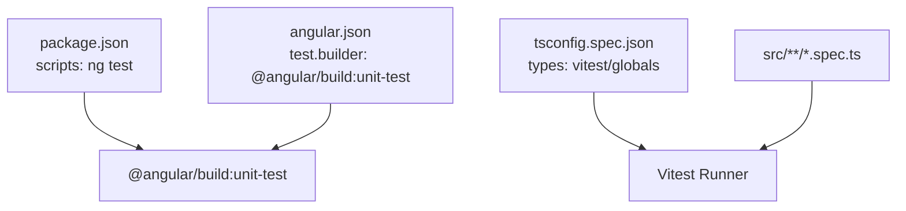
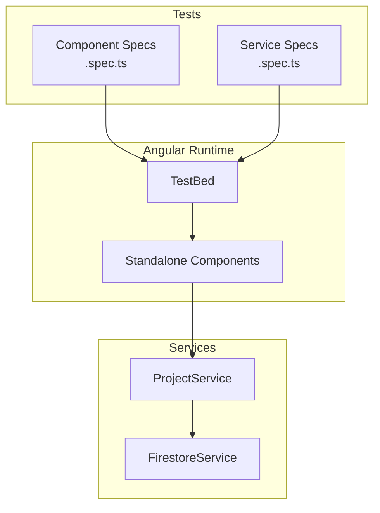
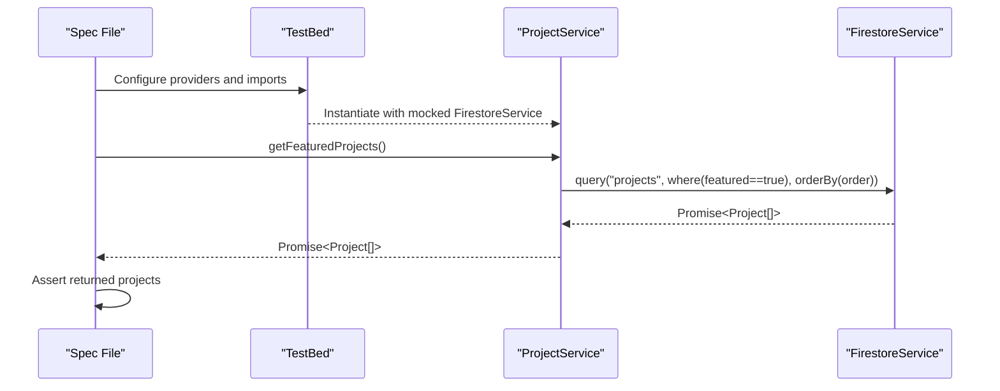
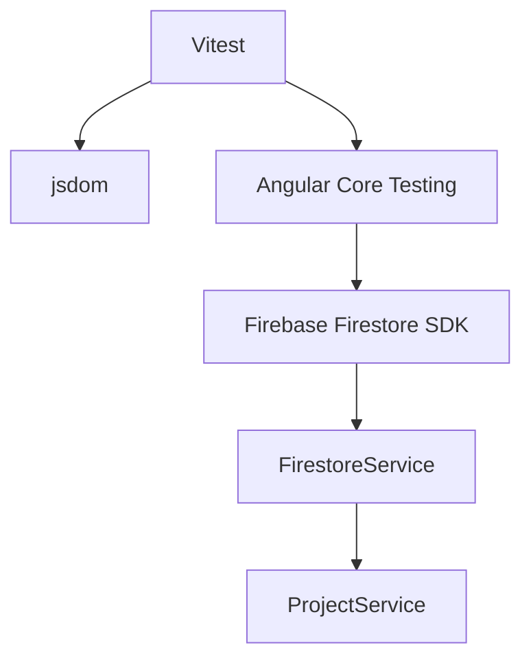

# Testing Strategy

<cite>
**Referenced Files in This Document**
- [package.json](file://package.json)
- [angular.json](file://angular.json)
- [tsconfig.spec.json](file://tsconfig.spec.json)
- [app.spec.ts](file://src/app/app.spec.ts)
- [home.spec.ts](file://src/app/features/home/pages/home/home.spec.ts)
- [hero.spec.ts](file://src/app/features/home/sections/hero/hero.spec.ts)
- [projects.spec.ts](file://src/app/features/projects/pages/projects/projects.spec.ts)
- [navbar.spec.ts](file://src/app/shared/layout/navbar/navbar.spec.ts)
- [hero.ts](file://src/app/features/home/sections/hero/hero.ts)
- [navbar.ts](file://src/app/shared/layout/navbar/navbar.ts)
- [project.service.ts](file://src/app/core/services/project.service.ts)
- [firestore.service.ts](file://src/app/core/firebase/firestore.service.ts)
</cite>

## Table of Contents
1. [Introduction](#introduction)
2. [Project Structure](#project-structure)
3. [Core Components](#core-components)
4. [Architecture Overview](#architecture-overview)
5. [Detailed Component Analysis](#detailed-component-analysis)
6. [Dependency Analysis](#dependency-analysis)
7. [Performance Considerations](#performance-considerations)
8. [Troubleshooting Guide](#troubleshooting-guide)
9. [Conclusion](#conclusion)
10. [Appendices](#appendices)

## Introduction
This document defines the comprehensive testing strategy for the MegaPortfolio application using Vitest with Angular’s component testing patterns. It covers unit tests for components, services, and utilities; service mocking and dependency injection; asynchronous operation testing; end-to-end (E2E) setup guidance; best practices; and CI integration. The goal is to ensure reliable, maintainable, and fast tests that validate templates, interactions, lifecycle hooks, and data flows across the app.

## Project Structure
The project uses Angular with a modern build pipeline and Vitest as the test runner. Key configuration points:
- Test runner and scripts are defined in package.json.
- Angular’s test builder is configured via angular.json.
- TypeScript spec configuration enables Vitest globals and includes all .spec.ts files under src.

**Diagram sources**
- [package.json:1-49](file://package.json#L1-L49)
- [angular.json:88-90](file://angular.json#L88-L90)
- [tsconfig.spec.json:1-16](file://tsconfig.spec.json#L1-L16)

**Section sources**
- [package.json:1-49](file://package.json#L1-L49)
- [angular.json:88-90](file://angular.json#L88-L90)
- [tsconfig.spec.json:1-16](file://tsconfig.spec.json#L1-L16)

## Core Components
Current test coverage focuses on basic instantiation and creation assertions for several top-level and feature components. These tests use Angular’s TestBed to compile standalone components and assert their existence.

Key observations:
- Tests import components directly and configure minimal modules via imports in TestBed.
- Asynchronous stabilization is handled with fixture.whenStable().
- Assertions currently verify component truthiness and simple template content where applicable.

Examples of existing patterns:
- App-level test validates creation and title rendering.
- Feature page tests (Home, Projects) validate component creation.
- Section-level tests (Hero) validate component creation.
- Layout tests (Navbar) validate component creation.

**Section sources**
- [app.spec.ts:1-24](file://src/app/app.spec.ts#L1-L24)
- [home.spec.ts:1-23](file://src/app/features/home/pages/home/home.spec.ts#L1-L23)
- [hero.spec.ts:1-23](file://src/app/features/home/sections/hero/hero.spec.ts#L1-L23)
- [projects.spec.ts:1-23](file://src/app/features/projects/pages/projects/projects.spec.ts#L1-L23)
- [navbar.spec.ts:1-23](file://src/app/shared/layout/navbar/navbar.spec.ts#L1-L23)

## Architecture Overview
The testing architecture integrates Angular’s TestBed with Vitest to run unit tests efficiently. Services like FirestoreService encapsulate Firebase operations, while higher-level services like ProjectService orchestrate queries and business logic. Components depend on these services through dependency injection.

**Diagram sources**
- [angular.json:88-90](file://angular.json#L88-L90)
- [firestore.service.ts:1-100](file://src/app/core/firebase/firestore.service.ts#L1-L100)
- [project.service.ts:1-60](file://src/app/core/services/project.service.ts#L1-L60)

## Detailed Component Analysis

### Component Testing Patterns
- Standalone components are imported directly into TestBed.imports.
- Use fixture.whenStable() to handle async initialization.
- Assert presence of DOM elements and text content for template validation.
- For components with dependencies (e.g., LanguageService), provide mocks or stubs in TestBed.

Example references:
- Hero component uses TranslatePipe and has no injected services in its class.
- Navbar component injects LanguageService and emits events; tests should mock LanguageService and simulate scroll events.

**Section sources**
- [hero.ts:1-12](file://src/app/features/home/sections/hero/hero.ts#L1-L12)
- [navbar.ts:1-30](file://src/app/shared/layout/navbar/navbar.ts#L1-L30)
- [hero.spec.ts:1-23](file://src/app/features/home/sections/hero/hero.spec.ts#L1-L23)
- [navbar.spec.ts:1-23](file://src/app/shared/layout/navbar/navbar.spec.ts#L1-L23)

#### Template Testing
- Verify rendered headings, paragraphs, and interactive elements.
- Ensure i18n pipes render expected placeholders when translations are not loaded.
- Validate conditional sections based on component state.

#### Component Interaction Testing
- Simulate user actions (clicks, scrolls) using native DOM APIs or Angular testing utilities.
- For event emitters (e.g., toggleMobileSidebar), subscribe to outputs and assert emissions.

#### Lifecycle Hook Testing
- Use fakeAsync and tick for asynchronous lifecycle behaviors if needed.
- Validate changes triggered by HostListener (e.g., window:scroll).

### Service Testing with Dependency Injection
- Mock FirestoreService methods to isolate ProjectService behavior.
- Use Jasmine/Vitest spies to assert method calls and return values.
- Handle Promise-based APIs with async/await and proper assertions.

**Diagram sources**
- [project.service.ts:1-60](file://src/app/core/services/project.service.ts#L1-L60)
- [firestore.service.ts:1-100](file://src/app/core/firebase/firestore.service.ts#L1-L100)

**Section sources**
- [project.service.ts:1-60](file://src/app/core/services/project.service.ts#L1-L60)
- [firestore.service.ts:1-100](file://src/app/core/firebase/firestore.service.ts#L1-L100)

### End-to-End Testing Setup and Critical User Flows
While the repository does not include an E2E framework, you can integrate Playwright or Cypress with Vitest-compatible setups. Recommended critical flows:
- Home page load and hero section visibility.
- Navigation between routes (Home, Projects, Architecture, Contact, Experience, Blog).
- Project filtering and search interactions.
- Language switching via LanguageSwitcher.

Guidance:
- Use headless browser automation to assert DOM states and interactions.
- Seed test data via Firebase Emulator Suite for consistent results.
- Capture screenshots and videos for failed runs in CI.

[No sources needed since this section provides general guidance]

## Dependency Analysis
Testing dependencies revolve around Angular’s testing utilities, Vitest, and Firebase SDK. The current setup relies on jsdom for DOM simulation and Vitest globals.

**Diagram sources**
- [package.json:34-47](file://package.json#L34-L47)
- [firestore.service.ts:1-100](file://src/app/core/firebase/firestore.service.ts#L1-L100)
- [project.service.ts:1-60](file://src/app/core/services/project.service.ts#L1-L60)

**Section sources**
- [package.json:34-47](file://package.json#L34-L47)

## Performance Considerations
- Keep unit tests isolated and fast by mocking external services (FirestoreService).
- Avoid heavy DOM manipulation in tests; prefer shallow rendering where possible.
- Use TestBed.configureTestingModule with minimal imports to reduce compilation time.
- Leverage Vitest’s parallel execution capabilities for faster feedback loops.
- Profile slow tests and refactor to reduce async waits and network calls.

[No sources needed since this section provides general guidance]

## Troubleshooting Guide
Common issues and resolutions:
- Missing translation keys: Provide mock TranslatePipe or translations in tests.
- Firebase initialization errors: Mock FirestoreService and avoid real network calls.
- HostListener not triggering: Manually dispatch scroll events in tests.
- Async stabilization: Always await fixture.whenStable() before assertions.

**Section sources**
- [navbar.ts:1-30](file://src/app/shared/layout/navbar/navbar.ts#L1-L30)
- [app.spec.ts:1-24](file://src/app/app.spec.ts#L1-L24)

## Conclusion
The MegaPortfolio application adopts a pragmatic testing approach using Angular’s TestBed and Vitest. Current tests focus on component instantiation and basic assertions. Expanding coverage to include template validations, service mocking, asynchronous operations, and E2E flows will significantly improve reliability and developer confidence. Adopting best practices such as isolation, mocking, and performance optimization ensures scalable and maintainable tests.

[No sources needed since this section summarizes without analyzing specific files]

## Appendices

### Best Practices Summary
- Isolate units: Mock dependencies and avoid real I/O.
- Write meaningful assertions: Check behavior, not implementation details.
- Organize tests by feature: Group specs near source files.
- Use descriptive names: Make test intent clear from the spec file name and describe blocks.
- Maintain consistency: Follow Angular testing patterns across components and services.

[No sources needed since this section provides general guidance]

### Continuous Integration Setup
- Add npm script for running tests in CI: npm test -- --run
- Configure GitHub Actions or similar to execute tests on push/PR.
- Cache node_modules and build artifacts to speed up runs.
- Generate coverage reports and upload to CI artifacts.

[No sources needed since this section provides general guidance]

### Accessibility Testing Strategies
- Integrate axe-core or pa11y for automated accessibility checks.
- Validate semantic HTML, ARIA attributes, and keyboard navigation.
- Include a11y checks in both unit and E2E tests.

[No sources needed since this section provides general guidance]

### Cross-Browser Compatibility Testing
- Use Playwright or Cypress with multiple browsers (Chrome, Firefox, Safari).
- Run tests in parallel across browser versions.
- Monitor and report cross-browser failures in CI.

[No sources needed since this section provides general guidance]